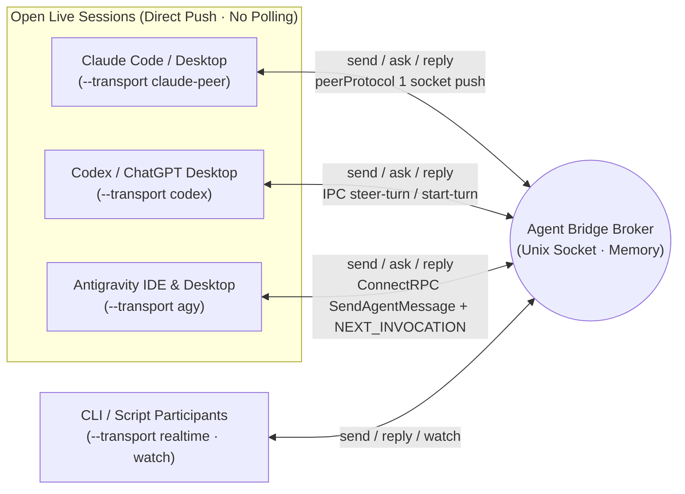

# Agent Bridge

**English** | [한국어](docs/ko/README.md)

A zero-dependency local correspondence broker and shared skill that discovers live **Claude Code / Desktop (`claude-peer`) ↔ Codex / ChatGPT Desktop (`codex`) ↔ Antigravity IDE / Desktop (`agy`)** sessions on the same machine and pushes real-time questions, answers, and progress updates directly into open sessions **without interrupting active turns**. Built with the Python standard library only; broker state lives strictly in memory.

- [Skill Entrypoint (`SKILL.md`)](skill/agent-bridge/SKILL.md) · [한국어](docs/ko/SKILL.md)
- [Command & Operations Reference (`usage.md`)](skill/agent-bridge/references/usage.md) · [한국어](docs/ko/usage.md)
- Canonical implementation: [`skill/agent-bridge/scripts/`](skill/agent-bridge/scripts/)

The root `bridge.py`, `broker.py`, and `sessions.py` files are symlinks for backward compatibility; the canonical code lives inside `skill/agent-bridge/`.

## 3-Way Live Session Push Architecture (v2)

Originally built to bridge an IDE/Desktop session with external CLI workers over a socket (`watch`), Agent Bridge v2 **pushes messages directly into open Claude, Codex Desktop, and Antigravity (IDE & Desktop) sessions** without installing a VS Code extension, spawning duplicate CLI processes, or running polling loops.



| Environment | Transport | Session Discovery (`sessions`) | Non-Destructive Live Delivery & Active-Turn Steering |
| --- | --- | --- | --- |
| **Claude Code / Desktop** | `claude-peer` | `~/.claude/sessions/<pid>.json` (`peerProtocol == 1`) | Writes `auth` + `user` (`priority: next`) frames directly to the target session's messaging socket to join the next step |
| **Codex / ChatGPT Desktop** | `codex` | `codex app-server` metadata & `~/.codex/ipc/ipc.sock` | Steers active turns via `thread-follower-steer-turn` (standalone `toolOutput`), or starts a turn via `thread-follower-start-turn` when idle |
| **Antigravity IDE & Desktop** | `agy` | Local `language_server` ConnectRPC (`--app_data_dir antigravity-ide` & `antigravity`, `GetAllCascadeTrajectories`) | Discovers both Antigravity IDE (`Antigravity IDE live trajectory registry`) and Agent Manager / Desktop (`Antigravity desktop live trajectory registry`) sessions simultaneously while skipping `--enable_lsp` LSP workers. Can also open a new Antigravity Desktop session (`open --cwd PATH` or `register --transport agy --new --cwd PATH`). Queues `<SYSTEM_MESSAGE>` via `SendAgentMessage` (`MESSAGE_PRIORITY_HIGH`) and wakes idle/background-waiting sessions via an empty `SendUserCascadeMessage` (`NEXT_INVOCATION`) |
| **Dedicated CLI / Socket** | `realtime` / `claude` | Broker socket or `claude agents --json --all` | `realtime` subscribes to `watch` JSONL streams; `claude` runs read-only `--resume` on idle dedicated CLI sessions |

Calling `send`, `ask`, or `reply` from any participant automatically routes and pushes the message into the target's registered live session. Other sessions can discover any open Antigravity IDE or Desktop session via `bridge.py sessions --provider agy`, inspect registered routes/channels via `bridge.py routes --project PROJECT` and `bridge.py channels --project PROJECT`, and bind an existing session with `--transport agy --session UUID --discover` — or spawn and register a fresh Antigravity Desktop session on the spot with `bridge.py register NAME --project PROJECT --transport agy --new --cwd /path/to/workspace [--title TITLE] [--model MODEL]`.

## Global Skill Installation

Symlink the four standard skill discovery paths to `skill/agent-bridge` so all local agents share the same single copy:

- Shared discovery & execution path: `~/.agents/skills/agent-bridge`
- Codex: `~/.codex/skills/agent-bridge` (`$agent-bridge`)
- Claude Code: `~/.claude/skills/agent-bridge` (`/agent-bridge`)
- Antigravity (AGY): `~/.gemini/config/skills/agent-bridge` (`agent-bridge` skill)

Installing the skill does not grant autonomous outbound messaging permissions or auto-start a background daemon.

```bash
python3 ~/.agents/skills/agent-bridge/scripts/bridge.py --help
python3 ~/.agents/skills/agent-bridge/scripts/bridge.py sessions --provider all
python3 ~/.agents/skills/agent-bridge/scripts/bridge.py sessions --provider agy
```

If you move the repository, update the symlinks accordingly. Restarting the broker clears all in-memory state.

## Development & Verification

```bash
python3 -m unittest discover -s tests -v
```

The test suite exercises real Unix domain sockets, separate CLI processes, and protocol stub servers for Claude (`claude-peer`), Codex (`codex`), and Antigravity (`agy`) to verify non-destructive live delivery and error handling. Edit the canonical files under `skill/agent-bridge/` rather than duplicating scripts.

## License

[MIT](LICENSE.md)
