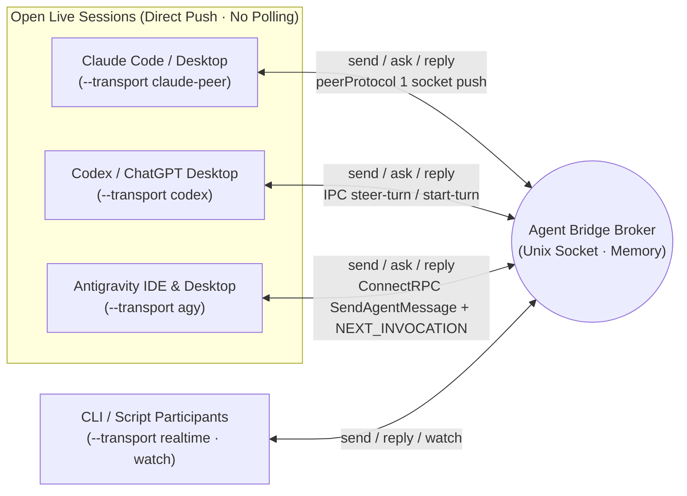

# Agent Bridge

**English** | [한국어](docs/ko/README.md)

A zero-dependency local correspondence broker and shared skill that discovers live **Claude Code / Desktop (`claude-peer`) ↔ Codex / ChatGPT Desktop (`codex`) ↔ Antigravity IDE / Desktop (`agy`)** sessions on the same machine and pushes real-time questions, answers, and progress updates directly into open sessions **without interrupting active turns**. Built with the Python standard library only; correspondence stays in memory; endpoints and channel bindings survive restarts in an owner-private routing snapshot.

- [Skill Entrypoint (`SKILL.md`)](skill/agent-bridge/SKILL.md) · [한국어](docs/ko/SKILL.md)
- [Command & Operations Reference (`usage.md`)](skill/agent-bridge/references/usage.md) · [한국어](docs/ko/usage.md)
- Canonical implementation: [`skill/agent-bridge/scripts/`](skill/agent-bridge/scripts/)

The root `bridge.py`, `broker.py`, and `sessions.py` files are symlinks for backward compatibility; the canonical code lives inside `skill/agent-bridge/`.

## 3-Way Live Session Push Architecture (v2)

Originally built to bridge an IDE/Desktop session with external CLI workers over a socket (`watch`), Agent Bridge v2 **pushes messages directly into open Claude, Codex Desktop, and Antigravity (IDE & Desktop) sessions** without installing a VS Code extension, spawning duplicate CLI processes, or running polling loops.



| Environment | Transport | Session Discovery (`sessions`) | Non-Destructive Live Delivery & Active-Turn Steering |
| --- | --- | --- | --- |
| **Claude Code / Desktop** | `claude-peer` | `~/.claude/sessions/<pid>.json` (`peerProtocol == 1`) | Writes `auth` + `user` (`priority: next`) frames directly to the target session's messaging socket to join the next step. Can also open a new Claude Code desktop session (`open --provider claude --cwd PATH` or `register --transport claude-peer --new --cwd PATH`) through the app's `claude://code/new` link; the session starts when someone presses Enter in the prefilled composer |
| **Codex / ChatGPT Desktop** | `codex` | `codex app-server` metadata & `~/.codex/ipc/ipc.sock` | Steers active turns via `thread-follower-steer-turn` (standalone `toolOutput`), or starts a turn via `thread-follower-start-turn` when idle. Autonomous creation: `open --provider codex --cwd PATH` or `register --transport codex --new --cwd PATH`; creates a persistent thread and verifies exact Desktop adoption |
| **Antigravity IDE & Desktop** | `agy` | Local `language_server` ConnectRPC (`--app_data_dir antigravity-ide` & `antigravity`, `GetAllCascadeTrajectories`) | Discovers both Antigravity IDE (`Antigravity IDE live trajectory registry`) and Agent Manager / Desktop (`Antigravity desktop live trajectory registry`) sessions simultaneously while skipping `--enable_lsp` LSP workers. Can also open a new Antigravity Desktop session (`open --cwd PATH` or `register --transport agy --new --cwd PATH`). Queues `<SYSTEM_MESSAGE>` via `SendAgentMessage` (`MESSAGE_PRIORITY_HIGH`) and wakes idle/background-waiting sessions via an empty `SendUserCascadeMessage` (`NEXT_INVOCATION`) |
| **Dedicated CLI / Socket** | `realtime` / `claude` | Broker socket or `claude agents --json --all` | `realtime` subscribes to `watch` JSONL streams; `claude` runs read-only `--resume` on idle dedicated CLI sessions |

Calling `send`, `ask`, or `reply` from any participant automatically routes and pushes the message into the target's registered live session. Other sessions can discover any open Antigravity IDE or Desktop session via `bridge.py sessions --provider agy`, inspect registered routes/channels via `bridge.py routes --project PROJECT` and `bridge.py channels --project PROJECT`, and bind an existing session with `--transport agy --session UUID --discover` — or spawn and register a fresh Antigravity Desktop session on the spot with `bridge.py register NAME --project PROJECT --transport agy --new --cwd /path/to/workspace [--title TITLE] [--model MODEL]`. The same `--new` works for Claude Code desktop with `--transport claude-peer`: `bridge.py register NAME --project PROJECT --transport claude-peer --new --cwd /path/to/workspace [--title FIRST_MESSAGE] [--timeout SECONDS]` opens the app's new-session composer at that folder with the first message prefilled, waits until someone presses Enter (and trusts the folder, if the app asks), then binds the new live session.

## Global Skill Installation

Symlink the four standard skill discovery paths to `skill/agent-bridge` so all local agents share the same single copy:

- Shared discovery & execution path: `~/.agents/skills/agent-bridge`
- Codex: `~/.codex/skills/agent-bridge` (`$agent-bridge`)
- Claude Code: `~/.claude/skills/agent-bridge` (`/agent-bridge`)
- Antigravity (AGY): `~/.gemini/config/skills/agent-bridge` (`agent-bridge` skill)

Installing the skill does not grant autonomous outbound messaging permissions or auto-start a background daemon.

```bash
python3 ~/.agents/skills/agent-bridge/scripts/bridge.py --help
python3 ~/.agents/skills/agent-bridge/scripts/bridge.py sessions --provider all
python3 ~/.agents/skills/agent-bridge/scripts/bridge.py sessions --provider agy
```

If you move the repository, update the symlinks accordingly. Restarting clears messages, idempotency keys, and events. Routes and channels reload after exact session/workspace checks; unavailable live bindings are dropped.

## Development & Verification

```bash
python3 -m unittest discover -s tests -v
```

The test suite exercises real Unix domain sockets, separate CLI processes, and protocol stub servers for Claude (`claude-peer`), Codex (`codex`), and Antigravity (`agy`) to verify non-destructive live delivery and error handling. Issue #5 regression bars cover bounded terminal-message retention, atomic routing snapshots, same-socket restarts, and TERM with open watch/wait/partial clients. Every integration broker uses an explicit temporary socket and isolated state directory. macOS plist validation uses `plutil -lint`; tests never load a service.

Edit the canonical files under `skill/agent-bridge/` rather than duplicating scripts.

## Retention, restart, and optional supervision

`serve --max-messages 2048` bounds retained messages. At capacity, the oldest unprotected `done`, `answered`, or `failed` message is evicted. Submitted pushes and uncertain delivery remain unfinished; an all-pending or protected set refuses new sends/replies explicitly. Idempotency ends when a message is evicted, so never automatically resend an evicted request.

`serve --state-dir PATH` selects the private routing directory (default: the socket path with its suffix replaced by `.state`). Of correspondence, only routes and channel bindings persist; the limit history below is a separate file in the same directory. `SIGTERM`, Ctrl-C, and the existing `stop` command close open clients cleanly. Restarts still lose in-flight message IDs and do not retry delivery.

Supervision is opt-in: `install-service` installs a per-user launchd agent; `uninstall-service` unloads and removes it. To inspect without loading anything, use `install-service --generate-only --plist /absolute/path/agent.plist`, then `plutil -lint /absolute/path/agent.plist`. `KeepAlive` restarts even after `stop`; uninstall the service to keep it down. See the [operations reference](skill/agent-bridge/references/usage.md#routing-storage-and-opt-in-launchd) before installation.

## Subscription limits (Codex)

The broker samples Codex subscription limits in a daemon thread of the same process, so no extra service is installed. Every `serve --usage-interval 15` minutes (minimum 5, `0` turns it off) it starts a private `codex app-server --stdio`, sends `initialize`, `initialized` and `account/rateLimits/read`, and stops the process. That read starts no thread or turn, delivers nothing to any session, and costs no model tokens.

Samples go to `<state-dir>/usage/codex.jsonl`, one record per bucket and window: `observed_at` and `resets_at` in UTC, `limit_id`, `slot` (`primary`/`secondary`), `used_percent`, `window_mins`, `allowed`, `reset_credits`, `source`, `status` (`ok`, `failed`, or `stale` when the reported reset time has already passed). Account identifiers and plan names are dropped before writing. A failed read is stored with null values and is shown as unknown, never as 0%. Unchanged samples are skipped for up to an hour, failures back off up to 4 hours, and the file keeps 30 days and at most 5 MB, replaced atomically on each write.

```bash
python3 bridge.py usage            # one line per bucket
python3 bridge.py usage --since 2d --json
```

The compact line shows remaining %, the reset in local time, when it was last observed and whether that is fresh (within 90 minutes, and no failed read since), and the burn in %p/h when at least two samples fall inside one reset period of the `--since` window. A drop in `used_percent` or a moved `resets_at` is a reset boundary: it is printed as `RESET between …`, and no rate is computed across it.

## License

[MIT](LICENSE.md)

Codex creation runs without human UI steps: it creates a persistent thread with the standard app-server API, sets its actual `--title`, closes the creator, and verifies adoption by the exact Desktop owner. An explicit `--model` is validated and confirmed on that owner; omission keeps the app default. Every newly created Codex thread uses Full Access (`:danger-full-access`) with `approvalPolicy: never`, verified again in the exact Desktop owner's next-turn settings. Unavailable/disallowed profiles are refused before creation; existing sessions and global configuration are unchanged. Partial failures preserve the UUID and creation/adoption state, with no automatic creation retry. See the [autonomous creation contract](skill/agent-bridge/references/usage.md#creating-a-new-codex-desktop-session-autonomously).
