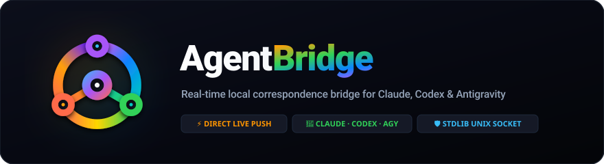
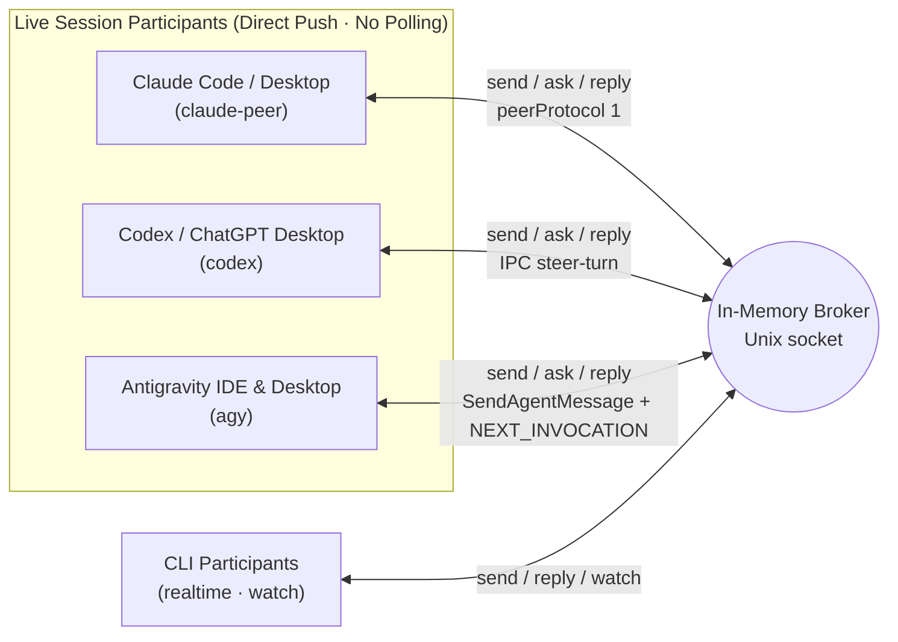

<p align="center">
  
</p>

<p align="center">
  
  
  
  
</p>

<p align="center">
  <strong>English</strong> · <a href="docs/ko/README.md">한국어</a>
</p>

A zero-dependency local real-time bridge for **Claude Code / Desktop (`claude-peer`) ↔ Codex / ChatGPT Desktop (`codex`) ↔ Antigravity IDE / Desktop (`agy`)** and CLI workers (`realtime`/`claude`) on the same machine. Built with Python 3.10+ standard library only over Unix domain sockets.

Instead of spawning duplicate CLI processes or trapping agents in polling loops, Agent Bridge pushes messages directly into open live sessions so agents can ask questions, report progress, and hand off work in real time without interrupting in-flight turns.

## Documentation Map

| Audience | English | 한국어 |
| --- | --- | --- |
| Overview & Quickstart | [README.md](README.md) | [docs/ko/README.md](docs/ko/README.md) |
| Agent Skill Instructions | [skill/agent-bridge/SKILL.md](skill/agent-bridge/SKILL.md) | [docs/ko/SKILL.md](docs/ko/SKILL.md) |
| Full CLI & Protocol Reference | [skill/agent-bridge/references/usage.md](skill/agent-bridge/references/usage.md) | [docs/ko/usage.md](docs/ko/usage.md) |
| MCP Phase 1 Specification | [skill/agent-bridge/references/mcp-phase1.md](skill/agent-bridge/references/mcp-phase1.md) | — |
| Antigravity IDE Commands | — | [docs/ko/antigravity-commands.md](docs/ko/antigravity-commands.md) |

## Architecture & Transports



| Environment | Transport | Delivery Mechanism |
| --- | --- | --- |
| **Claude Code / Desktop** | `claude-peer` | Pushes directly into the live session's messaging socket (`peerProtocol 1`) so the message arrives on the next turn without spawning a second CLI. |
| **Codex / ChatGPT Desktop** | `codex` | Connects to the exact Desktop thread owner over `CODEX_HOME/ipc/ipc.sock`, steering active turns via `thread-follower-steer-turn` (`toolOutput`) or starting a turn when idle. |
| **Antigravity IDE & Desktop** | `agy` | Connects to local `language_server` / `agy --hub` instances over ConnectRPC, injecting `<SYSTEM_MESSAGE>` (`SendAgentMessage`) into active turns and waking idle sessions via empty `SendUserCascadeMessage` (`NEXT_INVOCATION`). |
| **CLI Workers** | `realtime` / `claude` | `realtime` streams JSONL events over `watch`. `claude` resumes an **idle dedicated** CLI session in read-only `plan` mode via `deliver` (never use `claude` on a live session). |

## Installation

Link the skill folder into your global agent skill directories so Claude, Codex, and Antigravity use the same `bridge.py`:

```bash
mkdir -p ~/.agents/skills ~/.claude/skills ~/.gemini/config/skills
ln -sfn "$(pwd)/skill/agent-bridge" ~/.agents/skills/agent-bridge
ln -sfn "$(pwd)/skill/agent-bridge" ~/.claude/skills/agent-bridge
ln -sfn "$(pwd)/skill/agent-bridge" ~/.gemini/config/skills/agent-bridge
```

## Quickstart

```bash
bridge_cli="$HOME/.agents/skills/agent-bridge/scripts/bridge.py"

# 1. Start or check the local broker (default socket: ~/.local/share/agent-bridge/bridge.sock)
python3 "$bridge_cli" ping || python3 "$bridge_cli" serve

# 2. Discover live sessions across Claude, Codex, and Antigravity
python3 "$bridge_cli" sessions --cwd /path/to/workspace

# 3. Register existing live sessions by exact UUID
python3 "$bridge_cli" register claude-main --project my-app --transport claude-peer \
  --session CLAUDE_UUID --discover
python3 "$bridge_cli" register codex-main --project my-app --transport codex \
  --session CODEX_UUID --discover
python3 "$bridge_cli" register agy-main --project my-app --transport agy \
  --session AGY_UUID --discover

# 4. Or open and register a brand-new live session in one step
python3 "$bridge_cli" register agy-worker --project my-app --transport agy \
  --new --cwd /path/to/workspace --title "Worker"

# 5. Bind role channels and exchange messages
python3 "$bridge_cli" channel-bind logic --project my-app --owner claude-main
python3 "$bridge_cli" channel-bind view --project my-app --owner agy-main

python3 "$bridge_cli" ask --project my-app --from-channel logic --channel view \
  --key req-001 --file /path/to/request.txt --timeout 60
python3 "$bridge_cli" reply MESSAGE_ID --key reply-001 --file /path/to/answer.txt
```

## Core Capabilities

### 1. Session Lifecycle (`sessions`, `open`, `register --new`, `close`)

| Provider | Open Desktop Session | Open IDE Session (`--host ide`) | Close (`bridge.py close NAME --project P`) |
| --- | --- | --- | --- |
| **Antigravity (`agy`)** | Autonomous via Desktop `language_server` (`StartCascade`), auto-linked to Desktop project | Autonomous via IDE `agy --hub` (`workspaceUris`) | Archives conversation (`{archived: true}`) when idle and unregisters route |
| **Claude (`claude-peer`)** | Opens `claude://code/new` composer prefilled with `--title`; waits for user Enter | Autonomous via IDE CLI + `<scheme>://anthropic.claude-code/open` | Sends `SIGTERM` to the exact CLI process (`resumable: true`) and unregisters route |
| **Codex (`codex`)** | Autonomous via `app-server --stdio` + `codex://threads/UUID` adoption (`:danger-full-access`, `approvalPolicy: never`) | N/A | `unsupported` (Desktop IPC exposes no external archive/unload) |

```bash
# Open without registering, or open + register in one command:
python3 "$bridge_cli" open --provider agy --host ide --cwd /path/to/workspace --title "Worker"
python3 "$bridge_cli" register codex-worker --project my-app --transport codex \
  --new --cwd /path/to/workspace --title "Worker" --model gpt-6.1-sol

# Close a finished worker session and remove its route:
python3 "$bridge_cli" close agy-worker --project my-app
```

### 2. Models & Policy (`model`, `policy`)

Query or switch a registered session's model through a provider-neutral interface, governed by `<state-dir>/policy.json` (default seed denylist blocks `gpt-6-astra` for Codex):

```bash
python3 "$bridge_cli" model NAME --project my-app              # Fresh model read
python3 "$bridge_cli" model NAME --project my-app --set MODEL  # Switch model and verify readback
python3 "$bridge_cli" policy                                   # Show active defaults and denylist
```

- **Antigravity (`agy`)**: Reads the latest generator's `plannerConfig`. Switching while idle runs one invocation preserving existing planner settings (`knowledgeConfig`, etc.).
- **Codex (`codex`)**: Reads and updates the exact Desktop owner's next-turn model settings (`thread-follower-update-thread-settings`) without interrupting an active turn.
- **Claude (`claude-peer`)**: Reads the latest assistant model from the transcript. Desktop switching relays `set_session_model` through a configured `command_post` route in `policy.json`; IDE switching is `unsupported` (use the IDE picker).

### 3. Subscription Usage & Risk Monitoring (`usage`)

The broker samples subscription limits in the background into `<state-dir>/usage.jsonl`. Every `send`, `ask`, and `reply` touching a `codex` or `agy` route includes a `usage` summary (`ok`, `at_risk`, `exhausted`, or `unknown`) so coordinators can pace work before hitting a wall.

```bash
python3 "$bridge_cli" usage                        # All providers (Codex + Antigravity buckets)
python3 "$bridge_cli" usage --provider agy --json  # Antigravity buckets only (agy/gemini, agy/partner)
python3 "$bridge_cli" usage --events               # Reset history, spend horizon & stop-risk horizon
```

### 4. Agent Worktrees (`wt`)

Keep the main repository checkout clean on `main` and isolate every agent's work under `<workspace>/.worktrees/<repo>/<agent>-<issue>`:

```bash
python3 "$bridge_cli" wt new . jinni 42 --slug fix-bug --provider agy --session UUID
python3 "$bridge_cli" wt list --text
python3 "$bridge_cli" wt sweep          # Dry-run cleanup of merged worktrees whose owner session is gone
python3 "$bridge_cli" wt sweep --apply  # Remove eligible worktrees and branches
```

### 5. Broker Persistence & Optional `launchd` Supervision

- **In-memory correspondence, persistent routing**: Only endpoints and channel bindings are saved to `<state-dir>/routes.json` (`0600`). Messages, delivery state, idempotency keys, credentials, and events remain strictly in memory. On restart, the broker re-verifies saved routes before restoring them.
- **Optional macOS launchd service**: Supervision is off by default. Use `install-service` (or `--generate-only --plist PATH` to inspect without loading) and `uninstall-service` to manage a `KeepAlive` launch agent.

### 6. Remote MCP Facade (`mcp_server.py`)

Local agents (Claude Code, Codex, Antigravity) invoke `bridge.py` directly via the Python CLI and do not register a local MCP server. `skill/agent-bridge/scripts/mcp_server.py` is dedicated to remote MCP clients connecting through a private single-owner tunnel (`--phase1-config /absolute/private.json` over `stdio`), exposing session discovery/creation, message dispatch, and the optional independent inbox (`inbox_enabled: true`). Without `--phase1-config`, the server falls back to read-only `connectivity_only` (`bridge_status`). See [mcp-phase1.md](skill/agent-bridge/references/mcp-phase1.md) for the full contract.

## Development & Verification

Run the full unit and integration test suite before committing any changes:

```bash
python3 -m unittest discover -s tests -v
```

## License

[MIT](LICENSE.md)
