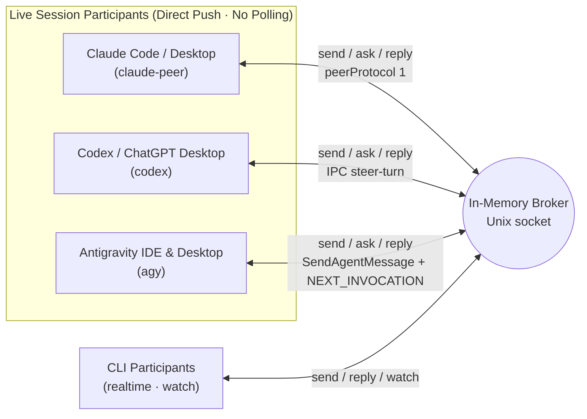

<p align="center">
  
</p>

<p align="center">
  
  
  
  
</p>

<p align="center">
  <strong>English</strong> · <a href="docs/ko/README.md">한국어</a>
</p>

A zero-dependency local real-time bridge for **Claude Code / Desktop (`claude-peer`) ↔ Codex / ChatGPT Desktop (`codex`) ↔ Antigravity IDE / Desktop (`agy`)** and CLI workers (`realtime`/`claude`) on the same machine. Built with Python 3.10+ standard library only over Unix domain sockets.

Instead of spawning duplicate CLI processes or trapping agents in polling loops, Agent Bridge pushes messages directly into open live sessions so agents can ask questions, report progress, and hand off work in real time without interrupting in-flight turns.

## Registration ownership

`register` protects each `(project, name)`: another transport, session UUID or canonical workspace is refused with `Route name is already in use; use a different name`. Same names in different projects are independent. Exact-binding retries return the existing route without rewriting it. An omitted `--executable` preserves the old value; an explicitly different executable is also refused. Existing channels and message routes stay pinned.

New-session registration commands check an occupied name before opening a session; the broker still checks atomically at final registration. In the Codex result, a known final conflict preserves the created session with `registered: false` and `uncertain: false`; an ambiguous registration write stays uncertain. Neither path automatically removes the registration or retries it. This protection requires the updated broker; client preflight does not reserve a name.

## Documentation Map

| Audience | English | 한국어 |
| --- | --- | --- |
| Overview & Quickstart | [README.md](README.md) | [docs/ko/README.md](docs/ko/README.md) |
| Agent Skill Instructions | [skill/agent-bridge/SKILL.md](skill/agent-bridge/SKILL.md) | [docs/ko/SKILL.md](docs/ko/SKILL.md) |
| Full CLI & Protocol Reference | [skill/agent-bridge/references/usage.md](skill/agent-bridge/references/usage.md) | [docs/ko/usage.md](docs/ko/usage.md) |
| Remote MCP Reference | [skill/agent-bridge/references/remote-mcp.md](skill/agent-bridge/references/remote-mcp.md) | — |
| Antigravity IDE Commands | — | [docs/ko/antigravity-commands.md](docs/ko/antigravity-commands.md) |
| Deploying a supervised install | [docs/DEPLOY.md](docs/DEPLOY.md) (`tools/deploy.py`) | — |

## Architecture & Transports



| Environment | Transport | Delivery Mechanism |
| --- | --- | --- |
| **Claude Code / Desktop** | `claude-peer` | Pushes directly into the live session's messaging socket (`peerProtocol 1`) so the message arrives on the next turn without spawning a second CLI. |
| **Codex / ChatGPT Desktop** | `codex` | Delivers to the exact registered Desktop thread over IPC as tool output during an active or new idle turn, or through the Codex queue notification path. |
| **Antigravity IDE & Desktop** | `agy` | Connects to local `language_server` / `agy --hub` instances over ConnectRPC, injecting `<SYSTEM_MESSAGE>` (`SendAgentMessage`) into active turns and waking idle sessions via empty `SendUserCascadeMessage` (`NEXT_INVOCATION`). |
| **CLI Workers** | `realtime` / `claude` | `realtime` streams JSONL events over `watch`. `claude` resumes an **idle dedicated** CLI session in read-only `plan` mode via `deliver` (never use `claude` on a live session). |

Codex Desktop 26.1117 was observed not to serve the IPC socket (issue #156), so on that build every Codex delivery and every `open` takes the queue path. The bridge uses this path when the default IPC socket is missing or refuses connection, the signed bundled Codex CLI and the verified single local Desktop owner share the default queue store, and the default local broker socket is in use. The Codex queue path uses `codex queue` for a fixed notification naming only the broker message UUID. The notice carries no peer text: it states the same scope line as every peer envelope (peer correspondence, not a new human instruction, within the existing user-authorized scope), the retrieval command and that UUID. The addressed thread runs `bridge.py receive-codex MESSAGE_ID` to read the peer body as tool output. The Desktop owner must share the CLI queue store and have the exact thread loaded and able to start an idle turn. Queue acceptance does not establish that the thread woke or read the body. The bridge never resumes a thread or retries an ambiguous queue write.

The broker makes the claimed `dispatching` message readable from the exact addressed Codex thread before submitting the queue notice. `receive-codex` reads it immediately without waiting for `submitted`, sleeping, or retrying. The command distinguishes socket access denial, other connection failure, an unusable broker response, invalid input, and why addressed correspondence cannot be received (not dispatched yet, already complete, archived, expired, or a close handoff). Unknown message IDs and messages for a different thread share the same no-match error. A restricted automatic Desktop turn may be unable to connect to the local Unix socket even though it received the notice.

Claude peer pushes bound the socket write and close wait. `deliver ID --timeout SECONDS` bounds lookup, claim and peer I/O for Claude peer delivery. After a possible write, recording the result can take up to 10 more seconds. If a guarded claim reply is lost before any peer write, the bridge gets up to 2 more seconds after the claim admission window closes to release its own reservation. An unresolved dispatch still protects the recipient from a duplicate push. `show` and CLI `inbox` identify queued messages with a `pending behind <id> since <time>` note.

## Installation

Install globally across Claude Code, Codex, and Antigravity in one command using [`skills`](https://skills.sh):

```bash
npx skills add firejune/AgentBridge -g -a claude-code codex antigravity
```

Or clone the repository and symlink the skill folder into your global agent skill directories:

```bash
mkdir -p ~/.agents/skills ~/.claude/skills ~/.gemini/config/skills
ln -sfn "$(pwd)/skill/agent-bridge" ~/.agents/skills/agent-bridge
ln -sfn "$(pwd)/skill/agent-bridge" ~/.claude/skills/agent-bridge
ln -sfn "$(pwd)/skill/agent-bridge" ~/.gemini/config/skills/agent-bridge
```

## Quickstart

```bash
bridge_cli="$HOME/.agents/skills/agent-bridge/scripts/bridge.py"

# 1. Start or check the local broker (default socket: ~/.local/share/agent-bridge/bridge.sock)
python3 "$bridge_cli" ping || python3 "$bridge_cli" serve

# 2. Discover live sessions across Claude, Codex, and Antigravity
python3 "$bridge_cli" sessions --cwd /path/to/workspace

# 3. Register existing live sessions by exact UUID
python3 "$bridge_cli" register claude-main --project my-app --transport claude-peer \
  --session CLAUDE_UUID --discover
python3 "$bridge_cli" register codex-main --project my-app --transport codex \
  --session CODEX_UUID --discover
python3 "$bridge_cli" register agy-main --project my-app --transport agy \
  --session AGY_UUID --discover

# 4. Or open and register a brand-new live session in one step
python3 "$bridge_cli" register agy-worker --project my-app --transport agy \
  --new --cwd /path/to/workspace --title "Worker"

# 5. Bind role channels and exchange messages
python3 "$bridge_cli" channel-bind logic --project my-app --owner claude-main
python3 "$bridge_cli" channel-bind view --project my-app --owner agy-main

python3 "$bridge_cli" ask --project my-app --from-channel logic --channel view \
  --key req-001 --file /path/to/request.txt --timeout 60
python3 "$bridge_cli" reply MESSAGE_ID --key reply-001 --file /path/to/answer.txt
```

## Core Capabilities

If saved metadata confirms that the exact Codex recipient is archived, the CLI reports `state: "failed"` and `reason: "archived"` and exits 1 before contacting Desktop.

### 1. Session Lifecycle (`sessions`, `open`, `register --new`, `close`)

The Python CLI lists sessions without per-session model reads by default. Add `sessions --with-model` to include live model details.

| Provider | Open Desktop Session | Open IDE Session (`--host ide`) | Close (`bridge.py close NAME --project P --retro-file FILE [--archive]`) |
| --- | --- | --- | --- |
| **Antigravity (`agy`)** | Autonomous via `language_server` / `agy --hub` (`StartCascade`), auto-linked to project & worktree environment | Identical to Desktop (`StartCascade` + project/environment association on unified hub) | Keeps conversation in active stack by default (`--archive` sets `{archived: true}`) and unregisters route |
| **Claude (`claude-peer`)** | Opens `claude://code/new` composer prefilled with `--title`; waits for user Enter | Autonomous via IDE CLI + `<scheme>://anthropic.claude-code/open` | Sends `SIGTERM` to CLI process; keeps in sidebar by default (`--archive` sets Desktop `isArchived: true`) and unregisters route |
| **Codex (`codex`)** | Saved thread via `app-server --stdio`, then Desktop adoption over IPC or a verified queued startup turn | N/A | Keeps thread in active sidebar by default (`--archive` checks descendants first, queues a native self-archive, and verifies the archived rollout) and unregisters route |

```bash
# Open without registering, or open + register in one command:
python3 "$bridge_cli" open --provider agy --host ide --cwd /path/to/workspace --title "Worker"
python3 "$bridge_cli" register codex-worker --project my-app --transport codex \
  --new --cwd /path/to/workspace --title "Worker" --model gpt-6.2-sol

# Close a finished worker session and remove its route (pass --archive to archive):
python3 "$bridge_cli" close agy-worker --project my-app --retro-file /absolute/retro.txt [--archive]

# Bring an idle-closed Claude Desktop session back (prints woken, already-live, unsupported or uncertain):
python3 "$bridge_cli" wake claude-tower --project my-app [--timeout 30]
```

After archive is confirmed, the broker removes eligible retained correspondence for the exact session, including aliases, and expires inbox snapshots affected by removal. Provider transcripts remain available. Ordinary close preserves correspondence. Direct archive with `--keep-route` still cleans correspondence. Confirmed archive and the requested route operation succeed when only uncertain correspondence remains, and the broker keeps those records and their idempotency keys.

By default, direct Codex `close --archive` queues one fixed self-archive entry for the exact thread. The thread archives itself with the native Desktop tool, and the sidebar entry disappears without a restart. The route is removed only after Agent Bridge reads back the archive bit and the rollout under `archived_sessions`. Agent Bridge only reads Codex state and never writes it. The result's `archive_path` says what happened:

- `self_archive`: archived and verified, route removed.
- `not_archived`: nothing was submitted. The route stays registered, and `reason` says why.
- `pending_self_archive`: exit 1, with a `close_id`. The thread may still be finishing a turn. After a Codex Desktop restart, a thread nobody has opened yet does not take its queued entry until it is opened in Desktop (#221). Run `close NAME --project PROJECT --finish CLOSE_ID --expect-session UUID` later. Do not run `close --archive` again.

When close is refused:

- `unfinished correspondence`: the error lists the blocking message IDs. Read and reconcile those messages. A one-way message or reply in `received` already qualifies as finished for close. A `submitted` reply sent directly to a live `claude-peer` or `agy` session also qualifies when closing the sender.
- `running_process_cwd`: a process other than the Desktop `node_repl` helpers has its CWD in the workspace. Find it with `lsof`, and ask its owner before stopping it.
- The queue is unavailable (`not_archived`): check `lsof -t -- ~/.codex/queue_1.sqlite`. More than one owner usually means a thread started its own `codex app-server` through CUA (#210). Stop that process only with the owner's approval.
- A thread whose archive bit is set while its rollout is still in `sessions/` cannot be closed through Agent Bridge yet. The queue refuses it as archived. Leave it and report it.

`--handoff` and an enrolled operator remain available for owners who set them up. [Closing a session](skill/agent-bridge/references/usage.md#closing-a-session).

Use `archive-sweep --cwd-prefix /absolute/workspace` to preview Codex archive candidates and refusals. Apply only with `archive-sweep --apply --manifest FILE` after reviewing the private JSON. Codex close verifies the native archive (archive bit and rollout under `archived_sessions`) and never writes Codex state; the sweep verifies archive bits. Undo can also affect descendants. [Codex archive sweep](skill/agent-bridge/references/usage.md#codex-archive-sweep).

Claude Desktop closes sessions on its own: a hidden session is paused 900 s after its last turn, and the longest-idle session is evicted under memory pressure. The CLI exits and its registry record and inbox socket go away. A `claude-peer` push to such a route wakes it first. The bridge opens `claude://claude.ai/epitaxy/<local_id>` (found in the Desktop metadata by `cliSessionId`), the app resumes the same session ID and transcript under a new PID, and the message is pushed once when the new inbox socket appears. Until then it stays `dispatching`; any other outcome returns it to `pending` with nothing sent. The bridge never reopens or resends on its own. Each wake outcome a push reports is kept with the message as `wakes` (newest last, at most 10) in normalized form only: `state` (`woken`, `already-live`, `unsupported`, `failed` when the opener reported the link was not opened, `uncertain`), a fixed `code` (for example `opener_failed`, `no_desktop_session`, `archived`, `scheduled_task`, `budget_spent`, `record_timeout`, `inbox_timeout`, `host_mismatch`), `elapsed`, `at`, `source` and `attempt`. It survives restarts, the answer and completion; the free-text reason stays in the volatile note and event stream. `bridge.py wake NAME --project P` does the same step explicitly. Opening the link focuses that session in the app and can bring the app forward. Scheduled-task sessions (the app starts them with cross-session messaging off) and IDE sessions are `unsupported`.

On the IPC path, if the exact Codex Desktop owner lookup times out, is unavailable, or finds no owner supporting untrusted input, delivery stays `pending`. The CLI and MCP report the outcome and any verified missing saved workspace without automatically reopening or resending.

Codex `open` and `register --new` create one saved thread and verify its identity before Desktop adoption. A reachable IPC transport uses exact-owner readback and requires Full Access with approval policy `never`. When the default IPC socket is missing or refuses connection, the local CLI can use the signed Desktop bundle at version `26.1117.41037` (build `29803`) and its default queue store. An explicit IPC endpoint and remote MCP creation still require the IPC handshake before creation. On the queue path, the bridge submits one authorized startup prompt and wakes the exact thread. Success requires that queued turn to complete with the requested model. The result reports `adoption_mode: "desktop-queue-wake"`, `wake_turn_id`, and the turn’s effective `permission_settings`. The bridge does not replay creation, queue submission, or wake after an ambiguous outcome.

The operator can add `"codex_desktop_wake_permissions": "workspace-write"` to the local `<state-dir>/policy.json`. For a newly created local Codex Desktop thread that uses the queue wake path, the bridge saves `:workspace` with approval policy `on-request` after the rollout exists and before submitting the startup prompt. The profile allows writes in the exact workspace and default OS temporary locations and restricts network access. The bridge verifies the exact queued turn used those settings before reporting success. Subsequent queue turns on that thread inherit those permissions until the thread’s settings change. With the key omitted, the bridge saves Full Access with `never` for new queue-wake threads as before. IPC adoption still requires Full Access with `never`. Sending a queue notice to an existing thread uses that thread’s settings and does not change them. [Codex Desktop session configuration](skill/agent-bridge/references/usage.md#3-opening--registering-codex-desktop-sessions-codex)

To reach an existing Codex thread, send to its registered route as usual. If the default IPC socket is missing or refuses connection and the queue checks pass, the bridge uses the official `codex queue` to enqueue a notice for that thread. Desktop can process the notice when the exact thread is loaded and eligible to start an idle turn.

Codex provider failure observation checks every registered Codex thread, with 10 seconds between passes. Configure `serve --codex-failure-interval SECONDS` (`0` disables observation). It pins the registered thread, current Desktop owner and latest terminal turn, and requires an idle runtime, the latest turn's `failed` completion and a matching terminal error with `willRetry: false`. Known network/stream failures produce one normalized `provider_failure_detected` notice to the originating message's frozen return route. Inspect the owner's `inbox`, then `show ID`, or read the notice through the MCP inbox. The original task keeps its state. Completed tool calls remain eligible for detection.

The notice records `observed_at`, the turn ID and failure kind. `failed_at` is derived from turn start plus duration when available and carries `failure_time_source: turn_duration`, otherwise it is null. Provider text, tool output and Desktop owner metadata stay out of the notice/checkpoint. Native capacity retries stay with the app. Observation resumes from registered routes after a broker restart. With no task in flight, the notice goes to the last retained sender to that route. If no sender remains in bounded correspondence, it stays in the registered thread's own inbox. Deduplication survives restart while the notice remains in bounded correspondence. Missing owners, unsupported snapshots and inactivity provide no provider-failure signal.

Codex recovery uses the native Resume continuation with the existing thread ID, empty `input`, `turnTrigger: "resume_interrupted_task"` and inherited thread settings. The bridge has no composer. It omits `additionalContext` and marks writing-block context prepared, matching Resume with an empty composer. The default minimum delays are 15/30/60 seconds before up to 3 accepted attempts. Configure `serve --provider-retry-backoff 15,30,60 --provider-retry-cap 3`. A shorter schedule reuses its last delay. Polling can add one observation interval, and policy is fixed for each failure episode.

Before each write, recovery rechecks the pinned owner, latest failed turn and input fingerprint, idle state, terminal `willRetry: false`, outstanding requests and tool completion. Completed tool calls are allowed. A newer turn, intervening input, owner change or started call without output stops with `provider_retry_unsafe`. Each attempt is reserved durably before IPC and appears as a `provider_retry` k/N message in the original detection notice's conversation. Accepted attempts count toward `provider_retry_exhausted` when the cap's continuation also fails. An ambiguous write, or restart with an unresolved reservation, stops as `provider_retry_uncertain` and is never resent. A later completed or interrupted turn resets the counter. Aliases of the same Codex thread share the counter. Normalized reservation/count/fingerprint metadata persists privately with correspondence, while the notice and event bodies stay immutable. Active episode counters remain protected from retention until reset. A known lost correspondence checkpoint stops recovery as `provider_retry_uncertain`.

Antigravity (`agy`) provider failure observation checks every registered `agy` route with one `GetAllCascadeTrajectories` poll per live server every 10 seconds (`serve --agy-failure-interval SECONDS`, `0` disables observation) and fetches the tail step (`GetCascadeTrajectorySteps`, `stepOffset = stepCount - 1`) only when the trajectory is `IDLE` (`CASCADE_RUN_STATUS_IDLE`) and `stepCount` changed. Internal retry attempts (`1–8`, while `RUNNING` or without `shouldShowUser: true`) are ignored. Terminal user-visible errors (`shouldShowUser: true`, `CORTEX_STEP_STATUS_DONE`, no trailing step) are deduplicated by `(sid, step_index, errorId)` with correlation `agy:<step_index>` and split into two match classes: a terminal step matching `WAKE_ELIGIBLE_ERROR_SUBSTRINGS` (`"http2: timeout awaiting response headers"`) arms the shared `--provider-retry-backoff` / `--provider-retry-cap` schedule (`15,30,60` s, cap `3`) and wakes the checkpoint via `wake_session` (empty-items `SendUserCascadeMessage` with `NEXT_INVOCATION`), while any other terminal `shouldShowUser: true` error records `provider_failure_detected` only and does not wake. With or without an in-flight message, notices go to the last retained sender to that route so the dispatching parent hears them (or to the route's own inbox if no sender remains in bounded correspondence). If `stepCount` has not advanced and `status` is not `RUNNING` on the next poll window after a wake, the monitor records `provider_retry_uncertain` and never double-wakes. In-memory tail-step caches reset on broker restart.

### 2. Models & Policy (`model`, `policy`)

Query or switch a registered session's model through a provider-neutral interface, governed by `<state-dir>/policy.json` (default seed denylist blocks `gpt-6-astra` for Codex):

```bash
python3 "$bridge_cli" model NAME --project my-app              # Fresh model read
python3 "$bridge_cli" model NAME --project my-app --set MODEL  # Switch model and verify readback
python3 "$bridge_cli" policy                                   # Show active defaults and denylist
```

- **Antigravity (`agy`)**: Reads the latest generator's `plannerConfig`. Switching while idle runs one invocation preserving existing planner settings (`knowledgeConfig`, etc.).
- **Codex (`codex`)**: Reads and updates the exact Desktop owner's next-turn model settings (`thread-follower-update-thread-settings`) without interrupting an active turn. With the default local IPC socket missing or unserved, readback reports the last recorded model from the registered Desktop rollout and names that source.
- **Claude (`claude-peer`)**: Reads the latest assistant model from the transcript. Desktop switching relays `set_session_model` through a configured `command_post` route in `policy.json`; IDE switching is `unsupported` (use the IDE picker).

### 3. Subscription Usage & Risk Monitoring (`usage`)

The broker samples subscription limits in the background into `<state-dir>/usage/<provider>.jsonl`. Every `send`, `ask`, and `reply` touching a `codex` or `agy` route (or one between two `claude-peer` routes) includes a `usage` summary (`ok`, `at_risk`, `exhausted`, or `unknown`) so coordinators can pace work before hitting a wall.

```bash
python3 "$bridge_cli" usage                        # All providers (Codex + Antigravity + Claude buckets)
python3 "$bridge_cli" usage --provider claude     # Claude Desktop and Claude Code (IDE/CLI) accounts
python3 "$bridge_cli" usage --provider agy --json  # Antigravity buckets (agy/gemini-weekly, agy/gemini-5h, agy/partner-weekly, agy/partner-5h)
python3 "$bridge_cli" usage --provider agy --refresh  # Force a fresh Antigravity quota read (bypasses 5m server cache)
python3 "$bridge_cli" usage --events               # Reset history, spend horizon & stop-risk horizon
```

**Antigravity (`agy/gemini-weekly`, `agy/gemini-5h`, `agy/partner-weekly`, `agy/partner-5h`)**:

- Reads `RetrieveUserQuotaSummary` on the local `language_server` (`{}` by default, using the server's 5-minute in-memory cache; pass `--refresh` for an explicit `{"forceRefresh": true}` read). The background collector never sends `forceRefresh`.
- Reports both the weekly (`window_mins: 10080`) and 5-hour (`window_mins: 300`) windows for Gemini (`gemini-*`) and Claude/GPT (`3p-*` → `partner-*`), while keeping legacy `agy/gemini` and `agy/partner` records readable as history. Missing weekly figures are reported as `weekly: unknown`, never `0%` or `100%`.
- Capacity risk (`AT RISK` / `holds until reset`) is judged on the weekly bucket only; the 5-hour line is shown alongside it without driving the capacity verdict.

**Claude (`claude/desktop`, `claude/ide`)** — for a machine where Claude Desktop and the Claude Code IDE extension run under different accounts. No read starts a model turn:

- `claude/desktop`: Desktop's own 15-minute history (`~/Library/Application Support/Claude/plan-usage-history.json`) for the account Desktop is signed in to. Used % only; no reset times.
- `claude/ide`: the Claude Code login (IDE extension and terminal CLI), read live from the usage endpoint the CLI's `/usage` uses, with the login's access token read per call from the Keychain item `Claude Code-credentials`. The token is never stored, logged, or refreshed. If it is missing or expired, or the call fails, the CLI's own cache in `~/.claude.json` is used (written only at session start or on `/usage`, so often old — check `observed`). `serve --no-claude-live` disables the Keychain read.
- Samples keep the time their source measured them, so `observed … ago` is the source's age, not the broker's.
- Each sample is keyed by an opaque hash of the account its source reports (never the address or name). Burn and `AT RISK` use only samples of the account the latest read saw; after a login switch, the other account's samples are dropped from the reading, not blended.
- Run inside a Claude Code session (`CLAUDE_CODE_SESSION_ID` set), `usage` prints `warning: you are a Claude session; read your own Claude limits from the app (get_usage). …` before any Claude bucket (`--json`: a `warning` field). A Claude session reads its own limits from the app; these figures are for the other surface and may lag.


#### Per-session consumption (`session-usage`)

`bridge.py session-usage NAME --project P [--json] [--prices FILE]` reads one
session without starting a turn, contacting a provider, or writing its files.
Use `session-usage --provider codex --id ID --json` without a route. Codex reads
the last cumulative rollout count, including cached input and reasoning within
output; wall time spans the record and active time excludes gaps over 600 seconds.
Unknown values are null with notes. Claude sums the transcript's unique responses,
reporting sub-agents apart; Antigravity reads a temporary copy of
`conversations/<id>.db` (with `-wal`/`-shm`), summing deduplicated `gen_metadata`
rows (`input_tokens = #2 + #5 + #4`, `output_tokens = #3 = #9 + #10`). Optional prices use `model id | input | cached input | output`
columns in USD per million tokens; no default prices are loaded. See the
[usage reference](skill/agent-bridge/references/usage.md#per-session-consumption-session-usage)
for fields, formula, offline lookup and reader extension details.

### 4. Agent Worktrees (`wt`)

Keep the main repository checkout clean on `main` and isolate every agent's work under `<workspace>/.worktrees/<repo>/<agent>-<issue>`:

```bash
python3 "$bridge_cli" wt new . jinni 42 --slug fix-bug --provider agy --session UUID
python3 "$bridge_cli" wt list --text
python3 "$bridge_cli" wt sweep          # Dry-run cleanup of merged worktrees whose owner session is gone
python3 "$bridge_cli" wt sweep --apply  # Remove eligible worktrees and branches
```

### 5. Broker Persistence & Optional `launchd` Supervision

- **Private durable correspondence and routing**. Restart restores owner-private routing and mail with the broker’s terminal-eviction guards, retaining protected mail above a lowered limit and reporting that excess through stderr and `ping.correspondence_over_limit`. See [correspondence storage](skill/agent-bridge/references/usage.md#correspondence-storage-issue-94) for fields, limits and loss diagnostics.
- **Opt-in TTL**. `serve --retention-ttl` removes `submitted`/`received` records and keys 24 hours after creation regardless of ACK, and keeps other eligible explicit one-way/completed bodies for 24 hours and compact lookup/deduplication receipts for seven days. Hard removal loses lookup, deduplication and late-reply correlation. Active waits and unsafe provider episodes remain protected. First inspect counts with `retention --dry-run` and `retention --live`. Hold strict rollout if capacity has no immediate headroom. Use the documented `serve --retention-prepare` warm-up when completion timestamps need adoption. See [TTL policy and rollout](skill/agent-bridge/references/usage.md#opt-in-correspondence-ttl-issue-105).
- **Service retention modes**. `install-service --retention-prepare|--retention-ttl` selects one mutually exclusive broker mode. Review with `--generate-only --plist /absolute/review/agent.plist` outside LaunchAgents first. Installation never overwrites an existing plist. Coordinate uninstall/reinstall to switch modes.
- **Optional macOS launchd service**: Supervision is off by default. Use `install-service` (or `--generate-only --plist PATH` to inspect without loading) and `uninstall-service` to manage a `KeepAlive` launch agent.

### 6. Remote MCP Facade (`mcp_server.py`)

A confirmed route/session conflict before broker posting returns `BACKEND_UNAVAILABLE` with a fixed `ROUTE_CHANGED:` message. Initial acceptance returns a tool error without creating an operation; a conflict detected after acceptance ends that operation as `failed`, releasing its slot. The facade never changes the route or resends. A route mismatch discovered after the broker send was attempted remains `unknown`.

Local agents (Claude Code, Codex, Antigravity) invoke `bridge.py` directly via the Python CLI and do not register a local MCP server. `skill/agent-bridge/scripts/mcp_server.py` is dedicated to remote MCP clients connecting through a private single-owner tunnel (`--phase1-config /absolute/private.json` over `stdio`), exposing session discovery/creation, message dispatch, and the optional independent inbox (`inbox_enabled: true`). Without `--phase1-config`, the server falls back to read-only `connectivity_only` (`bridge_status`). See [remote-mcp.md](skill/agent-bridge/references/remote-mcp.md) for the full contract.

Remote clients with `bridge:read` can use `bridge_models_list` for an allowed workspace and pass a returned model ID to `bridge_session_create` for Codex or Antigravity. Omit `model` to use the existing default behavior. Claude does not offer model selection. [Session model selection](skill/agent-bridge/references/remote-mcp.md#session-model-selection).

Use `bridge_message_reply({message_id, message, idempotency_key})` to answer independent inbox mail when the connection has `bridge:message:send`. The signed inbox ID selects the original sender’s frozen return route. Reply and ACK are separate actions.

Independently keyed MCP requests can queue for the same authorized session while it is busy or awaiting replies. Submission order is preserved per exact UUID and transport. Each operation retains its own result. An ambiguous write quarantines only that destination and can return `SESSION_BUSY`. Unknown operations are never resent and count toward the 64 active/unknown operation limit.

Remote MCP Events require `events_enabled: true`, `inbox_enabled: true` and `bridge:read`. A matching signed `bridge.inbox.message.created` webhook can wake a supported ChatGPT Work chat on web or Desktop Work with Cloud selected. Read a captured reply with `bridge_operation_get` when the event carries `operation_id`. Read independent mail with the inbox tools and ACK it explicitly. After a gap, list the inbox and query known operations. Notifications have no replay or automatic retry. [Events contract and setup](skill/agent-bridge/references/remote-mcp.md#optional-mcp-events).

## Development & Verification

Run the full unit and integration test suite before committing any changes:

```bash
python3 -m unittest discover -s tests -v
```

## License

[MIT](LICENSE)

`ping` also reports `build` (a digest of the modules the broker started from) and `cli_build` (the same digest for this CLI). When they differ, or the broker reports none, `ping` adds `warning: BROKER_BUILD_SKEW …` and still exits 0. A command the broker refuses with `Unknown operation` carries the same warning.

`ping` includes `checkpoint_last_save_seconds`, `checkpoint_max_save_seconds` and `checkpoint_bytes`: the last save attempt duration, the maximum since broker start (seconds, including failed attempts), and the payload bytes of the last successful `correspondence.json` save (excluding the metadata index). Without a checkpoint store, these are `null`, `0.0` and `0`. A save taking more than 1 second emits one volatile JSON stderr line with `event` set to `checkpoint_save_slow` and fields `timestamp` (UTC), `duration_seconds`, `thread_cpu_seconds`, `bytes` (last successful payload size on failure), `retained_count`, `outcome` (`saved` or `failed`) and `stages_seconds` (validation and serialization, manifest writes, and payload writes). Timing covers validation, serialization and durable writes, not mutation staging. The measurements reset on restart. During a save, `ping` reports the last completed attempt and committed message counts. Watch events appear after the corresponding save commits. Mutations, inbox snapshot operations and wait registration queue behind an in-progress save. Shutdown finishes an admitted commit before releasing the state lock. On macOS, `ping` also reports `codex_delivery`, which the CLI checks within about 2 seconds without sending anything to Codex: `path` is `ipc` (the legacy socket accepts a connection), `desktop-queue` (the default queue store is owned and has a single Desktop owner) or `unavailable`, and `reason` names the failed check (`null` otherwise). Another app-server holding the queue store, such as a tool running `codex app-server`, reads as `no single Desktop queue owner`.

`ping` also includes `attention`, a read-only summary of work that is not progressing: `pending_over_hour` (pending messages to a pushed recipient, `codex`, `claude-peer` or `agy`, created more than an hour ago; mail waiting for a `realtime` recipient to collect is not counted), `oldest_pending_seconds`, `dispatching`, `oldest_dispatching_seconds` and `uncertain`. The ages are whole seconds, or `null` when there is no such message. It holds counts and ages only, never message IDs, bodies, routes or names.

Codex `open` / `register --new` does not register a route when permission verification fails. A one-line stderr summary reports success or failure, the stage, and the observed `approvalPolicy` and sandbox type.


### Project retrospectives and closing (#139)

`close NAME --project P` requires `--retro-file FILE` or `--no-retro "reason"`.
Missing retros (`RETRO_REQUIRED`), blank files (`RETRO_EMPTY`) and blank opt-out
reasons (`RETRO_REASON_EMPTY`) are refused before any provider action or route
removal. Towers and HQ use an explicit `--no-retro` reason. A retro is read and
validated before the provider is touched and saved only after the close is
confirmed. A direct archive records it after the native archive is verified. Explicit and configured native handoffs record it before preparing the handoff because a closing route cannot send the retro notification. A close that fails before that point
saves none and reports `retro_recorded: false`; repeating it later records once.
If the session closed but the save failed, `retro_error` names it; add the
record with `retro add`.

```bash
python3 "$bridge_cli" retro add --project P --card repo#139 --runner worker \
  --model MODEL --from-file /absolute/retro.txt --urgency repeat --tags delivery,tests \
  --session SESSION_ID --notify hq
python3 "$bridge_cli" close worker --project P --retro-file /absolute/retro.txt \
  --card repo#139 --urgency note --tags tests
python3 "$bridge_cli" close tower --project P --no-retro "tower session"
python3 "$bridge_cli" retro list --project P --tag tests --since 2026-11-01 --urgency repeat --json
python3 "$bridge_cli" retro tally --project P --since 2026-11-01
```

Urgencies: **stop** means work stopped or a wrong thing shipped; **repeat** means
the same failure was seen before; **note** covers everything else. The tag
vocabulary is the caller's. `--tower` is optional. Close takes runner and session
from the registered route and reads the model through the existing model adapter;
an unavailable model is `unknown`. Opt-outs have null text and model, with the
reason in `no_retro`. Close's optional `--card` defaults to null, never an inferred
card. Standalone add takes `--session`, defaulting to `CODEX_THREAD_ID` or
`CLAUDE_CODE_SESSION_ID` when available (otherwise null).

Each project uses `<state-dir>/retros/<project>.jsonl`, with a 0600 file, exclusive
append lock and fsync; readers take a shared lock. `--store FILE` overrides
`AGENT_BRIDGE_RETRO_STORE`, which overrides that default. An override may share a
file across projects; queries still filter by project. Project names must be a
single ASCII name, not a path. `--state-dir DIR` must match the broker's custom
state directory when it differs from the socket path with `.state` suffix.
Entries are append-only, containing UTC time, project, tower, card, runner, model,
urgency, tags, verbatim text and session ID. This separate local ledger intentionally
retains retros; it is not bounded correspondence or part of the routing snapshot.
Keep the ledger and session IDs out of Git unless the owner explicitly arranges
private ledger storage. Add/close receipts expose the store path and record ID,
not the retro text. `list` is the explicit local read command; `--json` prints full
records. Tally prints tag, count, first/last date and unique cards. `--since` accepts
an ISO date or timestamp (timezone-free values mean UTC).

No HQ hierarchy is inferred. `--notify ROUTE` selects a registered route in the
same project. The optional owner-edited `<state-dir>/policy.json` setting
`{"retro_notify":{"P":"hq"}}` provides a per-project default. Other policy
settings are preserved. Only **stop** and **repeat** send one message, using the
registered runner as sender, with card, runner, urgency, tags and at most the first
five lines / 1000 characters. **note** sends nothing. With no configured target,
no message is sent. A missing notification sender/target is refused before saving
or closing. Delivery is attempted once; its ID/state or error appears in the
receipt. A notification error does not undo the saved retro or prevent close;
inspect that receipt and message before any manual follow-up. Delivery acceptance
is not HQ action. No other route receives the text. No broker changes or restart
are needed: these commands use existing routes/send/unregister operations.

### Verified run receipts and handovers (#141)

`run --label TEXT [--cwd DIR] [--state-dir DIR] -- COMMAND...` captures a local
command without contacting the broker. `<state-dir>/receipts/<id>.json` records
`schema: agent-bridge-run/1`, `id`, `label`, `argv`, `cwd`, UTC `started`/`finished`,
`exit_code`, sibling `log`, `log_sha256`, `log_bytes`, `capture`, `log_order`, `head` and `dirty`.
Git HEAD/dirty are sampled before the command; unavailable metadata is null, never
inferred clean. This does not freeze the source tree. The command's exit status
is returned (signals use 128 + signal), and the last stderr line is
`RUN_RECEIPT: <id>`. No shell expansion is applied; use `sh -c` explicitly if needed.

All TTY/redirection combinations preserve each child's stdio `isatty()` state.
Stdin is inherited unchanged in every layout, including full TTY and piped input.
The recorder does not read ahead, flush queued input or change original terminal
settings. With TTY stdin the child retains the caller's session/process group;
terminal SIGINT reaches it through that group and is not forwarded a second time.
With TTY stdin, `kill -INT <recorder_pid>` targeting only the recorder is
suppressed and does not interrupt the child; use terminal/group SIGINT instead.
Each terminal output uses an output-only PTY with window-size propagation;
outputs on the same terminal share one PTY. Each redirected output uses its own
pipe and is teed to its original stdout or stderr destination. The intermediate
PTY disables `OPOST` so the destination terminal applies line processing once.
This supports ordinary `printf 'answer\n' | ...` from a terminal, and independent
`>out 2>err` redirections.

Receipts record `capture: routed` and `log_order`. Strict combined write order is
guaranteed only for shared terminal output (`log_order: shared-pty`). For distinct
pipes/terminals, the log records observed relay read order (`observed-read-order`);
original global cross-stream write order cannot generally be recovered. Each
stream retains its own byte order and fd routing. The log contains captured
stdout/stderr only: input echo on the original terminal and explicit `/dev/tty`
writes bypass capture. This foreground recorder does not implement full shell
job control or record stdin independently. Output PTY log bytes are captured
before destination-terminal line processing; child-emitted ANSI/CRLF are not
stripped or normalized. A missing final stderr newline is added before the
receipt marker so it starts on the last stderr line.

Receipt/log files are 0600 under a 0700 receipts directory. Writers use
`O_NOFOLLOW`, exclusive locks, `fchmod`, and file/directory `fsync` as retros do;
readers use shared locks and reject symlinks/nonregular files. JSON is published
only after capture finishes and the log is synced. Capture failure may leave an
orphan log but no completed receipt. There is no automatic expiry: the owner
manages these files privately. Logs can contain sensitive command output.

A reference is a bridge id or a JSON path. Bridge logs are checked against their
recorded byte count and SHA-256. The Nova pool shape reads integer `exitCode`,
optional `sourceCommit` (full SHA or empty/absent = unknown), and **sibling
`command.log`** beside `result.json`; remote `root`/`out` are not local log paths.
A generic external JSON may instead supply integer `exit_code`, `log` (relative
to that JSON or absolute), and optional `head`. External receipts have no required
log hash. None of these formats authenticates provenance: the owner can edit
files, and matching figures does not establish that a claim is meaningful.

`handover check --rows FILE --head FULL_SHA [--state-dir DIR]` verifies locally,
without a broker. Rows are a nonempty JSON list of
`{claim, receipt, exit, figures:["literal text"]}`. An optional row `head` explicitly
states another full SHA. Missing/unreadable receipts/logs, invalid shapes, exit
mismatches, missing literal UTF-8 figures, known-head mismatches and native log
hash/size mismatches refuse as `HANDOVER_UNVERIFIED: row N: ...` (one-based).
Unknown recorded heads remain visibly unknown. No tests are chosen or run.

`handover --project P --from RUNNER --to TOWER --card REF --head FULL_SHA --rows FILE
[--note-file FILE] [--state-dir DIR]` checks every row before sending one existing
broker message. Claim/figure/reference cells are JSON-quoted, preserving text and
escaping table delimiters. Each row shows exit, verification scope, receipt kind,
reference and stated/recorded HEAD; earlier/different heads are marked explicitly.
The optional note follows verbatim under an **unverified free-text** separator.
Only references and stated row content are sent, never receipt JSON or full logs.
The message must fit 32768 UTF-8 bytes. Existing explicit routes are required;
identical content has a deterministic broker idempotency key. Never retry an
ambiguous dispatch. Delivery acceptance is not completion; no restart is needed.

Worked example (replace `FULL_CURRENT_SHA` with the actual full commit SHA and
`RECEIPT_ID` with the id printed by `run`; choose tests yourself):

```bash
bridge_cli="$HOME/.agents/skills/agent-bridge/scripts/bridge.py"
lane="$HOME/.local/share/agent-bridge/bridge.state/example-141"
mkdir -p "$lane"
# In an ordinary terminal, all three stdio descriptors are TTYs.
python3 "$bridge_cli" run --label stdin-smoke -- python3 -c \
  'import sys; value=input("Value: "); print("INPUT="+value); print("checks=1")'
# Enter probe-141. Copy the printed receipt id into this private rows file.
cat > "$lane/rows.json" <<'JSON'
[{"claim":"stdin smoke","receipt":"RECEIPT_ID","exit":0,"figures":["INPUT=probe-141","checks=1"]}]
JSON
python3 "$bridge_cli" handover check --head FULL_CURRENT_SHA --rows "$lane/rows.json"
python3 "$bridge_cli" handover --project P --from runner --to tower --card repo#141 \
  --head FULL_CURRENT_SHA --rows "$lane/rows.json"
# Noninteractive input from the same terminal keeps child stdio False,True,True:
printf 'probe-141\n' | python3 "$bridge_cli" run --label pipe-smoke -- python3 -c \
  'import os,sys; print([os.isatty(i) for i in range(3)]); x=input(); print("INPUT="+x); sys.exit(7)'
# Independent destinations stay separate; the log promises observed read order:
printf 'probe-141\n' | python3 "$bridge_cli" run --label routed-smoke -- python3 -c \
  'import sys; print("OUT="+input()); print("ERR",file=sys.stderr)' >"$lane/out" 2>"$lane/err"
# A retrieved pool result can replace the receipt id with an absolute path to
# result.json; keep its sibling command.log. An earlier run needs an explicit
# row "head" when its sourceCommit differs. Empty sourceCommit stays unknown.
```
