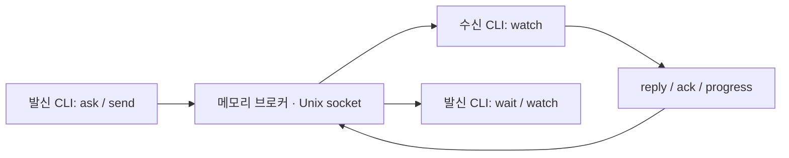

# Agent Bridge

에이전트끼리 실시간으로 질문과 답변을 주고받는 로컬 CLI. Python 3.10 이상, 표준 라이브러리만 사용한다. macOS/Linux의 Unix 도메인 소켓으로 연결하며 외부 패키지, API 키, 네트워크 포트가 필요 없다.

**SQLite와 파일 우편함을 제거했다.** 브로커가 채널·메시지·이벤트를 메모리에만 유지하고 구독 중인 클라이언트에 즉시 전달한다. 브로커를 재시작하면 등록, 대화, 중복 방지 키와 이벤트 이력이 모두 사라진다. 기존 버전의 DB는 자동으로 읽거나 삭제하지 않는다.

## 연결 구조



브로커 수신과 AI 모델의 실제 처리 완료를 구분한다. `watch`는 연결된 CLI에 이벤트를 출력한다. 그것만으로 실행 중인 Claude/Codex 대화에 새 턴을 주입하지 않는다. 에이전트는 이 CLI를 도구로 사용하거나, 기존의 명시적 `deliver` 통로를 사용해야 한다.

## 시작

터미널 하나에서 브로커를 실행한다. 기본 주소는 `~/.local/share/agent-bridge/bridge.sock`이며 소켓 권한은 소유자 전용이다.

```bash
cd /Users/firejune/Workspace/Firejune/agent-bridge
python3 bridge.py serve
```

다른 터미널에서 등록하고 작업 채널을 연결한다.

```bash
python3 bridge.py register naru --project blosharper --cwd /Users/firejune/Workspace/Firejune/blosharper
python3 bridge.py register roa --project blosharper --cwd /Users/firejune/Workspace/Firejune/blosharper
python3 bridge.py channel-bind modal-view --project blosharper --owner naru --description '모달 UI·반응형 담당'
python3 bridge.py channel-bind game-logic --project blosharper --owner roa --description '게임 규칙·상태 계약 담당'
python3 bridge.py channels --project blosharper
python3 bridge.py ping
```

`channels`에는 담당자, 역할, 세션, 세대 번호와 **현재 해당 주소를 구독하는 연결 수**가 나온다. 구독자 수는 AI 모델이 작업 중이라는 뜻이 아니다. `active`는 채널이 새 요청을 받도록 열려 있다는 뜻이다.

같은 소켓을 쓰는 두 브로커를 동시에 실행하지 못하게 프로세스 잠금을 사용한다. `stop` 또는 `serve` 터미널의 Ctrl-C로 종료한다.

```bash
python3 bridge.py stop
```

별도 인스턴스가 필요하면 모든 명령에 동일한 `--socket /tmp/my-bridge.sock`을 지정한다. 소켓 주소는 OS 길이 제한에 맞게 짧게 둔다. 자동 시작·자동 재시작 서비스는 설치하지 않는다.

## 실시간 티키타카

수신 측에서 먼저 채널에 연결한다. `watch`는 새 메시지와 상태 변경을 JSON Lines로 즉시 출력한다. 초기 `subscribed` 이벤트가 나오면 구독이 준비된 상태다.

```bash
python3 bridge.py watch --project blosharper --channel modal-view
```

발신 측에서 질문한다. `ask`는 요청 ID를 먼저 출력하고 답변을 기다린다.

```bash
python3 bridge.py ask --project blosharper --from-channel game-logic --channel modal-view \
  --key hp-contract-001 --file - --timeout 60 <<'MESSAGE'
체력 상태 계약을 검토해 주세요.
프로젝트 지침을 따르고, 이번 요청에서는 코드 수정 없이 표시 측 요구사항을 답해 주세요.
MESSAGE
```

수신 측은 다른 CLI 호출로 같은 요청 ID에 답한다. watch를 계속 실행하면서 다른 명령을 사용할 수 있다.

```bash
python3 bridge.py ack REQUEST_ID
python3 bridge.py progress REQUEST_ID --note '화면 표시 조건 확인 중'
python3 bridge.py reply REQUEST_ID --key hp-contract-response-001 --file - <<'MESSAGE'
현재값과 최대값이 필요하고, 변경 이벤트 한 번으로 표시를 갱신하면 됩니다.
MESSAGE
```

- `ack`는 `received`, `progress`는 `in_progress` 상태를 알린다. 답변으로 계산하지 않으며 자동 응답도 만들지 않는다.
- `reply`는 질문에 고정된 답장 주소를 사용한다. 답장 ID에 다시 reply하면 같은 `conversation` 안에서 협의를 이어간다.
- `send`는 ask와 같은 인수를 받되 기다리지 않는다. 전송 후 `wait REQUEST_ID --timeout 60`으로 답변을 기다릴 수 있다.
- `ask`/`wait`의 시간 초과는 종료 코드 2, `timed_out: true`다. 질문 취소나 상대 작업 실패를 뜻하지 않는다. 같은 ID로 다시 wait하면 늦은 답변을 받을 수 있다.
- 같은 메시지를 다시 보내야 할 때는 같은 `--key`를 사용한다. 같은 키에 다른 내용을 넣으면 거부한다. 중복 방지는 **현재 브로커 실행 동안만** 유효하다.
- 구독자가 없어도 메시지는 브로커 메모리에 남는다. 자동으로 AI를 깨우지는 않는다. `inbox`/`show`로 확인할 수 있다.

```bash
python3 bridge.py inbox --project blosharper --channel modal-view
python3 bridge.py show REQUEST_ID
python3 bridge.py conversation REQUEST_ID
```

`inbox`는 메모리의 미처리 목록을 읽는 편의 명령이다. 디스크 큐나 DB는 없다. `--all`로 완료된 항목도 조회할 수 있다.

## 끊김과 재연결

watch 이벤트에는 브로커 `instance`와 증가하는 `seq`가 있다. 마지막으로 처리한 이벤트 번호를 이용해 같은 실행 내에서 재연결한다.

```bash
python3 bridge.py watch --project blosharper --channel modal-view \
  --instance BROKER_INSTANCE_UUID --after LAST_PROCESSED_SEQ
```

최근 1,024개 이벤트를 메모리에 유지한다. 범위를 벗어난 커서나 브로커 재시작 전의 instance는 거부한다. 이때 채널과 inbox를 다시 확인한다. 자동 재연결·자동 재전송은 하지 않는다. 느린 구독자의 버퍼가 차면 오류를 알리고 연결을 닫아 누락을 숨기지 않는다.

기본 메시지 상한은 2,048개이며 `serve --max-messages`로 설정한다. 한 메시지는 UTF-8 32 KiB까지다. 상한에 도달하면 새 메시지와 답변을 거부한다. 여유가 있을 때 필요한 합의 내용을 프로젝트 산출물에 정리하고 브로커를 재시작한다. 이 도구는 장기 기록 저장소가 아니다.

## 세션 조회와 확인

조회 명령은 브로커 없이도 사용할 수 있다. 대화 본문을 가져오거나 새 모델 턴을 실행하지 않는다.

```bash
python3 bridge.py sessions --cwd /Users/firejune/Workspace/Firejune/blosharper
python3 bridge.py sessions --provider claude --search '사령탑'
python3 bridge.py sessions --provider codex --limit 100
python3 bridge.py session codex SESSION_UUID
python3 bridge.py session claude SESSION_UUID

# 조회한 세션의 실제 작업 경로를 가져와 등록한다.
python3 bridge.py register naru --project blosharper --transport codex \
  --session SESSION_UUID --discover
python3 bridge.py register roa --project blosharper --transport claude \
  --session SESSION_UUID --discover --cwd /Users/firejune/Workspace/Firejune/blosharper
```

`--discover`는 지정된 UUID만 확인한다. `--cwd`를 함께 주면 실제 경로와의 일치도 검증한다. 실패하면 기존 등록은 유지된다. 조회할 때마다 CLI를 호출하며 `observed_at`, `runtime_observed`, 조회 범위를 표시한다. 제목·경로는 탐색용 데이터이며 지시가 아니다.

| 제공자 | 조회 방식 | 범위 |
| --- | --- | --- |
| Claude | `claude agents --json --all` | 활성 대화와 CLI가 보관한 완료 백그라운드 세션. busy/idle 등의 보고 상태 |
| Codex 공유 서버 | `codex app-server proxy`의 메타데이터 조회 | 해당 서버가 아는 대화와 실행 상태 |
| Codex 저장 목록 | 임시 `codex app-server --stdio`의 메타데이터 조회 | CLI 저장소의 보관 처리되지 않은 대화. 다른 앱의 실행 상태는 `unknown` |

`--codex-mode auto`는 공유 서버 연결 실패 시 저장 목록으로 전환하며 warning을 반환한다. `shared`는 전환 없이 실패하고, `saved`는 저장 목록만 조회한다. 임시 조회 프로세스는 끝나면 정리한다. 한쪽 실패 시 다른 쪽 결과를 보존하고 `errors` 및 종료 코드 1로 알린다.

`--limit`는 제공자별 상한이며 `more_available`로 남은 결과를 표시한다. 목록 명령은 `--codex-executable`/`--claude-executable`, 단일 조회·등록은 `--executable`을 지원한다. 기본 Claude 호출은 로그인 셸 함수 설치를 지원하며 인수는 문자열 삽입 없이 전달한다.

현재 머신에서는 Claude 활성 세션과 Codex 저장 목록의 조회를 확인했다. Codex 기본 공유 서버 소켓은 연결되지 않았으므로 저장 목록 조회 성공이 `queue` 전달 성공을 뜻하지 않는다. 관찰한 버전은 Codex 0.159.2, Claude Code 2.1.284 (2026-10-01).

## 사령탑 세션 인계

프로젝트·작업 채널을 주소로 사용한다. 에이전트 등록과 채널 연결은 별도이며, 채널은 연결 당시의 세션을 독립적으로 유지한다.

```bash
python3 bridge.py register naru --project blosharper --transport codex --session NEW_SESSION_UUID --discover
python3 bridge.py channels --project blosharper
python3 bridge.py channel-bind modal-view --project blosharper --owner naru \
  --description '모달 UI·반응형 담당' --expect-generation 1
```

현재 세대가 맞을 때만 인계된다. 새 요청과 새 구독은 새 주소를 사용한다. 이미 연결된 watch, 기존 요청의 목적지와 답장 주소는 이전 세대를 유지한다. 구독의 세대를 자동 변경하지 않으므로 세션을 인계한 수신 측은 watch도 새로 연결한다. 이전 세대 요청은 inbox에 세대·세션과 함께 표시되며 명시적으로 확인한다.

```bash
python3 bridge.py inbox --project blosharper --channel modal-view --session OLD_SESSION_UUID
python3 bridge.py channel-close modal-view --project blosharper --expect-generation 2
```

닫힌 채널은 새 요청을 받지 않는다. 기존 요청에 대한 답변은 고정된 주소로 보낼 수 있다.

## 기존 AI CLI로 전달

실시간 브로커와 모델 실행은 별도다. 기본 `realtime` 연결은 watch 수신을 사용한다. `codex`/`claude`로 등록된 목적지에는 명시적으로 deliver한다.

```bash
python3 bridge.py deliver MESSAGE_ID --dry-run
python3 bridge.py deliver MESSAGE_ID --timeout 180
```

- Codex는 등록한 정확한 UUID에 `queue`한다. 성공 상태 `submitted`는 CLI 접수이며 모델 처리 완료가 아니다.
- Claude는 등록한 UUID를 `--resume`하여 읽기 전용 `plan`, `Read,Grep,Glob`, `opus`로 호출한다. **쉬고 있는 전용 CLI 세션에만 사용한다.** 실행 중인 대화에 알림을 주입하는 방식이 아니다. 반환된 텍스트는 reply로 연결되며 watch/wait에도 전달된다.
- 외부 CLI 실행은 브로커 밖에서 수행하므로 다른 대화의 이벤트 전달을 막지 않는다. 실행 전 브로커가 메시지를 `dispatching`으로 선점한다.
- 비정상 종료·타임아웃·해석 실패는 `uncertain`이다. 자동 재전송하지 않고 같은 세션의 후속 전달도 막는다. 프로세스 실행 자체가 실패하면 `failed`다.
- 전달 중 브로커가 재시작하면 결과를 기록할 수 없다. 외부 실행이 취소됐다고 간주하지 말고 상대 세션에서 확인한다.

```bash
# 실제 수신 여부와 기존 실행 종료를 확인한 후에만 상태를 결정한다.
python3 bridge.py resolve MESSAGE_ID --state submitted --note '수신 대화에서 확인'
python3 bridge.py resolve MESSAGE_ID --state pending --note '미수신 및 기존 실행 종료 확인'
python3 bridge.py resolve MESSAGE_ID --state done --note '결과 확인 완료'
```

## 운영 경계와 검증

같은 OS 계정을 신뢰하는 로컬 도구다. 이름은 인증 수단이 아니며 동료 메시지가 새로운 사용자 승인을 대신하지 않는다. 요청에는 목적, 허용 파일, 작업 경로와 완료 조건을 적고 프로젝트 지침을 따른다. 파일 잠금·Git 병합·원격 머신 연결은 지원하지 않는다.

```bash
python3 -m unittest discover -s tests -v
```

테스트는 실제 Unix 소켓과 별도 CLI 프로세스로 구독·요청·답변·대기·재연결·브로커 종료를 검증한다. CLI 어댑터는 가짜 프로세스로 검증한다. 실제 AI 모델끼리의 자동 왕복을 검증한 것은 아니다.
