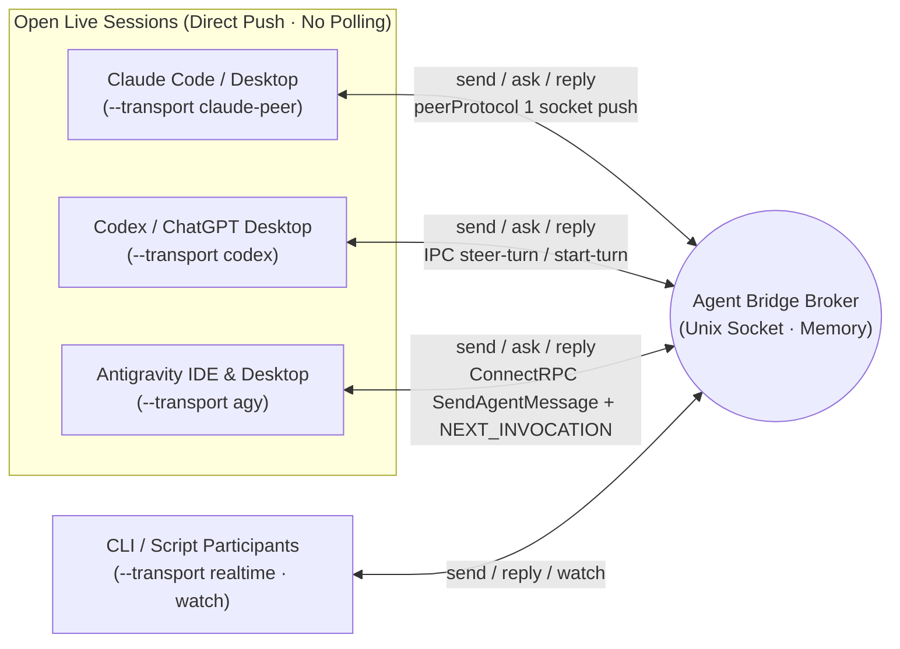

# Agent Bridge

**English** | [한국어](docs/ko/README.md)

A zero-dependency local correspondence broker and shared skill that discovers live **Claude Code / Desktop (`claude-peer`) ↔ Codex / ChatGPT Desktop (`codex`) ↔ Antigravity IDE / Desktop (`agy`)** sessions on the same machine and pushes real-time questions, answers, and progress updates directly into open sessions **without interrupting active turns**. Built with the Python standard library only; correspondence stays in memory; endpoints and channel bindings survive restarts in an owner-private routing snapshot.

- [Skill Entrypoint (`SKILL.md`)](skill/agent-bridge/SKILL.md) · [한국어](docs/ko/SKILL.md)
- [Command & Operations Reference (`usage.md`)](skill/agent-bridge/references/usage.md) · [한국어](docs/ko/usage.md)
- Canonical implementation: [`skill/agent-bridge/scripts/`](skill/agent-bridge/scripts/)

The root `bridge.py`, `broker.py`, and `sessions.py` files are symlinks for backward compatibility; the canonical code lives inside `skill/agent-bridge/`.

## 3-Way Live Session Push Architecture (v2)

Originally built to bridge an IDE/Desktop session with external CLI workers over a socket (`watch`), Agent Bridge v2 **pushes messages directly into open Claude, Codex Desktop, and Antigravity (IDE & Desktop) sessions** without installing a VS Code extension, spawning duplicate CLI processes, or running polling loops.



| Environment | Transport | Session Discovery (`sessions`) | Non-Destructive Live Delivery & Active-Turn Steering |
| --- | --- | --- | --- |
| **Claude Code / Desktop** | `claude-peer` | `~/.claude/sessions/<pid>.json` (`peerProtocol == 1`) | Writes `auth` + `user` (`priority: next`) frames directly to the target session's messaging socket to join the next step. Can also open a new Claude Code desktop session (`open --provider claude --cwd PATH` or `register --transport claude-peer --new --cwd PATH`) through the app's `claude://code/new` link; the session starts when someone presses Enter in the prefilled composer. With `--host ide` it opens a Claude Code IDE session (Antigravity IDE, VS Code, Cursor) through the extension's `/open` link with no human step |
| **Codex / ChatGPT Desktop** | `codex` | `codex app-server` metadata & `~/.codex/ipc/ipc.sock` | Steers active turns via `thread-follower-steer-turn` (standalone `toolOutput`), or starts a turn via `thread-follower-start-turn` when idle. Autonomous creation: `open --provider codex --cwd PATH` or `register --transport codex --new --cwd PATH`; creates a persistent thread and verifies exact Desktop adoption |
| **Antigravity IDE & Desktop** | `agy` | Local `language_server` ConnectRPC (`--app_data_dir antigravity-ide` & `antigravity`, `GetAllCascadeTrajectories`) | Discovers both Antigravity IDE (`Antigravity IDE live trajectory registry`) and Agent Manager / Desktop (`Antigravity desktop live trajectory registry`) sessions simultaneously while skipping `--enable_lsp` LSP workers. Can also open a new Antigravity Desktop session (`open --cwd PATH` or `register --transport agy --new --cwd PATH`), or an Antigravity IDE conversation in any folder with `--host ide`. Queues `<SYSTEM_MESSAGE>` via `SendAgentMessage` (`MESSAGE_PRIORITY_HIGH`) and wakes idle/background-waiting sessions via an empty `SendUserCascadeMessage` (`NEXT_INVOCATION`) |
| **Dedicated CLI / Socket** | `realtime` / `claude` | Broker socket or `claude agents --json --all` | `realtime` subscribes to `watch` JSONL streams; `claude` runs read-only `--resume` on idle dedicated CLI sessions |

Calling `send`, `ask`, or `reply` from any participant automatically routes and pushes the message into the target's registered live session. Other sessions can discover any open Antigravity IDE or Desktop session via `bridge.py sessions --provider agy`, inspect registered routes/channels via `bridge.py routes --project PROJECT` and `bridge.py channels --project PROJECT`, and bind an existing session with `--transport agy --session UUID --discover` — or spawn and register a fresh Antigravity Desktop session on the spot with `bridge.py register NAME --project PROJECT --transport agy --new --cwd /path/to/workspace [--title TITLE] [--model MODEL]` (add `--host ide` to create it in Antigravity IDE instead, in any folder, with no window needed). The same `--new` works for Claude Code desktop with `--transport claude-peer`: `bridge.py register NAME --project PROJECT --transport claude-peer --new --cwd /path/to/workspace [--title FIRST_MESSAGE] [--timeout SECONDS]` opens the app's new-session composer at that folder with the first message prefilled, waits until someone presses Enter (and trusts the folder, if the app asks), then binds the new live session. Add `--host ide [--ide antigravity-ide|vscode|cursor]` to open a Claude Code IDE session instead: the bridge focuses the IDE window holding that folder, opens the extension's new-conversation link and binds the new live session with no human step.

## Opening New Sessions

`open --provider P --cwd PATH` creates a session; `register NAME --project PROJECT --transport T --new --cwd PATH` creates and binds it in one step. `--host` picks the app for `claude` and `agy` (default `desktop`).

| Provider | `--host` | Folder | Human step | Model on creation |
| --- | --- | --- | --- | --- |
| Claude Code (`claude-peer`) | `desktop` | any folder (`claude://code/new?folder=`) | press Enter in the prefilled composer | not settable |
| Claude Code (`claude-peer`) | `ide` (`--ide antigravity-ide\|vscode\|cursor`) | the window's workspace; a folder with no window opens a new window | none | not settable |
| Codex (`codex`) | — | any folder | none | `--model`, policy, else `gpt-6.1-sol` |
| Antigravity (`agy`) | `desktop` | any folder (matched to a Desktop project when one exists) | none | `--model` or policy |
| Antigravity (`agy`) | `ide` | any folder, no window needed (one IDE server serves every window) | none | `--model` or policy |

Details: [SKILL.md](skill/agent-bridge/SKILL.md) and [usage.md](skill/agent-bridge/references/usage.md).

## Closing Sessions

`close NAME --project PROJECT` stops or archives a participant's session and then removes its route (`--keep-route` keeps it). It never deletes anything; permanent deletion is left to the owner.

| Transport | What `close` does | Undo |
| --- | --- | --- |
| `claude-peer` on the IDE extension | SIGTERM to the exact registered CLI process; the tab shows "process exited with code 143" | Type in that tab: the same session resumes |
| `claude-peer` on desktop | SIGTERM to the exact registered CLI process; the app shows "session interrupted" with a retry button | Send a message in that session: the same session resumes |
| `agy` | `{archived: true}` annotation, the panel's own Archive action; refused while `running` | Not confirmed from outside the panel |
| `codex` | `unsupported`: Desktop holds the thread (AgentBridge #27) | — |
| `realtime` / `claude` | Route removal only | — |

The caller's own Claude session is refused. A route that owns an active channel is not removed. A broker started before this version reports that it needs a restart to remove routes.

## Global Skill Installation

Symlink the four standard skill discovery paths to `skill/agent-bridge` so all local agents share the same single copy:

- Shared discovery & execution path: `~/.agents/skills/agent-bridge`
- Codex: `~/.codex/skills/agent-bridge` (`$agent-bridge`)
- Claude Code: `~/.claude/skills/agent-bridge` (`/agent-bridge`)
- Antigravity (AGY): `~/.gemini/config/skills/agent-bridge` (`agent-bridge` skill)

Installing the skill does not grant autonomous outbound messaging permissions or auto-start a background daemon.

```bash
python3 ~/.agents/skills/agent-bridge/scripts/bridge.py --help
python3 ~/.agents/skills/agent-bridge/scripts/bridge.py sessions --provider all
python3 ~/.agents/skills/agent-bridge/scripts/bridge.py sessions --provider agy
```

If you move the repository, update the symlinks accordingly. Restarting clears messages, idempotency keys, and events. Routes and channels reload after identity/workspace checks. Saved Codex routes survive temporary metadata or Desktop unavailability; confirmed mismatches and invalid stored identities are dropped. Other live-peer bindings retain their liveness checks.

## MCP Facade (Phase 0: `bridge_status` only)

`scripts/mcp_server.py` exposes the bridge to MCP clients (contract 0.1.0). Phase 0 (`connectivity_only`) lists and runs exactly one read-only tool, `bridge_status`; every other name, including the planned session/message tools, is refused as an unknown tool. The status call sends one `ping` to the broker socket, the same request `bridge.py ping` makes, and never discovers, sends, opens or registers anything. `daemon_status` is `ready` (ping answered with an instance), `unreachable` (no connection) or `degraded` (connected, malformed answer); `unreachable` is a valid result, not a tool error. Broker counters and the instance ID are not exposed.

Transports: stdio (default) or Streamable HTTP with `--http PORT`, which binds `127.0.0.1` only, serves `POST /mcp` in JSON response mode, answers `GET` with 405 and notifications with 202, and refuses any `Origin` other than its own loopback origins and exact `--allow-origin` values with 403. `--socket` selects a non-default broker.

Register with a Codex client (stdio; use absolute paths because `args` are not shell-expanded):

```toml
# ~/.codex/config.toml
[mcp_servers.agent-bridge]
command = "/ABSOLUTE/PATH/TO/python3"
args = ["/ABSOLUTE/PATH/TO/.agents/skills/agent-bridge/scripts/mcp_server.py"]
```

or `codex mcp add agent-bridge -- /ABSOLUTE/PATH/TO/python3 /ABSOLUTE/PATH/TO/mcp_server.py`. For an HTTP client, run `python3 scripts/mcp_server.py --http 8765` and register `url = "http://127.0.0.1:8765/mcp"`. Then call `bridge_status` from the client; a successful local call does not prove a different client exposes the tool. The write tools stay off until a phase-0 call from the intended client is confirmed and writes are approved.

## Development & Verification

```bash
python3 -m unittest discover -s tests -v
```

The test suite exercises real Unix domain sockets, separate CLI processes, and protocol stub servers for Claude (`claude-peer`), Codex (`codex`), and Antigravity (`agy`) to verify non-destructive live delivery and error handling. Issue #5 regression bars cover bounded terminal-message retention, atomic routing snapshots, same-socket restarts, and TERM with open watch/wait/partial clients. Every integration broker uses an explicit temporary socket and isolated state directory. macOS plist validation uses `plutil -lint`; tests never load a service.

Edit the canonical files under `skill/agent-bridge/` rather than duplicating scripts.

## Retention, restart, and optional supervision

`serve --max-messages 2048` bounds retained messages. At capacity, the oldest unprotected `done`, `answered`, or `failed` message is evicted. Submitted pushes and uncertain delivery remain unfinished; an all-pending or protected set refuses new sends/replies explicitly. Idempotency ends when a message is evicted, so never automatically resend an evicted request.

`serve --state-dir PATH` selects the private routing directory (default: the socket path with its suffix replaced by `.state`). Of correspondence, only routes and channel bindings persist; the limit history below is a separate file in the same directory. `SIGTERM`, Ctrl-C, and the existing `stop` command close open clients cleanly. Restarts still lose in-flight message IDs and do not retry delivery.

Supervision is opt-in: `install-service` installs a per-user launchd agent; `uninstall-service` unloads and removes it. To inspect without loading anything, use `install-service --generate-only --plist /absolute/path/agent.plist`, then `plutil -lint /absolute/path/agent.plist`. `KeepAlive` restarts even after `stop`; uninstall the service to keep it down. See the [operations reference](skill/agent-bridge/references/usage.md#routing-storage-and-opt-in-launchd) before installation.

## Subscription limits (Codex, Antigravity)

**Antigravity (#34)**: a second collector thread reads `GetCascadeModelConfigData` from whichever Antigravity language server runs (one RPC, no tokens). Each model carries `quotaInfo { remainingFraction, resetTime }`, the figures the app shows; models of one family share them, so the buckets are `agy/gemini` and `agy/partner` (every non-Gemini model), split per model only if a family disagrees. No window length is reported. History goes to `<state-dir>/usage/agy.jsonl`; query with `usage --provider agy`.

Each bucket line ends with a risk state (`holds until reset`, `AT RISK: empty ~T before reset`, `EXHAUSTED`, `risk unknown`), and every `send` / `ask` / `reply` to or from a `codex` or `agy` route carries the same lines as a `usage` field in the sender's output, so a command post sees them whenever it hands out work (#32).

The broker samples Codex subscription limits in a daemon thread of the same process, so no extra service is installed. Every `serve --usage-interval 15` minutes (minimum 5, `0` turns it off) it starts a private `codex app-server --stdio`, sends `initialize`, `initialized` and `account/rateLimits/read`, and stops the process. That read starts no thread or turn, delivers nothing to any session, and costs no model tokens.

Samples go to `<state-dir>/usage/codex.jsonl`, one record per bucket and window: `observed_at` and `resets_at` in UTC, `limit_id`, `slot` (`primary`/`secondary`), `used_percent`, `window_mins`, `allowed`, `reset_credits`, `source`, `status` (`ok`, `failed`, or `stale` when the reported reset time has already passed). Account identifiers and plan names are dropped before writing. A failed read is stored with null values and is shown as unknown, never as 0%. Unchanged samples (a `resets_at` within 60 s counts as unchanged, since the server's value drifts by a second between reads) are skipped for up to an hour, failures back off up to 4 hours, and the file keeps 30 days and at most 5 MB, replaced atomically on each write.

```bash
python3 bridge.py usage            # one line per bucket
python3 bridge.py usage --since 2d --json
```

The compact line shows remaining %, the reset in local time, when it was last observed and whether that is fresh (within 90 minutes, and no failed read since), and the burn in %p/h when at least two samples fall inside one reset period of the `--since` window. A drop in `used_percent` or a moved `resets_at` is a reset boundary: it is printed as `RESET between …`, and no rate is computed across it. When an early-reset estimate exists (below), the line ends with ` · next early reset ~<when> [est, n=…, <source>]`.

### Reset events and the two horizons

Codex resets do not accumulate: `used_percent` returns to 0. During a promotion, extra resets have arrived before the official `resets_at`, roughly every 2.5 days, with no guarantee. Planning only by the official expiry therefore wastes what is saved when an early reset lands, while counting on an early reset to avoid running out is unsafe. The bridge keeps the two questions apart:

- **spend horizon** (is it worth spending now, will capacity go unused?): the earlier of the official `resets_at` and the estimated next early reset;
- **stop risk horizon** (will work stop?): the official `resets_at` only.

Every reset boundary between two consecutive successful samples of a bucket becomes an event. It is a window (the earlier sample's `observed_at` → the later one's), with used % and `resets_at` before and after. It is `scheduled` when the window closes no more than one default sampling interval (15 minutes) before the earlier sample's `resets_at` (or after it), `early` when it closes before that, and `unknown` when no `resets_at` was reported. Failed reads in between do not end a window; they widen it to the surrounding successful samples. The broker derives events from the sample history after each write and keeps them in `<state-dir>/usage/codex-events.jsonl` (365 days, at most 1 MB, atomic, de-duplicated by bucket and window), so they outlive the samples' 30 days; a query also derives events from the current samples without writing anything. No extra read is made for events.

External announcements can seed the statistics. `usage --seed-announcements FILE` merges a JSONL file (one line per announcement: `at` as ISO 8601 with a UTC offset, `source: "announcement"`, `note`) into `<state-dir>/usage/codex-announcements.jsonl`; it is idempotent, refuses a time without an offset, and is the only writer of that file. Announcement times are publication times, not the moment an account was reset.

The estimate uses the intervals between consecutive early events of **one** source: observed events once a bucket has at least 3 early intervals, otherwise the announcements; the two are never pooled. An event whose window is wider than 3 hours (broker down, long backoff) is listed but measures no interval and cannot anchor an estimate. The next early reset is the latest early event of either source + the median interval, with the window latest + min … latest + max. Past its centre it is marked `overdue` and still used; past its window it is `lapsed` and not used. With fewer than 3 intervals the output says `too few`, prints no time, and the spend horizon is the official reset.

```bash
python3 bridge.py usage --events          # events, interval stats, estimate, both horizons
python3 bridge.py usage --events --json
python3 bridge.py usage --seed-announcements announcements.jsonl
```

With the six announcement posts of 2026-10-07 12:35, 10-11 07:16, 10-13 10:03, 10-15 13:55, 10-18 01:20 and 10-20 15:33 (KST) seeded and no observed early resets, `--events` prints:

```text
early-reset intervals [announcement, n=5]: mean 63.0h · median 59.4h · range 50.8h–90.7h
next early reset ~10-23 02:58 KST [est, n=5, announcement] window 10-22 18:20 KST … 10-24 10:14 KST, from announcement reset 10-20 15:33 KST
spend horizon: 10-23 02:58 KST (estimate)
stop risk horizon: 10-27 15:46 KST (official resets_at)
```

## License

[MIT](LICENSE.md)

Codex creation runs without human UI steps: it creates a persistent thread with the standard app-server API, sets its actual `--title`, closes the creator, and verifies adoption by the exact Desktop owner. An explicit `--model` is validated and confirmed on that owner; omitting it requests `AGENT_BRIDGE_CODEX_MODEL` if set, else `gpt-6.1-sol` (never the app's own default), and an unadvertised default fails by name. `bridge.py codex-model SESSION_ID --model M` switches an existing thread's model (only that field, verified by readback) from its next turn. Every newly created Codex thread uses Full Access (`:danger-full-access`) with `approvalPolicy: never`, verified again in the exact Desktop owner's next-turn settings. Unavailable/disallowed profiles are refused before creation; existing sessions and global configuration are unchanged. Partial failures preserve the UUID and creation/adoption state, with no automatic creation retry. See the [autonomous creation contract](skill/agent-bridge/references/usage.md#creating-a-new-codex-desktop-session-autonomously).
