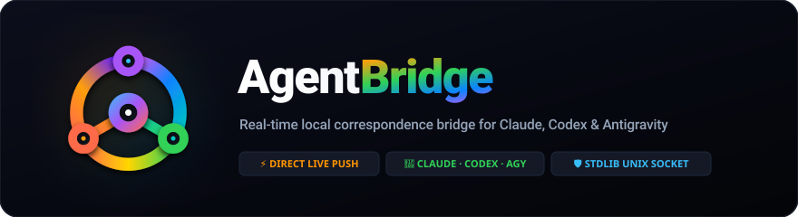
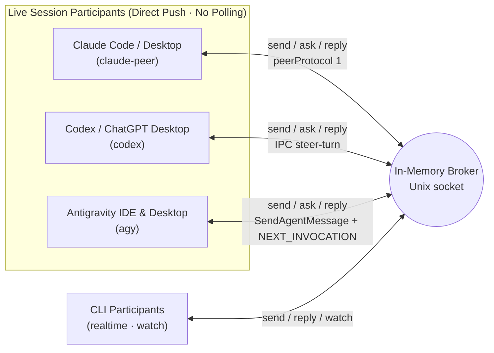

<p align="center">
  
</p>

<p align="center">
  
  
  
  
</p>

<p align="center">
  <strong>English</strong> · <a href="docs/ko/README.md">한국어</a>
</p>

A zero-dependency local real-time bridge for **Claude Code / Desktop (`claude-peer`) ↔ Codex / ChatGPT Desktop (`codex`) ↔ Antigravity IDE / Desktop (`agy`)** and CLI workers (`realtime`/`claude`) on the same machine. Built with Python 3.10+ standard library only over Unix domain sockets.

Instead of spawning duplicate CLI processes or trapping agents in polling loops, Agent Bridge pushes messages directly into open live sessions so agents can ask questions, report progress, and hand off work in real time without interrupting in-flight turns.

## Documentation Map

| Audience | English | 한국어 |
| --- | --- | --- |
| Overview & Quickstart | [README.md](README.md) | [docs/ko/README.md](docs/ko/README.md) |
| Agent Skill Instructions | [skill/agent-bridge/SKILL.md](skill/agent-bridge/SKILL.md) | [docs/ko/SKILL.md](docs/ko/SKILL.md) |
| Full CLI & Protocol Reference | [skill/agent-bridge/references/usage.md](skill/agent-bridge/references/usage.md) | [docs/ko/usage.md](docs/ko/usage.md) |
| MCP Phase 1 Specification | [skill/agent-bridge/references/mcp-phase1.md](skill/agent-bridge/references/mcp-phase1.md) | — |
| Antigravity IDE Commands | — | [docs/ko/antigravity-commands.md](docs/ko/antigravity-commands.md) |

## Architecture & Transports



| Environment | Transport | Delivery Mechanism |
| --- | --- | --- |
| **Claude Code / Desktop** | `claude-peer` | Pushes directly into the live session's messaging socket (`peerProtocol 1`) so the message arrives on the next turn without spawning a second CLI. |
| **Codex / ChatGPT Desktop** | `codex` | Connects to the exact Desktop thread owner over `CODEX_HOME/ipc/ipc.sock`, steering active turns via `thread-follower-steer-turn` (`toolOutput`) or starting a turn when idle. |
| **Antigravity IDE & Desktop** | `agy` | Connects to local `language_server` / `agy --hub` instances over ConnectRPC, injecting `<SYSTEM_MESSAGE>` (`SendAgentMessage`) into active turns and waking idle sessions via empty `SendUserCascadeMessage` (`NEXT_INVOCATION`). |
| **CLI Workers** | `realtime` / `claude` | `realtime` streams JSONL events over `watch`. `claude` resumes an **idle dedicated** CLI session in read-only `plan` mode via `deliver` (never use `claude` on a live session). |

Claude peer pushes bound the socket write and close wait. `deliver ID --timeout SECONDS` bounds lookup, claim and peer I/O for Claude peer delivery. After a possible write, recording the result can take up to 10 more seconds. If a guarded claim reply is lost before any peer write, the bridge gets up to 2 more seconds after the claim admission window closes to release its own reservation. An unresolved dispatch still protects the recipient from a duplicate push. `show` and CLI `inbox` identify queued messages with a `pending behind <id> since <time>` note.

## Installation

Install globally across Claude Code, Codex, and Antigravity in one command using [`skills`](https://skills.sh):

```bash
npx skills add firejune/AgentBridge -g -a claude-code codex antigravity
```

Or clone the repository and symlink the skill folder into your global agent skill directories:

```bash
mkdir -p ~/.agents/skills ~/.claude/skills ~/.gemini/config/skills
ln -sfn "$(pwd)/skill/agent-bridge" ~/.agents/skills/agent-bridge
ln -sfn "$(pwd)/skill/agent-bridge" ~/.claude/skills/agent-bridge
ln -sfn "$(pwd)/skill/agent-bridge" ~/.gemini/config/skills/agent-bridge
```

## Quickstart

```bash
bridge_cli="$HOME/.agents/skills/agent-bridge/scripts/bridge.py"

# 1. Start or check the local broker (default socket: ~/.local/share/agent-bridge/bridge.sock)
python3 "$bridge_cli" ping || python3 "$bridge_cli" serve

# 2. Discover live sessions across Claude, Codex, and Antigravity
python3 "$bridge_cli" sessions --cwd /path/to/workspace

# 3. Register existing live sessions by exact UUID
python3 "$bridge_cli" register claude-main --project my-app --transport claude-peer \
  --session CLAUDE_UUID --discover
python3 "$bridge_cli" register codex-main --project my-app --transport codex \
  --session CODEX_UUID --discover
python3 "$bridge_cli" register agy-main --project my-app --transport agy \
  --session AGY_UUID --discover

# 4. Or open and register a brand-new live session in one step
python3 "$bridge_cli" register agy-worker --project my-app --transport agy \
  --new --cwd /path/to/workspace --title "Worker"

# 5. Bind role channels and exchange messages
python3 "$bridge_cli" channel-bind logic --project my-app --owner claude-main
python3 "$bridge_cli" channel-bind view --project my-app --owner agy-main

python3 "$bridge_cli" ask --project my-app --from-channel logic --channel view \
  --key req-001 --file /path/to/request.txt --timeout 60
python3 "$bridge_cli" reply MESSAGE_ID --key reply-001 --file /path/to/answer.txt
```

## Core Capabilities

### 1. Session Lifecycle (`sessions`, `open`, `register --new`, `close`)

| Provider | Open Desktop Session | Open IDE Session (`--host ide`) | Close (`bridge.py close NAME --project P [--archive]`) |
| --- | --- | --- | --- |
| **Antigravity (`agy`)** | Autonomous via `language_server` / `agy --hub` (`StartCascade`), auto-linked to project & worktree environment | Identical to Desktop (`StartCascade` + project/environment association on unified hub) | Keeps conversation in active stack by default (`--archive` sets `{archived: true}`) and unregisters route |
| **Claude (`claude-peer`)** | Opens `claude://code/new` composer prefilled with `--title`; waits for user Enter | Autonomous via IDE CLI + `<scheme>://anthropic.claude-code/open` | Sends `SIGTERM` to CLI process; keeps in sidebar by default (`--archive` sets Desktop `isArchived: true`) and unregisters route |
| **Codex (`codex`)** | Autonomous via `app-server --stdio` + `codex://threads/UUID` adoption (`:danger-full-access`, `approvalPolicy: never`) | N/A | Keeps thread in active sidebar by default (`--archive` marks `archived=1` in `state_5.sqlite` + IPC broadcast) and unregisters route |

```bash
# Open without registering, or open + register in one command:
python3 "$bridge_cli" open --provider agy --host ide --cwd /path/to/workspace --title "Worker"
python3 "$bridge_cli" register codex-worker --project my-app --transport codex \
  --new --cwd /path/to/workspace --title "Worker" --model gpt-6.1-sol

# Close a finished worker session and remove its route (pass --archive to hide from sidebar):
python3 "$bridge_cli" close agy-worker --project my-app [--archive]
```

Run `bridge.py remap` to reopen non-archived Codex sessions registered across all broker projects. The command checks the saved workspace, skips sessions that already have a Desktop owner, and reports the result for each endpoint. Reopening can bring Codex Desktop to the foreground. The command preserves UUIDs and leaves messages queued.

Use `bridge.py remap NAME --project PROJECT --expect-session OLD_UUID --session NEW_UUID` to replace a registered Codex endpoint. The replacement must have a live Desktop owner and the same workspace. New messages addressed directly to the participant use the replacement UUID. Channel bindings and existing messages keep their original routes.

Codex provider failure observation checks every registered Codex thread, with 10 seconds between passes. Configure `serve --codex-failure-interval SECONDS` (`0` disables observation). It pins the registered thread, current Desktop owner and latest terminal turn, and requires an idle runtime, the latest turn's `failed` completion and a matching terminal error with `willRetry: false`. Known network/stream failures produce one normalized `provider_failure_detected` notice to the originating message's frozen return route. Inspect the owner's `inbox`, then `show ID`, or read the notice through the MCP inbox. The original task keeps its state. Completed tool calls remain eligible for detection.

The notice records `observed_at`, the turn ID and failure kind. `failed_at` is derived from turn start plus duration when available and carries `failure_time_source: turn_duration`, otherwise it is null. Provider text, tool output and Desktop owner metadata stay out of the notice/checkpoint. Native capacity retries stay with the app. Observation resumes from registered routes after a broker restart. With no task in flight, the notice goes to the last retained sender to that route. If no sender remains in bounded correspondence, it stays in the registered thread's own inbox. Deduplication survives restart while the notice remains in bounded correspondence. Missing owners, unsupported snapshots and inactivity provide no provider-failure signal.

Codex recovery uses the native Resume continuation with the existing thread ID, empty `input`, `turnTrigger: "resume_interrupted_task"` and inherited thread settings. The bridge has no composer. It omits `additionalContext` and marks writing-block context prepared, matching Resume with an empty composer. The default minimum delays are 15/30/60 seconds before up to 3 accepted attempts. Configure `serve --provider-retry-backoff 15,30,60 --provider-retry-cap 3`. A shorter schedule reuses its last delay. Polling can add one observation interval, and policy is fixed for each failure episode.

Before each write, recovery rechecks the pinned owner, latest failed turn and input fingerprint, idle state, terminal `willRetry: false`, outstanding requests and tool completion. Completed tool calls are allowed. A newer turn, intervening input, owner change or started call without output stops with `provider_retry_unsafe`. Each attempt is reserved durably before IPC and appears as a `provider_retry` k/N message in the original detection notice's conversation. Accepted attempts count toward `provider_retry_exhausted` when the cap's continuation also fails. An ambiguous write, or restart with an unresolved reservation, stops as `provider_retry_uncertain` and is never resent. A later completed or interrupted turn resets the counter. Aliases of the same Codex thread share the counter. Normalized reservation/count/fingerprint metadata persists privately with correspondence, while the notice and event bodies stay immutable. Active episode counters remain protected from retention until reset. A known lost correspondence checkpoint stops recovery as `provider_retry_uncertain`.

Antigravity (`agy`) provider failure observation checks every registered `agy` route with one `GetAllCascadeTrajectories` poll per live server every 10 seconds (`serve --agy-failure-interval SECONDS`, `0` disables observation) and fetches the tail step (`GetCascadeTrajectorySteps`, `stepOffset = stepCount - 1`) only when the trajectory is `IDLE` (`CASCADE_RUN_STATUS_IDLE`) and `stepCount` changed. Internal retry attempts (`1–8`, while `RUNNING` or without `shouldShowUser: true`) are ignored. Terminal user-visible errors (`shouldShowUser: true`, `CORTEX_STEP_STATUS_DONE`, no trailing step) are deduplicated by `(sid, step_index, errorId)` with correlation `agy:<step_index>` and split into two match classes: a terminal step matching `WAKE_ELIGIBLE_ERROR_SUBSTRINGS` (`"http2: timeout awaiting response headers"`) arms the shared `--provider-retry-backoff` / `--provider-retry-cap` schedule (`15,30,60` s, cap `3`) and wakes the checkpoint via `wake_session` (empty-items `SendUserCascadeMessage` with `NEXT_INVOCATION`), while any other terminal `shouldShowUser: true` error records `provider_failure_detected` only and does not wake. With or without an in-flight message, notices go to the last retained sender to that route so the dispatching parent hears them (or to the route's own inbox if no sender remains in bounded correspondence). If `stepCount` has not advanced and `status` is not `RUNNING` on the next poll window after a wake, the monitor records `provider_retry_uncertain` and never double-wakes. In-memory tail-step caches reset on broker restart.

### 2. Models & Policy (`model`, `policy`)

Query or switch a registered session's model through a provider-neutral interface, governed by `<state-dir>/policy.json` (default seed denylist blocks `gpt-6-astra` for Codex):

```bash
python3 "$bridge_cli" model NAME --project my-app              # Fresh model read
python3 "$bridge_cli" model NAME --project my-app --set MODEL  # Switch model and verify readback
python3 "$bridge_cli" policy                                   # Show active defaults and denylist
```

- **Antigravity (`agy`)**: Reads the latest generator's `plannerConfig`. Switching while idle runs one invocation preserving existing planner settings (`knowledgeConfig`, etc.).
- **Codex (`codex`)**: Reads and updates the exact Desktop owner's next-turn model settings (`thread-follower-update-thread-settings`) without interrupting an active turn.
- **Claude (`claude-peer`)**: Reads the latest assistant model from the transcript. Desktop switching relays `set_session_model` through a configured `command_post` route in `policy.json`; IDE switching is `unsupported` (use the IDE picker).

### 3. Subscription Usage & Risk Monitoring (`usage`)

The broker samples subscription limits in the background into `<state-dir>/usage/<provider>.jsonl`. Every `send`, `ask`, and `reply` touching a `codex` or `agy` route (or one between two `claude-peer` routes) includes a `usage` summary (`ok`, `at_risk`, `exhausted`, or `unknown`) so coordinators can pace work before hitting a wall.

```bash
python3 "$bridge_cli" usage                        # All providers (Codex + Antigravity + Claude buckets)
python3 "$bridge_cli" usage --provider claude     # Claude Desktop and Claude Code (IDE/CLI) accounts
python3 "$bridge_cli" usage --provider agy --json  # Antigravity buckets (agy/gemini-weekly, agy/gemini-5h, agy/partner-weekly, agy/partner-5h)
python3 "$bridge_cli" usage --provider agy --refresh  # Force a fresh Antigravity quota read (bypasses 5m server cache)
python3 "$bridge_cli" usage --events               # Reset history, spend horizon & stop-risk horizon
```

**Antigravity (`agy/gemini-weekly`, `agy/gemini-5h`, `agy/partner-weekly`, `agy/partner-5h`)**:

- Reads `RetrieveUserQuotaSummary` on the local `language_server` (`{}` by default, using the server's 5-minute in-memory cache; pass `--refresh` for an explicit `{"forceRefresh": true}` read). The background collector never sends `forceRefresh`.
- Reports both the weekly (`window_mins: 10080`) and 5-hour (`window_mins: 300`) windows for Gemini (`gemini-*`) and Claude/GPT (`3p-*` → `partner-*`), while keeping legacy `agy/gemini` and `agy/partner` records readable as history. Missing weekly figures are reported as `weekly: unknown`, never `0%` or `100%`.
- Capacity risk (`AT RISK` / `holds until reset`) is judged on the weekly bucket only; the 5-hour line is shown alongside it without driving the capacity verdict.

**Claude (`claude/desktop`, `claude/ide`)** — for a machine where Claude Desktop and the Claude Code IDE extension run under different accounts. No read starts a model turn:

- `claude/desktop`: Desktop's own 15-minute history (`~/Library/Application Support/Claude/plan-usage-history.json`) for the account Desktop is signed in to. Used % only; no reset times.
- `claude/ide`: the Claude Code login (IDE extension and terminal CLI), read live from the usage endpoint the CLI's `/usage` uses, with the login's access token read per call from the Keychain item `Claude Code-credentials`. The token is never stored, logged, or refreshed. If it is missing or expired, or the call fails, the CLI's own cache in `~/.claude.json` is used (written only at session start or on `/usage`, so often old — check `observed`). `serve --no-claude-live` disables the Keychain read.
- Samples keep the time their source measured them, so `observed … ago` is the source's age, not the broker's.

### 4. Agent Worktrees (`wt`)

Keep the main repository checkout clean on `main` and isolate every agent's work under `<workspace>/.worktrees/<repo>/<agent>-<issue>`:

```bash
python3 "$bridge_cli" wt new . jinni 42 --slug fix-bug --provider agy --session UUID
python3 "$bridge_cli" wt list --text
python3 "$bridge_cli" wt sweep          # Dry-run cleanup of merged worktrees whose owner session is gone
python3 "$bridge_cli" wt sweep --apply  # Remove eligible worktrees and branches
```

### 5. Broker Persistence & Optional `launchd` Supervision

- **Private durable correspondence and routing**. Restart restores owner-private routing and mail with the broker’s terminal-eviction guards, retaining protected mail above a lowered limit and reporting that excess through stderr and `ping.correspondence_over_limit`. See [correspondence storage](skill/agent-bridge/references/usage.md#correspondence-storage-issue-94) for fields, limits and loss diagnostics.
- **Optional macOS launchd service**: Supervision is off by default. Use `install-service` (or `--generate-only --plist PATH` to inspect without loading) and `uninstall-service` to manage a `KeepAlive` launch agent.

### 6. Remote MCP Facade (`mcp_server.py`)

Local agents (Claude Code, Codex, Antigravity) invoke `bridge.py` directly via the Python CLI and do not register a local MCP server. `skill/agent-bridge/scripts/mcp_server.py` is dedicated to remote MCP clients connecting through a private single-owner tunnel (`--phase1-config /absolute/private.json` over `stdio`), exposing session discovery/creation, message dispatch, and the optional independent inbox (`inbox_enabled: true`). Without `--phase1-config`, the server falls back to read-only `connectivity_only` (`bridge_status`). See [mcp-phase1.md](skill/agent-bridge/references/mcp-phase1.md) for the full contract.

## Development & Verification

Run the full unit and integration test suite before committing any changes:

```bash
python3 -m unittest discover -s tests -v
```

## License

[MIT](LICENSE)
