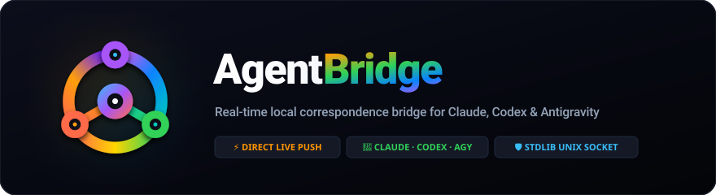
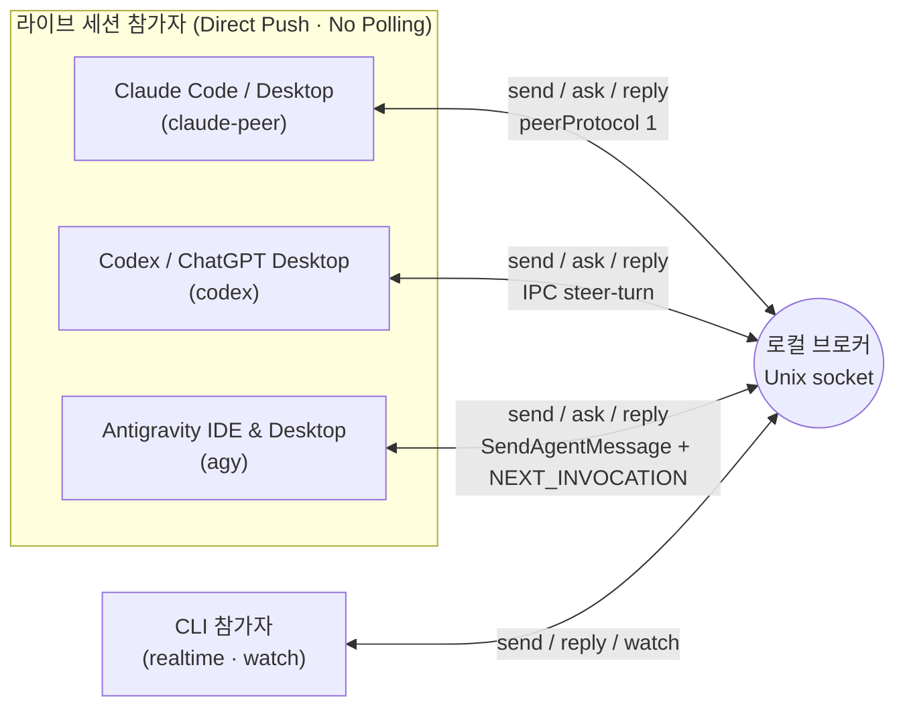

<p align="center">
  
</p>

<p align="center">
  
  
  
  
</p>

<p align="center">
  <a href="../../README.md">English</a> · <strong>한국어</strong>
</p>

같은 머신의 **Claude Code / Desktop (`claude-peer`) ↔ Codex / ChatGPT Desktop (`codex`) ↔ Antigravity IDE / Desktop (`agy`)** 및 CLI 참가자(`realtime`/`claude`)가 실시간으로 질문·답변·진행 상황을 주고받는 로컬 브릿지다. Python 3.10+ 표준 라이브러리와 Unix 도메인 소켓만 사용하며 외부 패키지, API 키, 네트워크 포트가 필요 없다.

별도의 CLI 사본을 중복 실행하거나 라이브 세션을 `watch` 폴링 루프에 가두지 않고, 열려 있는 상대 세션으로 메시지를 직접 push해 진행 중인 작업을 중단하지 않으면서 다자간 협업을 수행한다.

## 문서 구성

| 대상 | English | 한국어 |
| --- | --- | --- |
| 개요 및 빠른 시작 | [README.md](../../README.md) | [docs/ko/README.md](README.md) |
| 에이전트 스킬 지침 | [skill/agent-bridge/SKILL.md](../../skill/agent-bridge/SKILL.md) | [docs/ko/SKILL.md](SKILL.md) |
| 상세 CLI 및 프로토콜 레퍼런스 | [skill/agent-bridge/references/usage.md](../../skill/agent-bridge/references/usage.md) | [docs/ko/usage.md](usage.md) |
| MCP Phase 1 명세 | [skill/agent-bridge/references/mcp-phase1.md](../../skill/agent-bridge/references/mcp-phase1.md) | — |
| Antigravity IDE 내부 명령어 | — | [docs/ko/antigravity-commands.md](antigravity-commands.md) |

## 아키텍처 및 전송 방식



| 환경 | Transport | 전달 메커니즘 |
| --- | --- | --- |
| **Claude Code / Desktop** | `claude-peer` | 살아 있는 세션의 메시징 소켓(`peerProtocol 1`)으로 직접 주입해 별도 CLI 프로세스를 띄우지 않고 다음 턴에 전달한다. |
| **Codex / ChatGPT Desktop** | `codex` | `CODEX_HOME/ipc/ipc.sock`의 정확한 대화 소유자에 연결해 활성 턴이면 `thread-follower-steer-turn`(`toolOutput`)으로 합류하고, 유휴 상태면 새 턴을 시작한다. |
| **Antigravity IDE & Desktop** | `agy` | 로컬 `language_server` / `agy --hub`의 ConnectRPC에 연결해 활성 턴에는 `<SYSTEM_MESSAGE>`(`SendAgentMessage`)로 합류하고, 유휴/대기 상태에는 빈 `SendUserCascadeMessage`(`NEXT_INVOCATION`)로 즉시 깨운다. |
| **CLI 워커** | `realtime` / `claude` | `realtime`은 `watch`로 JSONL 이벤트를 구독한다. `claude`는 **쉬고 있는 전용 CLI 세션**만 `deliver` 시 읽기 전용 `plan` 모드로 `--resume`한다(라이브 세션에는 절대 사용하지 않는다). |

Claude peer 전송은 소켓 쓰기와 연결 종료 대기에 시간 제한을 둔다. `deliver ID --timeout SECONDS`는 Claude peer 전송의 조회, claim, peer I/O에 적용된다. 쓰기가 시작됐을 수 있다면 결과 기록에 최대 10초를 더 쓸 수 있다. peer에 쓰기 전 보호된 claim 응답을 잃으면, claim 접수 한도가 지난 뒤 자기 예약을 푸는 데 최대 2초를 더 쓴다. 결과가 미확정인 전송은 수신자에게 중복 전송되지 않도록 계속 보호한다. `show`와 CLI `inbox`는 대기 중인 메시지에 `pending behind <id> since <time>`을 표시한다.

## 글로벌 스킬 설치

[`skills`](https://skills.sh) CLI로 Claude Code, Codex, Antigravity 글로벌 스킬 경로에 한 번에 설치할 수 있다:

```bash
npx skills add firejune/AgentBridge -g -a claude-code codex antigravity
```

또는 저장소를 클론한 뒤 글로벌 스킬 경로에 직접 심볼릭 링크를 연결한다:

```bash
mkdir -p ~/.agents/skills ~/.claude/skills ~/.gemini/config/skills
ln -sfn "$(pwd)/skill/agent-bridge" ~/.agents/skills/agent-bridge
ln -sfn "$(pwd)/skill/agent-bridge" ~/.claude/skills/agent-bridge
ln -sfn "$(pwd)/skill/agent-bridge" ~/.gemini/config/skills/agent-bridge
```

## 빠른 시작

```bash
bridge_cli="$HOME/.agents/skills/agent-bridge/scripts/bridge.py"

# 1. 브로커 상태 확인 및 기동 (기본 소켓: ~/.local/share/agent-bridge/bridge.sock)
python3 "$bridge_cli" ping || python3 "$bridge_cli" serve

# 2. 열려 있는 Claude · Codex · Antigravity 세션 조회
python3 "$bridge_cli" sessions --cwd /path/to/workspace

# 3. 기존 라이브 세션을 정확한 UUID로 등록
python3 "$bridge_cli" register claude-main --project my-app --transport claude-peer \
  --session CLAUDE_UUID --discover
python3 "$bridge_cli" register codex-main --project my-app --transport codex \
  --session CODEX_UUID --discover
python3 "$bridge_cli" register agy-main --project my-app --transport agy \
  --session AGY_UUID --discover

# 4. 또는 새 라이브 세션을 열면서 즉시 등록
python3 "$bridge_cli" register agy-worker --project my-app --transport agy \
  --new --cwd /path/to/workspace --title "Worker"

# 5. 역할 채널 바인딩 및 질문·답변 교환
python3 "$bridge_cli" channel-bind logic --project my-app --owner claude-main
python3 "$bridge_cli" channel-bind view --project my-app --owner agy-main

python3 "$bridge_cli" ask --project my-app --from-channel logic --channel view \
  --key req-001 --file /path/to/request.txt --timeout 60
python3 "$bridge_cli" reply MESSAGE_ID --key reply-001 --file /path/to/answer.txt
```

## 핵심 기능

### 1. 세션 생명주기 (`sessions`, `open`, `register --new`, `close`)

| 공급자 | 데스크톱 세션 열기 | IDE 세션 열기 (`--host ide`) | 세션 닫기 (`bridge.py close NAME --project P [--archive]`) |
| --- | --- | --- | --- |
| **Antigravity (`agy`)** | `language_server` / `agy --hub`(`StartCascade`)로 무인 생성 및 프로젝트·워크트리 환경 자동 연결 | 데스크톱과 동일 (`StartCascade` + 통합 허브 프로젝트·환경 자동 연결) | 기본은 대화 스택 유지(`--archive` 시 `{archived: true}` 보관) 후 라우트 제거 |
| **Claude (`claude-peer`)** | `claude://code/new`로 첫 메시지를 채운 입력창을 열고 사용자의 Enter 대기 | IDE CLI + `<scheme>://anthropic.claude-code/open`으로 무인 생성 | CLI 프로세스에 `SIGTERM` 전송 후 기본은 대화 스택 유지(`--archive` 시 데스크톱 `isArchived: true` 보관) 및 라우트 제거 |
| **Codex (`codex`)** | `app-server --stdio` 생성 후 `codex://threads/UUID`로 데스크톱 자동 인계 (`:danger-full-access`, `approvalPolicy: never`) | 미지원 | 기본은 사이드바 대화 유지(`--archive` 시 `state_5.sqlite` `archived=1` 및 IPC 알림) 후 라우트 제거 |

```bash
# 단독 생성 또는 생성과 동시에 브로커 등록:
python3 "$bridge_cli" open --provider agy --host ide --cwd /path/to/workspace --title "Worker"
python3 "$bridge_cli" register codex-worker --project my-app --transport codex \
  --new --cwd /path/to/workspace --title "Worker" --model gpt-6.1-sol

# 작업이 끝난 워커 세션 닫기 및 라우트 해제 (사이드바에서 숨기려면 --archive 추가):
python3 "$bridge_cli" close agy-worker --project my-app [--archive]

# 유휴로 닫힌 Claude 데스크톱 세션 깨우기 (woken, already-live, unsupported, uncertain 중 하나를 출력):
python3 "$bridge_cli" wake claude-tower --project my-app [--timeout 30]
```

Claude 데스크톱은 세션을 스스로 닫는다. 화면에 안 보이는 세션은 마지막 턴 뒤 900초가 지나면 멈추고, 메모리가 부족하면 가장 오래 쉰 세션을 내린다. 그러면 CLI가 끝나고 레지스트리 기록과 inbox 소켓이 사라진다. 이런 라우트로 `claude-peer` push가 오면 브릿지가 먼저 세션을 깨운다. 데스크톱 메타데이터에서 `cliSessionId`로 찾은 `claude://claude.ai/epitaxy/<local_id>`를 열면, 앱이 같은 세션 ID와 대화 기록을 새 PID로 이어 받는다. 새 inbox 소켓이 뜨면 메시지를 한 번만 push한다. 그때까지 메시지는 `dispatching`이고, 다른 결과면 아무것도 보내지 않은 채 `pending`으로 돌아간다. 브릿지는 스스로 다시 열거나 다시 보내지 않는다. `bridge.py wake NAME --project P`는 같은 단계를 명시적으로 한다. 링크를 열면 앱이 그 세션으로 포커스를 옮기고 앞으로 올 수 있다. 예약 작업 세션(앱이 세션 간 메시징을 끈 채 띄운다)과 IDE 세션은 `unsupported`다.

`bridge.py remap`은 브로커의 모든 프로젝트에서 보관되지 않은 등록 Codex 세션을 다시 연다. 저장된 작업 디렉터리를 확인하고 Desktop 소유자가 이미 붙은 세션은 건너뛴다. 결과는 엔드포인트별로 출력한다. 세션을 다시 열 때 Codex Desktop이 화면 앞으로 올 수 있다. UUID와 대기 중인 메시지는 그대로 유지한다.

`bridge.py remap NAME --project PROJECT --expect-session OLD_UUID --session NEW_UUID`로 등록된 Codex 엔드포인트의 UUID를 교체할 수 있다. 새 세션에는 라이브 데스크톱 소유자가 있어야 하며 작업 디렉터리는 기존과 같아야 한다. 참가자 이름으로 직접 보내는 새 메시지에 교체된 UUID를 사용한다. 채널 바인딩과 기존 메시지는 원래 라우트를 유지한다.

Codex 공급자 실패는 등록된 모든 Codex 스레드를 대상으로 관찰하며 관찰 회차 사이 기본 간격은 10초다. `serve --codex-failure-interval SECONDS`로 주기를 정하며 `0`은 관찰을 끈다. 등록된 스레드·현재 Desktop 소유자·최신 최종 턴를 고정하고, 실행 상태가 idle이며 최신 턴의 완료 상태가 `failed`이고 일치하는 최종 오류가 `willRetry: false`일 때 알려진 네트워크·스트림 실패를 감지한다. 원래 메시지의 고정 반환 주소로 정규화한 `provider_failure_detected` 알림 하나를 남긴다. 소유자의 `inbox`에서 ID를 찾고 `show ID`로 읽거나 MCP inbox를 사용한다. 원본 작업 상태는 유지하며 완료된 도구 호출이 있는 턴도 감지한다.

알림에는 `observed_at`·턴 ID·실패 종류를 담는다. `failed_at`은 턴 시작 시각과 실행 시간이 모두 있으면 합산하고 `failure_time_source: turn_duration`을 표시하며, 자료가 없으면 null이다. 공급자 원문·도구 출력·Desktop 소유자 메타데이터는 알림과 체크포인트에서 제외한다. 앱의 capacity 재시도를 따른다. 브로커 재시작 뒤 등록 라우트에서 관찰을 재개한다. 진행 중 작업이 없어도 해당 라우트의 마지막 보관 발신자에게 알린다. 보관 한도 내에 발신자가 없으면 등록 스레드 자신의 inbox에 알림을 남긴다. 보관 한도 내 알림의 중복 방지는 재시작 후에도 유지한다. 소유자 부재·미지원 스냅샷·무응답 시간만으로 공급자 실패를 판정하지 않는다.

Codex 복구는 네이티브 Resume와 같은 기존 스레드 ID·빈 `input`·`turnTrigger: "resume_interrupted_task"`·상속된 스레드 설정을 사용한다. 브릿지에는 composer가 없으므로 `additionalContext`를 생략하고 writing-block 문맥 준비를 표시해 빈 composer의 Resume와 맞춘다. 기본 최소 대기는 시도별 15·30·60초이며 수락된 시도를 최대 3회 센다. `serve --provider-retry-backoff 15,30,60 --provider-retry-cap 3`으로 바꾼다. 짧은 대기 목록은 마지막 값을 재사용한다. 관찰 주기만큼 대기가 추가될 수 있으며 정책은 각 실패 묶음을 시작할 때 고정한다.

전송 직전에 고정 소유자·최신 실패 턴·입력 fingerprint·idle 상태·최종 `willRetry: false`·미결 요청·도구 완료를 다시 확인한다. 완료된 도구 호출은 허용한다. 더 최신 턴·중간 입력·소유자 변경·출력 없는 시작 호출이 있으면 `provider_retry_unsafe`로 멈춘다. IPC 전에 시도를 영구 예약하며 원래 감지 알림과 같은 대화에 `provider_retry` k/N 메시지를 남긴다. 수락된 시도만 세고 마지막 시도까지 실패하면 `provider_retry_exhausted`를 알린다. 전송 결과가 모호하거나 재시작 시 미결 예약이 있으면 `provider_retry_uncertain`으로 멈추고 재전송하지 않는다. 이후 턴이 completed 또는 interrupted로 끝나면 횟수를 초기화한다. 같은 Codex 스레드의 별칭도 횟수를 공유한다. 정규화한 예약·횟수·fingerprint만 비공개 correspondence 메타데이터로 저장하고 알림·이벤트 본문은 보존한다. 초기화 전까지 활성 실패 묶음의 횟수는 보관 한도로 삭제하지 않는다. correspondence 체크포인트 유실이 확인되면 `provider_retry_uncertain`으로 멈춘다.

Antigravity (`agy`) 공급자 실패 관찰은 등록된 모든 `agy` 라우트를 대상으로 기본 10초마다 서버당 `GetAllCascadeTrajectories`를 1회 폴링하며(`serve --agy-failure-interval SECONDS`, `0`은 비활성화), 세션이 `IDLE`이고 `stepCount`가 바뀌었을 때만 마지막 스텝(`GetCascadeTrajectorySteps`, `stepOffset = stepCount - 1`)을 조회한다. 내부 재시도(`1–8`차, `RUNNING` 상태이거나 `shouldShowUser: true`가 없는 스텝)는 무시한다. 최종 사용자 노출 오류(`shouldShowUser: true`, `CORTEX_STEP_STATUS_DONE`, 뒤따르는 스텝 없음)는 `(sid, step_index, errorId)`로 중복을 방지하고 `agy:<step_index>` 상관 ID를 사용한다. `WAKE_ELIGIBLE_ERROR_SUBSTRINGS`(`"http2: timeout awaiting response headers"`)와 일치하는 최종 스텝만 공통 `15/30/60`초·최대 `3`회 정책(`provider_retry` k/N, `provider_retry_exhausted`, `provider_retry_unsafe`, `provider_retry_uncertain`)으로 예약 후 `wake_session`(빈 `items`의 `SendUserCascadeMessage`, `NEXT_INVOCATION`)으로 깨우며, 그 외 최종 오류 스텝은 `provider_failure_detected`만 기록하고 깨우지 않는다. 진행 중 메시지 유무와 관계없이 알림은 해당 라우트의 마지막 보관 발신자(없으면 라우트 자신의 inbox)로 전달된다. 깨운 뒤 다음 폴링 주기에 `stepCount`가 늘지 않고 `RUNNING`도 아니면 `provider_retry_uncertain`을 기록하고 다시 깨우지 않는다. 메모리 내 스텝 캐시는 브로커 재시작 시 초기화된다.

### 2. 모델 조회·전환 및 정책 (`model`, `policy`)

공급자 중립 인터페이스로 세션의 모델을 실시간 조회·전환하며, `<state-dir>/policy.json` 정책(기본 시드 거부 목록은 Codex의 `gpt-6-astra` 차단)을 강제한다.

```bash
python3 "$bridge_cli" model NAME --project my-app              # 현재 모델 조회
python3 "$bridge_cli" model NAME --project my-app --set MODEL  # 모델 전환 후 재조회 검증
python3 "$bridge_cli" policy                                   # 적용 중인 기본값 및 거부 목록 확인
```

- **Antigravity (`agy`)**: 마지막 generator의 `plannerConfig`에서 모델을 읽는다. 대기 중 전환 시 기존 플래너 설정(`knowledgeConfig` 등)을 유지한 채 `requestedModel`만 바꿔 1회 호출로 적용한다.
- **Codex (`codex`)**: 정확한 데스크톱 소유자의 다음 턴 모델 설정을 읽고 `thread-follower-update-thread-settings`로 전환 후 재조회로 검증한다.
- **Claude (`claude-peer`)**: 대화 기록의 최신 assistant 메시지에서 모델을 읽는다. 데스크톱 세션 전환은 `policy.json`에 지정된 `command_post` 세션을 통해 `set_session_model`을 중계하며, IDE 세션 전환은 `unsupported`(IDE 모델 선택기 사용)다.

### 3. 구독 한도 및 위험도 모니터링 (`usage`)

브로커는 백그라운드에서 구독 한도를 수집해 `<state-dir>/usage/<provider>.jsonl`에 기록한다. `codex`나 `agy` 경로(또는 `claude-peer`끼리의 경로)를 거치는 모든 `send`·`ask`·`reply` 결과에는 `usage` 상태(`ok`, `at_risk`, `exhausted`, `unknown`)가 함께 반환되어 한도 고갈 전에 작업 속도를 조절할 수 있다.

```bash
python3 "$bridge_cli" usage                        # 전체 공급자(Codex + Antigravity + Claude) 버킷 한도 및 소모율 출력
python3 "$bridge_cli" usage --provider claude     # Claude 데스크톱 계정과 Claude Code(IDE/CLI) 계정
python3 "$bridge_cli" usage --provider agy --json  # Antigravity 버킷(agy/gemini-weekly, agy/gemini-5h, agy/partner-weekly, agy/partner-5h) JSON 조회
python3 "$bridge_cli" usage --provider agy --refresh  # Antigravity 5분 서버 캐시를 우회해 즉시 갱신 조회
python3 "$bridge_cli" usage --events               # 리셋 이력, spend horizon 및 stop-risk horizon 확인
```

**Antigravity (`agy/gemini-weekly`, `agy/gemini-5h`, `agy/partner-weekly`, `agy/partner-5h`)**:

- 로컬 `language_server`의 `RetrieveUserQuotaSummary`를 호출한다(백그라운드 수집기는 항상 `{}`만 보내 서버의 5분 메모리 캐시를 사용하며 `forceRefresh`를 보내지 않고, 명시적 `--refresh` 실행 시에만 `{"forceRefresh": true}`를 전송한다).
- Gemini(`gemini-*`)와 Claude/GPT(`3p-*` → `partner-*`)의 주간 한도(`window_mins: 10080`)와 5시간 한도(`window_mins: 300`)를 나란히 보고하며, 기존 `agy/gemini`·`agy/partner` 기록도 히스토리로 그대로 읽는다. 주간 수치가 없을 때는 `0%`나 `100%`가 아닌 `weekly: unknown`으로 표시한다.
- 용량 위험도(`AT RISK` / `holds until reset`)는 주간 버킷(`*-weekly`)을 기준으로만 판정하며, 5시간 창은 함께 표시하되 용량 위험 판정에는 사용하지 않는다.

**Claude (`claude/desktop`, `claude/ide`)** — Claude 데스크톱과 Claude Code IDE 확장이 서로 다른 계정으로 도는 머신용이다. 어느 읽기도 모델 턴을 시작하지 않는다:

- `claude/desktop`: 데스크톱이 스스로 15분마다 남기는 기록(`~/Library/Application Support/Claude/plan-usage-history.json`), 데스크톱에 로그인된 계정 기준. 사용률만 있고 리셋 시각은 없다.
- `claude/ide`: Claude Code 로그인(IDE 확장 · 터미널 CLI). CLI의 `/usage`가 부르는 사용량 엔드포인트를 실시간으로 읽고, 토큰은 매번 키체인 항목 `Claude Code-credentials`에서 읽는다. 토큰은 저장 · 기록 · 갱신하지 않는다. 토큰이 없거나 만료됐거나 호출이 실패하면 CLI 자체 캐시(`~/.claude.json`)를 쓴다 — 세션 시작이나 `/usage` 때만 쓰여서 낡은 경우가 많으니 `observed`를 본다. `serve --no-claude-live`로 키체인 읽기를 끈다.
- 표본은 원천이 잰 시각을 그대로 가진다 — `observed … ago`는 브로커가 아니라 원천의 나이다.
- 표본마다 원천이 알려 준 계정을 불투명한 해시로 붙인다(주소 · 이름은 저장하지 않는다). 소모율과 `AT RISK`는 가장 최근 읽기가 본 계정의 표본만 쓴다 — 로그인이 바뀌면 다른 계정의 표본은 섞지 않고 판독에서 뺀다.
- Claude Code 세션 안에서(`CLAUDE_CODE_SESSION_ID`가 있으면) `usage`는 Claude 버킷 앞에 `warning: you are a Claude session; read your own Claude limits from the app (get_usage). …` 한 줄을 찍는다(`--json`은 `warning` 필드). Claude 세션은 자기 한도를 앱에서 읽는다 — 이 수치는 다른 표면용이고 늦을 수 있다.


#### 세션별 소비량 (`session-usage`)

`bridge.py session-usage NAME --project P [--json] [--prices FILE]`은 턴·provider 통신·
provider 파일 쓰기 없이 세션 하나를 읽는다. 라우트 없이도
`session-usage --provider codex --id ID --json`을 사용할 수 있다. Codex는 마지막 누적
rollout 값(캐시 포함 input, reasoning 포함 output)을 사용한다. wall 시간은 기록 전체,
active 시간은 600초 초과 간격을 뺀 값이다. 모르는 값은 설명과 함께 null이다.
Claude는 transcript의 중복 없는 응답을 합산하고 sub-agent는 따로 보고하며, 이번 단계의 Antigravity는 reader 스텁이다. 선택적인 가격 표는
`model id | input | cached input | output` 열, 백만 토큰당 USD이며 기본 가격은 없다.
필드·계산식·offline 조회·reader 확장은 [사용법](usage.md#세션별-소비량-session-usage)을 참고한다.

### 4. 에이전트 워크트리 (`wt`)

메인 저장소 체크아웃은 항상 `main`으로 유지하고, 각 에이전트의 코드 작업은 `<workspace>/.worktrees/<repo>/<agent>-<issue>` 아래 격리된 워크트리에서 수행한다.

```bash
python3 "$bridge_cli" wt new . jinni 42 --slug fix-bug --provider agy --session UUID
python3 "$bridge_cli" wt list --text
python3 "$bridge_cli" wt sweep          # 머지 완료 및 소유 세션이 종료된 워크트리 정리 대상 확인 (dry-run)
python3 "$bridge_cli" wt sweep --apply  # 대상 워크트리 및 브랜치 실제 제거
```

### 5. 라우팅 영속화 및 선택적 `launchd` 서비스

- **소유자 전용 메시지·라우팅 저장**. 재시작은 브로커의 종료 메시지 제거·보호 규칙에 따라 라우트와 메시지를 복원하며, 낮춘 한도를 넘는 보호 메시지는 유지하고 stderr와 `ping.correspondence_over_limit`에 표시한다. 필드·한도·손실 진단은 [저장 계약](../../skill/agent-bridge/references/usage.md#correspondence-storage-issue-94)을 따른다.
- **선택적 macOS `launchd` 관리**: 자동 기동 서비스는 기본 꺼짐 상태다. `install-service`(검토용 파일 생성은 `--generate-only --plist PATH`)와 `uninstall-service`로 `KeepAlive` 에이전트를 관리한다.

### 6. 원격 MCP 파사드 (`mcp_server.py`)

로컬 에이전트(Claude Code, Codex, Antigravity)는 로컬 MCP를 등록하지 않고 `bridge.py` 파이썬 CLI를 직접 사용한다. `skill/agent-bridge/scripts/mcp_server.py`는 비공개 단일 소유자 원격 터널(`stdio` 기반 `--phase1-config /absolute/private.json`) 전용 인터페이스로, 세션 조회·생성, 메시지 전송, 독립 수신함(`inbox_enabled: true`)을 단일 커넥터로 노출한다(`--phase1-config` 생략 시 읽기 전용 `bridge_status`만 응답). 자세한 계약은 [mcp-phase1.md](../../skill/agent-bridge/references/mcp-phase1.md)를 참고한다.

## 개발 및 검증

변경 사항을 커밋하기 전에 전체 단위·통합 테스트 스위트를 실행해 검증한다.

```bash
python3 -m unittest discover -s tests -v
```

## 라이선스

[MIT](../../LICENSE)
