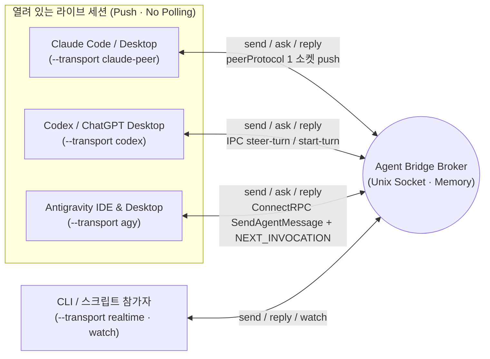

# Agent Bridge

[English](../../README.md) | **한국어**

같은 머신에서 실행 중인 **Claude Code / Desktop (`claude-peer`) ↔ Codex / ChatGPT Desktop (`codex`) ↔ Antigravity IDE / Desktop (`agy`)** 및 로컬 CLI 에이전트(`realtime`/`claude`)의 세션을 조회하고, 프로젝트 채널을 통해 **기존 대화를 중단하지 않으면서 3자간(다자간) 실시간 질문·답변·진행 상황**을 주고받는 로컬 브릿지 도구다. Python 표준 라이브러리만 사용하며 메시지·전달 상태는 메모리에 유지하고, endpoint·채널 바인딩만 소유자 전용 파일에 저장한다.

- [스킬 진입점 (한국어)](SKILL.md) · [English](../../skill/agent-bridge/SKILL.md)
- [명령·운영 사용법 (한국어)](usage.md) · [English](../../skill/agent-bridge/references/usage.md)
- [Antigravity 내부 커맨드 레퍼런스](antigravity-commands.md)
- 실행 코드 정본: [`skill/agent-bridge/scripts/`](../../skill/agent-bridge/scripts/)

루트의 `bridge.py`, `broker.py`, `sessions.py`는 기존 명령 호환을 위한 심볼릭 링크다. 실제 코드는 `skill/agent-bridge/` 폴더 안에 한 벌만 유지한다.

## 3자간 라이브 세션 소통 구조 (v2)

초기에는 IDE 익스텐션이나 데스크톱과 별도 CLI 프로세스 간의 소켓 구독(`watch`)을 위해 시작했으나, 현재(v2)는 **Claude · Codex Desktop · Antigravity(IDE 및 Desktop) 3대 환경 모두 별도의 익스텐션, CLI 사본, 폴링 루프 없이 열려 있는 라이브 대화에 직접 push**한다.



| 대상 환경 | Transport | 세션 탐색 (`sessions`) | 전달 및 활성 턴 합류 방식 (비파괴 · No Interrupt) |
| --- | --- | --- | --- |
| **Claude Code / Desktop** | `claude-peer` | `~/.claude/sessions/<pid>.json` (`peerProtocol == 1`) | 수신 세션의 메시징 소켓에 `auth` + `user`(`priority: next`) 프레임을 직접 기록해 다음 스텝에 주입. 앱의 `claude://code/new` 링크로 Claude Code 데스크톱 신규 세션 열기(`open --provider claude --cwd PATH` 또는 `register --transport claude-peer --new --cwd PATH`)도 지원 — 미리 채워진 입력창에서 사람이 Enter를 누르면 세션이 시작된다 |
| **Codex / ChatGPT Desktop** | `codex` | `codex app-server` 메타데이터 및 `~/.codex/ipc/ipc.sock` | 활성 턴이면 `thread-follower-steer-turn`(standalone `toolOutput`)으로 현재 턴에 합류, 유휴 상태면 `thread-follower-start-turn`으로 턴 시작 |
| **Antigravity IDE & Desktop** | `agy` | 로컬 `language_server` ConnectRPC (`--app_data_dir antigravity-ide` 및 `antigravity`, `GetAllCascadeTrajectories`) | `--enable_lsp` LSP 워커를 자동 제외하고 Antigravity IDE(`Antigravity IDE live trajectory registry`)와 Agent Manager/Desktop(`Antigravity desktop live trajectory registry`) 세션을 동시에 탐색. Antigravity 데스크톱 신규 세션 생성(`open --cwd PATH` 또는 `register --transport agy --new --cwd PATH`)도 지원. `SendAgentMessage`(`MESSAGE_PRIORITY_HIGH`)로 `<SYSTEM_MESSAGE>` 주입 후, 유휴/백그라운드 대기 시 빈 `SendUserCascadeMessage`(`NEXT_INVOCATION`)로 즉시 깨움 |
| **전용 CLI / 실시간 소켓** | `realtime` / `claude` | 브로커 소켓 또는 `claude agents --json --all` | `realtime`은 `watch` 스트림 구독, `claude`는 유휴 전용 CLI 세션 읽기 전용 `--resume` |

어느 에이전트에서든 `send`·`ask`·`reply`를 호출하면 상대방의 등록된 transport에 맞춰 해당 라이브 세션으로 즉시 들어간다. 다른 세션에서는 `bridge.py sessions --provider agy`로 열려 있는 Antigravity IDE·데스크톱 세션을 찾고, `bridge.py routes --project PROJECT`·`bridge.py channels --project PROJECT`로 등록된 라우트/채널을 확인한 뒤 `--transport agy --session UUID --discover`로 연결하거나, `bridge.py register NAME --project PROJECT --transport agy --new --cwd /path/to/workspace [--title TITLE] [--model MODEL]`로 새 Antigravity 데스크톱 세션을 즉시 생성·등록해 실시간 티키타카를 주고받는다. Claude Code 데스크톱도 `--transport claude-peer`로 같은 `--new`를 쓴다: `bridge.py register NAME --project PROJECT --transport claude-peer --new --cwd /path/to/workspace [--title 첫_메시지] [--timeout 초]`는 그 폴더의 새 세션 입력창을 첫 메시지가 채워진 채로 열고, 사람이 Enter를 누르면(앱이 묻는 경우 폴더 신뢰도) 새 라이브 세션을 등록한다.

## 전역 스킬 연결

로컬 환경에서는 아래 네 경로를 동일한 `skill/agent-bridge` 폴더로 심볼릭 링크해 공용으로 사용할 수 있다.

- 공용 탐색·실행 경로: `~/.agents/skills/agent-bridge`
- Codex: `~/.codex/skills/agent-bridge` (`$agent-bridge`)
- Claude Code: `~/.claude/skills/agent-bridge` (`/agent-bridge`)
- Antigravity (AGY): `~/.gemini/config/skills/agent-bridge` (`agent-bridge` 스킬)

별도 실행 권한이나 자동 발신 권한을 추가하지 않는다. 스킬만 다른 곳에 설치할 때도 폴더 안의 스크립트와 참조 문서를 함께 유지한다.

```bash
python3 ~/.agents/skills/agent-bridge/scripts/bridge.py --help
python3 ~/.agents/skills/agent-bridge/scripts/bridge.py sessions --provider all
python3 ~/.agents/skills/agent-bridge/scripts/bridge.py sessions --provider agy
```

심볼릭 링크 설치이므로 저장소 위치를 옮기면 네 링크도 갱신해야 한다. 재시작하면 메시지·중복 방지 키·이벤트는 사라지고, endpoint·채널은 정확한 세션·작업 경로를 재검증해 복원한다. 사용할 수 없는 라이브 바인딩은 제거한다. 전역 스킬 설치가 브로커를 자동 기동하거나 AI 대화를 깨우지는 않는다.

## 보존 상한·재시작·선택적 서비스

`serve --max-messages 2048`은 메시지 보존 개수다. 상한에서는 보호되지 않은 `done`·`answered`·`failed` 중 가장 오래된 항목을 제거한다. `submitted`·`uncertain`은 완료가 아니며, 미처리·보호 항목만 남으면 새 전송·답변을 거부한다. 제거 시 중복 방지 키도 사라지므로 자동 재전송하지 않는다.

`serve --state-dir PATH`는 소통 상태 중 endpoint·채널만 저장한다(기본: 소켓 확장자를 `.state`로 바꾼 디렉터리). 아래 한도 기록은 같은 디렉터리의 별도 파일이다. `stop`·Ctrl-C·SIGTERM은 열린 클라이언트도 닫는다. 재시작 시 진행 중 메시지 ID는 복원하지 않고 재시도도 없다.

서비스는 명시적 `install-service`로 설치한다. `install-service --generate-only --plist /absolute/review/agent.plist`와 `plutil -lint /absolute/review/agent.plist`는 서비스 로드 없이 검토한다. KeepAlive는 `stop` 뒤에도 다시 기동하므로 계속 중지하려면 `uninstall-service`로 제거한다. 자세한 경로·복원·운영 계약은 [사용법](usage.md#라우팅-저장과-선택적-launchd)을 읽는다.

## 구독 한도 (Codex)

브로커는 같은 프로세스의 데몬 스레드에서 Codex 구독 한도를 표본으로 읽는다. 서비스를 따로 설치하지 않는다. `serve --usage-interval 15`분마다(최소 5, `0`은 끔) 전용 `codex app-server --stdio`를 띄워 `initialize`·`initialized`·`account/rateLimits/read`만 보내고 프로세스를 끝낸다. 이 읽기는 스레드·턴을 시작하지 않고, 어느 세션에도 전달하지 않으며, 모델 토큰을 쓰지 않는다.

표본은 `<state-dir>/usage/codex.jsonl`에 버킷·창마다 한 줄로 남는다: UTC의 `observed_at`·`resets_at`, `limit_id`, `slot`(`primary`/`secondary`), `used_percent`, `window_mins`, `allowed`, `reset_credits`, `source`, `status`(`ok`·`failed`, 보고된 리셋 시각이 이미 지났으면 `stale`). 계정 식별자와 플랜 이름은 쓰기 전에 버린다. 읽기 실패는 null로 저장되고 0%가 아니라 「알 수 없음」으로 표시된다. 값이 같으면(서버의 `resets_at`은 읽을 때마다 1초쯤 흔들리므로 60초 안의 차이는 같은 값으로 본다) 한 시간까지 건너뛰고, 실패는 최대 4시간까지 간격을 늘리며, 파일은 30일·5 MB 안에서 매번 원자적으로 교체된다.

```bash
python3 bridge.py usage            # 버킷마다 한 줄
python3 bridge.py usage --since 2d --json
```

한 줄에는 남은 %, 현지 시각의 리셋, 마지막 관측과 신선도(90분 이내이고 그 뒤 실패한 읽기가 없으면 fresh), 그리고 `--since` 창 안 한 리셋 주기에 표본이 둘 이상이면 %p/h 소모율이 나온다. `used_percent`가 줄거나 `resets_at`이 움직이면 리셋 경계다 — `RESET between …`으로 표시하고 그 경계를 가로질러 소모율을 계산하지 않는다. 조기 리셋 추정치(아래)가 있으면 줄 끝에 ` · next early reset ~<시각> [est, n=…, <출처>]`가 붙는다.

### 리셋 이벤트와 두 개의 기준 시각

Codex 리셋은 누적되지 않는다 — `used_percent`가 0으로 돌아갈 뿐이다. 프로모션 기간에는 공식 `resets_at` 전에 추가 리셋이 대략 2.5일마다 왔지만 보장은 없다. 그래서 공식 만료만 보고 아끼면 조기 리셋이 올 때 아낀 몫이 사라지고, 반대로 조기 리셋을 믿고 바닥나지 않으리라 보는 것은 위험하다. 브릿지는 두 질문을 나눈다.

- **spend horizon**(지금 쓰는 게 이득인가, 남는 용량이 버려지나?): 공식 `resets_at`과 추정한 다음 조기 리셋 중 이른 쪽.
- **stop risk horizon**(작업이 멈추나?): 공식 `resets_at`만.

한 버킷의 연속된 두 성공 표본 사이의 리셋 경계는 모두 이벤트가 된다. 이벤트는 시점이 아니라 창(앞 표본의 `observed_at` → 뒤 표본의 것)이고, 전후의 사용 %와 `resets_at`을 함께 남긴다. 창이 앞 표본의 `resets_at`보다 기본 표본 간격(15분) 이내로 앞서거나 그 뒤에 닫히면 `scheduled`, 그보다 일찍 닫히면 `early`, `resets_at`이 보고되지 않았으면 `unknown`이다. 중간의 실패한 읽기는 창을 끊지 않고 앞뒤 성공 표본까지 넓힌다. 브로커는 표본을 쓸 때마다 이력에서 이벤트를 도출해 `<state-dir>/usage/codex-events.jsonl`(365일·최대 1 MB·원자적 교체·버킷과 창으로 중복 제거)에 보관하므로 표본의 30일보다 오래 남는다. 조회도 현재 표본에서 이벤트를 도출하지만 아무것도 쓰지 않는다. 이벤트를 위해 추가로 읽지 않는다.

외부 공지로 통계를 시드할 수 있다. `usage --seed-announcements FILE`은 JSONL 파일(공지마다 한 줄: UTC 오프셋이 있는 ISO 8601 `at`, `source: "announcement"`, `note`)을 `<state-dir>/usage/codex-announcements.jsonl`에 병합한다. 여러 번 돌려도 같고, 오프셋 없는 시각은 거부하며, 그 파일을 쓰는 것은 이 명령뿐이다. 공지 시각은 게시 시각이지 계정이 실제로 리셋된 시각이 아니다.

추정은 **한** 출처의 연속된 조기 이벤트 간격만 쓴다 — 버킷에 관측된 조기 간격이 3개 이상이면 관측, 아니면 공지. 두 출처를 섞지 않는다. 창이 3시간보다 넓은 이벤트(브로커 중단, 긴 백오프)는 목록에는 나오지만 간격을 재지 않고 추정의 기준점도 되지 못한다. 다음 조기 리셋 = 두 출처 중 가장 최근 조기 이벤트 + 간격 중앙값, 범위는 최근 + 최소 … 최근 + 최대다. 중심을 지나면 `overdue`로 표시하고 계속 쓰며, 범위를 지나면 `lapsed`로 버린다. 간격이 3개 미만이면 `too few`를 출력하고 시각을 내지 않으며 spend horizon은 공식 리셋이다.

```bash
python3 bridge.py usage --events          # 이벤트, 간격 통계, 추정, 두 기준 시각
python3 bridge.py usage --events --json
python3 bridge.py usage --seed-announcements announcements.jsonl
```

2026-10-07 12:35, 10-11 07:16, 10-13 10:03, 10-15 13:55, 10-18 01:20, 10-20 15:33(KST)의 공지 여섯 건을 시드하고 관측된 조기 리셋이 없으면 `--events`는 이렇게 출력한다.

```text
early-reset intervals [announcement, n=5]: mean 63.0h · median 59.4h · range 50.8h–90.7h
next early reset ~10-23 02:58 KST [est, n=5, announcement] window 10-22 18:20 KST … 10-24 10:14 KST, from announcement reset 10-20 15:33 KST
spend horizon: 10-23 02:58 KST (estimate)
stop risk horizon: 10-27 15:46 KST (official resets_at)
```

## 개발·검증

```bash
python3 -m unittest discover -s tests -v
```

테스트는 실제 Unix 소켓, 별도 CLI 프로세스, 그리고 Claude·Codex·Antigravity 프로토콜 스텁 서버로 협업 및 비파괴 전달 흐름을 검증한다. 코드 수정은 `skill/agent-bridge/` 폴더의 정본에서 하며 스크립트를 따로 복제하지 않는다.

Codex도 `open --provider codex --cwd PATH` 또는 `register --transport codex --new --cwd PATH`로 사람의 UI 조작 없이 새 대화를 만들고 정확한 Desktop 소유자를 확인해 등록한다. `--title`은 실제 제목이며 `--model`을 명시하면 그 소유자의 설정까지 일치를 검증한다. 새 Codex 대화는 항상 Full Access(`:danger-full-access`)·`approvalPolicy: never`로 생성하고 앱 인계 뒤 다음 턴 설정도 검증한다. 프로필이 없거나 허용되지 않으면 생성 전에 실패하며 기존 세션·전역 설정은 바꾸지 않는다. 생성·인계 뒤 실패해도 UUID와 상태를 보존하고 자동 재생성하지 않는다. [자세한 계약](usage.md#codex-desktop-세션-자동-생성)을 참고한다.
