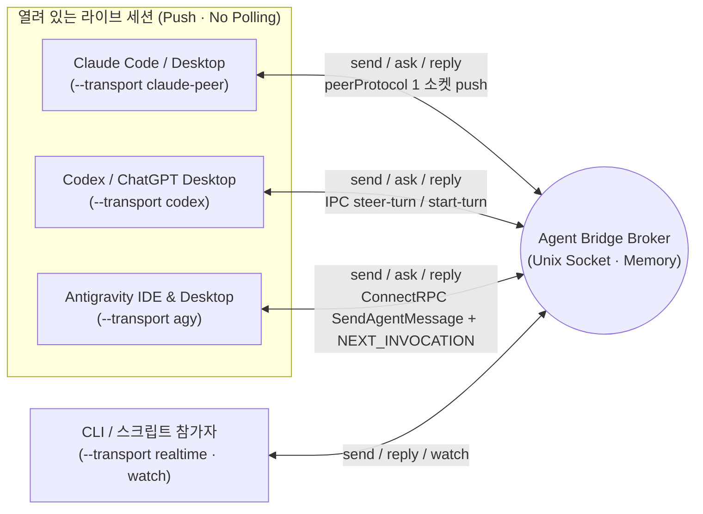

# Agent Bridge

[English](../../README.md) | **한국어**

같은 머신에서 실행 중인 **Claude Code / Desktop (`claude-peer`) ↔ Codex / ChatGPT Desktop (`codex`) ↔ Antigravity IDE / Desktop (`agy`)** 및 로컬 CLI 에이전트(`realtime`/`claude`)의 세션을 조회하고, 프로젝트 채널을 통해 **기존 대화를 중단하지 않으면서 3자간(다자간) 실시간 질문·답변·진행 상황**을 주고받는 로컬 브릿지 도구다. Python 표준 라이브러리만 사용하며 메시지·전달 상태는 메모리에 유지하고, endpoint·채널 바인딩만 소유자 전용 파일에 저장한다.

- [스킬 진입점 (한국어)](SKILL.md) · [English](../../skill/agent-bridge/SKILL.md)
- [명령·운영 사용법 (한국어)](usage.md) · [English](../../skill/agent-bridge/references/usage.md)
- [Antigravity 내부 커맨드 레퍼런스](antigravity-commands.md)
- 실행 코드 정본: [`skill/agent-bridge/scripts/`](../../skill/agent-bridge/scripts/)

루트의 `bridge.py`, `broker.py`, `sessions.py`는 기존 명령 호환을 위한 심볼릭 링크다. 실제 코드는 `skill/agent-bridge/` 폴더 안에 한 벌만 유지한다.

## 3자간 라이브 세션 소통 구조 (v2)

초기에는 IDE 익스텐션이나 데스크톱과 별도 CLI 프로세스 간의 소켓 구독(`watch`)을 위해 시작했으나, 현재(v2)는 **Claude · Codex Desktop · Antigravity(IDE 및 Desktop) 3대 환경 모두 별도의 익스텐션, CLI 사본, 폴링 루프 없이 열려 있는 라이브 대화에 직접 push**한다.



| 대상 환경 | Transport | 세션 탐색 (`sessions`) | 전달 및 활성 턴 합류 방식 (비파괴 · No Interrupt) |
| --- | --- | --- | --- |
| **Claude Code / Desktop** | `claude-peer` | `~/.claude/sessions/<pid>.json` (`peerProtocol == 1`) | 수신 세션의 메시징 소켓에 `auth` + `user`(`priority: next`) 프레임을 직접 기록해 다음 스텝에 주입. 앱의 `claude://code/new` 링크로 Claude Code 데스크톱 신규 세션 열기(`open --provider claude --cwd PATH` 또는 `register --transport claude-peer --new --cwd PATH`)도 지원 — 미리 채워진 입력창에서 사람이 Enter를 누르면 세션이 시작된다 |
| **Codex / ChatGPT Desktop** | `codex` | `codex app-server` 메타데이터 및 `~/.codex/ipc/ipc.sock` | 활성 턴이면 `thread-follower-steer-turn`(standalone `toolOutput`)으로 현재 턴에 합류, 유휴 상태면 `thread-follower-start-turn`으로 턴 시작 |
| **Antigravity IDE & Desktop** | `agy` | 로컬 `language_server` ConnectRPC (`--app_data_dir antigravity-ide` 및 `antigravity`, `GetAllCascadeTrajectories`) | `--enable_lsp` LSP 워커를 자동 제외하고 Antigravity IDE(`Antigravity IDE live trajectory registry`)와 Agent Manager/Desktop(`Antigravity desktop live trajectory registry`) 세션을 동시에 탐색. Antigravity 데스크톱 신규 세션 생성(`open --cwd PATH` 또는 `register --transport agy --new --cwd PATH`)도 지원. `SendAgentMessage`(`MESSAGE_PRIORITY_HIGH`)로 `<SYSTEM_MESSAGE>` 주입 후, 유휴/백그라운드 대기 시 빈 `SendUserCascadeMessage`(`NEXT_INVOCATION`)로 즉시 깨움 |
| **전용 CLI / 실시간 소켓** | `realtime` / `claude` | 브로커 소켓 또는 `claude agents --json --all` | `realtime`은 `watch` 스트림 구독, `claude`는 유휴 전용 CLI 세션 읽기 전용 `--resume` |

어느 에이전트에서든 `send`·`ask`·`reply`를 호출하면 상대방의 등록된 transport에 맞춰 해당 라이브 세션으로 즉시 들어간다. 다른 세션에서는 `bridge.py sessions --provider agy`로 열려 있는 Antigravity IDE·데스크톱 세션을 찾고, `bridge.py routes --project PROJECT`·`bridge.py channels --project PROJECT`로 등록된 라우트/채널을 확인한 뒤 `--transport agy --session UUID --discover`로 연결하거나, `bridge.py register NAME --project PROJECT --transport agy --new --cwd /path/to/workspace [--title TITLE] [--model MODEL]`로 새 Antigravity 데스크톱 세션을 즉시 생성·등록해 실시간 티키타카를 주고받는다. Claude Code 데스크톱도 `--transport claude-peer`로 같은 `--new`를 쓴다: `bridge.py register NAME --project PROJECT --transport claude-peer --new --cwd /path/to/workspace [--title 첫_메시지] [--timeout 초]`는 그 폴더의 새 세션 입력창을 첫 메시지가 채워진 채로 열고, 사람이 Enter를 누르면(앱이 묻는 경우 폴더 신뢰도) 새 라이브 세션을 등록한다.

## 전역 스킬 연결

로컬 환경에서는 아래 네 경로를 동일한 `skill/agent-bridge` 폴더로 심볼릭 링크해 공용으로 사용할 수 있다.

- 공용 탐색·실행 경로: `~/.agents/skills/agent-bridge`
- Codex: `~/.codex/skills/agent-bridge` (`$agent-bridge`)
- Claude Code: `~/.claude/skills/agent-bridge` (`/agent-bridge`)
- Antigravity (AGY): `~/.gemini/config/skills/agent-bridge` (`agent-bridge` 스킬)

별도 실행 권한이나 자동 발신 권한을 추가하지 않는다. 스킬만 다른 곳에 설치할 때도 폴더 안의 스크립트와 참조 문서를 함께 유지한다.

```bash
python3 ~/.agents/skills/agent-bridge/scripts/bridge.py --help
python3 ~/.agents/skills/agent-bridge/scripts/bridge.py sessions --provider all
python3 ~/.agents/skills/agent-bridge/scripts/bridge.py sessions --provider agy
```

심볼릭 링크 설치이므로 저장소 위치를 옮기면 네 링크도 갱신해야 한다. 재시작하면 메시지·중복 방지 키·이벤트는 사라지고, endpoint·채널은 정확한 세션·작업 경로를 재검증해 복원한다. 사용할 수 없는 라이브 바인딩은 제거한다. 전역 스킬 설치가 브로커를 자동 기동하거나 AI 대화를 깨우지는 않는다.

## 보존 상한·재시작·선택적 서비스

`serve --max-messages 2048`은 메시지 보존 개수다. 상한에서는 보호되지 않은 `done`·`answered`·`failed` 중 가장 오래된 항목을 제거한다. `submitted`·`uncertain`은 완료가 아니며, 미처리·보호 항목만 남으면 새 전송·답변을 거부한다. 제거 시 중복 방지 키도 사라지므로 자동 재전송하지 않는다.

`serve --state-dir PATH`는 endpoint·채널만 저장한다(기본: 소켓 확장자를 `.state`로 바꾼 디렉터리). `stop`·Ctrl-C·SIGTERM은 열린 클라이언트도 닫는다. 재시작 시 진행 중 메시지 ID는 복원하지 않고 재시도도 없다.

서비스는 명시적 `install-service`로 설치한다. `install-service --generate-only --plist /absolute/review/agent.plist`와 `plutil -lint /absolute/review/agent.plist`는 서비스 로드 없이 검토한다. KeepAlive는 `stop` 뒤에도 다시 기동하므로 계속 중지하려면 `uninstall-service`로 제거한다. 자세한 경로·복원·운영 계약은 [사용법](usage.md#라우팅-저장과-선택적-launchd)을 읽는다.

## 개발·검증

```bash
python3 -m unittest discover -s tests -v
```

테스트는 실제 Unix 소켓, 별도 CLI 프로세스, 그리고 Claude·Codex·Antigravity 프로토콜 스텁 서버로 협업 및 비파괴 전달 흐름을 검증한다. 코드 수정은 `skill/agent-bridge/` 폴더의 정본에서 하며 스크립트를 따로 복제하지 않는다.

Codex도 `open --provider codex --cwd PATH` 또는 `register --transport codex --new --cwd PATH`로 사람의 UI 조작 없이 새 대화를 만들고 정확한 Desktop 소유자를 확인해 등록한다. `--title`은 실제 제목이며 `--model`을 명시하면 그 소유자의 설정까지 일치를 검증한다. 새 Codex 대화는 항상 Full Access(`:danger-full-access`)·`approvalPolicy: never`로 생성하고 앱 인계 뒤 다음 턴 설정도 검증한다. 프로필이 없거나 허용되지 않으면 생성 전에 실패하며 기존 세션·전역 설정은 바꾸지 않는다. 생성·인계 뒤 실패해도 UUID와 상태를 보존하고 자동 재생성하지 않는다. [자세한 계약](usage.md#codex-desktop-세션-자동-생성)을 참고한다.
