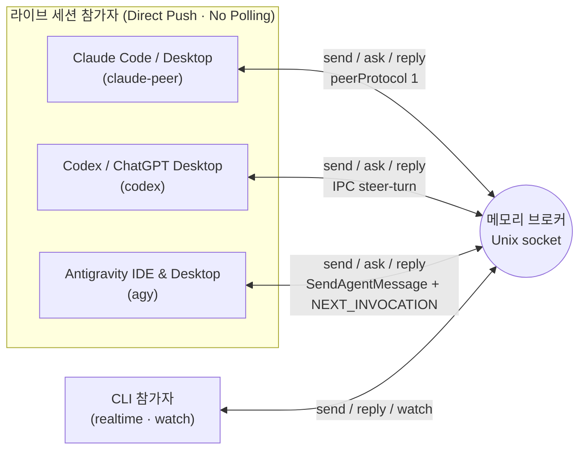

<p align="center">
  
</p>

<p align="center">
  
  
  
  
</p>

<p align="center">
  <a href="../../README.md">English</a> · <strong>한국어</strong>
</p>

같은 머신의 **Claude Code / Desktop (`claude-peer`) ↔ Codex / ChatGPT Desktop (`codex`) ↔ Antigravity IDE / Desktop (`agy`)** 및 CLI 참가자(`realtime`/`claude`)가 실시간으로 질문·답변·진행 상황을 주고받는 로컬 브릿지다. Python 3.10+ 표준 라이브러리와 Unix 도메인 소켓만 사용하며 외부 패키지, API 키, 네트워크 포트가 필요 없다.

별도의 CLI 사본을 중복 실행하거나 라이브 세션을 `watch` 폴링 루프에 가두지 않고, 열려 있는 상대 세션으로 메시지를 직접 push해 진행 중인 작업을 중단하지 않으면서 다자간 협업을 수행한다.

## 문서 구성

| 대상 | English | 한국어 |
| --- | --- | --- |
| 개요 및 빠른 시작 | [README.md](../../README.md) | [docs/ko/README.md](README.md) |
| 에이전트 스킬 지침 | [skill/agent-bridge/SKILL.md](../../skill/agent-bridge/SKILL.md) | [docs/ko/SKILL.md](SKILL.md) |
| 상세 CLI 및 프로토콜 레퍼런스 | [skill/agent-bridge/references/usage.md](../../skill/agent-bridge/references/usage.md) | [docs/ko/usage.md](usage.md) |
| MCP Phase 1 명세 | [skill/agent-bridge/references/mcp-phase1.md](../../skill/agent-bridge/references/mcp-phase1.md) | — |
| Antigravity IDE 내부 명령어 | — | [docs/ko/antigravity-commands.md](antigravity-commands.md) |

## 아키텍처 및 전송 방식



| 환경 | Transport | 전달 메커니즘 |
| --- | --- | --- |
| **Claude Code / Desktop** | `claude-peer` | 살아 있는 세션의 메시징 소켓(`peerProtocol 1`)으로 직접 주입해 별도 CLI 프로세스를 띄우지 않고 다음 턴에 전달한다. |
| **Codex / ChatGPT Desktop** | `codex` | `CODEX_HOME/ipc/ipc.sock`의 정확한 대화 소유자에 연결해 활성 턴이면 `thread-follower-steer-turn`(`toolOutput`)으로 합류하고, 유휴 상태면 새 턴을 시작한다. |
| **Antigravity IDE & Desktop** | `agy` | 로컬 `language_server` / `agy --hub`의 ConnectRPC에 연결해 활성 턴에는 `<SYSTEM_MESSAGE>`(`SendAgentMessage`)로 합류하고, 유휴/대기 상태에는 빈 `SendUserCascadeMessage`(`NEXT_INVOCATION`)로 즉시 깨운다. |
| **CLI 워커** | `realtime` / `claude` | `realtime`은 `watch`로 JSONL 이벤트를 구독한다. `claude`는 **쉬고 있는 전용 CLI 세션**만 `deliver` 시 읽기 전용 `plan` 모드로 `--resume`한다(라이브 세션에는 절대 사용하지 않는다). |

## 글로벌 스킬 설치

Claude Code, Codex, Antigravity가 동일한 브릿지 CLI를 참조하도록 글로벌 스킬 경로에 심볼릭 링크를 연결한다.

```bash
mkdir -p ~/.agents/skills ~/.claude/skills ~/.gemini/config/skills
ln -sfn "$(pwd)/skill/agent-bridge" ~/.agents/skills/agent-bridge
ln -sfn "$(pwd)/skill/agent-bridge" ~/.claude/skills/agent-bridge
ln -sfn "$(pwd)/skill/agent-bridge" ~/.gemini/config/skills/agent-bridge
```

## 빠른 시작

```bash
bridge_cli="$HOME/.agents/skills/agent-bridge/scripts/bridge.py"

# 1. 브로커 상태 확인 및 기동 (기본 소켓: ~/.local/share/agent-bridge/bridge.sock)
python3 "$bridge_cli" ping || python3 "$bridge_cli" serve

# 2. 열려 있는 Claude · Codex · Antigravity 세션 조회
python3 "$bridge_cli" sessions --cwd /path/to/workspace

# 3. 기존 라이브 세션을 정확한 UUID로 등록
python3 "$bridge_cli" register claude-main --project my-app --transport claude-peer \
  --session CLAUDE_UUID --discover
python3 "$bridge_cli" register codex-main --project my-app --transport codex \
  --session CODEX_UUID --discover
python3 "$bridge_cli" register agy-main --project my-app --transport agy \
  --session AGY_UUID --discover

# 4. 또는 새 라이브 세션을 열면서 즉시 등록
python3 "$bridge_cli" register agy-worker --project my-app --transport agy \
  --new --cwd /path/to/workspace --title "Worker"

# 5. 역할 채널 바인딩 및 질문·답변 교환
python3 "$bridge_cli" channel-bind logic --project my-app --owner claude-main
python3 "$bridge_cli" channel-bind view --project my-app --owner agy-main

python3 "$bridge_cli" ask --project my-app --from-channel logic --channel view \
  --key req-001 --file /path/to/request.txt --timeout 60
python3 "$bridge_cli" reply MESSAGE_ID --key reply-001 --file /path/to/answer.txt
```

## 핵심 기능

### 1. 세션 생명주기 (`sessions`, `open`, `register --new`, `close`)

| 공급자 | 데스크톱 세션 열기 | IDE 세션 열기 (`--host ide`) | 세션 닫기 (`bridge.py close NAME --project P`) |
| --- | --- | --- | --- |
| **Antigravity (`agy`)** | 데스크톱 `language_server`(`StartCascade`)로 자동 생성 및 프로젝트 연결 | IDE `agy --hub`(`workspaceUris`)로 자동 생성 | 대기 중일 때 보관(`{archived: true}`) 처리 후 라우트 제거 |
| **Claude (`claude-peer`)** | `claude://code/new`로 첫 메시지를 채운 입력창을 열고 사용자의 Enter 대기 | IDE CLI + `<scheme>://anthropic.claude-code/open`으로 무인 생성 | 해당 CLI 프로세스에 `SIGTERM`(`resumable: true`) 전송 후 라우트 제거 |
| **Codex (`codex`)** | `app-server --stdio` 생성 후 `codex://threads/UUID`로 데스크톱 자동 인계 (`:danger-full-access`, `approvalPolicy: never`) | 미지원 | `unsupported` (데스크톱 IPC에 외부 보관/언로드 명령 없음) |

```bash
# 단독 생성 또는 생성과 동시에 브로커 등록:
python3 "$bridge_cli" open --provider agy --host ide --cwd /path/to/workspace --title "Worker"
python3 "$bridge_cli" register codex-worker --project my-app --transport codex \
  --new --cwd /path/to/workspace --title "Worker" --model gpt-6.1-sol

# 작업이 끝난 워커 세션 닫기 및 라우트 해제:
python3 "$bridge_cli" close agy-worker --project my-app
```

### 2. 모델 조회·전환 및 정책 (`model`, `policy`)

공급자 중립 인터페이스로 세션의 모델을 실시간 조회·전환하며, `<state-dir>/policy.json` 정책(기본 시드 거부 목록은 Codex의 `gpt-6-astra` 차단)을 강제한다.

```bash
python3 "$bridge_cli" model NAME --project my-app              # 현재 모델 조회
python3 "$bridge_cli" model NAME --project my-app --set MODEL  # 모델 전환 후 재조회 검증
python3 "$bridge_cli" policy                                   # 적용 중인 기본값 및 거부 목록 확인
```

- **Antigravity (`agy`)**: 마지막 generator의 `plannerConfig`에서 모델을 읽는다. 대기 중 전환 시 기존 플래너 설정(`knowledgeConfig` 등)을 유지한 채 `requestedModel`만 바꿔 1회 호출로 적용한다.
- **Codex (`codex`)**: 정확한 데스크톱 소유자의 다음 턴 모델 설정을 읽고 `thread-follower-update-thread-settings`로 전환 후 재조회로 검증한다.
- **Claude (`claude-peer`)**: 대화 기록의 최신 assistant 메시지에서 모델을 읽는다. 데스크톱 세션 전환은 `policy.json`에 지정된 `command_post` 세션을 통해 `set_session_model`을 중계하며, IDE 세션 전환은 `unsupported`(IDE 모델 선택기 사용)다.

### 3. 구독 한도 및 위험도 모니터링 (`usage`)

브로커는 백그라운드에서 구독 한도를 수집해 `<state-dir>/usage.jsonl`에 기록한다. `codex`나 `agy` 경로를 거치는 모든 `send`·`ask`·`reply` 결과에는 `usage` 상태(`ok`, `at_risk`, `exhausted`, `unknown`)가 함께 반환되어 한도 고갈 전에 작업 속도를 조절할 수 있다.

```bash
python3 "$bridge_cli" usage                        # 전체 공급자(Codex + Antigravity) 버킷 한도 및 소모율 출력
python3 "$bridge_cli" usage --provider agy --json  # Antigravity 버킷(agy/gemini, agy/partner) JSON 조회
python3 "$bridge_cli" usage --events               # 리셋 이력, spend horizon 및 stop-risk horizon 확인
```

### 4. 에이전트 워크트리 (`wt`)

메인 저장소 체크아웃은 항상 `main`으로 유지하고, 각 에이전트의 코드 작업은 `<workspace>/.worktrees/<repo>/<agent>-<issue>` 아래 격리된 워크트리에서 수행한다.

```bash
python3 "$bridge_cli" wt new . jinni 42 --slug fix-bug --provider agy --session UUID
python3 "$bridge_cli" wt list --text
python3 "$bridge_cli" wt sweep          # 머지 완료 및 소유 세션이 종료된 워크트리 정리 대상 확인 (dry-run)
python3 "$bridge_cli" wt sweep --apply  # 대상 워크트리 및 브랜치 실제 제거
```

### 5. 라우팅 영속화 및 선택적 `launchd` 서비스

- **메모리 기반 메시지, 소유자 전용 라우팅 스냅샷**: 엔드포인트와 채널 바인딩만 `<state-dir>/routes.json`(`0600`)에 저장된다. 메시지 본문, 전달 상태, 중복 방지 키, 토큰, 이벤트 이력은 메모리에만 머물며 브로커 재시작 시 초기화된 뒤 유효한 라우트만 재검증해 복원한다.
- **선택적 macOS `launchd` 관리**: 자동 기동 서비스는 기본 꺼짐 상태다. `install-service`(검토용 파일 생성은 `--generate-only --plist PATH`)와 `uninstall-service`로 `KeepAlive` 에이전트를 관리한다.

### 6. MCP 파사드 (`mcp_server.py`)

`skill/agent-bridge/scripts/mcp_server.py`는 MCP 클라이언트에 브릿지를 노출한다(`stdio` 또는 `127.0.0.1` 전용 `--http PORT`).

- **기본값 (`connectivity_only`)**: 브로커에 `ping` 한 번만 보내는 읽기 전용 `bridge_status` 도구 하나만 노출한다.
- **Phase 1 (명시적 Opt-In)**: 세션 생성·메시지 전송 도구 및 독립 수신함(`inbox_enabled: true`)은 소유자가 승인한 비공개 `--phase1-config /absolute/private.json`을 `stdio`로 실행할 때만 활성화된다. 자세한 계약은 [mcp-phase1.md](../../skill/agent-bridge/references/mcp-phase1.md)를 참고한다.

## 개발 및 검증

변경 사항을 커밋하기 전에 전체 단위·통합 테스트 스위트를 실행해 검증한다.

```bash
python3 -m unittest discover -s tests -v
```

## 라이선스

[MIT](../../LICENSE.md)
