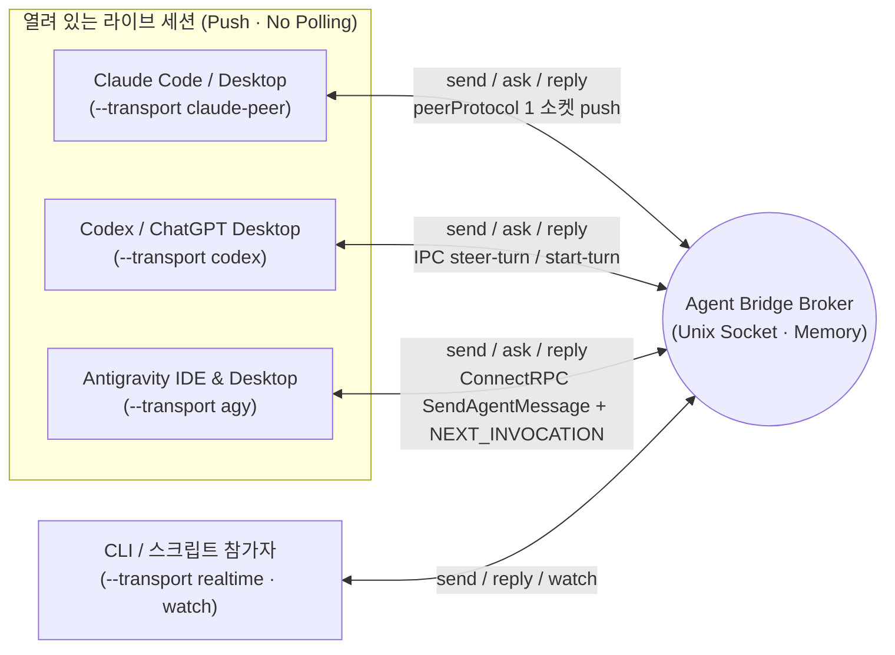

# Agent Bridge

[English](../../README.md) | **한국어**

같은 머신에서 실행 중인 **Claude Code / Desktop (`claude-peer`) ↔ Codex / ChatGPT Desktop (`codex`) ↔ Antigravity IDE / Desktop (`agy`)** 및 로컬 CLI 에이전트(`realtime`/`claude`)의 세션을 조회하고, 프로젝트 채널을 통해 **기존 대화를 중단하지 않으면서 3자간(다자간) 실시간 질문·답변·진행 상황**을 주고받는 로컬 브릿지 도구다. Python 표준 라이브러리만 사용하며 상태는 브로커 메모리에만 유지한다.

- [스킬 진입점 (한국어)](SKILL.md) · [English](../../skill/agent-bridge/SKILL.md)
- [명령·운영 사용법 (한국어)](usage.md) · [English](../../skill/agent-bridge/references/usage.md)
- [Antigravity 내부 커맨드 레퍼런스](antigravity-commands.md)
- 실행 코드 정본: [`skill/agent-bridge/scripts/`](../../skill/agent-bridge/scripts/)

루트의 `bridge.py`, `broker.py`, `sessions.py`는 기존 명령 호환을 위한 심볼릭 링크다. 실제 코드는 `skill/agent-bridge/` 폴더 안에 한 벌만 유지한다.

## 3자간 라이브 세션 소통 구조 (v2)

초기에는 IDE 익스텐션이나 데스크톱과 별도 CLI 프로세스 간의 소켓 구독(`watch`)을 위해 시작했으나, 현재(v2)는 **Claude · Codex Desktop · Antigravity(IDE 및 Desktop) 3대 환경 모두 별도의 익스텐션, CLI 사본, 폴링 루프 없이 열려 있는 라이브 대화에 직접 push**한다.



| 대상 환경 | Transport | 세션 탐색 (`sessions`) | 전달 및 활성 턴 합류 방식 (비파괴 · No Interrupt) |
| --- | --- | --- | --- |
| **Claude Code / Desktop** | `claude-peer` | `~/.claude/sessions/<pid>.json` (`peerProtocol == 1`) | 수신 세션의 메시징 소켓에 `auth` + `user`(`priority: next`) 프레임을 직접 기록해 다음 스텝에 주입 |
| **Codex / ChatGPT Desktop** | `codex` | `codex app-server` 메타데이터 및 `~/.codex/ipc/ipc.sock` | 활성 턴이면 `thread-follower-steer-turn`(standalone `toolOutput`)으로 현재 턴에 합류, 유휴 상태면 `thread-follower-start-turn`으로 턴 시작 |
| **Antigravity IDE & Desktop** | `agy` | 로컬 `language_server` ConnectRPC (`--app_data_dir antigravity-ide` 및 `antigravity`, `GetAllCascadeTrajectories`) | `--enable_lsp` LSP 워커를 자동 제외하고 Antigravity IDE(`Antigravity IDE live trajectory registry`)와 Agent Manager/Desktop(`Antigravity desktop live trajectory registry`) 세션을 동시에 탐색. `SendAgentMessage`(`MESSAGE_PRIORITY_HIGH`)로 `<SYSTEM_MESSAGE>` 주입 후, 유휴/백그라운드 대기 시 빈 `SendUserCascadeMessage`(`NEXT_INVOCATION`)로 즉시 깨움 |
| **전용 CLI / 실시간 소켓** | `realtime` / `claude` | 브로커 소켓 또는 `claude agents --json --all` | `realtime`은 `watch` 스트림 구독, `claude`는 유휴 전용 CLI 세션 읽기 전용 `--resume` |

어느 에이전트에서든 `send`·`ask`·`reply`를 호출하면 상대방의 등록된 transport에 맞춰 해당 라이브 세션으로 즉시 들어간다. 다른 세션에서는 `bridge.py sessions --provider agy`로 열려 있는 Antigravity IDE·데스크톱 세션을 찾고, `bridge.py routes --project PROJECT`·`bridge.py channels --project PROJECT`로 등록된 라우트/채널을 확인한 뒤 `--transport agy --session UUID --discover`로 연결해 실시간 티키타카를 주고받는다.

## 전역 스킬 연결

로컬 환경에서는 아래 네 경로를 동일한 `skill/agent-bridge` 폴더로 심볼릭 링크해 공용으로 사용할 수 있다.

- 공용 탐색·실행 경로: `~/.agents/skills/agent-bridge`
- Codex: `~/.codex/skills/agent-bridge` (`$agent-bridge`)
- Claude Code: `~/.claude/skills/agent-bridge` (`/agent-bridge`)
- Antigravity (AGY): `~/.gemini/config/skills/agent-bridge` (`agent-bridge` 스킬)

별도 실행 권한이나 자동 발신 권한을 추가하지 않는다. 스킬만 다른 곳에 설치할 때도 폴더 안의 스크립트와 참조 문서를 함께 유지한다.

```bash
python3 ~/.agents/skills/agent-bridge/scripts/bridge.py --help
python3 ~/.agents/skills/agent-bridge/scripts/bridge.py sessions --provider all
python3 ~/.agents/skills/agent-bridge/scripts/bridge.py sessions --provider agy
```

심볼릭 링크 설치이므로 저장소 위치를 옮기면 네 링크도 갱신해야 한다. 브로커를 재시작하면 메모리 상태가 사라진다. 전역 스킬 설치가 브로커를 자동 기동하거나 AI 대화를 깨우지는 않는다.

## 개발·검증

```bash
python3 -m unittest discover -s tests -v
```

테스트는 실제 Unix 소켓, 별도 CLI 프로세스, 그리고 Claude·Codex·Antigravity 프로토콜 스텁 서버로 협업 및 비파괴 전달 흐름을 검증한다. 코드 수정은 `skill/agent-bridge/` 폴더의 정본에서 하며 스크립트를 따로 복제하지 않는다.
