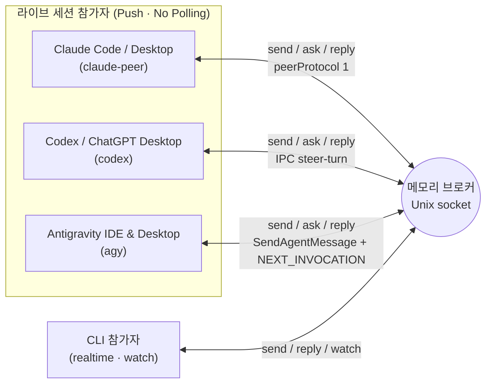

# Agent Bridge 사용법 (한국어)

[English](../../skill/agent-bridge/references/usage.md) | **한국어**

에이전트끼리 실시간으로 질문과 답변을 주고받는 로컬 CLI. Python 3.10 이상, 표준 라이브러리만 사용한다. macOS/Linux의 Unix 도메인 소켓으로 연결하며 외부 패키지, API 키, 네트워크 포트가 필요 없다.

브로커는 소유자 전용 라우팅 파일(`routes.json`)과 상한이 있는 우편 체크포인트(`correspondence.json`)를 쓴다. 재시작하면 받아 둔 메시지와 전달 상태를 복원하되 전달을 재생하지 않는다. 자격 증명·서명 토큰·공급자 진단·이벤트 스트림은 메모리에만 둔다. 저장 필드와 손상 복구는 [영문 usage.md의 Correspondence storage (issue #94)](../../skill/agent-bridge/references/usage.md#correspondence-storage-issue-94)를 따른다.

## 등록 이름 보호

`register`는 `(project, name)`을 보호한다. 다른 transport·세션 UUID·정규화된 작업 경로로 덮어쓰려 하면 `Route name is already in use; use a different name`으로 거절한다. 프로젝트가 다르면 같은 이름을 쓸 수 있다. 동일 바인딩 재시도는 파일을 다시 쓰지 않고 기존 경로를 반환한다. `--executable`을 생략하면 기존 값을 유지하며, 명시적으로 다른 실행 파일을 지정해도 거절한다. 채널과 기존 메시지의 고정 경로는 유지된다.

새 세션 등록 명령은 세션을 열기 전에 이름 점유를 확인하고, 브로커는 최종 등록 시 원자적으로 다시 검사한다. Codex 결과에서 확정된 최종 충돌은 생성된 세션을 보존한 채 `registered: false`, `uncertain: false`로 보고하고, 불명확한 등록 쓰기는 uncertain으로 남긴다. 등록을 자동으로 제거하거나 다시 시도하지 않는다. 이 보호에는 업데이트된 브로커가 필요하며, 클라이언트 사전 확인은 이름 예약이 아니다.

## 연결 구조



브로커 수신과 AI 모델의 실제 처리 완료를 구분한다. `watch`는 연결된 CLI에 이벤트를 출력할 뿐 실행 중인 대화에 새 턴을 주입하지 않는다. 살아 있는 Claude·Codex·Antigravity(IDE 및 Desktop) 라이브 세션은 각각 `claude-peer`, `codex`, `agy`로 등록해 **상대방의 활성 턴이나 유휴 대화에 직접 push**한다. 라이브 세션에서 `watch` 폴링 루프를 돌리는 것은 안티패턴이며, `watch`는 `realtime` CLI 워커용으로만 사용한다.

## 시작

터미널 하나에서 브로커를 실행한다. 기본 주소는 `~/.local/share/agent-bridge/bridge.sock`(`0600`)이다.

```bash
bridge_cli="$HOME/.agents/skills/agent-bridge/scripts/bridge.py"
python3 "$bridge_cli" serve
```

참가자(Claude · Codex · Antigravity 또는 CLI)를 등록하고 작업 채널을 연결한다.

```bash
python3 "$bridge_cli" register codex-agent --project my-app --transport codex --session CODEX_UUID --discover
python3 "$bridge_cli" register claude-agent --project my-app --transport claude-peer --session CLAUDE_UUID --discover
python3 "$bridge_cli" register agy-agent --project my-app --transport agy --session AGY_UUID --discover

python3 "$bridge_cli" channel-bind modal-view --project my-app --owner codex-agent --description '모달 UI·반응형 담당'
python3 "$bridge_cli" channel-bind game-logic --project my-app --owner claude-agent --description '게임 규칙·상태 계약 담당'
python3 "$bridge_cli" channel-bind motion-rig --project my-app --owner agy-agent --description '리깅·렌더 검증 담당'
python3 "$bridge_cli" channels --project my-app
python3 "$bridge_cli" ping
```

`channels`에는 담당자, 역할, 세션, 세대 번호와 현재 구독 연결 수가 나온다. 구독자 수는 AI 모델이 작업 중이라는 뜻이 아니며, `active`는 채널이 새 요청을 받도록 열려 있다는 뜻이다.

같은 소켓을 쓰는 두 브로커가 동시에 뜨지 않도록 프로세스 잠금을 사용한다. `stop` 또는 `Ctrl-C`로 종료한다.

```bash
python3 "$bridge_cli" stop
```

격리 인스턴스는 모든 명령에 명시적 임시 `--socket`을 주고 서버에 `serve --state-dir /absolute/private/state`를 지정한다. 테스트를 위해 공유 브로커를 멈추지 않는다.

## 실시간 티키타카

`claude-peer`·`codex`·`agy`로 등록된 라이브 세션은 별도 구독 없이 `send`·`ask`·`reply` 시점에 즉시 상대 세션으로 push된다. `realtime` 참가자는 먼저 채널에 `watch`를 연결해 새 메시지와 상태 변경을 JSON Lines로 받는다(초기 `subscribed` 이벤트가 나오면 준비된 상태다).

```bash
python3 "$bridge_cli" watch --project my-app --channel modal-view
```

발신 측에서 질문한다(`ask`는 요청 ID를 먼저 출력하고 답변을 기다린다):

```bash
python3 "$bridge_cli" ask --project my-app --from-channel game-logic --channel modal-view \
  --key hp-contract-001 --file - --timeout 60 <<'MESSAGE'
체력 상태 계약을 검토해 주세요.
프로젝트 지침을 따르고, 이번 요청에서는 코드 수정 없이 표시 측 요구사항을 답해 주세요.
MESSAGE
```

수신 측은 다른 CLI 호출로 같은 요청 ID에 답한다:

```bash
python3 "$bridge_cli" ack REQUEST_ID
python3 "$bridge_cli" progress REQUEST_ID --note '화면 표시 조건 확인 중'
python3 "$bridge_cli" reply REQUEST_ID --key hp-contract-response-001 --file - <<'MESSAGE'
현재값과 최대값이 필요하고, 변경 이벤트 한 번으로 표시를 갱신하면 됩니다.
MESSAGE
```

- `ack`는 `received`, `progress`는 `in_progress` 상태를 알린다. 답변으로 계산하지 않으며 자동 응답도 만들지 않는다.
- `reply`는 질문에 고정된 답장 주소를 사용한다. 답장 ID에 다시 reply하면 같은 `conversation` 안에서 협의를 이어간다.
- `send`는 `ask`와 같은 인수를 받되 기다리지 않는다. 전송 후 `wait REQUEST_ID --timeout 60`으로 답변을 기다릴 수 있다.
- `ask`/`wait`의 시간 초과는 종료 코드 2(`timed_out: true`)다. 질문 취소가 아니므로 같은 ID로 다시 `wait`하면 늦은 답변을 받을 수 있다.
- 같은 메시지를 다시 보내야 할 때는 같은 `--key`를 사용한다. 중복키는 메시지 또는 선택적 축약 영수증이 보존되는 동안 재시작 뒤에도 유지된다.
- 브로커가 보존 중인 메시지 목록과 대화 이력은 `inbox`, `show`, `conversation`으로 확인한다:

```bash
python3 "$bridge_cli" inbox --project my-app --channel modal-view
python3 "$bridge_cli" show REQUEST_ID
python3 "$bridge_cli" conversation REQUEST_ID
```

## 끊김, 보존 상한과 재연결

`watch` 이벤트에는 브로커 `instance`와 증가하는 `seq`가 있다. 마지막으로 처리한 이벤트 번호를 이용해 같은 브로커 실행 내에서 재연결한다:

```bash
python3 "$bridge_cli" watch --project my-app --channel modal-view \
  --instance BROKER_INSTANCE_UUID --after LAST_PROCESSED_SEQ
```

- **이벤트 창**: 최근 1,024개 이벤트를 메모리에 유지한다. 범위를 벗어난 커서나 재시작 전 `instance`는 거부되며, 이때는 `channels`와 `inbox`를 다시 확인한다.
- **메시지 크기 및 보존 상한**: 한 메시지는 UTF-8 32 KiB까지다. `serve --max-messages 2048`은 메시지 보존 상한이다. TTL을 끈 경우 상한 도달 시 보호되지 않은 종료 항목(`done`, `answered`, `failed`) 중 가장 오래된 것을 제거한다.
- **TTL을 끈 경우의 보호 대상**: `pending`·`dispatching`·`submitted`·`received`·`in_progress`·`uncertain`은 미완료 상태라 제거하지 않는다. 현재 답변의 부모, 실행 중인 `wait`, 미완료 또는 대기 중인 부모에게 필요한 종료 답변도 보호된다. 제거 후보가 없으면 `In-memory message limit reached: no evictable terminal messages`로 새 전송을 거부한다.

## 선택적 메시지 TTL (issue #105)

`serve --retention-ttl`로 명시적으로 켤 때만 TTL 보존 정책을 적용한다. 플래그를 생략하면 기존 보존 정책을 유지한다. 전달 상태와 명시적 단방향 메시지·요청의 수명을 따로 관리하며, `submitted`·`received` 항목은 기존·신규 여부나 ACK 여부와 관계없이 `created`부터 24시간 뒤 제거한다. 보존 기한이며 작업 완료 판정은 아니다.

- `send --one-way`는 답장을 기대하지 않는 단방향 메시지라고 명시한다. `send`와 `ask`는 `--reply-deadline SECONDS`(0보다 크고 최대 604800초)도 받으며 `--one-way`와 함께 쓸 수 없다. 이 기한은 `ask`/`wait --timeout`과 별개다. 로컬 대기 시간이 끝나도 요청을 취소하지 않는다.
- 기한 지정은 TTL을 켜거나 꺼도 동작한다. 명시적 요청은 `request_status`(`open`·`answered`·`completed`·`expired`), `reply_deadline_at`(epoch 초), `late_reply`를 표시한다. 만료돼도 전달 상태는 유지한다. 만료된 pending 요청은 전달 claim을 거부하고 그 사유를 표시한다. 요청이 남아 있는 동안 늦은 답장은 원래 고정된 답장 주소로 보내며 요청은 만료 상태로 남는다. 완전히 제거된 뒤에는 그 ID로 늦은 답장을 연결할 수 없다.
- 제거 조건을 충족한 명시적 단방향 메시지·완료 메시지의 본문 TTL은 24시간이다. 단방향 메시지는 전달이 확인된 시점부터, 완료 메시지는 완료 시점부터 계산한다. `submitted`·`received` 항목은 별도의 생성 시각 규칙으로 완전히 제거하며, 이 규칙은 단방향·답장 기한에 따른 본문 축약보다 우선한다. 조회·중복 방지용 축약 영수증은 원래 식별자와 고정 주소를 `compacted_at`부터 7일간 보존하며 별도 상한은 8192개다. 연결된 하위 메시지나 대기가 활성 상태면 축약 영수증을 7일보다 오래 보호할 수 있다. 축약 항목 조회는 `body_expired: true`, 빈 `body`, `body_sha256`·`body_chars`·`body_bytes`·`body_ttl_anchor_at`·`compacted_at`·`lookup_expires_at`을 반환한다. 원문을 복구하는 기능은 아니다.

완전 제거는 활성 항목과 연결된 중복키를 지운다. 축약 영수증을 남기지 않아 축약 영수증 상한을 차지하지 않는다. 이후 그 ID로 조회하거나 답장을 연결할 수 없다. 같은 키를 쓰면 새 메시지가 생길 수 있으므로 기록이 없다는 이유로 불명확한 전달을 다시 보내지 않는다. 현재 저장 중인 답장의 정확한 부모, 해당 항목이나 답장 부모의 실제 활성 대기, 재시도 안전성에 필요한 미복구 공급자 제어·원본 참조는 보호한다. ACK·기한·부모 자식 관계만으로는 제거를 늦추지 않는다.

`body_ttl_anchor_at`은 본문 제거 조건을 충족한 기준 시각(epoch 초)이며 이후 바뀌지 않는다. 늦은 답장이 완료돼도 이 본문 보존 기준은 유지한다.

- `pending`·`dispatching`·`uncertain`·`in_progress`, 활성 대기와 그에 필요한 답장·작업은 `submitted`·`received` 완전 제거 규칙 외에는 기존 보호 정책을 따른다. 메시지 상한은 `--max-messages`(기본값이자 TTL 최대값 2048개)다. 축약 레코드가 너무 크면 `compact_record_too_large` 사유를 표시하고 본문 전체를 유지한다. 자리 확보를 위해 보호 항목이나 보존 기한이 남은 항목을 지우지 않는다. 이 항목들이 상한을 모두 차지하면 새 전송·답장을 명시적으로 거부한다. TTL 활성화로 상한을 우회할 수 없다.

상태 전환 시각이 없는 기존 종료 항목은 보수적인 기준을 쓴다. `answered`는 연결된 답장의 생성 시각, `done`은 기존 ACK 시각을 사용하고, 그 근거도 없으면 `retention_adopted_at`을 저장해 기준으로 삼는다. 별도의 `submitted`·`received` 규칙은 작업을 완료로 바꾸지 않고 생성 시각부터 계산해 제거한다. 진행 중인 공급자 재시도 묶음도 보호한다.

공유 브로커를 활성화하거나 재시작하기 전에 계획을 확인한다.

```bash
# 오프라인 개수 집계만 수행하며 라이브 브로커·체크포인트를 바꾸지 않는다.
python3 "$bridge_cli" retention --dry-run --state-dir /absolute/private-state --max-messages 2048
# 업데이트된 실행 중 브로커에서 활성 wait 보호까지 포함해 개수만 확인한다.
python3 "$bridge_cli" retention --live
# 여유와 재시작 일정을 확인한 뒤에만 활성화한다.
python3 "$bridge_cli" serve --retention-ttl
```

두 계획은 `legacy_adoptions`·`would_remove`·`would_compact`·`would_forget`·`free_slots_after`·`admission_blocked`와 보호 사유별 개수만 반환한다. `would_remove`는 생성 기한이 지난 `submitted`·`received` 항목을 본문 축약과 별도로 센다. 준비 모드의 계획도 이 제거 수를 예측하지만 실제로 지우지는 않는다. 오프라인 계획은 `live_waiters_visible: false`를 표시한다. 실행 중인 대기자를 볼 수 없어 예상 정리 수는 상한값이다. 적용 전에 라이브 집계도 확인한다. 즉시 사용할 여유가 없으면 엄격한 TTL 적용을 보류한다. 보호 항목을 지우거나 기존 전달을 완료로 바꾸지 않는다. 기존 완료 시각 누락이 원인이면 조율 후 `serve --retention-prepare`로 재시작해 준비할 수 있다. 이 플래그는 `--retention-ttl`과 함께 쓸 수 없다. 시작 시·60초마다·새 메시지 수용 시 보수적 시각을 저장하되 TTL 제거는 하지 않으며, 기존 상한·종료 항목 제거 정책은 유지한다. 준비 모드는 저장 동결이나 무제한 큐가 아니다. 준비 모드를 유지하며 본문 나이 24시간을 기다린 뒤 `retention --live`를 다시 확인해 즉시 여유가 있을 때만 엄격한 TTL을 켠다. 여전히 여유가 없으면 정상 작업 흐름에서 완료·처리한다.

라이브 집계는 `retention_mode`(`legacy`·`prepare`·`ttl`)와 `retention_prepare_enabled`도 표시한다.

준비 단계나 처음으로 전달 목적을 명시해 전송하기 전에 체크포인트를 비공개 사본으로 보존한다. 명시적 단방향·기한 지정 또는 축약 영수증을 처음 저장하면 버전 2 체크포인트를 쓴다. 시각만 준비하는 단계는 버전 1을 유지한다. 그 뒤에는 예전 바이너리로 그 파일을 열지 않는다. 업데이트된 브로커는 플래그를 꺼도 축약 영수증을 보존하며, 플래그를 끈다고 제거된 본문이 돌아오지는 않는다.

## 라우팅 저장과 선택적 launchd

`serve --state-dir PATH`는 소유자 전용 디렉터리(`0700`)의 `routes.json`(`0600`)에 엔드포인트와 채널을 원자적으로 저장한다(기본 경로: `~/.local/share/agent-bridge/bridge.state/`).

- **저장 항목**: 프로젝트·이름·전송 방식·세션 UUID·작업 경로·선택 실행 파일과 채널 소유자·설명·세대·활성 여부·고정 주소만 저장한다. 메시지·전달 상태·중복키·이벤트·토큰·소켓 경로·PID는 저장하지 않는다.
- **시작 시 재검증**:
  - `claude-peer`: 정확한 라이브 레지스트리 UUID·PID·프로토콜·소유 소켓·작업 경로를 확인한다.
  - `agy`: 정확한 라이브 trajectory와 작업 경로를 확인한다.
  - `codex`: 시작 시 데스크톱 소유자 생존을 요구하지 않고 저장된 신원을 유지하며, 확인된 UUID/작업 경로 불일치나 존재하지 않는 로컬 폴더만 제거한다.
  - `realtime` / `claude`: UUID와 작업 경로의 형식·존재만 검증한다.
- **선택적 macOS `launchd` 서비스**: 자동 기동 서비스는 **기본 꺼짐**이다. 설치 전에 로드 없이 plist를 생성·검토할 수 있다:

```bash
python3 "$bridge_cli" --socket /absolute/private/bridge.sock install-service \
  --state-dir /absolute/private/state --plist /absolute/review/agent.plist --generate-only \
  --retention-prepare
plutil -lint /absolute/review/agent.plist
```

실제 설치는 `--generate-only` 없이 `install-service`를 실행한다(`~/Library/LaunchAgents/com.agent-bridge.broker.SOCKET_HASH.plist` 생성 및 `launchctl bootstrap`). `KeepAlive`는 `stop`이나 `SIGTERM` 후에도 브로커를 재기동하므로 계속 중지하려면 `uninstall-service`를 사용한다.

`install-service`는 서로 함께 쓸 수 없는 `--retention-prepare`·`--retention-ttl` 플래그를 받아 생성할 브로커 인수에 해당 모드를 넣는다. 둘 다 생략하면 기존 모드다. 위 검토 경로는 `~/Library/LaunchAgents` 밖이며 `--generate-only`는 `launchctl`을 호출하지 않는다. 기존 plist는 덮어쓰지 않는다. 감독 중인 브로커의 모드를 바꿀 때는 점검 시간을 조율하고 별도 경로에 새 plist를 생성해 검토한 뒤 `uninstall-service`와 선택한 모드의 설치를 진행한다. 제거 명령은 두 모드 중 하나가 붙은 알려진 구성을 인식하며 임의의 추가 인수는 거부한다.

비공개 MCP facade에서 엄격한 TTL을 적용하려면 브로커와 facade 런타임을 함께 업데이트해야 한다. 새 facade는 확정된 용량 거부를 용량 설명이 있는 `failed`/`BACKEND_UNAVAILABLE`로 반환하고 세션 점유를 해제한다. 연결 끊김으로 결과가 불명확한 경우의 처리는 그대로다. MCP 도구 스키마 변경은 없다. 기존 고정 facade 배포도 엄격한 TTL 활성화 전에 업데이트한다. 관찰 중인 작업의 답장이 확실히 없거나 같은 브로커 epoch에서 전달됐던 메시지의 부재가 확인되면 `failed`/`BACKEND_UNAVAILABLE`로 끝내고 세션 점유를 해제한다. 네트워크 실패나 epoch가 불명확하면 `unknown`을 유지한다. 자동으로 다시 보내지 않는다.

## 세션 조회, 생성과 인계

조회 명령은 브로커 없이도 동작하며 대화 본문을 가져오거나 모델 턴을 실행하지 않는다:

```bash
python3 "$bridge_cli" sessions --cwd /path/to/workspace
python3 "$bridge_cli" sessions --provider claude --search 'feature'
python3 "$bridge_cli" sessions --provider codex --limit 100
python3 "$bridge_cli" sessions --provider codex --with-model
python3 "$bridge_cli" sessions --provider agy --cwd /path/to/workspace
python3 "$bridge_cli" session codex SESSION_UUID
python3 "$bridge_cli" session claude SESSION_UUID
python3 "$bridge_cli" session agy SESSION_UUID
```

기본 목록은 `model` 필드를 생략한다. 조회된 세션별 현재 모델 정보가 필요하면 `--with-model`을 추가한다. `--no-model`은 기본 동작을 명시하며 `--with-model`과 함께 쓸 수 없다.

| 제공자 | 조회 방식 | 범위 |
| --- | --- | --- |
| **Claude** | `claude agents --json --all` 및 `~/.claude/sessions/*.json` | 활성 대화와 CLI가 보관한 완료 백그라운드 세션 |
| **Codex (공유 서버)** | `codex app-server proxy` 메타데이터 조회 | 공유 서버가 아는 대화와 실행 상태 |
| **Codex (저장 목록)** | 임시 `codex app-server --stdio` 메타데이터 조회 | 보관 처리되지 않은 CLI 대화 (다른 앱의 실행 상태는 `unknown`) |
| **Antigravity (`agy`)** | 로컬 `language_server` / `agy --hub` (`GetAllCascadeTrajectories` · `GetConversationMetadata`, `--enable_lsp` 제외) | 실행 중인 Antigravity IDE 및 Desktop의 라이브 워크스페이스 대화(`running`/`idle`) |

### 1. Antigravity 세션 열기 및 등록 (`agy`)

```bash
# 단독 생성 (기본 데스크톱, --host ide 추가 시 IDE):
python3 "$bridge_cli" open --provider agy [--host ide] --cwd /path/to/workspace \
  --title "Motion Worker" --model claude-opus-4-6-thinking

# 생성과 동시에 브로커 등록:
python3 "$bridge_cli" register agy-worker --project my-app --transport agy \
  --new [--host ide] --cwd /path/to/workspace --title "Motion Worker"
```

- **데스크톱 (기본)**: 실행 중인 데스크톱 `language_server`(`--app_data_dir antigravity`)에 `StartCascade`와 `UpdateConversationAnnotations`를 호출하고, 데스크톱 프로젝트(`~/.gemini/config/projects/*.json`) 자동 매칭 및 `customAgentSpec`(`builtinAgent.defaultAgent` + `planModel`) 초기화를 수행해 0-step 신규 세션도 첫 브릿지 메시지 수신 즉시 깨어나 첫 턴을 시작한다.
- **IDE (`--host ide`)**: IDE 허브 서버(`agy --hub`, 여러 창이 열려 있으면 `--cwd`와 일치하는 `--add-dir` 창 서버 우선, 또는 구버전 `--app_data_dir antigravity-ide`)에 `workspaceUris`로 대화를 생성한다. 탐색 시 유휴 상태인 고아 `agy --hub` 프로세스(`ppid == 1`)를 자동으로 정리(`SIGTERM`)해 죽은 창 프로세스가 세션 생성이나 상태 판정을 가로채지 않도록 한다.

### 2. Claude 세션 열기 및 등록 (`claude-peer`)

```bash
# 데스크톱 (첫 메시지가 채워진 입력창 오픈 · 사용자의 Enter 대기):
python3 "$bridge_cli" open --provider claude --cwd /path/to/workspace --title "첫 메시지"
python3 "$bridge_cli" register claude-worker --project PROJECT --transport claude-peer \
  --new --cwd /path/to/workspace --title "첫 메시지" --timeout 300

# IDE (사람 단계 없이 즉시 무인 생성):
python3 "$bridge_cli" open --provider claude --host ide --cwd /path/to/workspace [--ide antigravity-ide|vscode|cursor]
python3 "$bridge_cli" register claude-worker --project PROJECT --transport claude-peer \
  --new --host ide --cwd /path/to/workspace --timeout 120
```

- **데스크톱**: `claude://code/new?folder=<cwd>&q=<title>&source=url_external`을 열고 `--cwd` 아래 `entrypoint == "claude-desktop"` 및 `hostSessionId: "local_…"`인 새 라이브 레코드 하나를 기다린다(폴더 신뢰 직후 뜨는 임시 조회 CLI는 무시). Enter 입력은 사람 단계로 남는다.
- **IDE (`--host ide`)**: IDE CLI(`antigravity-ide`·`code`·`cursor`)로 폴더 창을 먼저 열고 3초 뒤 `<scheme>://anthropic.claude-code/open`을 연다. 확장이 새 탭을 열면서 Enter 없이 즉시 `entrypoint == "claude-vscode"`, `peerProtocol == 1` 레코드가 생성된다. 다른 폴더 창에 생성되면 즉시 `stray`로 실패하고 등록하지 않는다.

### 3. Codex 데스크톱 세션 무인 생성 및 등록 (`codex`)

```bash
python3 "$bridge_cli" open --provider codex --cwd PATH --title "작업 세션" --model MODEL \
  [--register codex-worker --project PROJECT]
python3 "$bridge_cli" register codex-worker --project PROJECT --transport codex \
  --new --cwd /path/to/workspace --title "작업 세션" --model MODEL --timeout 180
```

- **Desktop 인계**. Codex `open`과 `register --new`는 저장 스레드를 하나 만들고 정확한 ID를 확인한 뒤 Desktop에 인계한다. IPC에 연결되면 정확한 소유자에게 설정을 재조회해 Full Access와 승인 정책 `never`를 확인한다. 로컬 CLI의 `bridge.py open`과 `bridge.py register --new`에서 기본 IPC 소켓이 없거나 연결을 거부하면 서명된 로컬 Desktop `26.1117.31558` (빌드 `29513`)과 기본 큐 저장소를 사용한다. IPC 엔드포인트를 명시했거나 원격 MCP에서 생성하는 경우에는 스레드를 만들기 전에 IPC 초기화 응답을 확인해야 한다. 열기 요청으로 승인된 무해한 시작 프롬프트 하나를 큐에 넣고 정확한 UUID를 깨운다. 지정한 모델로 실행된 해당 Desktop 턴의 완료를 확인해야 성공한다. 성공하면 `adoption_mode: "desktop-queue-wake"`와 `wake_turn_id`에 인계 방식과 턴 ID가 표시된다. `permission_settings`는 해당 자동 턴의 실효 권한이다. `readOnly` 또는 `workspaceWrite`와 승인 정책 `on-request`로 실행된 경우 경고 코드 `CODEX_DESKTOP_WAKE_RESTRICTED`가 표시된다. 지원하는 `:workspace` 프로필의 쓰기 범위는 지정한 작업 공간과 OS 기본 임시 경로이며 네트워크 접근은 제한된다. 이후 Desktop 입력창에서 Full Access를 쓸 수 있으며 이후 턴의 실제 권한은 별도로 확인한다. 결과가 모호해도 생성, 큐 제출, 깨우기를 자동으로 반복하지 않는다.
- **모델 선택**. 우선순위는 `--model` → `AGENT_BRIDGE_CODEX_MODEL` → `policy.json`의 `defaults.codex` → `gpt-6.2-sol`이다.
- **중복 생성 방지**: `--title`이 있는 일반 `open --provider codex`는 보관되지 않은 저장 세션에서 동일한 제목과 정규화한 `cwd`를 검사해 일치 항목이 있으면 종료 코드 1·`stage: "duplicate"`(`existing_sessions`)로 거부한다. `open --new` 또는 `register --new`는 중복 검사를 건너뛴다.
- **출력 JSON 필드**: `created`, `adopted`, `registered`, `uncertain`, `adoption_mode`, `wake_turn_id`, `stage`, `error`, `registration_error`, `warning`, `session`, `owner`, `url`, `model`, `model_source`, `creator_settings`, `permission_settings`, `permission_settings_source`, `settings_update`, `existing_sessions`를 고정 키로 반환한다. 실패하거나 `uncertain`인 생성을 자동 재시도하지 않는다. 대화는 만들어졌는데 그것을 가리키는 경로가 없으면 결과의 `recovery`가 정확한 대화와 그것을 묶는 명령 하나(`register NAME --project P --transport codex --session UUID --discover`)를 알려 준다. 요청한 이름이 이미 쓰이고 있으면 `route_conflict`가 그 경로의 transport·세션·작업 폴더를 알려 주고 아무것도 만들지 않는다. 브로커에 연결할 수 없으면 대화를 만들기 전에 그 사실을 알린다.

Codex 공급자 실패는 등록된 모든 Codex 스레드를 대상으로 관찰하며 관찰 회차 사이 기본 간격은 10초다. `serve --codex-failure-interval SECONDS`로 주기를 정하며 `0`은 관찰을 끈다. 등록된 스레드·현재 Desktop 소유자·최신 최종 턴를 고정하고, 실행 상태가 idle이며 최신 턴의 완료 상태가 `failed`이고 일치하는 최종 오류가 `willRetry: false`일 때 알려진 네트워크·스트림 실패를 감지한다. 원래 메시지의 고정 반환 주소로 정규화한 `provider_failure_detected` 알림 하나를 남긴다. 소유자의 `inbox`에서 ID를 찾고 `show ID`로 읽거나 MCP inbox를 사용한다. 원본 작업 상태는 유지하며 완료된 도구 호출이 있는 턴도 감지한다.

알림에는 `observed_at`·턴 ID·실패 종류를 담는다. `failed_at`은 턴 시작 시각과 실행 시간이 모두 있으면 합산하고 `failure_time_source: turn_duration`을 표시하며, 자료가 없으면 null이다. 공급자 원문·도구 출력·Desktop 소유자 메타데이터는 알림과 체크포인트에서 제외한다. 앱의 capacity 재시도를 따른다. 브로커 재시작 뒤 등록 라우트에서 관찰을 재개한다. 진행 중 작업이 없어도 해당 라우트의 마지막 보관 발신자에게 알린다. 보관 한도 내에 발신자가 없으면 등록 스레드 자신의 inbox에 알림을 남긴다. 보관 한도 내 알림의 중복 방지는 재시작 후에도 유지한다. 소유자 부재·미지원 스냅샷·무응답 시간만으로 공급자 실패를 판정하지 않는다.

Codex 복구는 네이티브 Resume와 같은 기존 스레드 ID·빈 `input`·`turnTrigger: "resume_interrupted_task"`·상속된 스레드 설정을 사용한다. 브릿지에는 composer가 없으므로 `additionalContext`를 생략하고 writing-block 문맥 준비를 표시해 빈 composer의 Resume와 맞춘다. 기본 최소 대기는 시도별 15·30·60초이며 수락된 시도를 최대 3회 센다. `serve --provider-retry-backoff 15,30,60 --provider-retry-cap 3`으로 바꾼다. 짧은 대기 목록은 마지막 값을 재사용한다. 관찰 주기만큼 대기가 추가될 수 있으며 정책은 각 실패 묶음을 시작할 때 고정한다.

전송 직전에 고정 소유자·최신 실패 턴·입력 fingerprint·idle 상태·최종 `willRetry: false`·미결 요청·도구 완료를 다시 확인한다. 완료된 도구 호출은 허용한다. 더 최신 턴·중간 입력·소유자 변경·출력 없는 시작 호출이 있으면 `provider_retry_unsafe`로 멈춘다. IPC 전에 시도를 영구 예약하며 원래 감지 알림과 같은 대화에 `provider_retry` k/N 메시지를 남긴다. 수락된 시도만 세고 마지막 시도까지 실패하면 `provider_retry_exhausted`를 알린다. 전송 결과가 모호하거나 재시작 시 미결 예약이 있으면 `provider_retry_uncertain`으로 멈추고 재전송하지 않는다. 이후 턴이 completed 또는 interrupted로 끝나면 횟수를 초기화한다. 같은 Codex 스레드의 별칭도 횟수를 공유한다. 정규화한 예약·횟수·fingerprint만 비공개 correspondence 메타데이터로 저장하고 알림·이벤트 본문은 보존한다. 초기화 전까지 활성 실패 묶음의 횟수는 보관 한도로 삭제하지 않는다. correspondence 체크포인트 유실이 확인되면 `provider_retry_uncertain`으로 멈춘다.

Antigravity (`agy`) 공급자 실패 관찰은 등록된 모든 `agy` 라우트를 대상으로 기본 10초마다 서버당 `GetAllCascadeTrajectories`를 1회 폴링하며(`serve --agy-failure-interval SECONDS`, `0`은 비활성화), 세션이 `IDLE`이고 `stepCount`가 바뀌었을 때만 마지막 스텝(`GetCascadeTrajectorySteps`, `stepOffset = stepCount - 1`)을 조회한다. 내부 재시도(`1–8`차, `RUNNING` 상태이거나 `shouldShowUser: true`가 없는 스텝)는 무시한다. 최종 사용자 노출 오류(`shouldShowUser: true`, `CORTEX_STEP_STATUS_DONE`, 뒤따르는 스텝 없음)는 `(sid, step_index, errorId)`로 중복을 방지하고 `agy:<step_index>` 상관 ID를 사용한다. `WAKE_ELIGIBLE_ERROR_SUBSTRINGS`(`"http2: timeout awaiting response headers"`)와 일치하는 최종 스텝만 공통 `15/30/60`초·최대 `3`회 정책(`provider_retry` k/N, `provider_retry_exhausted`, `provider_retry_unsafe`, `provider_retry_uncertain`)으로 예약 후 `wake_session`(빈 `items`의 `SendUserCascadeMessage`, `NEXT_INVOCATION`)으로 깨우며, 그 외 최종 오류 스텝은 `provider_failure_detected`만 기록하고 깨우지 않는다. 진행 중 메시지 유무와 관계없이 알림은 해당 라우트의 마지막 보관 발신자(없으면 라우트 자신의 inbox)로 전달된다. 깨운 뒤 다음 폴링 주기에 `stepCount`가 늘지 않고 `RUNNING`도 아니면 `provider_retry_uncertain`을 기록하고 다시 깨우지 않는다. 메모리 내 스텝 캐시는 브로커 재시작 시 초기화된다.

### 4. 세션 인계 (Handoff)
기존에 등록한 Codex 라우트에는 평소대로 메시지를 보낸다. 기본 IPC 소켓이 없거나 연결을 거부할 때 큐 전송 조건이 충족되면 브리지는 공식 `codex queue`로 해당 스레드에 알림을 넣는다. Desktop에 지정된 스레드가 로드되어 있고 유휴 턴을 시작할 수 있어야 알림을 처리한다.

프로젝트 채널은 고정 주소 역할을 하며 채널 바인딩마다 세대 번호(`generation`)를 관리한다:

```bash
python3 "$bridge_cli" register codex-agent --project my-app --transport codex --session NEW_SESSION_UUID --discover
python3 "$bridge_cli" channel-bind modal-view --project my-app --owner codex-agent \
  --description '모달 UI·반응형 담당' --expect-generation 1
```

`--expect-generation`이 현재 세대와 일치할 때만 인계된다. 새 요청은 새 세대로 가고, 이미 진행 중인 요청의 답장 주소는 원래 세대를 유지한다. 채널을 닫을 때는 `channel-close modal-view --project my-app --expect-generation 2`를 사용한다.

## 라이브 세션 Push 및 전달 메커니즘

`codex`, `claude-peer`, `agy`는 `send`·`ask`·`reply` 시 자동으로 대상 라이브 세션에 push하며, `pending` 실패 후에는 `deliver`로 명시적 재시도가 가능하다. 쉬고 있는 전용 `claude` CLI 세션은 `deliver`로 실행한다.

- **Claude (`claude-peer`)**:
  - `~/.claude/sessions/<pid>.json`에서 등록된 `sessionId`, 프로세스 생존, `peerProtocol == 1`, `messagingSocketPath`를 확인한다.
  - 소켓에 JSON 두 줄(`{"type":"auth","token":<peerToken>}`, `{"type":"user","message":{...},"session_id":<sessionId>,...}`)을 쓰고 닫는다. `peerToken`은 메모리에서만 읽는다.
  - peer 연결, 쓰기, 빈 EOF 확인에는 합계 최대 5초를 쓴다. `deliver ID --timeout SECONDS`의 한도는 브로커 조회, claim, peer I/O, 쓰기 전 실패가 확실할 때의 결과 기록에 함께 적용된다. 쓰기가 시작됐을 수 있다면 이 한도가 지나도 브로커 finish 요청에는 별도의 10초 한도를 적용한다.
  - 빈 EOF를 받으면 `pushed` 이벤트와 `submitted`를 기록한다. 쓰기 전 오류가 확실하면 `push_failed` 이벤트와 `pending`을 기록한다. 쓰기가 시작된 뒤 쓰기나 종료에 실패하거나, EOF가 없거나 응답 바이트가 오면 브로커가 finish를 확인한 경우 `uncertain`을 기록한다. 이 실패들은 종료 코드 1을 반환한다.
  - 클라이언트가 peer 소켓을 열기 전에 보호된 claim 응답을 잃으면 접수 한도가 지날 때까지 기다렸다가 별도의 2초 한도로 해제를 한 번 요청한다. 브로커는 클라이언트 토큰과 접수 한도가 둘 다 일치하는 현재 `dispatching` 예약만 해제한다. 한도가 지난 claim은 접수하지 않으며 재시작하면 기존 예약의 소유 정보는 사라진다. 해제가 확인되면 종료 코드 1과 `push_failed: true`를 반환하고 `push_failed` 이벤트와 `pending`을 기록한다. 이 경로에서는 peer 프레임을 보내지 않는다.
  - 구버전 브로커가 보호된 claim 작업을 명시적으로 거부한 뒤에만 기존 claim 방식을 사용한다. 기존 방식의 응답을 잃으면 예약을 보호 상태로 둔다. claim, 해제, finish가 미확정이면 종료 코드 1과 `id`, `stage`(`claim`, `claim-release` 또는 `finish`), `uncertain: true`를 출력한다. 기록된 메시지 상태는 `show ID`로 조회한다.
  - 세션의 라이브 기록이 없으면 같은 한도 안에서 push용 5초를 남기고 먼저 한 번 깨우고(「유휴로 닫힌 Claude 세션 깨우기」), inbox가 뜨면 한 번 push한다. peer 쓰기 전(조회 · 깨우기 · 프레임)에 실패하거나 중단되면 `push_failed` 이벤트와 함께 `pending`으로 돌아간다. `uncertain`은 쓰기가 일어났을 수 있을 때만 기록한다.
- **Codex (`codex`)**:
  - 저장된 메타데이터에서 정확한 수신 Codex 대화의 보관이 확인되면 CLI는 Desktop에 연결하기 전에 `state: "failed"`와 `reason: "archived"`를 반환한다. 종료 코드는 1이다. `send`, `ask`, `reply`, `deliver`의 실패 메시지와 이유는 브로커 재시작 뒤에도 남는다. `deliver --dry-run`은 메시지를 바꾸지 않고 이유만 반환한다. 저장된 메타데이터를 읽을 수 없으면 선택된 전달 경로의 검사를 적용한다.
  - IPC 경로에서 정확한 Desktop 소유자 조회의 시간이 초과되거나, 조회할 수 없거나, 외부 입력을 지원하는 소유자가 없으면 전달은 `pending`에 머문다. CLI와 MCP는 조회 결과를 구분해 보고하며, 저장된 정확한 작업 경로가 없음을 확인하면 함께 알린다. 브리지는 대화를 자동으로 다시 열거나 메시지를 재전송하지 않는다.
  - `CODEX_HOME/ipc/ipc.sock`(또는 `AGENT_BRIDGE_CODEX_IPC`)에서 정확한 대화 소유자에 연결한다.
  - 동료 본문을 standalone `toolOutput`(`agent_bridge`)로 전달하며, 활성 턴이면 `thread-follower-steer-turn`을 먼저 호출해 현재 턴에 합류하고 유휴 상태일 때만 `thread-follower-start-turn`을 호출한다.
  - 기본 IPC 소켓이 없거나 연결을 거부하고, 서명된 앱 번들 Codex CLI와 확인된 단일 로컬 Desktop 소유자가 기본 큐 저장소를 공유하며, 기본 로컬 브로커 소켓을 사용할 때 이 경로를 사용한다. Desktop 큐 경로는 브릿지 메시지 UUID만 담은 고정 알림을 큐에 넣는다. Desktop 소유자와 같은 큐 저장소를 사용하며 `--resume`을 쓰지 않는다. 로드된 대화는 턴을 시작할 수 있을 때 알림을 가져간다. 로드되지 않았거나 중단된 대화는 알림을 큐에 남겨 둘 수 있다. 큐 접수(`delivery_path: "codex-desktop-queue"`)만으로 대화가 깨어났거나 본문을 읽었다고 판정하지 않는다. 결과가 모호한 쓰기는 자동 재시도하지 않는다.
  - 수신 Codex 대화에서 `python3 "$bridge_cli" receive-codex MESSAGE_ID`를 실행한다. 정확한 브로커 ID, 메시지에 고정된 Codex 목적지, 환경의 `CODEX_THREAD_ID`를 대조해 메시지 ID·발신자·동료 출처와 `text`를 반환한다. `text`는 직접 전달이 대화에 넘기는 것과 같은 봉투·본문·회신 명령(또는 단방향 안내)이다. 이미 전달을 시도했고 보관 중인 서신을 읽으며 상태는 변경하지 않는다. 브로커는 큐 알림을 제출하기 전에 전달을 맡긴 `dispatching` 메시지를 정확한 수신 Codex 스레드에서 읽을 수 있게 한다. `receive-codex`는 `submitted`를 기다리거나, 지연을 넣거나, 재시도하지 않고 즉시 읽는다. 이 명령은 소켓 접근 거부, 그 밖의 연결 실패, 사용할 수 없는 브로커 응답, 잘못된 입력, 읽을 수 없는 수신 서신을 구분한다. 알 수 없는 메시지 ID와 다른 스레드로 보낸 메시지는 같은 불일치 오류를 반환한다. 권한이 제한된 Desktop 자동 턴은 알림을 받았어도 로컬 Unix 소켓에 연결하지 못할 수 있다. 네이티브 종료 인계는 별도 IPC 경로를 사용한다.
  - 첫 과제가 `submitted`로 수락된 뒤 비어 있는 네이티브 사이드바 `preview`를 `state_5.sqlite`에 한 번 초기화한다(잠금 대기 100ms 제한; 미리보기 실패가 전달 성공을 뒤집거나 재전송을 유발하지 않음).
- **Antigravity (`agy`)**:
  - 로컬 `language_server` / `agy --hub`의 ConnectRPC로 정확한 `conversationId`와 워크스페이스를 검증한다.
  - `SendAgentMessage`로 `<SYSTEM_MESSAGE>`(`MESSAGE_PRIORITY_HIGH`)를 주입해 `running` 턴이면 작업을 끊지 않고 다음 스텝에 합류시키고, `idle`이거나 백그라운드 명령/서브에이전트 대기 중이면 빈 `SendUserCascadeMessage`(`MESSAGE_DELIVERY_STRATEGY_NEXT_INVOCATION`)를 이어 호출해 즉시 깨운다.
- **전용 Claude CLI (`claude`)**:
  - ⛔ **라이브 세션에는 `--transport claude`를 절대 쓰지 않는다** — 별개의 CLI 사본을 띄운다. 쉬고 있는 전용 CLI 세션에만 사용하며 `deliver`가 읽기 전용 `plan` 모드로 `--resume`한다.
- **차단된 전송**. 같은 transport와 세션의 다른 메시지가 `dispatching` 또는 `uncertain`이면 `show`와 CLI `inbox`는 `blocked_by: {id, state, since}`와 `pending behind <id> since <time>`을 표시한다. 대기 중인 메시지의 claim을 거부할 때는 두 메시지 ID를 출력한다. 이전 체크포인트에는 `since: null`이 표시될 수 있다. 같은 세션을 가리키는 별칭도 보호 범위에 포함된다. 발신 측 전송 클라이언트가 종료됐는지 확인하고 차단 중인 메시지와 정확한 수신 세션을 확인한 후 `resolve`를 사용한다. 브로커는 차단 중인 메시지를 자동 만료하거나 재전송하지 않는다.
- **명시적 재전달 및 수동 상태 확정 (`deliver`, `resolve`)**:

```bash
python3 "$bridge_cli" deliver MESSAGE_ID --dry-run
python3 "$bridge_cli" deliver MESSAGE_ID --timeout 180

# uncertain 메시지의 실제 수신 여부를 대상 세션에서 확인한 뒤 확정:
python3 "$bridge_cli" resolve MESSAGE_ID --state submitted --note '수신 대화에서 확인'
python3 "$bridge_cli" resolve MESSAGE_ID --state pending --note '미수신 및 기존 실행 종료 확인'
python3 "$bridge_cli" resolve MESSAGE_ID --state done --note '결과 확인 완료'
```

## 모델: 읽기 · 전환 · 정책

`model NAME --project P [--set M]` 명령 하나가 transport별 어댑터(`scripts/models.py`)를 호출한다:

| 공급자 | 읽기 | 전환 (`model NAME --project P --set M`) | 새 세션 모델 |
| --- | --- | --- | --- |
| **Antigravity (`agy`)** | 마지막 generator `plannerConfig` (`GetCascadeTrajectoryGeneratorMetadata`, `generatorMetadataOffset` 꼬리 조회) | 대기 중일 때만 허용. 기존 플래너 설정(`knowledgeConfig` 등)을 복사해 `requestedModel`만 바꿔 빈 `SendUserCascadeMessage`로 1회 호출(실제 턴: generator 2–8개, 10–90초) 후 `generators_spent`·`busy_after` 보고 | `open` / `register --new --model` (데스크톱 서버, `--host ide`면 IDE 서버) |
| **Claude (`claude-peer`)** | 대화 기록의 최근 assistant `message.model` | **데스크톱**: `policy.json`에 지정된 사령탑(`{"command_post": {"claude": "<경로>"}}`)으로 중계해 `mcp__ccd_session_mgmt__set_session_model`을 호출하고 `bridge-model-reply: {"model", "changed", "applies"}`로 응답. **VS Code / IDE**: `unsupported (STOP)` | `unsupported (STOP)` — 입력창 또는 IDE 모델 선택기 사용 |
| **Codex (`codex`)** | 정확한 데스크톱 소유자의 재개된 **다음 턴 설정** (`latestThreadSettings`) | `model/list` 광고 여부 확인 후 정확한 소유자에게 `thread-follower-update-thread-settings`로 `{model: M}`만 전송하고 재조회로 검증. 활성 턴을 끊지 않음 (`codex-model`은 폐기 예정 UUID 별칭) | `open` / `register --new`: `--model` > `AGENT_BRIDGE_CODEX_MODEL` > `policy.json` `defaults.codex` > `gpt-6.2-sol` |

## 세션 닫기

```bash
python3 "$bridge_cli" close NAME --project PROJECT --retro-file /absolute/retro.txt [--archive] [--keep-route] [--timeout 10]
python3 "$bridge_cli" close NAME --project PROJECT --retro-file /absolute/retro.txt --archive --handoff
python3 "$bridge_cli" close NAME --project PROJECT --finish CLOSE_ID --expect-session UUID
```

일반 `close`는 세션을 중지하거나 분리하고 라우트를 제거한다. `--keep-route`로 라우트를 유지할 수 있다. `--archive`를 사용하면 정확한 세션을 보관한다.

보관이 확인되면 브로커는 별칭을 포함해 정확한 세션의 정리 가능한 서신을 삭제하고, 영향을 받은 수신함 스냅샷을 만료시킨다. 공급자 대화 원문은 유지한다. 일반 종료는 서신을 유지한다. 직접 보관에 `--keep-route`를 사용해도 서신 정리는 수행한다. 직접 보관 전에 브로커 지원 여부와 전달·이어하기·대기 상태를 확인한다. 진행 중인 작업이 있으면 보관을 거부한다. 정리는 서신의 양쪽 주소에 저장된 transport, UUID, 작업 경로를 대조한다. 보관 도중 시작된 작업과 전달이 불명확한 서신은 보존한다. 서신 정리와 라우트 제거는 별도로 저장한다. 공급자의 보관과 요청한 라우트 처리를 확인했고 전달이 불명확한 서신만 남았으면 종료 코드 0을 반환한다. 정리 결과에는 `retained`, `complete: false`, `active_retained: 0`이 표시된다. 진행 중인 서신이나 상태를 분류할 수 없는 보호 기록이 남거나, 정리·라우트 제거를 확인하지 못하면 보관 결과와 함께 보고하며 종료 코드 1을 반환한다. 재시도는 호출자가 결정한다.

| Transport | 일반 종료 | 직접 보관 (`--archive`) |
| --- | --- | --- |
| `claude-peer` | 정확히 등록된 CLI 프로세스에 `SIGTERM`을 보낸다 | 지원되는 Desktop 세션을 보관한다 |
| `agy` | 대기 중인 대화를 분리한다 | 대화를 보관하고 상태를 재확인한다 |
| `codex` | 라우트를 분리한다 | 정확한 작업 경로의 대화를 보관하고 Desktop에 알린다 |
| `realtime` / `claude` | 라우트를 제거한다 | — |

### Codex 네이티브 보관 인계

`--archive --handoff`는 정확히 등록된 Codex 대화의 보관 인계를 준비하고 `session`, `cwd`, `close_id`를 반환한다. 활성 채널, 같은 대화의 다른 별칭, 전송 대기 중이거나 진행 중인 서신과 응답 대기·공급자 이어하기가 있으면 준비를 거부한다. 정확히 같은 세션과 작업 경로에 속한 전달 불명확 기록은 보관을 확인한 뒤에도 멱등성 키와 함께 유지하며 재전송하지 않는다. 종료 대기 라우트는 재시작 후에도 남고 전달, 교체, 일괄 다시 열기를 막는다. 인계 명령을 다시 실행하면 대기 상태를 확인한다. 인계에는 `--keep-route`를 사용할 수 없다.

권한을 받은 별도의 Codex Desktop 담당자가 UUID와 작업 경로, 대기 상태를 확인한다. `set_thread_archived`에 정확한 `threadId`, 확인한 로컬 호스트, `source: codex`, `archived: true`를 전달한다. 사용자가 Desktop에서 정확한 대화를 직접 보관할 수도 있다. 원래 식별자로 `--finish`를 실행한다. 보관 플래그와 읽을 수 있는 네이티브 보관 기록을 확인한 뒤 서신을 정리하고 일치하는 라우트를 제거한다. 검증 실패나 시간 초과 시 종료 대기 라우트를 유지한다. 앱 응답이 불명확하면 보관을 다시 시도하기 전에 finish로 확인한다.

#### Codex 종료 담당자 등록

소유자는 `set_thread_archived`를 사용할 수 있는 기존 Codex Desktop 채팅 하나를 지정할 수 있다. 해당 Codex UUID와 `realtime` 발신자를 같은 프로젝트에 등록한다. 브로커의 소유자 전용 `<state-dir>/close-operator.json`에 권한 `0600`으로 저장한다.

```json
{"project":"ops","name":"archive","session":"OPERATOR_UUID","sender":"trigger"}
```

새 인계는 등록된 담당자에게 제어 요청을 한 번 보내고 `operator_message_id`와 `operator_delivery`를 반환한다. `wait MESSAGE_ID --timeout 60`으로 검증된 완료를 기다릴 수 있다. 전달이 실패하거나 중단되면 수동 확인을 위해 종료 대기 라우트가 남는다. 불명확한 요청은 재전송하지 않는다.

등록된 채팅에서 전달받은 `close-operator MESSAGE_ID`를 실행한다. 이 명령은 등록 정보, 호출자 대화, 종료 대상과 세대를 대조한다. 대상이 대기 중인지 확인한 뒤 보관하고, 반환받은 식별자로 finish를 실행한다. 라우트 제거를 확인한 뒤 `operator_receipt: needs_reconciliation`과 종료 코드 1이 표시되면 완료 기록을 수동으로 남겨야 한다. 보관과 라우트 상태를 확인한 뒤 제어 요청을 완료로 처리한다.

## 유휴로 닫힌 Claude 세션 깨우기 (이슈 #115)

```bash
python3 "$bridge_cli" wake NAME --project PROJECT [--timeout 30]
```

Claude 데스크톱은 세션을 스스로 닫는다(앱 `main.log`에서 관찰, CLI 2.1.317). `[WarmLifecycle:session] Idle timeout reached`는 안 보이는 세션을 마지막 턴 뒤 900초에 멈추고, `[CliGovernor] pressure evicting`은 메모리가 부족할 때 가장 오래 쉰 세션을 멈춘다. CLI가 끝나고 `~/.claude/sessions/<pid>.json`과 inbox 소켓이 사라진다. 대화 기록과 데스크톱 메타데이터(`claude-code-sessions/**/local_*.json`의 `cliSessionId`)는 남는다.

`wake`(그리고 대상이 사라진 `claude-peer` push)는 `cliSessionId`로 데스크톱 세션을 찾고 `open -g`로 `claude://claude.ai/epitaxy/<local_id>`를 연다. 앱이 그 세션으로 포커스를 옮기며 데운다. 앱 자신의 CLI가 `--resume`으로 뜨고, 같은 `sessionId`와 `hostSessionId`가 새 PID로 돌아오며, CLI는 턴 없이 시작 단계에서 inbox 소켓을 연다. 브릿지는 CLI를 직접 띄우지 않고 입력창에 타이핑하지 않는다. `open -g` 자체도 남은 깨우기 한도 안에서만 기다린다(최대 10초, 최소 0.25초). 한도가 이미 다 쓰였으면 링크를 열지 않는다.

| 결과 | 뜻 | Push |
| --- | --- | --- |
| `already-live` | inbox가 이미 돌고 있다. 아무것도 열지 않는다 | 한 번 push |
| `woken` | 같은 세션이 `--timeout` 안에 inbox 소켓과 함께 돌아왔다 | 한 번 push (결과에 `wake`, 노트 `after wake (woken)`) |
| `unsupported` | 아무것도 열지 않는다: 보관됨, 예약 작업 세션(앱이 `CLAUDE_CODE_HARBOR_KITE=0`으로 띄워 inbox가 꺼져 있다), inbox가 꺼진 채 실행 중, IDE 세션(`<scheme>://anthropic.claude-code/open?session=ID`는 있으나 측정 안 됨), ID에 맞는 데스크톱 세션 없음 | `pending`으로 복귀, 보낸 것 없음 |
| `uncertain` | 링크 열기가 실패하거나 시간을 넘겼다. 또는 링크는 열었지만 제한 시간 안에 기록이 안 뜨거나, 소켓이 없거나, 다른 호스트의 기록이 떴다 | `pending`으로 복귀, 보낸 것 없음. 자동으로 다시 열거나 다시 보내지 않는다 |

깨우는 동안 메시지는 `dispatching`에 묶여 있다. 같은 세션으로 두 번째 `claude-peer` push가 오면 링크를 또 열지 않고 그 뒤에서 한 번 기다린다. 기다림은 깨우기 제한 시간 + 10초와 두 번째 push 자신의 전송 한도 안이고, 쓰기용 5초를 남긴다. 앞 메시지가 전달로 끝나면 두 번째도 같은 호출자 토큰 `claim-guarded` 경로(응답을 잃었을 때의 1회 해제 포함)로 다시 claim해서 한 번 push한다(결과에 `behind: {id, state}`). 아니면 아무것도 보내지 않고 `pending`으로 남으며, 위의 차단된 전송 노트에 앞 전달이 끝난 상태를 붙여 기록한다: `pending behind <id> since <time> (<상태>); not sent`. 앞 전달이 `uncertain`이면 기다리지 않고 바로 그 노트를 단다. 브로커의 `note-pending` 작업은 메시지가 아직 `pending`일 때만 노트를 기록하고, 아니면 `noted: false`를 돌려준다. 그래서 그사이 다른 호출자가 잡은 claim을 덮어쓰지 않는다. 이 작업이 없는 브로커는 `Unknown operation`으로 답하고, 그때 노트는 CLI 결과에만 나오며(`note_scope: local`) 브로커에는 아무것도 기록하지 않는다. `unsupported`나 `uncertain` 뒤에는 앱에서 세션을 확인하고 `deliver MESSAGE_ID`로 한 번 다시 시도한다. 링크를 열면 앱이 보여 주는 세션이 바뀌고, `open -g`여도 앱이 앞으로 올 수 있다.

## 원격 MCP 세션 모델 선택

비공개 MCP에서 `bridge:read` 권한으로 `bridge_models_list`를 호출하면 승인된 워크스페이스와 에이전트 종류에 맞는 모델 ID가 나온다. Codex와 Antigravity는 반환된 ID를 `bridge_session_create`의 `model`에 지정할 수 있다. 생략하면 기존 기본값을 사용한다. 같은 생성 멱등성 키로 모델을 바꾸면 충돌한다. [세션 모델 선택 계약](../../skill/agent-bridge/references/remote-mcp.md#session-model-selection).

## 비공개 MCP 독립 inbox

브로커에 메시지를 기록하기 전에 라우트 또는 세션 충돌이 확인되면 `BACKEND_UNAVAILABLE`과 고정된 `ROUTE_CHANGED:` 메시지를 반환한다. 최초 접수에서 발견하면 작업을 만들지 않고 도구 오류를 반환하며, 접수 후 발견하면 해당 작업을 `failed`로 끝내 점유를 해제한다. 파사드는 라우트를 자동으로 바꾸거나 메시지를 다시 보내지 않는다. 브로커 send를 시도한 뒤 발견한 라우트 불일치는 `unknown`으로 남긴다.

기존 CLI `inbox`·`ack` 의미는 그대로 유지된다. 비공개 MCP 파사드(`scripts/mcp_server.py`)에서 `--phase1-config`에 `"inbox_enabled": true`를 명시하면 `bridge_inbox_list`·`bridge_message_get`으로 독립(`reply_to: null`) 수신 메시지를 소비 없이 읽고, 처리 후 `bridge_message_ack`로 명시적으로 `done` 처리할 수 있다. `bridge_message_reply({message_id, message, idempotency_key})`는 서명된 수신함 ID를 받아 원문에 고정된 반환 경로로 답장한다. ACK와 답장에는 모두 `bridge:message:send` 권한이 필요하다. 답장하면 원문은 보통 `answered`로 바뀐다. 원래 핸들과 브로커 기록이 남아 있는 동안 동일한 인자로 호출하면 재전송 없이 기록된 전송 상태를 읽는다. 쓰기 결과가 불명확해도 자동 재전송하지 않는다. 질문에 대한 답장(correlated reply)은 기존 `bridge_operation_get` 전용이다. 페이지네이션·용량·토큰 검증·배포 게이트는 [remote-mcp.md](../../skill/agent-bridge/references/remote-mcp.md#independent-inbox-issue-48-explicit-opt-in)를 따른다.

허용된 세션이 작업 중이거나 답장을 기다리는 동안에도 서로 다른 키의 MCP 요청을 접수한다. 전송 순서는 같은 UUID와 transport 안에서 유지되고 결과는 각 작업에 따로 연결된다. 쓰기 결과가 불명확하면 해당 대상만 격리되고 `SESSION_BUSY`가 반환될 수 있다. 결과를 알 수 없는 작업은 재전송하지 않으며 전체 active/unknown 작업 64개 한도에 포함된다.

브로커 발송 전에 라우트 충돌이 확인되면 `BACKEND_UNAVAILABLE`과 `ROUTE_CHANGED:` 메시지를 반환한다. 최초 접수에서 발견하면 작업을 만들지 않고, 접수 뒤에 발견하면 작업을 `failed`로 종료한다. 발송 시도 뒤에 확인된 라우트 불일치는 `unknown`으로 남긴다.

원격 MCP Events에는 `events_enabled: true`, `inbox_enabled: true`, `bridge:read`가 필요하다. 활성 구독과 일치하는 서명된 `bridge.inbox.message.created` 웹훅이 도착하면 웹의 ChatGPT Work 채팅이나 Cloud를 선택한 Desktop Work 채팅이 깨어날 수 있다. 알림에 `operation_id`가 있으면 `bridge_operation_get`으로 기록된 답장을 읽는다. 독립 메시지는 수신함 도구로 읽고 명시적으로 ACK한다. 알림이 누락되면 수신함과 알고 있는 작업 ID를 다시 조회한다. 알림의 재생과 자동 재시도는 지원하지 않는다. [Events 계약과 설정](../../skill/agent-bridge/references/remote-mcp.md#optional-mcp-events)을 참고한다.

## 메시지 체크포인트 복원

소유자 전용 `correspondence.json`은 메시지·전달 상태·중복키·ACK 시각과 차단 중인 전송의 `dispatch_started_at`을 보존한다. 저장할 때마다 내용으로 버전을 정한다. 명시적 단방향·답장 기한 또는 축약 영수증이 남아 있으면 버전 2를 쓰고, 그 조건이 모두 사라진 뒤의 저장은 버전 1을 쓴다. 완료 시각 등만 채우는 TTL 준비는 버전을 올리지 않는다. 전달 이유는 실패한 Codex 전송의 `archived`를 저장한다. 재시작은 메시지를 자동 전송하지 않는다. TTL을 끈 상태에서 `--max-messages`를 줄이면 브로커의 기존 `make_room`을 재사용해 보호되지 않은 종료 메시지부터 오래된 순서로 제거한다. 부모·조상 보호 조건을 적용하고 남은 메시지는 저장 순서를 유지한다. 중복키는 실제 제거한 메시지의 것만 해제한다. 비종료 메시지와 보호된 메시지는 새 한도를 넘어도 유지한다. 시작 시 stderr에 `correspondence.json`·보존 건수·한도를 기록하고, `ping.correspondence_over_limit`과 `ping.max_messages`로 상태를 알린다. 새 메시지를 넣을 자리가 생길 때까지 전송은 기존 메시지 한도 오류로 거부된다. 실제 제거한 종료 메시지 ID만 손실 원장에 기록하며, 제거한 메시지가 없으면 원장을 새로 쓰지 않는다.

쓰기 상한은 바이트 단위로 `max_messages * 1 MiB + 16 MiB + 8192 * 1024 + 8192 * 16384`이며 건수 한도를 초과해 복원된 집합에도 적용한다. 마지막 항은 별도 상한인 축약 레코드 8192개의 몫이다. 각 축약 레코드는 최대 16384바이트다. 기본 읽기 상한은 쓰기 식에서 `max_messages` 대신 `max(max_messages, 2048)`을 쓴다. 더 큰 이전 저장본은 검증된 메타데이터 인덱스의 건수에 메시지당 1 MiB와 인박스 예산을 더한 값까지 읽기 상한을 높일 수 있다. 기본 상한을 넘고 인덱스를 사용할 수 없거나 계산된 상한을 넘으면 시작을 거부한다.

체크포인트와 손실 원장의 읽기 I/O 오류·소유권·파일 유형·권한 오류는 시작을 거부하고 파일 경로를 오류에 표시한다. 인덱스는 큰 본문을 읽거나 손실 ID를 확인할 때 사용한다. 손실 복구에서는 안전하지 않은 인덱스를 무시할 수 있으며, 본문이 정상이라면 0644 인덱스가 있어도 시작하고 이를 0600으로 다시 쓴다. 손상된 JSON·레코드는 손실 ID를 기록하고 원본을 `correspondence-corrupt.json`에 격리한다. 후속 격리에는 시각·UUID 접미사를 붙여 이전 파일을 보존한다. 손실 원장 자체의 손상도 `correspondence-lost-corrupt.json`과 같은 접미사 규칙을 따른다. 격리 사본에는 건수 상한이 없다. 최초 저장은 본문을 먼저 쓰고 인덱스를 만들어 허위 손실 기록을 방지한다. 이후 교체 저장은 인덱스를 먼저 기록한다.

이전 epoch의 인박스 스냅샷·ACK 영수증은 시작 시 검증 후 해제한다. 메시지의 소비 상태와 ACK 시각은 유지된다. 새 목록으로 핸들을 다시 발급받는다. 읽기 전용 `inbox_list`는 페이지 상태를 메모리에 두며 체크포인트 쓰기를 생략한다. 다른 변경을 저장할 때는 전체 파일을 다시 쓴다. 버전 1과 2 모두 활성 메시지에는 본문을 저장하고, 연결된 중복키가 있으면 원래 intent에도 같은 본문을 저장한다. 버전 2의 축약 레코드에는 원문 대신 본문 해시·크기·만료 시각을 보존하고, 연결된 중복키의 intent에는 fingerprint를 저장한다. TTL 축약 영수증은 조회·중복 방지에 쓰이며 앞서 설명한 인박스 ACK 영수증의 epoch 제한과 별도로 관리한다. TTL을 꺼도 남아 있는 축약 영수증은 보존된다. 제거된 본문은 돌아오지 않는다. 구버전으로 되돌릴 때는 버전 2 파일을 그대로 열지 말고 준비 또는 첫 명시적 전송 전에 보존한 호환 체크포인트 사본을 사용한다. 파사드 ping은 느린 저장을 기다릴 수 있도록 다른 RPC와 같은 소켓 작업당 3초 제한을 사용한다. 자세한 필드·한도·복원 계약은 [영문 저장 계약](../../skill/agent-bridge/references/usage.md#correspondence-storage-issue-94)을 따른다.

## 운영 경계와 검증

같은 OS 계정을 신뢰하는 로컬 도구다. 참가자 이름은 라우팅 라벨일 뿐 암호학적 신원이 아니며, 동료 메시지가 새로운 사용자 승인을 대신하지 않는다.

변경 사항을 커밋하기 전에 전체 테스트 스위트를 실행한다:

```bash
python3 -m unittest discover -s tests -v
```

### 세션별 소비량 (`session-usage`)

`bridge.py session-usage NAME --project P [--json] [--prices FILE]`은 등록된
세션 하나를 읽는다. `bridge.py session-usage --provider codex --id ID --json`은
라우트와 브로커 없이 동작한다. 턴·네트워크 요청을 시작하거나 provider 파일을 쓰지 않는다.
Codex는 기존 세션 조회 인터페이스의 offline record 모드로 `CODEX_HOME`(기본 Codex 홈 포함)의
현재·보관 rollout에서 정확한 ID를 찾는다. 없거나 여러 개이거나 읽을 수 없는 기록은 경로와 함께 실패한다.

JSON 필드는 `provider`, `id`, `model`, `input_tokens`(캐시 포함), `cached_input_tokens`,
`cache_write_tokens`, `output_tokens`, `first_ts`, `last_ts`, `wall_seconds`,
`active_seconds`, `usd`, `source`, `notes`다. 모르는 값은 설명과 함께 null이며 일반 출력도
같은 필드를 한 줄로 표시한다. Codex는 마지막 누적 `total_token_usage`만 읽고 reasoning을
output에 다시 더하지 않는다. active 시간은 600초를 넘는 간격 전체를 제외한 기록 간 시간이다.
여러 모델이면 마지막 모델과 설명을 표시하고 USD는 null이다. Claude는 `CLAUDE_CONFIG_DIR`(기본 `~/.claude`)의
transcript에서 message·request id로 중복을 뺀 응답을 합산하고 sub-agent transcript는 `subagents`에
따로 보고한다. Antigravity는 `conversations/<id>.db`(`-wal`/`-shm` 포함)를 임시 디렉터리로 복사해
응답 ID `#11`로 중복 제거한 `gen_metadata` 행을 합산하며(전체 0 행 건너뜀, `#9 + #10 == #3` 항등식 검증),
`input_tokens = #2 + #5 + #4`, `cached_input_tokens = #5`, `cache_write_tokens = #4`,
`output_tokens = #3`으로 정규화하고 타임스탬프는 null로 두며 재시도 사용량 포함 여부가 미확인임을 설명에 남긴다.

`--prices FILE`은 `model id | input | cached input | output` 헤더의 Markdown 표를 읽는다.
단위는 백만 토큰당 USD이고 기본 파일은 없다. 계산식은
`((input-cached)*input_price + cached*cached_price + output*output_price)/1000000`이다.
모델 행이 없으면 USD는 null이다. 제공한 표의 계산값이며 구독 청구액을 뜻하지 않는다.
담당자는 `session_usage.py`의 `read_claude(sid)` 또는 `read_agy(sid)`와 자체 테스트만
추가하면 된다. 공통 반환 형태는 `empty` 헬퍼로 만들 수 있다.

fork·subagent는 `subagent_history_start_ordinal` 경계 또는 부모 snapshot prefix의 정확한
일치가 있을 때만 상속 누적값을 뺀다. 기준을 확인할 수 없거나 참조형 `history_base`만 있으면
토큰은 null과 설명으로 표시한다. 시간 간격으로 추측하지 않고 `token_usage_record`도
누적값에 더하지 않는다. `scope: "session-alone"`, `subagents: null`은 세션 단독 수치와
하위 에이전트 수치를 분리한다. provider reader는 독립적인 결과 객체 목록으로 `subagents`를
채울 수 있으며 캐시 입력 정규화는 notes와 fixture 테스트에 명시한다.

`ping`은 `checkpoint_last_save_seconds`, `checkpoint_max_save_seconds`, `checkpoint_bytes`를 반환한다. 각각 마지막 저장 시도 시간, 브로커 시작 이후 최대 시간(실패한 시도 포함, 초), 마지막으로 성공한 `correspondence.json` 페이로드 크기(메타데이터 인덱스 제외, 바이트)다. 저장소가 없으면 각각 `null`, `0.0`, `0`이다. 저장이 1초를 넘으면 `checkpoint_save_slow` JSON 로그 한 줄을 stderr에 남긴다. `duration_seconds`, `bytes`, `retained_count`만 포함하며 실패 시 `bytes`는 마지막 성공 크기다. 시간에는 검증·직렬화·영속 쓰기가 포함되며 변경 상태 준비는 제외한다. 계측은 재시작하면 초기화된다. 저장 중 `ping`은 마지막으로 끝난 저장 시도와 커밋된 메시지 수를 반환한다. watch 이벤트는 해당 저장이 끝난 뒤 공개된다. 상태 변경, inbox 스냅샷 작업, wait 등록은 진행 중인 저장이 끝날 때까지 기다린다. 브로커가 종료되면 이미 시작한 커밋을 마친 뒤 상태 잠금을 해제한다.

Codex `open` / `register --new`는 권한 확인에 실패하면 라우트를 등록하지 않는다. 성공·실패 단계와 확인된 `approvalPolicy`, 샌드박스 유형을 stderr 한 줄에 출력한다.


### 프로젝트 회고와 종료 (#139)

`close NAME --project P`에는 `--retro-file FILE` 또는 `--no-retro "사유"`가
필수다. 누락은 `RETRO_REQUIRED`, 빈 파일은 `RETRO_EMPTY`, 빈 사유는
`RETRO_REASON_EMPTY`로 공급자 동작과 경로 삭제 전에 거절한다. 타워와 HQ는
`--no-retro` 사유를 남긴다.
회고를 먼저 저장하므로 이후 공급자 종료가 실패해도 기록은 남는다. 기록 영수증이
종료 성공을 뜻하지 않으며 실패한 close를 무작정 반복하지 않는다.

```bash
python3 "$bridge_cli" retro add --project P --card repo#139 --runner worker \
  --model MODEL --from-file /absolute/retro.txt --urgency repeat --tags delivery,tests \
  --session SESSION_ID --notify hq
python3 "$bridge_cli" close worker --project P --retro-file /absolute/retro.txt --card repo#139
python3 "$bridge_cli" close tower --project P --no-retro "tower session"
python3 "$bridge_cli" retro list --project P --tag tests --since 2026-11-01 --urgency repeat --json
python3 "$bridge_cli" retro tally --project P --since 2026-11-01
```

긴급도는 **stop**(작업 중단 또는 잘못된 결과 출하), **repeat**(같은 실패 재발),
**note**(그 외)다. 태그 어휘는 호출자가 정한다. `--tower`는 선택이다. close는
등록 경로에서 runner/session을 가져오고 기존 모델 어댑터로 model을 읽으며 읽지
못하면 `unknown`이다. opt-out은 text/model이 null이고 `no_retro`에 사유를 기록한다.
close의 `--card`는 생략하면 null이며 추측하지 않는다. add의 `--session` 기본은
`CODEX_THREAD_ID` 또는 `CLAUDE_CODE_SESSION_ID`이며 둘 다 없으면 null이다.

기본 저장소는 `<state-dir>/retros/<project>.jsonl`이다. 파일 권한은 0600이며
배타 잠금으로 append하고 fsync한다. 읽기는 공유 잠금을 쓴다. 우선순위는
`--store FILE` > `AGENT_BRIDGE_RETRO_STORE` > 기본 경로다. 공유 파일에서도 조회는
프로젝트별로 필터링한다. 프로젝트명은 단일 ASCII 이름이며 경로는 거절한다.
커스텀 브로커 상태 경로는 `--state-dir DIR`로 맞춘다. 기본 상태 경로는 소켓 경로의
접미사를 `.state`로 바꾼 것이다. UTC 시각·project·tower·card·runner·model·urgency·tags·
원문 text·session ID를 수정 없는 줄로 저장한다. 이 로컬 원장은 bounded correspondence나
routing snapshot과 별개로 보존된다. 소유자가 비공개 원장 저장을 정하지 않았다면
원장과 세션 ID를 Git에 넣지 않는다. add/close 출력에는 원문 대신 경로·기록 ID를
표시한다. `list`는 명시적인 로컬 조회이며 `--json`은 전체 기록을 출력한다.
tally는 태그별 횟수·최초/최종 시각·중복 제거한 카드를 출력한다. `--since`는 ISO
날짜/시각이고 시간대가 없으면 UTC다.

HQ 계층을 추론하지 않는다. `--notify ROUTE`는 같은 프로젝트의 등록 경로를 고른다.
소유자가 편집하는 `<state-dir>/policy.json`의 `{"retro_notify":{"P":"hq"}}`로
프로젝트별 기본값을 둘 수 있다. 다른 설정은 바꾸지 않는다. **stop/repeat**만 등록된
runner를 발신자로 한 번 전송하며 card·runner·urgency·tags와 첫 5줄/1000자 이내
발췌를 보낸다. **note** 또는 대상 미설정은 전송하지 않는다. 알림 발신/수신 경로가
없으면 저장·종료 전에 거절한다. 전송은 한 번만 시도하고 영수증에 ID/상태 또는 오류를
표시한다. 알림 실패도 이미 저장한 회고를 되돌리거나 close를 막지는 않는다.
수동 후속 조치 전에 영수증과 메시지를 확인한다. 전달 접수는 HQ의 조치 완료가 아니다.
다른 경로로 원문을 보내지 않는다. 기존 routes/send/unregister를 쓰므로 브로커 변경이나
재시작은 필요 없다.

### 실행 영수증과 검증된 인계 (#141)

`run --label TEXT [--cwd DIR] [--state-dir DIR] -- COMMAND...`는 브로커 접속 없이
명령을 실행하고 `<state-dir>/receipts/<id>.json`과 같은 위치의 `.log`를 저장한다.
JSON은 `schema: agent-bridge-run/1`, `id`, `label`, `argv`, `cwd`, UTC
`started`/`finished`, `exit_code`, `log`, `log_sha256`, `log_bytes`, `capture`,
`log_order`, `head`, `dirty`를 기록한다. HEAD/dirty는 실행 직전에 읽고 실패하면 null이다.
소스 동결을 보장하지 않는다. 명령의 종료 코드를 반환하며 시그널 종료는 128+시그널이다.
마지막 stderr 줄은 `RUN_RECEIPT: <id>`다. 셸 확장은 없으며 필요하면 `sh -c`를 명시한다.

TTY/리다이렉션 조합별로 자식의 각 stdio `isatty()` 상태를 보존한다.
전체 TTY와 파이프 입력을 포함한 모든 조합에서 stdin을 그대로 상속한다. 기록기가 입력을
미리 읽거나 큐를 비우거나 원래 터미널 설정을 바꾸지 않는다. stdin이 TTY면 자식은 기존
세션/프로세스 그룹을 유지하며, 그룹으로 도착하는 터미널 SIGINT를 다시 전달하지 않는다.
stdin이 TTY일 때 기록기 PID만 겨냥한 `kill -INT <recorder_pid>`는 억제되며 자식을
중단하지 않는다. 자식을 중단하려면 터미널/그룹 SIGINT를 사용한다.
터미널 출력마다 크기를 전달하는 출력 전용 PTY를 쓰고, 같은 터미널을 향한 두 출력은
PTY 하나를 공유한다. 리다이렉션된 출력마다 별도 파이프를 쓰며 원래 stdout 또는 stderr로
전달한다. 중간 PTY의 `OPOST`를 꺼서 최종 터미널이 줄 처리를 한 번만 하게 한다.
일반 터미널의 `printf 'answer\n' | ...`와 `>out 2>err`를 모두 지원한다.

영수증은 `capture: routed`와 `log_order`를 기록한다. 엄격한 합산 쓰기 순서 보장은
같은 터미널의 공유 PTY 출력(`log_order: shared-pty`)에 한정한다. 별도 파이프/터미널의
로그는 관측된 읽기 순서(`observed-read-order`)이며 원래의 전역 교차 스트림 쓰기 순서는
일반적으로 복원할 수 없다. 각 스트림 내부 바이트 순서와 원래 fd 경로는 유지한다.
로그는 캡처된 stdout/stderr만 담는다. 원래 터미널의 입력 에코와 명시적인 `/dev/tty` 쓰기는
캡처를 우회한다. 셸 전체 job control이나 별도 stdin 기록은 제공하지 않는다. 출력 PTY의
로그는 최종 터미널 줄 처리 전 바이트이며 자식이 출력한 ANSI/CRLF를 정규화하지 않는다.
stderr가 개행 없이 끝나면 표식 전에 개행을 넣어 마지막 stderr 줄에서 시작하게 한다.

receipts 폴더는 0700, 영수증과 로그는 0600이다. retros와 같은 `O_NOFOLLOW`, 배타 잠금,
`fchmod`, 파일/디렉터리 `fsync`를 쓰고 읽기는 공유 잠금을 쓴다. 심볼릭 링크·비정규 파일은
거부한다. 로그가 완성·동기화된 뒤 JSON을 게시한다. 캡처 실패 시 JSON 없이 로그만 남을 수
있다. 자동 만료는 없으며 소유자가 비공개로 관리한다. 명령 출력에는 민감한 정보가 있을 수 있다.

영수증 참조는 bridge id 또는 JSON 경로다. bridge 로그는 바이트 수와 SHA-256을 검사한다.
Nova `result.json`은 정수 `exitCode`, 선택적 `sourceCommit`(전체 SHA 또는 빈 값/누락 = unknown),
**형제 `command.log`**를 읽는다. 원격 `root`/`out`은 로컬 경로로 쓰지 않는다.
일반 외부 JSON은 정수 `exit_code`, JSON 기준 상대/절대 `log`, 선택적 `head`를 받는다.
외부 형식에는 필수 로그 해시가 없다. 어떤 형식도 암호학적 출처를 인증하지 않으며,
문자열이 존재한다고 주장 자체의 적절성을 보장하지 않는다.

`handover check --rows FILE --head FULL_SHA [--state-dir DIR]`는 브로커 없이 검증한다.
rows는 `{claim, receipt, exit, figures:["문자열"]}`의 비어 있지 않은 JSON 목록이다.
행의 선택적 `head`는 다른 전체 SHA를 명시한다. 영수증/로그 읽기 실패, 잘못된 형식,
종료 코드 불일치, UTF-8 원문 문자열 누락, 알려진 HEAD 불일치, bridge 로그 크기/해시 불일치는
`HANDOVER_UNVERIFIED: row N: ...`로 거부한다(1부터 시작). 모르는 HEAD는 unknown으로 남긴다.
테스트 선택이나 실행은 하지 않는다.

`handover --project P --from RUNNER --to TOWER --card REF --head FULL_SHA --rows FILE
[--note-file FILE] [--state-dir DIR]`는 모든 행을 검사한 뒤 기존 등록 경로로 메시지 하나를 보낸다.
표의 주장·수치·참조는 JSON 인용으로 원문을 보존하고 표 구분자를 이스케이프한다.
각 행의 종료 코드, 검사 범위, 영수증 종류·참조, 명시/기록 HEAD를 표시하고 다른 HEAD는 표시한다.
노트는 **검증하지 않은 자유 텍스트** 구분 뒤에 원문 그대로 붙는다. 영수증 JSON/전체 로그는
전송하지 않으며 메시지 상한은 UTF-8 32768바이트다. 동일 내용은 결정적 멱등 키를 쓴다.
불명확한 발신은 재시도하지 않는다. 접수는 작업 완료가 아니며 브로커 재시작은 필요 없다.

실행 예시 (`FULL_CURRENT_SHA`는 실제 전체 커밋 SHA, `RECEIPT_ID`는 출력된 id로 바꾼다):

```bash
bridge_cli="$HOME/.agents/skills/agent-bridge/scripts/bridge.py"
lane="$HOME/.local/share/agent-bridge/bridge.state/example-141"
mkdir -p "$lane"
# 일반 터미널에서 세 stdio가 모두 TTY인 상태로 실행하고 probe-141을 입력한다.
python3 "$bridge_cli" run --label stdin-smoke -- python3 -c \
  'import sys; value=input("Value: "); print("INPUT="+value); print("checks=1")'
cat > "$lane/rows.json" <<'JSON'
[{"claim":"stdin smoke","receipt":"RECEIPT_ID","exit":0,"figures":["INPUT=probe-141","checks=1"]}]
JSON
python3 "$bridge_cli" handover check --head FULL_CURRENT_SHA --rows "$lane/rows.json"
python3 "$bridge_cli" handover --project P --from runner --to tower --card repo#141 \
  --head FULL_CURRENT_SHA --rows "$lane/rows.json"
# 파이프 입력과 터미널 출력의 stdio는 False,True,True이며 종료 코드는 7이다.
printf 'probe-141\n' | python3 "$bridge_cli" run --label pipe-smoke -- python3 -c \
  'import os,sys; print([os.isatty(i) for i in range(3)]); x=input(); print("INPUT="+x); sys.exit(7)'
# stdout/stderr를 별도로 보존하며 합산 로그는 관측된 읽기 순서다.
printf 'probe-141\n' | python3 "$bridge_cli" run --label routed-smoke -- python3 -c \
  'import sys; print("OUT="+input()); print("ERR",file=sys.stderr)' >"$lane/out" 2>"$lane/err"
# 회수된 Nova 결과는 receipt를 result.json 절대 경로로 바꾸고 형제 command.log를 유지한다.
# sourceCommit이 이전 SHA면 행에 head를 명시한다. 비어 있으면 unknown으로 남는다.
```
