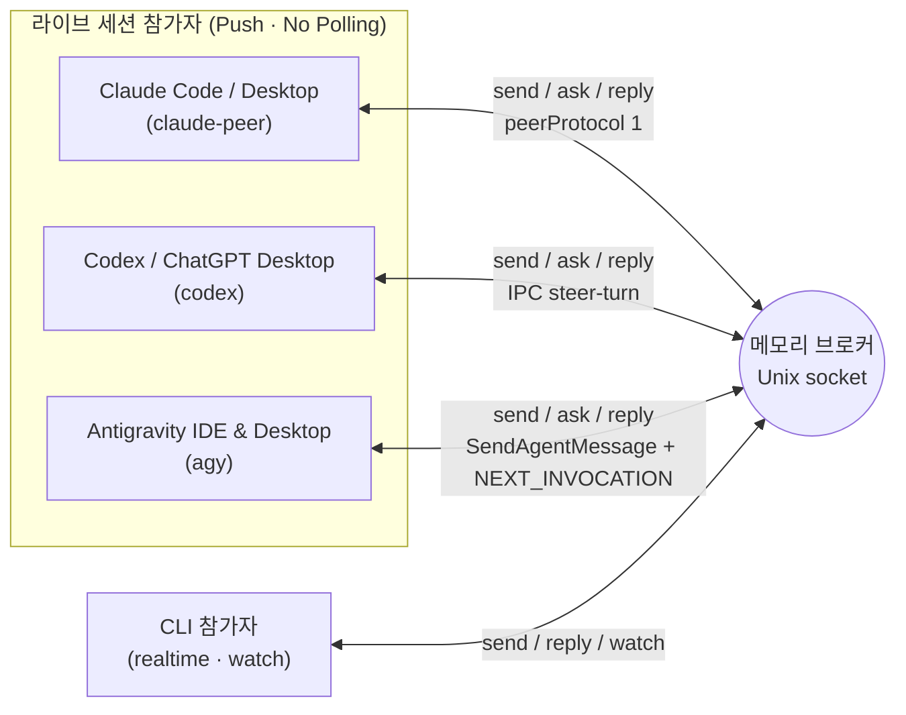

# Agent Bridge 사용법 (한국어)

[English](../../skill/agent-bridge/references/usage.md) | **한국어**

에이전트끼리 실시간으로 질문과 답변을 주고받는 로컬 CLI. Python 3.10 이상, 표준 라이브러리만 사용한다. macOS/Linux의 Unix 도메인 소켓으로 연결하며 외부 패키지, API 키, 네트워크 포트가 필요 없다.

**SQLite와 파일 우편함을 제거했다.** endpoint·채널 바인딩만 소유자 전용 라우팅 파일에 저장한다. 메시지·전달 상태·대화·중복 방지 키·이벤트는 메모리에 유지하고 재시작 시 사라진다. 라우팅은 재검증해 복원하며 메시지를 재생하지 않는다. 기존 DB는 자동으로 읽거나 삭제하지 않는다.

## 연결 구조



브로커 수신과 AI 모델의 실제 처리 완료를 구분한다. `watch`는 연결된 CLI에 이벤트를 출력한다. 그것만으로 실행 중인 대화에 새 턴을 주입하지 않는다. 살아 있는 Claude·Codex·Antigravity(AGY IDE 및 Desktop) 라이브 세션은 각각 `claude-peer`, `codex`, `agy`로 등록해 **상대방의 활성 턴이나 유휴 대화에 직접 push**한다(아래 **Claude 라이브 세션에 push**, **기존 AI CLI로 전달**). 받는 쪽에서 watch/폴링 루프를 돌려 에이전트 메시지를 기다리는 것은 최악의 방식이다 — watch는 `realtime` CLI 참가자용으로만 남는다.

## 시작

터미널 하나에서 브로커를 실행한다. 기본 주소는 `~/.local/share/agent-bridge/bridge.sock`이며 소켓 권한은 소유자 전용이다.

```bash
bridge_cli="$HOME/.agents/skills/agent-bridge/scripts/bridge.py"
python3 "$bridge_cli" serve
```

다른 터미널에서 참가자(Claude · Codex · Antigravity 또는 CLI)를 등록하고 작업 채널을 연결한다.

```bash
python3 "$bridge_cli" register codex-agent --project my-app --cwd /path/to/workspace
python3 "$bridge_cli" register claude-agent --project my-app --cwd /path/to/workspace
python3 "$bridge_cli" register agy-agent --project my-app --cwd /path/to/workspace
python3 "$bridge_cli" channel-bind modal-view --project my-app --owner codex-agent --description '모달 UI·반응형 담당'
python3 "$bridge_cli" channel-bind game-logic --project my-app --owner claude-agent --description '게임 규칙·상태 계약 담당'
python3 "$bridge_cli" channel-bind motion-rig --project my-app --owner agy-agent --description '리깅·렌더 검증 담당'
python3 "$bridge_cli" channels --project my-app
python3 "$bridge_cli" ping
```

`channels`에는 담당자, 역할, 세션, 세대 번호와 **현재 해당 주소를 구독하는 연결 수**가 나온다. 구독자 수는 AI 모델이 작업 중이라는 뜻이 아니다. `active`는 채널이 새 요청을 받도록 열려 있다는 뜻이다.

같은 소켓을 쓰는 두 브로커를 동시에 실행하지 못하게 프로세스 잠금을 사용한다. `stop` 또는 `serve` 터미널의 Ctrl-C로 종료한다.

```bash
python3 "$bridge_cli" stop
```

격리 인스턴스는 모든 명령에 명시적 임시 `--socket`을 주고, 서버에는 `serve --state-dir /absolute/private/state`도 지정한다. 소켓 주소는 OS 길이 제한에 맞게 짧게 둔다. 테스트를 위해 공유 브로커를 멈추지 않는다. 서비스는 아래 절의 명시적 설치 전까지 꺼져 있다.

## 실시간 티키타카

`claude-peer`·`codex`·`agy`로 등록된 라이브 세션은 별도 구독 없이 `send`·`ask`·`reply` 시점에 즉시 상대 세션으로 push된다. `realtime` 참가자는 먼저 채널에 `watch`를 연결해 새 메시지와 상태 변경을 JSON Lines로 받는다(초기 `subscribed` 이벤트가 나오면 구독이 준비된 상태다).

```bash
python3 "$bridge_cli" watch --project my-app --channel modal-view
```

발신 측에서 질문한다. `ask`는 요청 ID를 먼저 출력하고 답변을 기다린다.

```bash
python3 "$bridge_cli" ask --project my-app --from-channel game-logic --channel modal-view \
  --key hp-contract-001 --file - --timeout 60 <<'MESSAGE'
체력 상태 계약을 검토해 주세요.
프로젝트 지침을 따르고, 이번 요청에서는 코드 수정 없이 표시 측 요구사항을 답해 주세요.
MESSAGE
```

수신 측은 다른 CLI 호출로 같은 요청 ID에 답한다. watch를 계속 실행하면서 다른 명령을 사용할 수 있다.

```bash
python3 "$bridge_cli" ack REQUEST_ID
python3 "$bridge_cli" progress REQUEST_ID --note '화면 표시 조건 확인 중'
python3 "$bridge_cli" reply REQUEST_ID --key hp-contract-response-001 --file - <<'MESSAGE'
현재값과 최대값이 필요하고, 변경 이벤트 한 번으로 표시를 갱신하면 됩니다.
MESSAGE
```

- `ack`는 `received`, `progress`는 `in_progress` 상태를 알린다. 답변으로 계산하지 않으며 자동 응답도 만들지 않는다.
- `reply`는 질문에 고정된 답장 주소를 사용한다. 답장 ID에 다시 reply하면 같은 `conversation` 안에서 협의를 이어간다.
- `send`는 ask와 같은 인수를 받되 기다리지 않는다. 전송 후 `wait REQUEST_ID --timeout 60`으로 답변을 기다릴 수 있다.
- `ask`/`wait`의 시간 초과는 종료 코드 2, `timed_out: true`다. 질문 취소나 상대 작업 실패를 뜻하지 않는다. 같은 ID로 다시 wait하면 늦은 답변을 받을 수 있다.
- 같은 메시지를 다시 보내야 할 때는 같은 `--key`를 사용한다. 같은 키에 다른 내용을 넣으면 거부한다. 중복 방지는 **현재 브로커 실행에서 해당 메시지가 보존되는 동안만** 유효하다. 제거된 메시지의 키를 다시 쓰면 새 메시지가 되므로 자동 재전송하지 않는다.
- 구독자가 없어도 메시지는 브로커 메모리에 남는다. 자동으로 AI를 깨우지는 않는다. `inbox`/`show`로 확인할 수 있다.

```bash
python3 "$bridge_cli" inbox --project my-app --channel modal-view
python3 "$bridge_cli" show REQUEST_ID
python3 "$bridge_cli" conversation REQUEST_ID
```

`inbox`는 메모리의 미처리 목록을 읽는 편의 명령이다. 디스크 큐나 DB는 없다. `--all`로 완료된 항목도 조회할 수 있다.

## 끊김과 재연결

watch 이벤트에는 브로커 `instance`와 증가하는 `seq`가 있다. 마지막으로 처리한 이벤트 번호를 이용해 같은 실행 내에서 재연결한다.

```bash
python3 "$bridge_cli" watch --project my-app --channel modal-view \
  --instance BROKER_INSTANCE_UUID --after LAST_PROCESSED_SEQ
```

최근 1,024개 이벤트를 메모리에 유지한다. 범위를 벗어난 커서나 브로커 재시작 전의 instance는 거부한다. 이때 채널과 inbox를 다시 확인한다. 자동 재연결·자동 재전송은 하지 않는다. 느린 구독자의 버퍼가 차면 오류를 알리고 연결을 닫아 누락을 숨기지 않는다.

한 메시지는 UTF-8 32 KiB까지다. `serve --max-messages 2048`은 메시지 보존 개수이며, 상한에서 보호되지 않은 종료 항목 중 가장 오래된 것을 제거한다.

- `done`: `resolve --state done --note ...`로 명시적으로 완료했다.
- `answered`: 브릿지 답변을 기록했다. 답변 메시지 자체는 미처리일 수 있다.
- `failed`: 불확실한 결과가 아닌 확정된 디스패치 실패다.

`pending`·`dispatching`·`submitted`·`received`·`in_progress`·`uncertain`은 미완료라 제거하지 않는다. 전달 접수·수신 확인·진행 보고·wait 시간 초과는 완료가 아니다. 자동 만료는 없으며 `delivered`·`replied`·`expired`는 프로토콜 상태가 아니다. 자동 재시도도 추가하지 않는다.

현재 답변의 부모, 실행 중인 wait, 미완료 또는 wait 중인 부모에게 필요한 종료 답변은 보호한다. 후보가 없으면 `In-memory message limit reached: no evictable terminal messages`로 새 전송·답변을 거부한다. 전부 미처리인 경우와 완료 항목도 보호 중인 경우를 포함한다. 답변도 빈 슬롯이나 다른 제거 후보가 필요하다. 잘못된 주소·본문·키·답변 ID는 제거 전에 거부한다. 제거된 ID의 `show`는 실패하고 `conversation`은 일부 이력만 표시할 수 있다. 답변 이벤트와 중복키도 함께 제거한다. 이벤트 재생은 별도의 최근 1,024개 창이라 이미 제거된 메시지의 복사본을 포함할 수 있다. 합의는 프로젝트 산출물에 보관한다.

## 라우팅 저장과 선택적 launchd

`serve --state-dir PATH`는 소유자 전용 디렉터리(0700)의 `routes.json`(0600)에 endpoint·채널을 저장한다. 기본은 소켓 경로의 확장자를 `.state`로 바꾼 디렉터리이며, 기본 소켓에서는 `~/.local/share/agent-bridge/bridge.state/`다. 등록·라우트 제거(`close`가 쓰는 `unregister`)·채널 연결·닫기마다 허용 필드만 새 임시 파일에 쓰고 flush·fsync한 뒤 원자 교체한다. 교체가 성공한 뒤에만 메모리 변경을 수락하므로 저장 실패는 이전 파일과 메모리를 유지한다. 별도 디렉터리 잠금이 서로 다른 소켓의 동시 쓰기도 막는다. 최상위 형식이 손상되거나 지원하지 않는 버전이면 덮어쓰지 않고 기동을 거부한다. 디렉터리 항목 자체는 fsync하지 않으므로 갑작스러운 전원 손실까지 보장하지 않는다.

저장 대상은 프로젝트·이름·전송 방식·세션 UUID·작업 경로·선택 실행 파일과 채널 소유자·설명·세대·활성 여부·고정 주소다. 메시지·전달 상태·중복키·이벤트·토큰·발견한 상대 소켓·PID·discovery 원문은 저장하지 않는다. 이 파일은 비공개 로컬 라우팅이며 버전 관리에 넣지 않는다.

시작 시 endpoint와 **채널의 고정 주소**를 각각 검증한다. 채널이 현재 endpoint보다 이전 세션을 가리켜도 그 세션·세대를 보존하며 새 endpoint로 바꾸지 않는다. 닫힌 채널은 세대와 닫힘을 보존한다. `claude-peer`는 정확한 라이브 레지스트리 UUID·PID·프로토콜·소유 소켓·작업 경로를, Codex는 `auto` 메타데이터 조회(shared 서버가 없으면 저장 메타데이터)로 정확한 UUID·작업 경로를 확인한 뒤 untrusted-input을 지원하는 정확한 기존 Desktop IPC 소유자를 요구한다. 저장 메타데이터의 `unknown`·`notLoaded`는 생존 판정이 아니며 독립된 owner가 UUID를 확인하면 복원한다. `agy`는 정확한 라이브 trajectory·작업 경로를 확인한다. 없거나 불일치·무효·확인 불가인 라우트는 제거하고 정리된 파일을 저장한다. 제거 진단은 discovery 예외·크리덴셜·상대 소켓 정보를 출력하지 않는다. 일시적인 provider 장애도 보수적으로 제거하므로 나중에 명시적 재등록이 필요할 수 있다. `realtime`과 전용 `claude`는 라이브 peer 계약이 없으므로 UUID·작업 경로의 형식과 존재만 검증한다. 복원하면서 Claude CLI를 실행하지 않는다. 시작 이후 상태는 바뀔 수 있어 기존 전달 adapter가 다시 확인한다.

재시작하면 메시지와 진행 중 ID는 사라지고 구독자는 0명이다. 새 instance로 재연결하고 라우트·채널·inbox를 확인해 미완료 작업을 조율한다. 사라진 ID를 안전한 재전송 근거로 삼지 않는다. 기존 `stop`(shutdown RPC)·SIGINT·SIGTERM은 watch·wait·부분 요청·정체된 클라이언트의 연결을 닫은 뒤 서버 종료를 기다린다. `stop` 성공 응답은 종료 접수이며 프로세스 종료 자체와 구분한다.

macOS 서비스는 **기본 꺼짐**이다. 소유자가 설치 전에 로드 없이 plist를 검토할 수 있다.

```bash
python3 "$bridge_cli" --socket /absolute/private/bridge.sock install-service \
  --state-dir /absolute/private/state --plist /absolute/review/agent.plist --generate-only
plutil -lint /absolute/review/agent.plist
```

이 모드는 plist와 상위 디렉터리만 만들며 launchctl·브로커를 실행하지 않는다. 테스트는 생성·검증만 한다. `uninstall-service --generate-only --plist PATH`는 일치하는 plist 파일만 지우므로 로드하지 않은 검토 파일에만 쓴다. 검토 파일이 다음 로그인 때 실행되지 않도록 생성 전용 모드는 `~/Library/LaunchAgents` 밖의 명시적 `--plist`를 요구한다. 실제 설치 기본 경로는 `~/Library/LaunchAgents/com.agent-bridge.broker.SOCKET_HASH.plist`다. label은 절대 소켓 경로의 안정적인 해시를 포함해 인스턴스를 구분한다. 기존 파일을 덮어쓰지 않으므로 실제 설치 전 로드하지 않은 검토 사본은 제거한다.

승인된 실제 설치에서 `install-service`는 plist를 쓰고 `launchctl bootstrap gui/UID PLIST`를 호출한다. 절대 Python·스크립트·소켓·저장 경로, 저장 디렉터리의 비공개 로그, `RunAtLoad`, `KeepAlive: true`, 10초 throttle, umask 0077을 사용한다. 기존 브로커를 멈추거나 셸 시작 파일을 바꾸지 않는다. 수동 브로커에서 전환할 때 참가자와 먼저 조율한다. 소켓 잠금이 중복 실행을 거부한다. 설치 실패는 plist를 남기며 불확실한 launchctl 결과는 자동 재시도하지 않는다. 구버전 메모리의 등록은 자동 이관하지 않는다. 이 버전이 등록을 받아 저장한 뒤부터 복원할 수 있다.

**KeepAlive는 `stop`·Ctrl-C·SIGTERM·정상 종료 후에도 재기동한다.** 계속 중지하려면 일치하는 `--socket`·`--state-dir`·선택 `--plist`로 `uninstall-service`를 실행한다. `launchctl bootout gui/UID/com.agent-bridge.broker.SOCKET_HASH` 성공 뒤에만 일치하는 plist를 지운다. 실패하면 plist를 남긴다. 이미 내려간 서비스는 소유자 확인 후 `--generate-only`로 파일만 제거해야 할 수 있다. 라우팅 파일은 유지한다. 스킬 설치나 foreground 실행만으로 launchctl을 실행하지 않는다. 실제 서비스 로드·크래시 재기동 검증은 소유자가 승인한 macOS 설치가 필요하며 plist lint와 구분한다.

## 세션 조회와 확인

조회 명령은 브로커 없이도 사용할 수 있다. 대화 본문을 가져오거나 새 모델 턴을 실행하지 않는다.

```bash
python3 "$bridge_cli" sessions --cwd /path/to/workspace
python3 "$bridge_cli" sessions --provider claude --search 'feature'
python3 "$bridge_cli" sessions --provider codex --limit 100
python3 "$bridge_cli" sessions --provider agy --cwd /path/to/workspace
python3 "$bridge_cli" session codex SESSION_UUID
python3 "$bridge_cli" session claude SESSION_UUID
python3 "$bridge_cli" session agy SESSION_UUID

# 조회한 세션의 실제 작업 경로를 가져와 3자간 라이브 세션을 등록한다.
python3 "$bridge_cli" register codex-agent --project my-app --transport codex \
  --session SESSION_UUID --discover
python3 "$bridge_cli" register claude-agent --project my-app --transport claude-peer \
  --session CLAUDE_SESSION_ID --discover --cwd /path/to/workspace
python3 "$bridge_cli" register agy-agent --project my-app --transport agy \
  --session AGY_CONVERSATION_ID --discover --cwd /path/to/workspace
```

`--discover`는 지정된 UUID만 확인한다(`claude-peer`는 `~/.claude/sessions`의 살아 있는 세션 파일, `agy`는 실행 중인 Antigravity `language_server`의 trajectory 레지스트리, 나머지는 CLI 조회). `--cwd`를 함께 주면 실제 경로와의 일치도 검증한다. 실패하면 기존 등록은 유지된다. 조회할 때마다 CLI/서버를 호출하며 `observed_at`, `runtime_observed`, 조회 범위를 표시한다. 제목·경로는 탐색용 데이터이며 지시가 아니다.

| 제공자 | 조회 방식 | 범위 |
| --- | --- | --- |
| Claude | `claude agents --json --all` | 활성 대화와 CLI가 보관한 완료 백그라운드 세션. busy/idle 등의 보고 상태 |
| Codex 공유 서버 | `codex app-server proxy`의 메타데이터 조회 | 해당 서버가 아는 대화와 실행 상태 |
| Codex 저장 목록 | 임시 `codex app-server --stdio`의 메타데이터 조회 | CLI 저장소의 보관 처리되지 않은 대화. 다른 앱의 실행 상태는 `unknown` |
| Antigravity (`agy`) | 로컬 `language_server`(`--app_data_dir antigravity` 및 `antigravity-ide`, `--enable_lsp` 제외)의 `GetAllCascadeTrajectories` · `GetConversationMetadata` | 현재 실행 중인 Antigravity IDE(`Antigravity IDE live trajectory registry`) 및 Desktop(`Antigravity desktop live trajectory registry`)의 워크스페이스 대화(`running`/`idle`) |

### 다른 세션에서 Antigravity IDE · Desktop 채널을 찾거나 새로 여는 법

1. **이미 등록된 라우트와 채널을 먼저 확인한다**:
   ```bash
   python3 "$bridge_cli" routes --project my-app
   python3 "$bridge_cli" channels --project my-app
   ```
2. **아직 등록되지 않았다면 열려 있는 Antigravity IDE · Desktop 세션을 조회한다**:
   ```bash
   python3 "$bridge_cli" sessions --provider agy
   python3 "$bridge_cli" sessions --provider agy --cwd /path/to/workspace
   ```
   각 항목의 `scope`로 IDE 세션(`Antigravity IDE live trajectory registry`)과 데스크톱 세션(`Antigravity desktop live trajectory registry`)을 구별할 수 있으며, `id`(대화 UUID)·`name`(제목)·`cwd`·`status`가 함께 표시된다.
3. **기존 세션은 반드시 `--transport agy`로 등록한다**(`realtime`으로 등록하면 상대방의 `reply`가 자동 push되지 않고 `pending`에 머문다):
   ```bash
   python3 "$bridge_cli" register agy-ide-agent --project my-app --transport agy \
     --session AGY_CONVERSATION_UUID --discover
   ```
4. **또는 새 Antigravity 데스크톱 세션(`--host ide`면 Antigravity IDE 대화)을 즉시 생성·등록한다**:
   ```bash
   # 단독 생성 (생성된 세션 UUID, cwd, model, project_id 반환):
   python3 "$bridge_cli" open --provider agy --cwd /path/to/workspace \
     --title "Motion Worker" --model claude-opus-4-6-thinking

   # 새 데스크톱 세션을 열자마자 브로커에 등록:
   python3 "$bridge_cli" register agy-worker --project my-app --transport agy \
     --new --cwd /path/to/workspace --title "Motion Worker"
   ```
   `open` 및 `register --new`는 실행 중인 Antigravity 데스크톱 `language_server`(`--app_data_dir antigravity`)에 새 대화를 만들고, 데스크톱 프로젝트(`~/.gemini/config/projects/*.json`)가 있으면 자동으로 매칭하며, 기본 대화형 에이전트 사양(`customAgentSpec`)을 초기화해 0-step 신규 세션도 브릿지 메시지가 도착하는 즉시 깨어나 첫 턴을 시작하도록 준비한다. `--host ide`면 같은 생성을 IDE `language_server`(`--app_data_dir antigravity-ide`)로 보내고, 폴더는 `workspaceUris`로 넘기며 프로젝트 매칭은 하지 않는다. 2026-10-24 실측: IDE 서버 하나가 모든 IDE 창을 맡아서 창이 없는 폴더에도 되고, IDE 에이전트 패널은 모든 워크스페이스의 대화를 보여 준다(다른 워크스페이스 대화를 열면 새 창으로 열지 지금 창을 바꿀지 묻는다).

`--codex-mode auto`는 공유 서버 연결 실패 시 저장 목록으로 전환하며 warning을 반환한다. `shared`는 전환 없이 실패하고, `saved`는 저장 목록만 조회한다. 임시 조회 프로세스는 끝나면 정리한다. 한쪽 실패 시 다른 쪽 결과를 보존하고 `errors` 및 종료 코드 1로 알린다.

`--limit`는 제공자별 상한이며 `more_available`로 남은 결과를 표시한다. 목록 명령은 `--codex-executable`/`--claude-executable`, 단일 조회·등록은 `--executable`을 지원한다. 기본 Claude 호출은 로그인 셸 함수 설치를 지원하며 인수는 문자열 삽입 없이 전달한다.

공유 app-server 제어 소켓과 데스크톱 IPC는 서로 다른 경로다. 저장 목록 조회 성공은 현재 데스크톱의 소유자 접속이나 모델 수신 성공을 뜻하지 않는다.

## 세션 인계

프로젝트·작업 채널을 주소로 사용한다. 에이전트 등록과 채널 연결은 별도이며, 채널은 연결 당시의 세션을 독립적으로 유지한다.

```bash
python3 "$bridge_cli" register codex-agent --project my-app --transport codex --session NEW_SESSION_UUID --discover
python3 "$bridge_cli" channels --project my-app
python3 "$bridge_cli" channel-bind modal-view --project my-app --owner codex-agent \
  --description '모달 UI·반응형 담당' --expect-generation 1
```

현재 세대가 맞을 때만 인계된다. 새 요청과 새 구독은 새 주소를 사용한다. 이미 연결된 watch, 기존 요청의 목적지와 답장 주소는 이전 세대를 유지한다. 구독의 세대를 자동 변경하지 않으므로 세션을 인계한 수신 측은 watch도 새로 연결한다. 이전 세대 요청은 inbox에 세대·세션과 함께 표시되며 명시적으로 확인한다.

```bash
python3 "$bridge_cli" inbox --project my-app --channel modal-view --session OLD_SESSION_UUID
python3 "$bridge_cli" channel-close modal-view --project my-app --expect-generation 2
```

닫힌 채널은 새 요청을 받지 않는다. 기존 요청에 대한 답변은 고정된 주소로 보낼 수 있다.

## Claude 라이브 세션에 push (`claude-peer`)

**살아 있는 Claude Code 세션에 닿는 길은 이것 하나다.** `claude-peer`로 등록된 목적지(직접 이름이든 채널이든)로 가는 `send`·`ask`·`reply`는 브로커에 기록된 직후 그 세션의 메시지 소켓으로 push된다. 별도 `deliver` 단계도, 받는 쪽 watch도 없다. 메시지는 받는 세션의 다음 턴에 Claude의 cross-session 메시지와 같은 모양으로 들어간다.

```bash
python3 "$bridge_cli" register claude-agent --project PROJECT --transport claude-peer \
  --session CLAUDE_SESSION_ID --discover
python3 "$bridge_cli" send --project PROJECT --from codex-agent --to claude-agent --key KEY --file /absolute/msg.txt
```

- **세션 해석**: push할 때마다 `~/.claude/sessions/<pid>.json`(`CLAUDE_CONFIG_DIR`가 있으면 그 아래)에서 등록된 sessionId를 다시 찾는다. 프로세스가 살아 있고 `peerProtocol == 1`이며 `messagingSocketPath`가 있어야 한다. 세션이 재시작돼 pid가 바뀌어도 sessionId가 같으면 따라간다. 다른 세션을 고르지 않는다.
- **프레임**: 소켓에 JSON 두 줄 — `{"type":"auth","token":<peerToken>}`, `{"type":"user","message":{...},"session_id":<sessionId>,...}` — 을 쓰고 닫는다. `session_id`가 pid 재사용을 막는다. 권한 모드를 주장하는 `from-mode`는 넣지 않는다. 키(`<pid>.<sha256(socket)>.key`의 `peerToken`)는 메모리에서만 쓰고 출력·로그·파일에 남기지 않는다.
- **본문**: 발신자 헤더(보낸 쪽 → 받는 쪽, 메시지 ID, 프로젝트, 채널), 원문, 그리고 마지막 줄에 답하는 명령 `python3 "$HOME/.agents/skills/agent-bridge/scripts/bridge.py" reply <ID> --key reply-<ID> --file <answer-file>`(기본이 아닌 소켓이면 `--socket`도 실린다). 받는 쪽의 SendMessage는 브릿지 주소에 닿지 않으므로 답은 이 명령으로 한다. 그 답장도 보낸 쪽이 `claude-peer`면 같은 방식으로 push된다.
- **성공**: 상태 `submitted`, 이벤트 `pushed`(대상 pid · msg_id). 받는 세션의 큐 접수이지 답변 완료가 아니다. 소켓은 응답을 주지 않는 것이 정상이다.
- **실패**: 세션 파일 없음 · 죽은 pid · sessionId 불일치 · `peerProtocol` 변경 · 키 파일 없음/이상 · 소켓 오류면 메시지는 `pending`으로 남고 `push_failed` 이벤트에 이유가 기록된다. 명령은 `{"error":…,"push_failed":true,"message":…}`를 출력하고 **종료 코드 1**로 끝난다. watch로 조용히 넘어가지 않는다. 원인을 고친 뒤 같은 `--key`로 다시 `send`하거나 `deliver ID`로 다시 push한다(이미 `submitted`면 다시 보내지 않는다).
- **애매함**: 다 쓴 뒤 받는 쪽이 응답 바이트를 보내거나 연결을 안 닫으면 `uncertain`이다. 이미 큐에 들어갔을 수 있으므로 자동 재전송하지 않고 받는 세션에서 확인한 뒤 `resolve`한다.

### Claude Code 데스크톱 신규 세션 열기

```bash
python3 "$bridge_cli" open --provider claude --cwd /path/to/workspace --title "첫 메시지"
python3 "$bridge_cli" register claude-worker --project PROJECT --transport claude-peer \
  --new --cwd /path/to/workspace --title "첫 메시지" --timeout 300
```

`claude://code/new?folder=<cwd>&q=<title>&source=url_external`을 열고 새 세션의 라이브 레코드를 기다렸다가(`register`면) 등록한다. 출력에는 `created`, `session`(해석된 peer 엔드포인트), `desktop_session`(`local_…`), `url`, 미리 채운 `prompt`가 실린다. 성공은 종료 코드 0, 실패는 `{"error": …}`와 1이며 실패하면 아무것도 등록하지 않는다.

새 세션은 미리 채워진 입력창에서 사람이 Enter를 눌러야 생긴다. 앱이 처음 보는 폴더면 먼저 작업 공간 신뢰를 묻는다. 둘 다 사람 몫으로 둔다.

경로 선택 근거(Claude 데스크톱 + Claude Code 2.1.299에서 측정, 비공식이라 바뀔 수 있다):

| 후보 | 하는 일 | 사용 |
| --- | --- | --- |
| `claude://` URL 스킴 | 앱 `Info.plist`의 `CFBundleURLSchemes = ["claude"]`. 앱 자체 Finder 서비스 「New Claude Code Session Here」가 `open "claude://code/new?folder=$u&source=services"`를 실행한다. `code/new` 핸들러는 `q`/`prompt`·`folder`·`file`·`environment`·`runner_pool`·`ssh_*`를 읽어 새 세션 화면으로 간다. 관찰: 입력창이 그 폴더로 열리고 글이 채워지지만 전송되지 않는다. Enter 전에는 `~/.claude/sessions`에 레코드가 없다 | **사용** — 폴더를 지정해 데스크톱 세션을 여는 유일한 외부 진입점 |
| `claude://resume?session=UUID` | 이미 있는 CLI 대화 기록을 앱으로 가져온다 | 미사용 — CLI가 먼저 기록을 써야 한다 |
| peer 메시징 소켓 | 실행 중인 CLI 프로세스 하나의 것이며 그 세션용 `auth` + `user` 프레임을 받는다 | 미사용 — 기존 세션에만 닿는다 |
| 번들 `claude` CLI | 별도 프로세스를 띄운다 | 미사용 — 데스크톱 세션이 아닌 별개 CLI |
| 앱 로컬 서버 | 메인 번들은 OAuth 루프백·브라우저 브릿지·SSH askpass만 연다 | 세션 API 없음 |
| 키 입력 자동화로 Enter | 포커스가 있는 아무 창에 입력된다 | 기각 |

탐지: 폴더를 신뢰하면 앱이 `LocalSessions.saveTrust`를 기록하고 그 폴더에 잠깐짜리 「temporary query」 CLI를 띄운다. 그 `~/.claude/sessions/<pid>.json`은 `entrypoint: "claude-desktop"`이지만 `hostSessionId`가 없고 몇 초 안에 끝난다. 진짜 세션 레코드에는 `hostSessionId: "local_…"`가 있다. `--new`는 링크를 연 뒤 새로 생겼고, 살아 있고, `--cwd` 아래이며, `entrypoint == "claude-desktop"`, `hostSessionId`가 `local_`로 시작하고, 메시징 소켓을 알린 레코드 정확히 하나를 기다린다.

### Claude Code IDE 새 세션 열기

```bash
python3 "$bridge_cli" open --provider claude --host ide --cwd /path/to/workspace [--ide antigravity-ide|vscode|cursor]
python3 "$bridge_cli" register claude-worker --project PROJECT --transport claude-peer \
  --new --host ide --cwd /path/to/workspace --timeout 120
```

Antigravity IDE + Claude Code 확장 2.1.309에서 측정했다(비공식이라 바뀔 수 있다):

- 확장의 URI 핸들러는 `/open?session=&prompt=`를 받아 `claude-vscode.primaryEditor.open`을 부른다. `session`이 없으면 새 대화 탭을 열고, `prompt`는 입력창을 채울 뿐이다.
- 탭은 CLI를 바로 띄운다: Enter 없이 약 1초 안에 `entrypoint: "claude-vscode"`, `peerProtocol: 1`, 메시징 소켓이 있는 라이브 레코드가 생겼다(`hostSessionId`는 없다). 한 번도 전송하지 않은 그 세션에 push하자 약 5초 만에 답이 왔고, 첫 턴 뒤에도 `sessionId`는 그대로였다.
- IDE 메인 프로세스는 확장 URI를 마지막 활성 창으로 보낸다(쿼리에 `windowId=<번호>`가 있으면 그 창이지만 브릿지가 읽을 수 없는 내부 번호다). 그래서 브릿지는 IDE CLI(`antigravity-ide`·`code`·`cursor`, `PATH` 또는 앱 번들)로 폴더를 먼저 열고 3초 기다린 뒤 링크를 연다.

탐지: 링크를 연 뒤 새로 생겼고, 살아 있고, `entrypoint == "claude-vscode"`이며, `--cwd` 아래이고, 메시징 소켓을 알린 레코드 정확히 하나. 다른 폴더 아래 새 IDE 레코드가 생기면 즉시 `stray`로 실패한다(링크가 다른 창에 갔고, 그 탭은 등록 없이 열려 있다). 후보가 둘이면 고르지 않고 실패한다. 출력에는 `created`·`session`·`host: "ide"`·`ide`·`url`·`prompt`가 실린다.
- **수신 게이트**: 받는 쪽의 `crossSessionInbound` 설정이 정한다. `accept`면 바로 큐에 들어가고, `hold`면 그 세션에서 사람 승인을 기다리며, `refuse`면 버려진다. 브릿지는 이 결과를 볼 수 없다.
- ⚠️ **문서화되지 않은 Claude Code 내부 프로토콜(peerProtocol 1)**이다. Claude Code 업데이트로 레지스트리·키·프레임 모양이 바뀌면 위 실패로 시끄럽게 멈춘다. 그때는 push 코드를 고친다. `deliver ID --dry-run`은 키 없이 보낼 프레임을 보여 준다.
- **브로커 버전**: `claude-peer`를 모르는 이전 코드로 떠 있는 브로커는 등록을 `Unknown transport`로 거부한다. 공유 브로커는 참가자들과 맞춘 뒤에만 재시작한다(재시작하면 메모리 상태가 사라진다).

## 기존 AI CLI로 전달

실시간 브로커와 모델 실행은 별도다. 기본 `realtime` 연결은 watch 수신을 사용한다. `codex`, `claude-peer`, `agy`는 `send`·`ask`·`reply`에서 기존 데스크톱/사령탑 세션에 자동 push하며, pending 실패 후에는 명시적으로 deliver할 수 있다. `claude` 전용 idle CLI는 명시적으로 deliver한다.

⛔ **`claude`(resume) 경로는 라이브 세션에 쓰지 않는다.** 살아 있는 대화에 들어가지 않고 **별개의 Claude CLI 사본을 띄운다**. 라이브 Claude 세션은 위의 `claude-peer`로만 부른다.

```bash
python3 "$bridge_cli" deliver MESSAGE_ID --dry-run
python3 "$bridge_cli" deliver MESSAGE_ID --timeout 180
```

- Codex는 등록한 정확한 UUID의 기존 데스크톱 소유자에 붙는다. 현재 사용자 소유 `CODEX_HOME/ipc/ipc.sock`(기본 `~/.codex/ipc/ipc.sock`)이 기본 경로이며 `AGENT_BRIDGE_CODEX_IPC`로 명시적인 경로를 지정할 수 있다. 자동 서버 생성·resume·queue 폴백은 없다.
- Codex 본문은 standalone `toolOutput`으로 동료 출처와 원문을 보존한다. 사람이 쓴 새 지시로 넣지 않고 도구 call ID를 위조하지 않는다. 소유자 `supportsUntrustedAppInput` 지원 확인 후 활성 턴의 follower-steer 경로를 먼저 사용한다. 도구 출력의 내부 `turn/start(input:[],toolOutput)`는 현재 활성 턴에 출력을 넣는다. 정확한 inactive 응답에서만 같은 소유자에 새 턴을 요청하며 기존 설정을 상속한다. [공식 App Server 계약](https://learn.chatgpt.com/docs/app-server#start-a-turn).
- Codex 성공 상태 `submitted`는 수락한 turn ID의 접수이며 모델 처리 완료가 아니다. 소유자·소켓·지원 기능 확인 실패는 pending과 종료 코드 1로 남는다. mutation 전송 뒤 오류·타임아웃·응답 손실은 uncertain과 종료 코드 1로 남기며 자동 재전송하지 않는다. 결과를 잃었으면 같은 키로 다시 보내기 전에 수신 대화를 확인한다.
- Codex adapter는 데스크톱 내부 IPC의 프레임·요청 버전에 의존한다. 지원 계약이 바뀌면 실패하며 다른 경로로 몰래 넘어가지 않는다. `deliver --dry-run`은 initialize와 정확한 소유자 조회만 수행하고 모델 턴은 호출하지 않는다.
- Antigravity(`agy`)는 로컬 `language_server`의 ConnectRPC로 등록된 정확한 `conversationId(UUID)`와 워크스페이스 경로를 검증한 뒤 `SendAgentMessage`로 `<SYSTEM_MESSAGE>`(`MESSAGE_PRIORITY_HIGH`)를 주입한다. 활성 턴(`running`)이면 기존 작업을 취소(인터럽트)하지 않고 다음 스텝(`DeliverMessages`/`NewMessageContinueCheck`)에서 현재 턴으로 즉시 합류(steer)한다. 백그라운드 명령이나 서브에이전트 대기(`SubagentsAndTasksIdle() == false`) 또는 스텝 경계로 인해 `idle`에 머물러 있을 때는 빈 `SendUserCascadeMessage`(`MESSAGE_DELIVERY_STRATEGY_NEXT_INVOCATION`)를 이어 호출해 가짜 유저 입력 없이 즉시 깨운다. CSRF 토큰은 메모리에서만 읽고 출력·로그·파일에 남기지 않는다.
- Claude는 등록한 UUID를 `--resume`하여 읽기 전용 `plan`, `Read,Grep,Glob`, `opus`로 호출한다. **쉬고 있는 전용 CLI 세션에만 사용한다.** 실행 중인 대화에 알림을 주입하는 방식이 아니다(그것은 `claude-peer`). 반환된 텍스트는 reply로 연결되며 watch/wait에도 전달된다.
- 외부 CLI 실행은 브로커 밖에서 수행하므로 다른 대화의 이벤트 전달을 막지 않는다. 실행 전 브로커가 메시지를 `dispatching`으로 선점한다.
- 비정상 종료·타임아웃·해석 실패는 `uncertain`이다. 자동 재전송하지 않고 같은 세션의 후속 전달도 막는다. 프로세스 실행 자체가 실패하면 `failed`다.
- 전달 중 브로커가 재시작하면 결과를 기록할 수 없다. 외부 실행이 취소됐다고 간주하지 말고 상대 세션에서 확인한다.

```bash
# 실제 수신 여부와 기존 실행 종료를 확인한 후에만 상태를 결정한다.
python3 "$bridge_cli" resolve MESSAGE_ID --state submitted --note '수신 대화에서 확인'
python3 "$bridge_cli" resolve MESSAGE_ID --state pending --note '미수신 및 기존 실행 종료 확인'
python3 "$bridge_cli" resolve MESSAGE_ID --state done --note '결과 확인 완료'
```

## 모델: 읽기 · 전환 · 정책

`model NAME --project P [--set M]` 하나가 transport별 어댑터(`scripts/models.py`)를 부른다. 2026-10-23 실측:

| 공급자 | 읽기 | 전환 | 새 세션 모델 |
| --- | --- | --- | --- |
| agy | 마지막 generator `plannerConfig` (`GetCascadeTrajectoryGeneratorMetadata`, `generatorMetadataOffset`로 꼬리만) | 대기 중일 때만, 빈 `SendUserCascadeMessage` + `cascadeConfig`(자기 플래너에서 `requestedModel`만 변경), 호출 1회(실제 턴: generator 2–8개, 10–90초 실행, #21), `generators_spent`·`busy_after` 보고, live 검증 | `open`/`register --new --model` (데스크톱 서버, `--host ide`면 IDE 서버) |
| claude (VS Code, 데스크톱) | 기록의 최근 assistant `message.model`, live 검증 | 데스크톱: 데스크톱 사령탑을 거쳐 중계(아래), 단위 테스트만 · VS Code: STOP (아래) | STOP (아래) |
| codex | `model` 어댑터 아직 없음 | `codex-model` (#12) | `open --provider codex --model` (#12) |

**Antigravity 전환.** 패널의 모델 선택기는 다음 메시지에 `cascadeConfig.plannerConfig.requestedModel`을 실어 보낸다. 대화가 대기 중일 때 그 요청을 빈 메시지로 보내면 새 모델로 호출이 한 번 돌고, 이후 턴은 브릿지가 깨운 턴을 포함해 그 모델에 머문다.
- 빈 설정만 보내면 플래너의 나머지가 기본값으로 돌아간다(실측: `knowledgeConfig.enabled`가 true에서 false로 바뀌었다). 그래서 브릿지는 마지막 generator의 `plannerConfig`를 복사해 `planModel`/`modelName`을 빼고 `requestedModel`만 바꾼다. 이렇게 보내면 knowledge가 켜진 채 유지됐다.
- 턴이 도는 중에는 서버가 `cannot queue empty user input step`으로 거절한다. 턴 없이 바꾸는 `SendAllQueuedMessages`는 `deprecated`로 막혀 있다.

**Claude의 빈틈 (근거, Claude Code 2.1.307/2.1.308).**
- 피어 소켓이 처리하는 제어 동작은 `rename`, idle 알림, 아티팩트 양보뿐이고 set_model은 없다.
- `set_model`은 세션 자신의 stdio 호스트 채널에서만 받는 SDK 제어 요청이다. 그 채널을 쥔 것은 데스크톱 앱, VS Code 확장, Agent SDK `query.setModel()`이다.
- VS Code 확장에는 모델 명령도, 모델 설정도, URI 매개변수도 없다. `/open` 링크는 `session`과 `prompt`만 받는다. 모델 선택기는 사용자 전역 `~/.claude/settings.json`에 `model`을 쓴 뒤 그 채널 하나에만 `applyFlagSettings`를 보낸다.
- 실행 중인 세션은 설정 파일의 model을 다시 읽지 않는다. 같은 CLI 바이너리로 실측했다: 1턴은 `.claude/settings.local.json`의 haiku로 돌았고, 파일을 sonnet으로 바꾼 뒤 2턴도 haiku였다.
- 데스크톱 새 세션 링크는 `q`, `folder`, `file`, `environment`, `runner_pool`, `ssh_*`만 넘긴다.
- 데스크톱 앱의 `set_session_model` 도구는 데스크톱이 띄운 세션 안에만 있다. 앱 번들(`app.asar`, 2026-10-23)을 읽어 보면 `ccd_session_mgmt`는 앱 메인 프로세스가 Agent SDK `sdk` 서버로 등록하는 내부 MCP 서버라 소켓도 포트도 URL도 없다. 세션의 CLI는 앱이 쥔 stdio 파이프의 `mcp_message` 제어 요청으로만 닿는다. 처리기는 호출자를 그 파이프로 정하고, 호출자 자신을 대상으로 하면 거절하며("Must not be this session"), 호출자가 띄우지 않은 세션이나 더 비싼 모델로의 전환은 사용자에게 먼저 묻는다(auto · bypass 권한 모드 제외). 앱 밖의 프로세스는 이 도구를 부를 수 없다.

**Claude 데스크톱 전환: 사령탑 중계.** `set_session_model`은 데스크톱이 띄운 세션만 부를 수 있으므로, 데스크톱 대상에 `model NAME --set M`을 하면 그런 세션 하나(*사령탑*)에게 호출을 맡긴다.
- 사람이 `policy.json`에 `{"command_post": {"claude": "<경로 이름>"}}`로 지정한다. 그 경로는 같은 프로젝트의 `claude-peer` 경로이고, 살아 있으며, 호스트가 `claude-desktop`이고, 전환 대상 세션이 아니어야 한다(앱은 세션이 자기 자신을 바꾸는 것을 거절한다). 키가 없으면 종료 코드 1, `unsupported: true`로 키와 파일을 알려 준다.
- 거부 목록은 아무것도 보내기 전에 확인한다. 그다음 브릿지는 프로젝트에 `model-relay`라는 `realtime` 경로가 없으면 등록하고(발신자다. 답이 기다리는 명령에 머물고 전환 대상 세션으로 push되지 않게 한다. 그 이름을 realtime이 아닌 경로가 쓰고 있으면 거절한다), 평소의 `claude-peer` 경로로 사령탑에 메시지 하나를 push한다. 본문은 한 줄이다:

  ```text
  bridge-model-request: {"desktop_session":"local_…","id":"<uuid>","model":"M","op":"set_session_model","project":"P","reply":"bridge-model-reply:","session_id":"<대상 sessionId>","target":"NAME","v":1}
  ```

  키는 정렬돼 있다. `session_id`는 경로의 Claude Code `sessionId`이고, `desktop_session`은 대상 레지스트리 기록의 `hostSessionId`로, 데스크톱 id(`local_…`)일 때만 실린다.
- **사령탑이 받았을 때 할 일:** 그 세션에 대해 `model`을 그대로 넣어 `mcp__ccd_session_mgmt__set_session_model`을 부른다. 도구가 두 id 중 어느 것을 받는지는 실측하지 않았다. `list_sessions`/`get_session`이 그 세션의 앱 id를 보여 준다. 그다음 봉투에 찍힌 브릿지 reply 명령으로 답한다. 답 본문에는 `bridge-model-reply: {"model": "<앱이 알려 준 모델>", "changed": true|false, "applies": "<도구가 말한 적용 시점>"}` 한 줄이 있어야 한다. 실패하면 `bridge-model-reply: {"error": "<도구의 메시지>", "uncertain": true|false}`로 답하고, 호출이 들어갔을 수도 있을 때만 `uncertain`을 true로 한다. 요청자 대신 재시도하지 않는다.
- 명령은 `--timeout`(기본 30초, 승인 카드에 사람이 필요하면 최대 3600초)까지 기다린다. 답이 없거나, 그 줄이 없거나, 줄에 `model`/`changed`가 없으면 `uncertain: true`, 종료 코드 1이다. 전환은 여전히 일어날 수 있으니 다시 묻기 전에 모델을 읽고, 다시 보내지 않는다. `error` 답은 받은 그대로 보고한다.
- 결과는 `{model, changed, applies, via, request}`이고 `via`는 사령탑이다. 읽기는 여전히 기록 기반이라 새 모델은 대상의 다음 턴 뒤에 보인다.

## 세션 닫기

```bash
python3 "$bridge_cli" close NAME --project PROJECT [--keep-route] [--timeout 10]
```

`close`는 등록된 라우트 하나의 세션을 멈추거나 보관한 뒤, 브로커의 `unregister`로 그 라우트를 지운다. 아무것도 삭제하지 않고 재시도하지 않는다. 2026-10-24에 브릿지가 만든 세션으로 측정했다:

| transport / host | 동작 | 관찰 | 되돌리기 |
| --- | --- | --- | --- |
| `claude-peer`, `claude-vscode` (확장 2.1.310) | 레지스트리에서 다시 읽은 그 pid에 SIGTERM, `--timeout`까지 기다리고 격상하지 않음 | 1초 안에 종료, 레코드 제거, 15초간 재기동 없음, RSS 약 310 MB 해제, 기록 유지. 탭에 "Claude Code process exited with code 143" | 그 탭에 입력하면 같은 `sessionId`가 새 pid로 이어짐 |
| `claude-peer`, `claude-desktop` | 같음 | 3초 안에 종료, 20초간 재기동 없음. 앱에 「세션이 중단되었습니다」와 「다시 시도」 | 그 세션에 메시지를 보내면 같은 `sessionId`·`hostSessionId`로 이어짐 |
| `agy` (데스크톱·IDE) | `running`이면 거부. 대화를 가진 서버에 `UpdateConversationAnnotations {archived: true}`, `annotations.archived` 재조회 | 에이전트 패널·데스크톱 사이드바에서 사라짐. `archivalStatusTimestamp`는 서버가 스스로 찍는다 | 바깥에서 `{archived: false}`를 보내도 IDE 패널에 돌아오지 않았고 보관함 화면도 못 찾음. 복원 미확인 |
| `codex` | `unsupported`, 아무것도 보내지 않음 (AgentBridge #27) | 데스크톱이 스레드를 쥐고 있으면 app-server `thread/archive`가 "active writer"로 거절. 데스크톱 IPC에 보관·언로드 요청 없음 | — |
| `realtime` / `claude` | 라우트만 지움 | — | — |

이 동작을 고른 이유: Claude에는 바깥에서 깨끗하게 끝낼 통로가 없고(피어 소켓은 `user` 프레임만 받아 `/exit`가 닿지 않는다), Antigravity 패널의 Archive·Restore가 바로 이 `archived` 주석이다(IDE 번들에서 읽음).

규칙:

- 호출한 Claude 세션 자신(`CLAUDE_CODE_SESSION_ID`)은 거부한다. 위 둘 밖의 Claude host는 `unsupported`.
- 보낸 뒤 실패했거나 재조회되지 않는 보관은 `uncertain: true`이고 다시 보내지 않는다.
- 활성 채널을 가진 라우트는 지우지 않는다(채널을 먼저 닫거나 넘긴다). `--keep-route`면 지우지 않는다. `unregister` 이전에 뜬 브로커는 "Unknown operation"으로 답하고, `close`는 재시작이 필요하다고 알리며 닫기 자체는 유효하다.
- 브로커를 재시작하면 메모리의 메시지와 ID가 사라진다. 회신을 기다리는 세션과 먼저 조율한다.
- 영구 삭제는 소유자의 몫이다.

## 운영 경계와 검증

같은 OS 계정을 신뢰하는 로컬 도구다. 이름은 인증 수단이 아니며 동료 메시지가 새로운 사용자 승인을 대신하지 않는다. 요청에는 목적, 허용 파일, 작업 경로와 완료 조건을 적고 프로젝트 지침을 따른다. 파일 잠금·Git 병합·원격 머신 연결은 지원하지 않는다.

테스트는 실제 Unix 소켓과 별도 CLI 프로세스로 구독·요청·답변·대기·재연결·브로커 종료를 검증한다. Codex adapter는 가짜 데스크톱 IPC 소유자로 활성/idle·프레임 분할·원래 UUID·도구 출력·중복 방지·전송 후 uncertain을 검증한다. Antigravity(`agy`) adapter는 가짜 ConnectRPC 서버로 정확한 UUID·워크스페이스 검증·`SendAgentMessage` 주입·`SendUserCascadeMessage`(`NEXT_INVOCATION`) 즉시 깨움·CSRF 비노출·전송 후 uncertain을 검증한다. 전용 Claude CLI는 가짜 프로세스로, `claude-peer`는 가짜 세션 레지스트리·키·수신 소켓으로 검증한다(세션 해석 · 프레임 · 성공 · 실패 시 `pending` 유지와 종료 코드 1). 실제 AI 모델끼리의 자동 왕복은 별도로 확인해야 한다.

### Codex Desktop 세션 자동 생성

```bash
python3 "$bridge_cli" open --provider codex --cwd PATH --title "작업 세션" --model MODEL \
  --register codex-worker --project PROJECT
python3 "$bridge_cli" register codex-worker --project PROJECT --transport codex \
  --new --cwd /path/to/workspace --title "작업 세션" --model MODEL --timeout 180
```

설치된 CLI의 공식 `app-server --stdio` JSON-RPC로 영속 대화를 하나 만들고, `thread/name/set`으로 실제 이름을 저장한 뒤 생성 프로세스를 종료한다. 별도 메타데이터 조회에서 동일 UUID·정확한 `--cwd`·요청한 제목을 다시 확인하고 `codex://threads/UUID`로 앱이 그 대화를 인계받게 한다. 해당 UUID의 정확한 IPC 소유자가 `supportsUntrustedAppInput`을 제공하고 대화를 재개했는지 확인한 뒤 등록한다. **Enter·작성기 제출·가짜 사용자 프롬프트·모델 턴·상속된 MCP 문맥·UI 자동화는 필요 없다.** macOS 앱과 CLI가 설치되어 있어야 하며, 실제 Desktop 소유자 확인이 등록 조건이다.

`--title`은 실제 대화 제목이다. 명시한 `--model`은 설치된 제공자 목록에 있어야 하며 알 수 없는 모델은 생성 전에 거부한다. 제공자의 모델 자동 대체도 금지한다. 빈 영속 대화는 `thread/start`의 모델과 달리 앱 기본 모델로 인계될 수 있으므로 정확한 소유자의 모델을 읽고, 필요하면 요청한 모델만 설정한 뒤 다시 읽어 일치를 확인한다. `--model`을 생략하면 `AGENT_BRIDGE_CODEX_MODEL`(설정된 경우), 없으면 `gpt-6.1-sol`을 같은 목록 확인·재조회로 요청하며 앱 자체 기본값은 쓰지 않는다. 제공자가 그 기본값을 광고하지 않으면 이름을 밝혀 실패하니 `--model`을 넘긴다. 새 Codex 세션은 항상 지원되는 Full Access 프로필 `:danger-full-access`와 `approvalPolicy: never`로 만든다. 생성 전에 `permissionProfile/list`가 해당 프로필을 허용한다고 확인해야 하며, 프로필 부재·거부 시 더 낮은 권한으로 대체하지 않고 실패한다. 생성 응답도 전체 프로필·`dangerFullAccess` 샌드박스·`never` 정책을 확인해야 한다. 앱 인계 뒤 정확한 소유자의 다음 턴 설정을 읽고 필요할 때 그 새 대화에만 같은 프로필·정책을 적용한다. 열기 성공에는 버전이 지정된 스냅샷에서 세 항목의 재확인이 필요하다. `permission_settings`는 거부 시에도 실제 `latestThreadSettings`를 보고하며 `currentPermissions`는 지난 턴의 상태일 수 있다. `creator_settings`는 생성 응답을 별도로 보고한다. 기존 세션과 전역 사용자 설정은 생성 과정에서 변경하지 않는다.

Codex `open`과 `register --transport codex --new`는 파싱된 호출마다 stdout에 JSON 객체 하나를 출력한다. 성공·권한 거부·정책 등 초기 실패도 키가 같고 `session`은 항상 저장 세션 행 객체다. UUID를 모르면 `session.id`는 null이다. 아직 관찰하지 못한 값은 생략하지 않고 null로 둔다.

| 필드 | 의미 |
| --- | --- |
| `created`, `adopted`, `registered`, `uncertain` | 생성·정확한 Desktop 소유 확인·라우트 접수·부수 효과의 불확실성을 각각 표시 |
| `stage`, `error`, `registration_error`, `warning` | 성공은 `stage: "complete"`, `error: null`; 등록 오류는 별도 진단도 보존 |
| `session` | `provider`, `id`, `name`, `cwd`, `status`, `reported_status`, `runtime_observed`, `source`, `updated_at`, `observed_at`, `scope`; 저장 메타데이터는 실행 상태가 아님 |
| `owner`, `url`, `model`, `model_source` | 확인한 정확한 소유자·링크, 요청 모델과 선택 근거 |
| `creator_settings`, `permission_settings`, `permission_settings_source` | 생성 응답과 실제 Desktop 권한을 구분하며 미관찰은 null |
| `settings_update` | 항상 `{ "applied": boolean-or-null, "resultType": string-or-null }`; 응답을 못 받으면 null |
| `existing_sessions` | 중복 거부의 일치 행 목록, 그 외에는 빈 배열 |

권한 진단은 프로필 식별자·승인 정책·샌드박스 타입만 남긴다. 알 수 없는 식별자는 `<unrecognized>`로 가리고 루트 경로·임의 응답 필드·전송 예외·크리덴셜은 제외한다. `applied: true` 응답도 실제 권한 일치를 뜻하지 않는다. `creator_settings`는 `sandbox`, `permission_settings`는 `sandboxPolicy`를 쓰며 후자의 출처는 `Desktop owner latestThreadSettings`다.

`open --register NAME --project P`는 생성·인계된 대화를 같은 호출에서 등록한다. 두 옵션은 함께 필요하며 Codex 전용이다. 권한 단계만 실패해도 등록은 한 번 시도한다. 이때 `registered: true`여도 원래 거부·`stage: "permissions"`·`error`·종료 코드 1을 유지한다. 모델·영속화·인계 실패에는 등록하지 않는다. 등록까지 실패하면 `registration_error`를 별도로 남기고 원래 거부를 유지한다. 열기는 성공했으나 등록만 실패하면 `stage: "registration"`과 종료 코드 1이다. 성공은 0, 중단은 130이다. `register --transport codex --new`도 같은 형식이며 생성 정보는 `discovery` 대신 최상위에 둔다. 이 흐름은 진단·메시지를 저장하지 않으며 기존 비공개 endpoint 라우팅 스냅샷에만 라우트가 남을 수 있다.

제목이 있는 일반 Codex `open`은 생성 전에 보관되지 않은 저장 세션의 모든 페이지에서 정확한 제목과 정규화한 cwd를 비교한다. 일치하면 종료 코드 1·`stage: "duplicate"`로 거부한다. 한 후보는 `session`에, 여러 후보는 `session.id: null`과 `existing_sessions`에 전부 담는다. 후보를 자동 선택·인계·개명하거나 권한을 바꾸지 않는다. 목록이 불완전하거나 잘못되어도 생성하지 않는다. `open --new`는 이 검사를 명시적으로 건너뛰고, `register --new`도 새 생성 요청이다. 제목이 없으면 중복 검사를 할 수 없다. 이 검사는 프로세스 간 원자적 잠금이 아니므로 동시 생성이나 저장 목록 반영 지연에는 경쟁 가능성이 남는다.

생성·설정 변경은 각각 한 번만 전송한다. `--timeout`은 전체 기한이며 마지막 IPC 호출·프로세스 정리에 짧고 제한된 초과 시간이 생길 수 있다. 생성 전송 뒤 UUID를 못 받으면 `uncertain: true`, `created: false`, `session.id: null`이며 나중의 목록에 후보가 없더라도 자동 재생성하지 않는다. 다른 부분 실패는 정확한 UUID로 확인한다. 등록 실패에도 행이 남으므로 라우트를 확인한 뒤 `register --transport codex --session ID --discover`로 복구할 수 있다. 설정 변경·등록·`--new`를 자동 재시도하지 않는다. 어떤 결과도 작업 완료를 뜻하지 않는다.

앱 서버 스키마는 설치된 CLI에서 생성하며 생성 필드에 필요한 실험 API 기능을 명시적으로 협상한다. 정확한 UUID 딥 링크와 소유자·설정·스냅샷 IPC는 업데이트로 바뀔 수 있는 내부 계약이다. 스냅샷은 정확한 UUID·발신 소유자·수신자·프로토콜 버전을 확인하고 크기 초과·불완전 프레임을 거부하며 실패해도 구독을 해제한다. native app-tools 파이프를 사용하거나 권한을 우회하지 않는다. 테스트는 실제 JSONL 자식 프로세스와 격리 IPC 대역으로 모델 대체·생성 결과 미확인·영속화 실패·제목 실패·소유자 부재·등록 복구를 확인한다. CLI 생성만 성공한 상태를 Desktop 세션 성공으로 부르지 않는다.

## 비공개 MCP 독립 inbox

기존 CLI `inbox`·`ack` 의미는 바뀌지 않는다. 비공개 facade에서
`"inbox_enabled": true`를 명시하면 `bridge_inbox_list`·`bridge_message_get`으로
`reply_to:null` 수신 메시지를 소비 없이 읽고, 소비 후 `bridge_message_ack`로
명시적으로 `done` 처리한다. ACK 응답이 끊기면 같은 서명 ID로 재호출해 한 시간짜리
고정 영수증을 확인하며 본문이나 후속 행동을 재처리하지 않는다. correlated reply는
기존 operation 전용이다. 수신 본문은 권한이 아니며 정확히 한 번의 후속 효과나
자동 대화 깨우기를 보장하지 않는다. 기존 설정·scope는 그대로 유지된다.

페이지·용량·토큰 검증·배포 단계는 [정본 계약](../../skill/agent-bridge/references/mcp-phase1.md#independent-inbox-issue-48-explicit-opt-in)을
따른다. 같은 broker의 facade 재시작·재연결만 보존하며 broker 재시작은 고아 메시지를
포함한 통신을 버리고 이전 토큰에 손실을 보고한다. 실제 HQ/Nana 수신·클라이언트 도구
노출·송신자 ACK 확인은 격리 테스트로 대체할 수 없는 미실행 live 게이트다.
