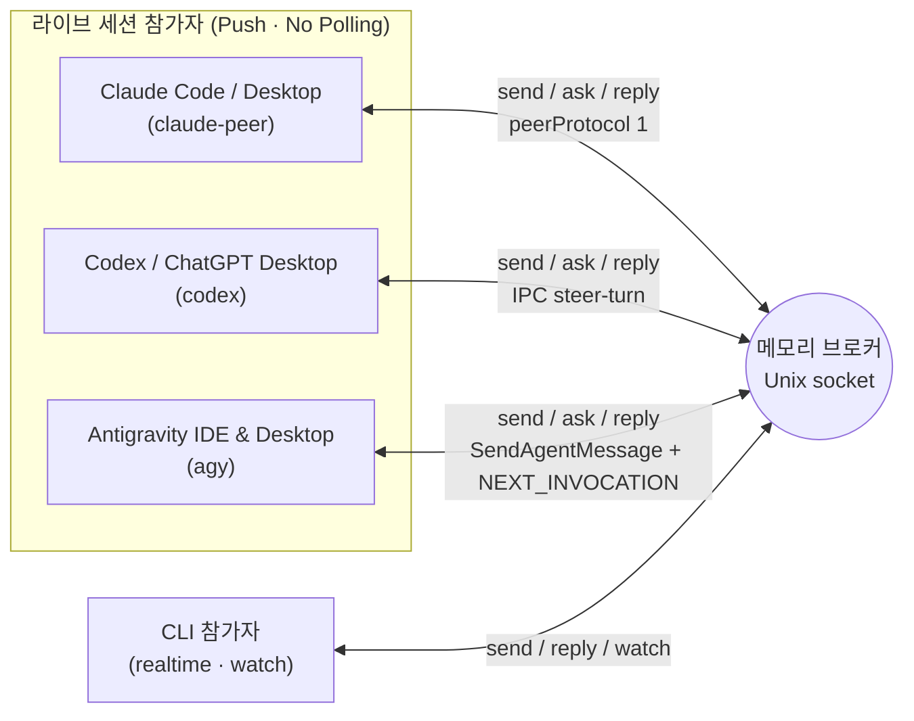

# Agent Bridge 사용법 (한국어)

[English](../../skill/agent-bridge/references/usage.md) | **한국어**

에이전트끼리 실시간으로 질문과 답변을 주고받는 로컬 CLI. Python 3.10 이상, 표준 라이브러리만 사용한다. macOS/Linux의 Unix 도메인 소켓으로 연결하며 외부 패키지, API 키, 네트워크 포트가 필요 없다.

**브로커 메시지를 위한 SQLite나 파일 우편함은 없다.** 엔드포인트·채널 바인딩만 소유자 전용 라우팅 파일(`routes.json`)에 저장한다. 메시지·전달 상태·대화·중복 방지 키·이벤트는 메모리에만 유지하고 재시작 시 사라진다. 라우팅은 재검증해 복원하며 메시지를 재생하지 않는다.

## 연결 구조



브로커 수신과 AI 모델의 실제 처리 완료를 구분한다. `watch`는 연결된 CLI에 이벤트를 출력할 뿐 실행 중인 대화에 새 턴을 주입하지 않는다. 살아 있는 Claude·Codex·Antigravity(IDE 및 Desktop) 라이브 세션은 각각 `claude-peer`, `codex`, `agy`로 등록해 **상대방의 활성 턴이나 유휴 대화에 직접 push**한다. 라이브 세션에서 `watch` 폴링 루프를 돌리는 것은 안티패턴이며, `watch`는 `realtime` CLI 워커용으로만 사용한다.

## 시작

터미널 하나에서 브로커를 실행한다. 기본 주소는 `~/.local/share/agent-bridge/bridge.sock`(`0600`)이다.

```bash
bridge_cli="$HOME/.agents/skills/agent-bridge/scripts/bridge.py"
python3 "$bridge_cli" serve
```

참가자(Claude · Codex · Antigravity 또는 CLI)를 등록하고 작업 채널을 연결한다.

```bash
python3 "$bridge_cli" register codex-agent --project my-app --transport codex --session CODEX_UUID --discover
python3 "$bridge_cli" register claude-agent --project my-app --transport claude-peer --session CLAUDE_UUID --discover
python3 "$bridge_cli" register agy-agent --project my-app --transport agy --session AGY_UUID --discover

python3 "$bridge_cli" channel-bind modal-view --project my-app --owner codex-agent --description '모달 UI·반응형 담당'
python3 "$bridge_cli" channel-bind game-logic --project my-app --owner claude-agent --description '게임 규칙·상태 계약 담당'
python3 "$bridge_cli" channel-bind motion-rig --project my-app --owner agy-agent --description '리깅·렌더 검증 담당'
python3 "$bridge_cli" channels --project my-app
python3 "$bridge_cli" ping
```

`channels`에는 담당자, 역할, 세션, 세대 번호와 현재 구독 연결 수가 나온다. 구독자 수는 AI 모델이 작업 중이라는 뜻이 아니며, `active`는 채널이 새 요청을 받도록 열려 있다는 뜻이다.

같은 소켓을 쓰는 두 브로커가 동시에 뜨지 않도록 프로세스 잠금을 사용한다. `stop` 또는 `Ctrl-C`로 종료한다.

```bash
python3 "$bridge_cli" stop
```

격리 인스턴스는 모든 명령에 명시적 임시 `--socket`을 주고 서버에 `serve --state-dir /absolute/private/state`를 지정한다. 테스트를 위해 공유 브로커를 멈추지 않는다.

## 실시간 티키타카

`claude-peer`·`codex`·`agy`로 등록된 라이브 세션은 별도 구독 없이 `send`·`ask`·`reply` 시점에 즉시 상대 세션으로 push된다. `realtime` 참가자는 먼저 채널에 `watch`를 연결해 새 메시지와 상태 변경을 JSON Lines로 받는다(초기 `subscribed` 이벤트가 나오면 준비된 상태다).

```bash
python3 "$bridge_cli" watch --project my-app --channel modal-view
```

발신 측에서 질문한다(`ask`는 요청 ID를 먼저 출력하고 답변을 기다린다):

```bash
python3 "$bridge_cli" ask --project my-app --from-channel game-logic --channel modal-view \
  --key hp-contract-001 --file - --timeout 60 <<'MESSAGE'
체력 상태 계약을 검토해 주세요.
프로젝트 지침을 따르고, 이번 요청에서는 코드 수정 없이 표시 측 요구사항을 답해 주세요.
MESSAGE
```

수신 측은 다른 CLI 호출로 같은 요청 ID에 답한다:

```bash
python3 "$bridge_cli" ack REQUEST_ID
python3 "$bridge_cli" progress REQUEST_ID --note '화면 표시 조건 확인 중'
python3 "$bridge_cli" reply REQUEST_ID --key hp-contract-response-001 --file - <<'MESSAGE'
현재값과 최대값이 필요하고, 변경 이벤트 한 번으로 표시를 갱신하면 됩니다.
MESSAGE
```

- `ack`는 `received`, `progress`는 `in_progress` 상태를 알린다. 답변으로 계산하지 않으며 자동 응답도 만들지 않는다.
- `reply`는 질문에 고정된 답장 주소를 사용한다. 답장 ID에 다시 reply하면 같은 `conversation` 안에서 협의를 이어간다.
- `send`는 `ask`와 같은 인수를 받되 기다리지 않는다. 전송 후 `wait REQUEST_ID --timeout 60`으로 답변을 기다릴 수 있다.
- `ask`/`wait`의 시간 초과는 종료 코드 2(`timed_out: true`)다. 질문 취소가 아니므로 같은 ID로 다시 `wait`하면 늦은 답변을 받을 수 있다.
- 같은 메시지를 다시 보내야 할 때는 같은 `--key`를 사용한다. 중복 방지는 현재 브로커 실행에서 해당 메시지가 보존되는 동안만 유효하다.
- 메모리의 메시지 목록과 대화 이력은 `inbox`, `show`, `conversation`으로 확인한다:

```bash
python3 "$bridge_cli" inbox --project my-app --channel modal-view
python3 "$bridge_cli" show REQUEST_ID
python3 "$bridge_cli" conversation REQUEST_ID
```

## 끊김, 보존 상한과 재연결

`watch` 이벤트에는 브로커 `instance`와 증가하는 `seq`가 있다. 마지막으로 처리한 이벤트 번호를 이용해 같은 브로커 실행 내에서 재연결한다:

```bash
python3 "$bridge_cli" watch --project my-app --channel modal-view \
  --instance BROKER_INSTANCE_UUID --after LAST_PROCESSED_SEQ
```

- **이벤트 창**: 최근 1,024개 이벤트를 메모리에 유지한다. 범위를 벗어난 커서나 재시작 전 `instance`는 거부되며, 이때는 `channels`와 `inbox`를 다시 확인한다.
- **메시지 크기 및 보존 상한**: 한 메시지는 UTF-8 32 KiB까지다. `serve --max-messages 2048`은 메시지 보존 상한이며, 상한 도달 시 보호되지 않은 종료 항목(`done`, `answered`, `failed`) 중 가장 오래된 것을 제거한다.
- **보호 대상**: `pending`·`dispatching`·`submitted`·`received`·`in_progress`·`uncertain`은 미완료 상태라 제거하지 않는다. 현재 답변의 부모, 실행 중인 `wait`, 미완료 또는 대기 중인 부모에게 필요한 종료 답변도 보호된다. 제거 후보가 없으면 `In-memory message limit reached: no evictable terminal messages`로 새 전송을 거부한다.

## 라우팅 저장과 선택적 launchd

`serve --state-dir PATH`는 소유자 전용 디렉터리(`0700`)의 `routes.json`(`0600`)에 엔드포인트와 채널을 원자적으로 저장한다(기본 경로: `~/.local/share/agent-bridge/bridge.state/`).

- **저장 항목**: 프로젝트·이름·전송 방식·세션 UUID·작업 경로·선택 실행 파일과 채널 소유자·설명·세대·활성 여부·고정 주소만 저장한다. 메시지·전달 상태·중복키·이벤트·토큰·소켓 경로·PID는 저장하지 않는다.
- **시작 시 재검증**:
  - `claude-peer`: 정확한 라이브 레지스트리 UUID·PID·프로토콜·소유 소켓·작업 경로를 확인한다.
  - `agy`: 정확한 라이브 trajectory와 작업 경로를 확인한다.
  - `codex`: 시작 시 데스크톱 소유자 생존을 요구하지 않고 저장된 신원을 유지하며, 확인된 UUID/작업 경로 불일치나 존재하지 않는 로컬 폴더만 제거한다.
  - `realtime` / `claude`: UUID와 작업 경로의 형식·존재만 검증한다.
- **선택적 macOS `launchd` 서비스**: 자동 기동 서비스는 **기본 꺼짐**이다. 설치 전에 로드 없이 plist를 생성·검토할 수 있다:

```bash
python3 "$bridge_cli" --socket /absolute/private/bridge.sock install-service \
  --state-dir /absolute/private/state --plist /absolute/review/agent.plist --generate-only
plutil -lint /absolute/review/agent.plist
```

실제 설치는 `--generate-only` 없이 `install-service`를 실행한다(`~/Library/LaunchAgents/com.agent-bridge.broker.SOCKET_HASH.plist` 생성 및 `launchctl bootstrap`). `KeepAlive`는 `stop`이나 `SIGTERM` 후에도 브로커를 재기동하므로 계속 중지하려면 `uninstall-service`를 사용한다.

## 세션 조회, 생성과 인계

조회 명령은 브로커 없이도 동작하며 대화 본문을 가져오거나 모델 턴을 실행하지 않는다:

```bash
python3 "$bridge_cli" sessions --cwd /path/to/workspace
python3 "$bridge_cli" sessions --provider claude --search 'feature'
python3 "$bridge_cli" sessions --provider codex --limit 100
python3 "$bridge_cli" sessions --provider agy --cwd /path/to/workspace
python3 "$bridge_cli" session codex SESSION_UUID
python3 "$bridge_cli" session claude SESSION_UUID
python3 "$bridge_cli" session agy SESSION_UUID
```

| 제공자 | 조회 방식 | 범위 |
| --- | --- | --- |
| **Claude** | `claude agents --json --all` 및 `~/.claude/sessions/*.json` | 활성 대화와 CLI가 보관한 완료 백그라운드 세션 |
| **Codex (공유 서버)** | `codex app-server proxy` 메타데이터 조회 | 공유 서버가 아는 대화와 실행 상태 |
| **Codex (저장 목록)** | 임시 `codex app-server --stdio` 메타데이터 조회 | 보관 처리되지 않은 CLI 대화 (다른 앱의 실행 상태는 `unknown`) |
| **Antigravity (`agy`)** | 로컬 `language_server` / `agy --hub` (`GetAllCascadeTrajectories` · `GetConversationMetadata`, `--enable_lsp` 제외) | 실행 중인 Antigravity IDE 및 Desktop의 라이브 워크스페이스 대화(`running`/`idle`) |

### 1. Antigravity 세션 열기 및 등록 (`agy`)

```bash
# 단독 생성 (기본 데스크톱, --host ide 추가 시 IDE):
python3 "$bridge_cli" open --provider agy [--host ide] --cwd /path/to/workspace \
  --title "Motion Worker" --model claude-opus-4-6-thinking

# 생성과 동시에 브로커 등록:
python3 "$bridge_cli" register agy-worker --project my-app --transport agy \
  --new [--host ide] --cwd /path/to/workspace --title "Motion Worker"
```

- **데스크톱 (기본)**: 실행 중인 데스크톱 `language_server`(`--app_data_dir antigravity`)에 `StartCascade`와 `UpdateConversationAnnotations`를 호출하고, 데스크톱 프로젝트(`~/.gemini/config/projects/*.json`) 자동 매칭 및 `customAgentSpec`(`builtinAgent.defaultAgent` + `planModel`) 초기화를 수행해 0-step 신규 세션도 첫 브릿지 메시지 수신 즉시 깨어나 첫 턴을 시작한다.
- **IDE (`--host ide`)**: IDE 허브 서버(`agy --hub`, 여러 창이 열려 있으면 `--cwd`와 일치하는 `--add-dir` 창 서버 우선, 또는 구버전 `--app_data_dir antigravity-ide`)에 `workspaceUris`로 대화를 생성한다. 탐색 시 유휴 상태인 고아 `agy --hub` 프로세스(`ppid == 1`)를 자동으로 정리(`SIGTERM`)해 죽은 창 프로세스가 세션 생성이나 상태 판정을 가로채지 않도록 한다.

### 2. Claude 세션 열기 및 등록 (`claude-peer`)

```bash
# 데스크톱 (첫 메시지가 채워진 입력창 오픈 · 사용자의 Enter 대기):
python3 "$bridge_cli" open --provider claude --cwd /path/to/workspace --title "첫 메시지"
python3 "$bridge_cli" register claude-worker --project PROJECT --transport claude-peer \
  --new --cwd /path/to/workspace --title "첫 메시지" --timeout 300

# IDE (사람 단계 없이 즉시 무인 생성):
python3 "$bridge_cli" open --provider claude --host ide --cwd /path/to/workspace [--ide antigravity-ide|vscode|cursor]
python3 "$bridge_cli" register claude-worker --project PROJECT --transport claude-peer \
  --new --host ide --cwd /path/to/workspace --timeout 120
```

- **데스크톱**: `claude://code/new?folder=<cwd>&q=<title>&source=url_external`을 열고 `--cwd` 아래 `entrypoint == "claude-desktop"` 및 `hostSessionId: "local_…"`인 새 라이브 레코드 하나를 기다린다(폴더 신뢰 직후 뜨는 임시 조회 CLI는 무시). Enter 입력은 사람 단계로 남는다.
- **IDE (`--host ide`)**: IDE CLI(`antigravity-ide`·`code`·`cursor`)로 폴더 창을 먼저 열고 3초 뒤 `<scheme>://anthropic.claude-code/open`을 연다. 확장이 새 탭을 열면서 Enter 없이 즉시 `entrypoint == "claude-vscode"`, `peerProtocol == 1` 레코드가 생성된다. 다른 폴더 창에 생성되면 즉시 `stray`로 실패하고 등록하지 않는다.

### 3. Codex 데스크톱 세션 무인 생성 및 등록 (`codex`)

```bash
python3 "$bridge_cli" open --provider codex --cwd PATH --title "작업 세션" --model MODEL \
  [--register codex-worker --project PROJECT]
python3 "$bridge_cli" register codex-worker --project PROJECT --transport codex \
  --new --cwd /path/to/workspace --title "작업 세션" --model MODEL --timeout 180
```

- **무인 인계 흐름**: 설치된 CLI의 `app-server --stdio` JSON-RPC로 영속 대화를 하나 만들고 `thread/name/set`으로 실제 이름을 저장한 뒤, `codex://threads/UUID`를 열어 데스크톱 앱이 인계받게 한다. 정확한 IPC 소유자가 `supportsUntrustedAppInput`을 광고하고 대화를 재개했는지 확인한 뒤 등록한다. **Enter 입력, 가짜 사용자 프롬프트, 모델 턴, UI 자동화가 필요 없다.**
- **모델 및 권한 검증**:
  - 모델 선택 순서: `--model` > `AGENT_BRIDGE_CODEX_MODEL` > `policy.json` `defaults.codex` > `gpt-6.1-sol` (앱 기본 모델이나 `gpt-6-astra`는 코딩 세션에 사용하지 않음). 데스크톱 소유자의 설정 재조회로 일치를 확인한다.
  - 항상 Full Access 프로필(`:danger-full-access`, `approvalPolicy: never`, `dangerFullAccess` 샌드박스)을 요청하고 데스크톱 소유자의 `latestThreadSettings` 스냅샷에서 재확인한다.
- **중복 생성 방지**: `--title`이 있는 일반 `open --provider codex`는 보관되지 않은 저장 세션에서 동일한 제목과 정규화한 `cwd`를 검사해 일치 항목이 있으면 종료 코드 1·`stage: "duplicate"`(`existing_sessions`)로 거부한다. `open --new` 또는 `register --new`는 중복 검사를 건너뛴다.
- **출력 JSON 필드**: `created`, `adopted`, `registered`, `uncertain`, `stage`, `error`, `registration_error`, `warning`, `session`, `owner`, `url`, `model`, `model_source`, `creator_settings`, `permission_settings`, `permission_settings_source`, `settings_update`, `existing_sessions`를 고정 키로 반환한다. 실패하거나 `uncertain`인 생성을 자동 재시도하지 않는다.

### 4. 세션 인계 (Handoff)

프로젝트 채널은 고정 주소 역할을 하며 채널 바인딩마다 세대 번호(`generation`)를 관리한다:

```bash
python3 "$bridge_cli" register codex-agent --project my-app --transport codex --session NEW_SESSION_UUID --discover
python3 "$bridge_cli" channel-bind modal-view --project my-app --owner codex-agent \
  --description '모달 UI·반응형 담당' --expect-generation 1
```

`--expect-generation`이 현재 세대와 일치할 때만 인계된다. 새 요청은 새 세대로 가고, 이미 진행 중인 요청의 답장 주소는 원래 세대를 유지한다. 채널을 닫을 때는 `channel-close modal-view --project my-app --expect-generation 2`를 사용한다.

## 라이브 세션 Push 및 전달 메커니즘

`codex`, `claude-peer`, `agy`는 `send`·`ask`·`reply` 시 자동으로 대상 라이브 세션에 push하며, `pending` 실패 후에는 `deliver`로 명시적 재시도가 가능하다. 쉬고 있는 전용 `claude` CLI 세션은 `deliver`로 실행한다.

- **Claude (`claude-peer`)**:
  - `~/.claude/sessions/<pid>.json`에서 등록된 `sessionId`, 프로세스 생존, `peerProtocol == 1`, `messagingSocketPath`를 확인한다.
  - 소켓에 JSON 두 줄(`{"type":"auth","token":<peerToken>}`, `{"type":"user","message":{...},"session_id":<sessionId>,...}`)을 쓰고 닫는다. `peerToken`은 메모리에서만 읽는다.
  - 성공 시 `submitted`(`pushed` 이벤트), 전송 전 오류 시 `pending`(`push_failed` 이벤트, 종료 코드 1), 전송 후 비정상 바이트 수신 시 `uncertain`으로 기록한다.
- **Codex (`codex`)**:
  - `CODEX_HOME/ipc/ipc.sock`(또는 `AGENT_BRIDGE_CODEX_IPC`)에서 정확한 대화 소유자에 연결한다.
  - 동료 본문을 standalone `toolOutput`(`agent_bridge`)로 전달하며, 활성 턴이면 `thread-follower-steer-turn`을 먼저 호출해 현재 턴에 합류하고 유휴 상태일 때만 `thread-follower-start-turn`을 호출한다.
  - 첫 과제가 `submitted`로 수락된 뒤 비어 있는 네이티브 사이드바 `preview`를 `state_5.sqlite`에 한 번 초기화한다(잠금 대기 100ms 제한; 미리보기 실패가 전달 성공을 뒤집거나 재전송을 유발하지 않음).
- **Antigravity (`agy`)**:
  - 로컬 `language_server` / `agy --hub`의 ConnectRPC로 정확한 `conversationId`와 워크스페이스를 검증한다.
  - `SendAgentMessage`로 `<SYSTEM_MESSAGE>`(`MESSAGE_PRIORITY_HIGH`)를 주입해 `running` 턴이면 작업을 끊지 않고 다음 스텝에 합류시키고, `idle`이거나 백그라운드 명령/서브에이전트 대기 중이면 빈 `SendUserCascadeMessage`(`MESSAGE_DELIVERY_STRATEGY_NEXT_INVOCATION`)를 이어 호출해 즉시 깨운다.
- **전용 Claude CLI (`claude`)**:
  - ⛔ **라이브 세션에는 `--transport claude`를 절대 쓰지 않는다** — 별개의 CLI 사본을 띄운다. 쉬고 있는 전용 CLI 세션에만 사용하며 `deliver`가 읽기 전용 `plan` 모드로 `--resume`한다.
- **명시적 재전달 및 수동 상태 확정 (`deliver`, `resolve`)**:

```bash
python3 "$bridge_cli" deliver MESSAGE_ID --dry-run
python3 "$bridge_cli" deliver MESSAGE_ID --timeout 180

# uncertain 메시지의 실제 수신 여부를 대상 세션에서 확인한 뒤 확정:
python3 "$bridge_cli" resolve MESSAGE_ID --state submitted --note '수신 대화에서 확인'
python3 "$bridge_cli" resolve MESSAGE_ID --state pending --note '미수신 및 기존 실행 종료 확인'
python3 "$bridge_cli" resolve MESSAGE_ID --state done --note '결과 확인 완료'
```

## 모델: 읽기 · 전환 · 정책

`model NAME --project P [--set M]` 명령 하나가 transport별 어댑터(`scripts/models.py`)를 호출한다:

| 공급자 | 읽기 | 전환 (`model NAME --project P --set M`) | 새 세션 모델 |
| --- | --- | --- | --- |
| **Antigravity (`agy`)** | 마지막 generator `plannerConfig` (`GetCascadeTrajectoryGeneratorMetadata`, `generatorMetadataOffset` 꼬리 조회) | 대기 중일 때만 허용. 기존 플래너 설정(`knowledgeConfig` 등)을 복사해 `requestedModel`만 바꿔 빈 `SendUserCascadeMessage`로 1회 호출(실제 턴: generator 2–8개, 10–90초) 후 `generators_spent`·`busy_after` 보고 | `open` / `register --new --model` (데스크톱 서버, `--host ide`면 IDE 서버) |
| **Claude (`claude-peer`)** | 대화 기록의 최근 assistant `message.model` | **데스크톱**: `policy.json`에 지정된 사령탑(`{"command_post": {"claude": "<경로>"}}`)으로 중계해 `mcp__ccd_session_mgmt__set_session_model`을 호출하고 `bridge-model-reply: {"model", "changed", "applies"}`로 응답. **VS Code / IDE**: `unsupported (STOP)` | `unsupported (STOP)` — 입력창 또는 IDE 모델 선택기 사용 |
| **Codex (`codex`)** | 정확한 데스크톱 소유자의 재개된 **다음 턴 설정** (`latestThreadSettings`) | `model/list` 광고 여부 확인 후 정확한 소유자에게 `thread-follower-update-thread-settings`로 `{model: M}`만 전송하고 재조회로 검증. 활성 턴을 끊지 않음 (`codex-model`은 폐기 예정 UUID 별칭) | `open` / `register --new`: `--model` > `AGENT_BRIDGE_CODEX_MODEL` > `policy.json` `defaults.codex` > `gpt-6.1-sol` |

## 세션 닫기

```bash
python3 "$bridge_cli" close NAME --project PROJECT [--keep-route] [--timeout 10]
```

`close`는 등록된 라우트의 세션을 멈추거나 보관한 뒤 브로커의 `unregister`로 라우트를 지운다(`--keep-route`면 라우트 유지). 데이터를 영구 삭제하거나 재시도하지 않는다:

| Transport / Host | 동작 | 관찰된 결과 | 되돌리기 / 재개 |
| --- | --- | --- | --- |
| `claude-peer` (`claude-vscode`) | 등록된 정확한 PID에 `SIGTERM`, `--timeout`까지 대기 | 약 1초 내 종료(`resumable: true`), RSS 약 310 MB 해제, 탭에 종료 코드 143 표시 | 그 탭에 입력하면 같은 `sessionId`가 새 PID로 이어짐 |
| `claude-peer` (`claude-desktop`) | 같음 (`SIGTERM`) | 약 3초 내 종료, 앱에 「세션이 중단되었습니다」 표시 | 그 세션에 메시지를 보내면 같은 `sessionId`로 이어짐 |
| `agy` (데스크톱 · IDE) | `running`이면 거부, 대기 중일 때 `UpdateConversationAnnotations {archived: true}` 전송 후 재조회 | 에이전트 패널·데스크톱 사이드바에서 보관 처리됨 | UI 보관함에서 복원 |
| `codex` | `unsupported` (아무것도 보내지 않음) | 데스크톱 IPC에 외부 보관·언로드 요청 없음 | — |
| `realtime` / `claude` | 라우트만 제거 | — | — |

## 비공개 MCP 독립 inbox

기존 CLI `inbox`·`ack` 의미는 그대로 유지된다. 비공개 MCP 파사드(`scripts/mcp_server.py`)에서 `--phase1-config`에 `"inbox_enabled": true`를 명시하면 `bridge_inbox_list`·`bridge_message_get`으로 독립(`reply_to: null`) 수신 메시지를 소비 없이 읽고, 처리 후 `bridge_message_ack`로 명시적으로 `done` 처리할 수 있다. 질문에 대한 답장(correlated reply)은 기존 `bridge_operation_get` 전용이다. 페이지네이션·용량·토큰 검증·배포 게이트는 [mcp-phase1.md](../../skill/agent-bridge/references/mcp-phase1.md#independent-inbox-issue-48-explicit-opt-in)를 따른다.

## 운영 경계와 검증

같은 OS 계정을 신뢰하는 로컬 도구다. 참가자 이름은 라우팅 라벨일 뿐 암호학적 신원이 아니며, 동료 메시지가 새로운 사용자 승인을 대신하지 않는다.

변경 사항을 커밋하기 전에 전체 테스트 스위트를 실행한다:

```bash
python3 -m unittest discover -s tests -v
```
