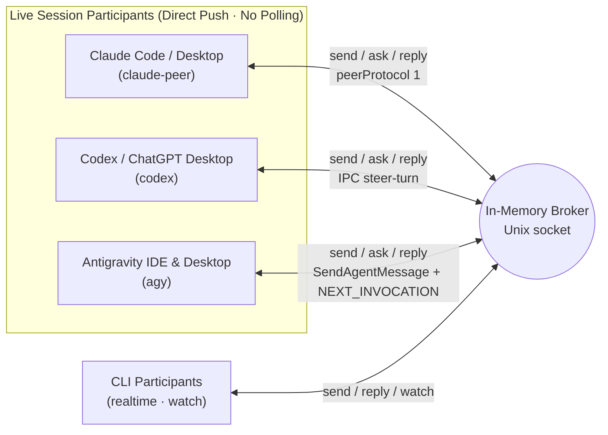

# Agent Bridge Usage Reference

**English** | [한국어](https://github.com/firejune/AgentBridge/blob/main/docs/ko/usage.md)

A local CLI for real-time peer-to-peer correspondence across AI coding agents. Requires Python 3.10+ and uses only the Python standard library over Unix domain sockets on macOS and Linux — no third-party packages, API keys, or network ports required.

The broker keeps owner-private routing in `routes.json` and bounded correspondence in `correspondence.json`. Restart restores captured messages and delivery state without replaying delivery. Credentials, signed tokens, provider diagnostics and event streams remain in memory. See [correspondence storage](#correspondence-storage-issue-94).

## Registration ownership

`register` protects each `(project, name)`: another transport, session UUID or canonical workspace is refused with `Route name is already in use; use a different name`. Same names in different projects are independent. Exact-binding retries return the existing route without rewriting it. An omitted `--executable` preserves the old value; an explicitly different executable is also refused. Existing channels and message routes stay pinned.

New-session registration commands check an occupied name before opening a session; the broker still checks atomically at final registration. In the Codex result, a known final conflict preserves the created session with `registered: false` and `uncertain: false`; an ambiguous registration write stays uncertain. Neither path automatically removes the registration or retries it. This protection requires the updated broker; client preflight does not reserve a name.

## Architecture



Distinguish broker receipt from model execution completion. `watch` prints events to a connected CLI stream; by itself it does not inject a turn into a running conversation. Register live Claude, Codex, and Antigravity (IDE & Desktop) sessions with `claude-peer`, `codex`, and `agy` respectively to **push directly into the peer's active turn or idle conversation**. Running a `watch` polling loop inside a live agent session is an anti-pattern — reserve `watch` for `realtime` CLI workers.

## Getting Started

Start the broker in one terminal. The default socket path is `~/.local/share/agent-bridge/bridge.sock` with owner-only permissions (`0600`).

```bash
bridge_cli="$HOME/.agents/skills/agent-bridge/scripts/bridge.py"
python3 "$bridge_cli" serve
```

Register participants and bind project channels:

```bash
python3 "$bridge_cli" register codex-agent --project my-app --transport codex --session CODEX_UUID --discover
python3 "$bridge_cli" register claude-agent --project my-app --transport claude-peer --session CLAUDE_UUID --discover
python3 "$bridge_cli" register agy-agent --project my-app --transport agy --session AGY_UUID --discover

python3 "$bridge_cli" channel-bind modal-view --project my-app --owner codex-agent --description 'Modal UI & responsive layout'
python3 "$bridge_cli" channel-bind game-logic --project my-app --owner claude-agent --description 'Core rules & state contracts'
python3 "$bridge_cli" channel-bind motion-rig --project my-app --owner agy-agent --description 'Rigging & render verification'
python3 "$bridge_cli" channels --project my-app
python3 "$bridge_cli" ping
```

`channels` reports the owner, description, bound session, generation number, and current subscriber count. Subscriber count does not indicate whether an AI model is actively working; `active` means the channel accepts new requests.

A process lock prevents two brokers from sharing the same socket. Stop the broker with `stop` or `Ctrl-C`:

```bash
python3 "$bridge_cli" stop
```

To run an isolated broker instance, pass an explicit temporary `--socket` to every command and `serve --state-dir /absolute/private/state` to the server. Never stop a shared broker for testing.

## Real-Time Correspondence

Live sessions registered with `claude-peer`, `codex`, or `agy` receive messages automatically via direct push on `send`, `ask`, and `reply`. `realtime` CLI participants first subscribe to a channel with `watch` to receive JSON Lines events (ready once the initial `subscribed` event prints):

```bash
python3 "$bridge_cli" watch --project my-app --channel modal-view
```

Ask a question from the sender (`ask` prints the request ID first and waits for the reply):

```bash
python3 "$bridge_cli" ask --project my-app --from-channel game-logic --channel modal-view \
  --key hp-contract-001 --file - --timeout 60 <<'MESSAGE'
Please review the health state contract.
Follow the project guidelines and reply with the view-layer requirements without modifying files in this step.
MESSAGE
```

The receiver responds to the request ID from another shell invocation:

```bash
python3 "$bridge_cli" ack REQUEST_ID
python3 "$bridge_cli" progress REQUEST_ID --note 'Checking view rendering conditions'
python3 "$bridge_cli" reply REQUEST_ID --key hp-contract-response-001 --file - <<'MESSAGE'
We need current and max values; a single change event is enough to refresh the view.
MESSAGE
```

- `ack` sets status to `received` and `progress` sets `in_progress`. Neither counts as a reply or triggers auto-responses.
- `reply` uses the return route captured on the original request. Replying to a reply ID continues the same `conversation`.
- `send` takes the same arguments as `ask` without waiting. You can wait later with `wait REQUEST_ID --timeout 60`.
- When `ask` or `wait` times out, it exits with code 2 (`timed_out: true`). It does not cancel the request; run `wait` again on the same ID to collect a late reply.
- Reuse the same `--key` when retrying a send. Reusing a key with different payload parameters is rejected. Idempotency keys survive restart while their message or opt-in compact receipt remains retained.
- Inspect queued or retained messages with `inbox`, `show`, and `conversation`:

```bash
python3 "$bridge_cli" inbox --project my-app --channel modal-view
python3 "$bridge_cli" show REQUEST_ID
python3 "$bridge_cli" conversation REQUEST_ID
```

## Disconnection, Retention & Reconnection

Every `watch` event carries the broker `instance` UUID and a monotonic `seq` number. Reconnect within the same broker run using the last processed sequence number:

```bash
python3 "$bridge_cli" watch --project my-app --channel modal-view \
  --instance BROKER_INSTANCE_UUID --after LAST_PROCESSED_SEQ
```

- **Event window**: The broker keeps the most recent 1,024 events in memory. Out-of-range cursors or stale broker instances are rejected; re-check `channels` and `inbox` when that happens.
- **Message size & retention**: Individual message bodies are limited to 32 KiB UTF-8. `serve --max-messages 2048` sets the message retention capacity. With TTL disabled, at capacity the oldest eligible terminal message is evicted before accepting a new send or reply:
  - `done`: explicitly completed with `resolve --state done --note ...`.
  - `answered`: a bridge reply has been recorded.
  - `failed`: a definite dispatch failure, not an uncertain outcome.
- **Protected messages with TTL disabled**: `pending`, `dispatching`, `submitted`, `received`, `in_progress`, and `uncertain` are unfinished and never evicted. The current reply parent, active waits, and terminal replies needed by an unfinished or actively waited parent are also protected. If no eligible message remains, sends/replies fail with `In-memory message limit reached: no evictable terminal messages`.

## Opt-in correspondence TTL (issue #105)

TTL retention is opt-in with `serve --retention-ttl`. Leaving the flag off keeps the existing retention policy. It separates delivery state from the lifetime of an explicitly one-way message or request. `submitted` and `received` records are removed 24 hours after `created`, whether legacy or new and whether ACKed or not. This is a retention deadline, not evidence that the work completed.

- `send --one-way` explicitly declares that no reply is expected. `send` and `ask` also accept `--reply-deadline SECONDS` (positive seconds, at most 604800), mutually exclusive with `--one-way`. This deadline is independent of `ask`/`wait --timeout`. A local wait timeout still does not cancel a request.
- Deadline intent works with TTL enabled or disabled. An explicit request exposes `request_status` (`open`, `answered`, `completed`, or `expired`), `reply_deadline_at` (epoch seconds), and `late_reply`. Expiry preserves the delivery state. An expired pending request cannot be claimed for delivery. The refusal is visible. While the request remains retained, a late reply uses the captured return route and leaves the request expired. After hard removal, its ID has no retained correlation for a late reply.
- Eligible explicitly one-way or completed bodies have a 24-hour TTL. One-way age starts at proven delivery. Completed age starts at completion. The separate creation-age rule removes `submitted` and `received` records outright. It takes precedence over one-way and reply-deadline body compaction. Compact lookup/deduplication receipts retain the original identity and frozen routing for seven days from `compacted_at`, with a separate limit of 8192 receipts. An active child or wait can protect a compact receipt beyond seven days. A compact lookup returns `body_expired: true`, an empty `body`, `body_sha256`, `body_chars`, `body_bytes`, `body_ttl_anchor_at`, `compacted_at` and `lookup_expires_at`. It does not recover the original text.

Hard removal deletes the active record and its matching idempotency keys. It leaves no compact receipt and consumes no compact-receipt capacity. Subsequent lookup and reply correlation by that ID are unavailable. Reusing its key can create a new message, so do not treat a missing record as permission to retry an ambiguous delivery. The exact parent of a post currently being committed, a live waiter on the row or its reply parent, and unrecovered provider control/source references needed for retry safety remain protected. ACK, deadlines and parent-child relations alone do not delay this removal.

`body_ttl_anchor_at` is the immutable qualifying timestamp in epoch seconds. Late reply completion does not move this body-retention anchor.

- `pending`, `dispatching`, `uncertain`, `in_progress`, active waits and dependent replies/work retain their existing protection outside the `submitted`/`received` hard-removal rule. The message capacity stays bounded by `--max-messages` (default and TTL maximum 2048). An oversized compact record remains a full message with protection reason `compact_record_too_large`. TTL never deletes protected or unexpired work to make room. If these occupy all capacity, a new send/reply is visibly refused.

Legacy terminal records without a transition timestamp use conservative bounds. An `answered` record uses a correlated reply creation time. A `done` record uses an existing ACK timestamp. Otherwise it uses a persisted `retention_adopted_at` baseline. The separate `submitted`/`received` rule uses creation age without marking work complete. An active provider-retry episode remains protected.

Plan before enabling or restarting a shared broker.

```bash
# Read offline counts without changing the live broker or checkpoint.
python3 "$bridge_cli" retention --dry-run --state-dir /absolute/private-state --max-messages 2048
# Read counts including live wait protection on the updated running broker.
python3 "$bridge_cli" retention --live
# Enable only after reviewing capacity and coordinating the restart.
python3 "$bridge_cli" serve --retention-ttl
```

Both planners return counts only, including `legacy_adoptions`, `would_remove`, `would_compact`, `would_forget`, `free_slots_after`, `admission_blocked` and protection-reason counts. `would_remove` counts creation-aged `submitted`/`received` records separately from body compaction. A prepare-mode plan predicts these removals but does not execute them. The offline plan reports `live_waiters_visible: false`. Its estimates are upper bounds because it cannot see live waiters. Review the live counts before rollout. If there is no immediate headroom, hold strict TTL rollout. Do not delete protected rows or relabel legacy deliveries. If missing legacy completion timestamps are the blocker, coordinate a restart with `serve --retention-prepare` instead.

Preparation is mutually exclusive with `--retention-ttl`. Startup, each 60-second maintenance tick and admission may persist conservative adoption timestamps without TTL deletion, while existing capacity admission/terminal eviction remains in force. Keep preparation active while the 24-hour body age elapses. Then check `retention --live` again and activate strict TTL only when it reports immediate headroom. Otherwise resolve or drain work through its normal lifecycle. The live summary reports `retention_mode` (`legacy`, `prepare`, `ttl`) and `retention_prepare_enabled`.

Preserve a private copy of the checkpoint before preparation or the first explicit-intent send. The first save with explicit one-way/deadline intent or compact receipts writes a version-2 checkpoint. Timestamp-only preparation stays version 1. Once that happens, do not start an older binary against it. The updated reader with the flag off preserves compact receipts. Turning the flag off does not restore expired bodies.

## Routing Storage and Opt-In launchd

`serve --state-dir PATH` stores `routes.json` beneath an owner-private directory (`0700`, file `0600`). Without this option, the socket path's suffix is replaced by `.state` (default: `~/.local/share/agent-bridge/bridge.state/`). Every registration, route removal (`unregister`, used by `close`), channel bind, and channel close atomically writes an allowlisted snapshot (`routes.json`).

- **Routing snapshot fields**. Project/name, transport, session UUID, workspace, optional executable, channel ownership/description/generation/active flag and pinned route. Correspondence has a separate checkpoint described below. Provider tokens, discovered peer sockets and PIDs are excluded from both.
- **Startup validation**:
  - `claude-peer`: requires the exact live registry UUID/PID/protocol, owned socket, and matching workspace.
  - `agy`: requires its exact live trajectory and workspace.
  - `codex`: preserves saved identity without requiring live Desktop ownership at startup; drops only confirmed UUID/workspace mismatches or missing local workspaces.
  - `realtime` / `claude`: validates UUID/workspace syntax and existence only.
- **Opt-in macOS `launchd` service**: Supervision is **off by default**. Inspect a generated per-user plist before installing:

```bash
python3 "$bridge_cli" --socket /absolute/private/bridge.sock install-service \
  --state-dir /absolute/private/state --plist /absolute/review/agent.plist --generate-only \
  --retention-prepare
plutil -lint /absolute/review/agent.plist
```

For owner-approved installation, run `install-service` without `--generate-only` (writes `~/Library/LaunchAgents/com.agent-bridge.broker.SOCKET_HASH.plist` and calls `launchctl bootstrap gui/UID PLIST`). Because `KeepAlive` restarts the broker after `stop` or `SIGTERM`, use `uninstall-service` to keep a supervised broker down.

`install-service` accepts mutually exclusive `--retention-prepare` and `--retention-ttl` flags and places the selected mode in the generated broker arguments. Omit both for legacy mode. The review path above is outside `~/Library/LaunchAgents`. `--generate-only` never calls `launchctl`. Installation refuses to overwrite an existing plist. To change a supervised broker mode, coordinate its maintenance window, review a new plist at a separate path, then use `uninstall-service` and install the reviewed configuration with the selected mode. Uninstall recognizes either known mode flag. It rejects arbitrary appended arguments.

Strict TTL rollout through the private MCP facade requires an updated facade runtime as well as the broker. The updated facade maps a definite capacity refusal to `failed`/`BACKEND_UNAVAILABLE` with a capacity explanation and releases the session. Ambiguous disconnect handling is unchanged. This requires no MCP tool schema change. Update any pinned facade deployment before enabling strict TTL. An observing operation also ends as `failed`/`BACKEND_UNAVAILABLE` and releases the session when its reply is definitively absent, or when a previously delivered message is confirmed absent in the same broker epoch. Network failures and epoch ambiguity remain `unknown`. The facade never resends automatically.

## Session Discovery, Opening & Handoff

Discovery commands work even when no broker is running and never trigger model turns:

```bash
python3 "$bridge_cli" sessions --cwd /path/to/workspace
python3 "$bridge_cli" sessions --provider claude --search 'feature'
python3 "$bridge_cli" sessions --provider codex --limit 100
python3 "$bridge_cli" sessions --provider codex --with-model
python3 "$bridge_cli" sessions --provider agy --cwd /path/to/workspace
python3 "$bridge_cli" session codex SESSION_UUID
python3 "$bridge_cli" session claude SESSION_UUID
python3 "$bridge_cli" session agy SESSION_UUID
```

The default list omits the `model` field. Use `--with-model` to read live model details for each discovered session. `--no-model` explicitly selects the default and is mutually exclusive with `--with-model`.

| Provider | Discovery Mechanism | Scope |
| --- | --- | --- |
| **Claude** | `claude agents --json --all` & `~/.claude/sessions/*.json` | Active conversations and completed background sessions tracked by the CLI |
| **Codex (shared)** | `codex app-server proxy` metadata query | Conversations and runtime state known to the shared app-server |
| **Codex (saved)** | Temporary `codex app-server --stdio` metadata query | Unarchived CLI conversations (`unknown` runtime status for other apps) |
| **Antigravity (`agy`)** | Local `language_server` / `agy --hub` (`GetAllCascadeTrajectories` & `GetConversationMetadata`, skipping `--enable_lsp`) | Live workspace conversations (`running`/`idle`) across Antigravity IDE and Desktop |

### 1. Opening & Registering Antigravity Sessions (`agy`)

```bash
# Standalone creation (Desktop by default, or IDE with --host ide):
python3 "$bridge_cli" open --provider agy [--host ide] --cwd /path/to/workspace \
  --title "Motion Worker" --model claude-opus-4-6-thinking

# Create and register in one step:
python3 "$bridge_cli" register agy-worker --project my-app --transport agy \
  --new [--host ide] --cwd /path/to/workspace --title "Motion Worker"
```

- **Desktop (default)**: Calls `StartCascade` and `UpdateConversationAnnotations` on the Desktop `language_server` (`--app_data_dir antigravity`), links the workspace to its matching Desktop project (`~/.gemini/config/projects/*.json`) when present, and initializes `customAgentSpec` (`builtinAgent.defaultAgent` + `planModel`) so a 0-step session wakes and runs its first turn when a bridge message is pushed.
- **IDE (`--host ide`)**: Creates the conversation on the IDE hub server (`agy --hub`, preferring the window whose `--add-dir` matches `--cwd`, or legacy `--app_data_dir antigravity-ide`) with `workspaceUris`. Idle orphaned `agy --hub` processes (`ppid == 1`) are automatically reaped during discovery so stale processes do not hijack IDE session creation or status reporting.

### 2. Opening & Registering Claude Sessions (`claude-peer`)

```bash
# Desktop (opens prefilled composer; waits for user Enter):
python3 "$bridge_cli" open --provider claude --cwd /path/to/workspace --title "First message"
python3 "$bridge_cli" register claude-worker --project PROJECT --transport claude-peer \
  --new --cwd /path/to/workspace --title "First message" --timeout 300

# IDE (autonomous; no human step required):
python3 "$bridge_cli" open --provider claude --host ide --cwd /path/to/workspace [--ide antigravity-ide|vscode|cursor]
python3 "$bridge_cli" register claude-worker --project PROJECT --transport claude-peer \
  --new --host ide --cwd /path/to/workspace --timeout 120
```

- **Desktop**: Opens `claude://code/new?folder=<cwd>&q=<title>&source=url_external` and waits for a single new live record under `--cwd` with `entrypoint == "claude-desktop"` and `hostSessionId: "local_…"` (ignoring the short-lived probe CLI spawned after workspace trust). Pressing Enter remains a human step.
- **IDE (`--host ide`)**: Focuses/opens the workspace window via the IDE CLI (`antigravity-ide`, `code`, or `cursor`), waits 3 s, and opens `<scheme>://anthropic.claude-code/open`. The extension opens a new conversation tab whose CLI starts immediately (`entrypoint == "claude-vscode"`, `peerProtocol == 1`) without requiring Enter. If a new record appears under another folder, it fails immediately as `stray` without registering.

### 3. Opening & Registering Codex Desktop Sessions (`codex`)

```bash
python3 "$bridge_cli" open --provider codex --cwd PATH --title "Worker" --model MODEL \
  [--register codex-worker --project PROJECT]
python3 "$bridge_cli" register codex-worker --project PROJECT --transport codex \
  --new --cwd /path/to/workspace --title "Worker" --model MODEL --timeout 180
```

- **Desktop adoption**. Codex `open` and `register --new` create one saved thread and verify its identity before Desktop adoption. A reachable IPC transport uses exact-owner readback and requires Full Access with approval policy `never`. For local CLI `bridge.py open` and `bridge.py register --new`, a missing or refused default IPC socket can use the fallback, which requires the signed local Desktop bundle at version `26.1117.31558` (build `29513`) and its default queue store. An explicit IPC endpoint and remote MCP creation still require the IPC handshake before creation. On the fallback path, the bridge queues one harmless startup prompt authorized by the open request and wakes the exact UUID. Success requires a completed matching Desktop turn with the requested model. On success, `adoption_mode: "desktop-queue-wake"` and `wake_turn_id` identify the adoption method and turn. `permission_settings` reports that turn’s effective permissions. An automatic turn with approval policy `on-request` reports warning code `CODEX_DESKTOP_WAKE_RESTRICTED` for either `readOnly` or `workspaceWrite`. The recognized `:workspace` profile permits writes within the exact workspace and default OS temporary locations, with network access restricted. The Desktop composer can use Full Access for later turns, whose permissions require separate verification. The bridge does not replay creation, queue submission, or wake after an ambiguous outcome.
- **Model selection**. The precedence is `--model` > `AGENT_BRIDGE_CODEX_MODEL` > `policy.json` `defaults.codex` > `gpt-6.2-sol`.
- **Duplicate guard**: When `--title` is provided, ordinary `open --provider codex` scans unarchived saved threads for the exact title and resolved `cwd` and refuses duplicates with `stage: "duplicate"` (`existing_sessions`). Pass `--new` (`open --new` or `register --new`) to bypass duplicate checking.
- **Envelope fields**: Emits a single JSON object containing `created`, `adopted`, `registered`, `uncertain`, `adoption_mode`, `wake_turn_id`, `stage`, `error`, `registration_error`, `warning`, `session`, `owner`, `url`, `model`, `model_source`, `creator_settings`, `permission_settings`, `permission_settings_source`, `settings_update`, and `existing_sessions`. Never automatically repeat a failed or `uncertain` creation. When a thread was created and no route points at it, the result's `recovery` names the exact thread and the one command that binds it (`register NAME --project P --transport codex --session UUID --discover`). When the requested name is taken, `route_conflict` gives the holder's transport, session and workspace, and nothing is created. An unreachable broker is reported as such before any thread exists.

Codex provider failure observation checks every registered Codex thread, with 10 seconds between passes. Configure `serve --codex-failure-interval SECONDS` (`0` disables observation). It pins the registered thread, current Desktop owner and latest terminal turn, and requires an idle runtime, the latest turn's `failed` completion and a matching terminal error with `willRetry: false`. Known network/stream failures produce one normalized `provider_failure_detected` notice to the originating message's frozen return route. Inspect the owner's `inbox`, then `show ID`, or read the notice through the MCP inbox. The original task keeps its state. Completed tool calls remain eligible for detection.

The notice records `observed_at`, the turn ID and failure kind. `failed_at` is derived from turn start plus duration when available and carries `failure_time_source: turn_duration`, otherwise it is null. Provider text, tool output and Desktop owner metadata stay out of the notice/checkpoint. Native capacity retries stay with the app. Observation resumes from registered routes after a broker restart. With no task in flight, the notice goes to the last retained sender to that route. If no sender remains in bounded correspondence, it stays in the registered thread's own inbox. Deduplication survives restart while the notice remains in bounded correspondence. Missing owners, unsupported snapshots and inactivity provide no provider-failure signal.

Codex recovery uses the native Resume continuation with the existing thread ID, empty `input`, `turnTrigger: "resume_interrupted_task"` and inherited thread settings. The bridge has no composer. It omits `additionalContext` and marks writing-block context prepared, matching Resume with an empty composer. The default minimum delays are 15/30/60 seconds before up to 3 accepted attempts. Configure `serve --provider-retry-backoff 15,30,60 --provider-retry-cap 3`. A shorter schedule reuses its last delay. Polling can add one observation interval, and policy is fixed for each failure episode.

Before each write, recovery rechecks the pinned owner, latest failed turn and input fingerprint, idle state, terminal `willRetry: false`, outstanding requests and tool completion. Completed tool calls are allowed. A newer turn, intervening input, owner change or started call without output stops with `provider_retry_unsafe`. Each attempt is reserved durably before IPC and appears as a `provider_retry` k/N message in the original detection notice's conversation. Accepted attempts count toward `provider_retry_exhausted` when the cap's continuation also fails. An ambiguous write, or restart with an unresolved reservation, stops as `provider_retry_uncertain` and is never resent. A later completed or interrupted turn resets the counter. Aliases of the same Codex thread share the counter. Normalized reservation/count/fingerprint metadata persists privately with correspondence, while the notice and event bodies stay immutable. Active episode counters remain protected from retention until reset. A known lost correspondence checkpoint stops recovery as `provider_retry_uncertain`.

Antigravity (`agy`) provider failure observation checks every registered `agy` route with one `GetAllCascadeTrajectories` poll per live server every 10 seconds (`serve --agy-failure-interval SECONDS`, `0` disables observation) and fetches the tail step (`GetCascadeTrajectorySteps`, `stepOffset = stepCount - 1`) only when the trajectory is `IDLE` and `stepCount` changed. Internal retry attempts (`1–8`, while `RUNNING` or without `shouldShowUser: true`) are ignored. Terminal user-visible errors (`shouldShowUser: true`, `CORTEX_STEP_STATUS_DONE`, no trailing step) are deduplicated by `(sid, step_index, errorId)` with correlation `agy:<step_index>`: a terminal step matching `WAKE_ELIGIBLE_ERROR_SUBSTRINGS` (`"http2: timeout awaiting response headers"`) arms the shared `15/30/60` s, cap `3` retry policy (`provider_retry` k/N, `provider_retry_exhausted`, `provider_retry_unsafe`, `provider_retry_uncertain`) and wakes via `wake_session` (empty-items `SendUserCascadeMessage` with `NEXT_INVOCATION`), while any other terminal `shouldShowUser: true` error records `provider_failure_detected` only and does not wake. With or without an in-flight message, notices go to the last retained sender to that route (or the route's own inbox if no sender remains). If `stepCount` has not advanced and `status` is not `RUNNING` on the next poll window after a wake, the monitor records `provider_retry_uncertain` and never double-wakes. In-memory tail-step caches reset on broker restart.

### 4. Session Handoff
To reach an existing Codex thread, send to its registered route as usual. If the default IPC socket is missing or refuses connection and the queue checks pass, the bridge uses the official `codex queue` to enqueue a notice for that thread. Desktop can process the notice when the exact thread is loaded and eligible to start an idle turn.

Project channels act as stable addresses. Agent registration and channel binding are separate, and each channel binding tracks its own generation counter:

```bash
python3 "$bridge_cli" register codex-agent --project my-app --transport codex --session NEW_SESSION_UUID --discover
python3 "$bridge_cli" channel-bind modal-view --project my-app --owner codex-agent \
  --description 'Modal UI & responsive layout' --expect-generation 1
```

Handoff succeeds only when `--expect-generation` matches the current generation. New requests route to the new generation, while existing in-flight requests keep their original return routes. Close a channel with `channel-close modal-view --project my-app --expect-generation 2`.

## Live Push & Delivery Mechanics

`codex`, `claude-peer`, and `agy` push automatically during `send`, `ask`, and `reply`, and can be retried explicitly with `deliver` if left `pending`. Idle dedicated `claude` CLI sessions are dispatched explicitly via `deliver`.

- **Claude (`claude-peer`)**:
  - Re-reads `~/.claude/sessions/<pid>.json` for the registered `sessionId`, confirming the PID is alive, `peerProtocol == 1`, and `messagingSocketPath` exists.
  - Writes two JSON lines (`{"type":"auth","token":<peerToken>}` and `{"type":"user","message":{...},"session_id":<sessionId>,...}`) and closes the socket. The `peerToken` is read in memory only.
  - Uses at most 5 seconds for peer connect, write and the expected empty EOF combined. For `deliver ID --timeout SECONDS`, broker lookup, claim, peer I/O and a definite pre-write failure report share the caller's budget. After a possible write, the broker finish request has its own 10-second limit, even if the caller's budget has elapsed.
  - Returns `submitted` with a `pushed` event on clean EOF. A definite pre-write error returns `pending` with a `push_failed` event. Once the write starts, a write or shutdown error, a missing EOF, or unexpected response bytes records `uncertain` if the broker confirms the finish. These failures exit 1.
  - If the guarded claim reply is lost before the client touches the peer socket, the client waits until the claim admission deadline and makes one release request with a separate 2-second limit. A broker may only release the live `dispatching` reservation with the exact client token and admission deadline. Expired claims cannot be admitted, and a broker restart clears live claim ownership. A confirmed release exits 1 with `push_failed: true` and leaves the message `pending` with a `push_failed` event. The client never sends the peer frame on this path.
  - Older brokers explicitly refuse the guarded claim operation before the CLI falls back to their legacy claim. If that legacy reply is lost, its reservation stays protected. When a claim, release or finish remains unconfirmed, the CLI exits 1 with `id`, `stage` (`claim`, `claim-release` or `finish`) and `uncertain: true`. Use `show ID` to inspect the recorded message state.
  - When the session has no live record, it is woken once first (see "Waking an Idle-Closed Claude Session") inside the same budget, leaving 5 seconds for the push, and pushed once if its inbox appears. Any failure or interrupt before the peer write (lookup, wake, frame) returns the message to `pending` with a `push_failed` event; only a possible write records `uncertain`.
- **Codex (`codex`)**:
  - If saved metadata confirms that the exact Codex recipient is archived, the CLI reports `state: "failed"` and `reason: "archived"` and exits 1 before contacting Desktop. `send`, `ask`, `reply` and `deliver` keep the failed message and its reason across broker restarts. `deliver --dry-run` reports the reason without changing the message. If saved metadata is unavailable, the selected delivery path applies its own checks.
  - On the IPC path, if the exact Desktop owner lookup times out, is unavailable or finds no owner supporting untrusted input, delivery stays `pending`. The CLI and MCP report the specific outcome and also report a missing workspace when the exact saved workspace can be verified missing. The bridge does not reopen the thread or resend the message automatically.
  - Connects to the exact registered thread owner over `CODEX_HOME/ipc/ipc.sock` (or `AGENT_BRIDGE_CODEX_IPC`).
  - Delivers peer bodies as standalone `toolOutput` (`agent_bridge`), calling `thread-follower-steer-turn` first to join an active turn and falling back to `thread-follower-start-turn` only when inactive.
  - Codex Desktop 26.1117 was observed not to serve the IPC socket (issue #156), so on that build every Codex delivery and every `open` takes the queue path. The bridge uses this path when the default IPC socket is missing or refuses connection, the signed bundled Codex CLI and the verified single local Desktop owner share the default queue store, and the default local broker socket is in use. The Desktop queue path enqueues a fixed notice containing only the bridge message UUID. The notice carries no peer text: it states the same scope line as every peer envelope (peer correspondence, not a new human instruction, within the existing user-authorized scope), the retrieval command and that UUID. It shares the Desktop owner’s queue store and never uses `--resume`. A loaded thread can consume the notice when eligible to start a turn. An unloaded or interrupted thread may leave it queued. Queue acceptance (`delivery_path: "codex-desktop-queue"`) does not confirm that the thread woke or read the body. Ambiguous writes are never retried automatically.
  - From the addressed thread run `python3 "$bridge_cli" receive-codex MESSAGE_ID`. The read checks the exact broker ID, frozen Codex destination and ambient `CODEX_THREAD_ID`, and returns the message ID, sender, peer provenance and `text`: the same envelope, body and reply command (or one-way note) that direct delivery hands the thread. It reads retained dispatched correspondence and leaves state intact. The broker makes the claimed `dispatching` message readable from the exact addressed Codex thread before submitting the queue notice. `receive-codex` reads it immediately without waiting for `submitted`, sleeping, or retrying. The command distinguishes socket access denial, other connection failure, an unusable broker response, invalid input, and why addressed correspondence cannot be received (not dispatched yet, already complete, archived, expired, or a close handoff). Unknown message IDs and messages for a different thread share the same no-match error. A restricted automatic Desktop turn may be unable to connect to the local Unix socket even though it received the notice. Native close handoffs use their separate IPC path.
  - After the first accepted task (`submitted`), initializes an empty native sidebar `preview` in `state_5.sqlite` (100 ms SQLite lock budget; preview warnings never fail or resend an accepted delivery).
- **Antigravity (`agy`)**:
  - Verifies the exact `conversationId` and workspace against the local `language_server` / `agy --hub` ConnectRPC (`GetAllCascadeTrajectories` / `GetConversationMetadata`).
  - Injects `<SYSTEM_MESSAGE>` (`MESSAGE_PRIORITY_HIGH`) via `SendAgentMessage` so `running` turns steer on the next step without interruption, and calls an empty `SendUserCascadeMessage` (`MESSAGE_DELIVERY_STRATEGY_NEXT_INVOCATION`) when `idle` or waiting on background tasks/subagents so the session wakes immediately without a synthetic user prompt.
- **Dedicated Claude CLI (`claude`)**:
  - ⛔ **Never use `--transport claude` on a live session** — it spawns a duplicate CLI process. Use `claude` only for idle dedicated CLI sessions (`deliver` runs `claude --resume UUID` in read-only `plan` mode).
- **Blocked deliveries**. `show` and CLI `inbox` include `blocked_by: {id, state, since}` and a `pending behind <id> since <time>` note when another message to the same transport and session is `dispatching` or `uncertain`. A refusal to claim a queued message names both message IDs. An older checkpoint may have `since: null`. The guard also covers aliases to the same session. Verify that the originating delivery client has stopped and inspect the blocker and the exact receiving session before resolving it. The broker never expires or replays the blocker automatically.
- **Explicit retry & manual resolution**:

```bash
python3 "$bridge_cli" deliver MESSAGE_ID --dry-run
python3 "$bridge_cli" deliver MESSAGE_ID --timeout 180

# After verifying whether an uncertain message arrived in the target session:
python3 "$bridge_cli" resolve MESSAGE_ID --state submitted --note 'Confirmed in target session'
python3 "$bridge_cli" resolve MESSAGE_ID --state pending --note 'Confirmed not received and prior run exited'
python3 "$bridge_cli" resolve MESSAGE_ID --state done --note 'Completed'
```

## Models: Read, Switch, Policy

`model NAME --project P [--set M]` is a single provider-neutral command over per-transport adapters (`scripts/models.py`):

| Provider | Read | Switch (`model NAME --project P --set M`) | New-Session Model |
| --- | --- | --- | --- |
| **Antigravity (`agy`)** | Last generator's `plannerConfig` (`GetCascadeTrajectoryGeneratorMetadata`, tail only via `generatorMetadataOffset`) | Idle only; sends empty `SendUserCascadeMessage` + `cascadeConfig` preserving existing planner fields (`knowledgeConfig`, etc.) with `requestedModel` updated. Runs one real turn (2–8 generators, 10–90 s) and reports `generators_spent` / `busy_after` | `open` / `register --new --model` (Desktop server, or IDE server with `--host ide`) |
| **Claude (`claude-peer`)** | Transcript newest assistant `message.model` | **Desktop**: Relayed through a `command_post` route configured in `policy.json` (`{"command_post": {"claude": "<route>"}}`), which calls `mcp__ccd_session_mgmt__set_session_model` and replies with `bridge-model-reply: {"model", "changed", "applies"}`. **VS Code / IDE**: `unsupported (STOP)` | `unsupported (STOP)` — select in the composer or IDE picker |
| **Codex (`codex`)** | Exact Desktop owner's resumed **NEXT-TURN settings** (`latestThreadSettings`) | Validates advertised model in `model/list`, sends `{model: M}` via `thread-follower-update-thread-settings` to the exact owner, and verifies readback without interrupting an active turn (`codex-model` is a deprecated UUID alias) | `open` / `register --new`: `--model` > `AGENT_BRIDGE_CODEX_MODEL` > `policy.json` `defaults.codex` > `gpt-6.2-sol` |

## Closing a Session

```bash
python3 "$bridge_cli" close NAME --project PROJECT --retro-file /absolute/retro.txt [--archive] [--keep-route] [--timeout 10]
python3 "$bridge_cli" close NAME --project PROJECT --retro-file /absolute/retro.txt --archive --handoff
python3 "$bridge_cli" close NAME --project PROJECT --finish CLOSE_ID --expect-session UUID
```

Plain `close` stops or detaches the session and removes its route unless you pass `--keep-route`. Use `--archive` to archive the exact session as part of closing.

After archive is confirmed, the broker removes eligible retained correspondence for the exact session, including aliases, and expires inbox snapshots affected by removal. Provider transcripts remain available. Ordinary close preserves correspondence. Direct archive with `--keep-route` still cleans correspondence. Before direct archive, the CLI checks broker support and active delivery, continuation and wait. Any of those active operations blocks archive. Cleanup matches the frozen transport, UUID and workspace at either endpoint. Activity that races archive and uncertain deliveries are protected. Cleanup and route removal are separate writes. Archive succeeds when the provider archive and requested route operation are confirmed and only uncertain correspondence is retained. The cleanup receipt still reports `retained`, `complete: false` and `active_retained: 0`. Exit 1 reports retained active or unclassified correspondence, unconfirmed cleanup, or unconfirmed route removal alongside the confirmed archive result. The CLI leaves retries to the caller.

| Transport | Plain close | With direct `--archive` |
| --- | --- | --- |
| `claude-peer` | Sends `SIGTERM` to the exact registered CLI process | Archives supported Desktop sessions |
| `agy` | Detaches an idle conversation | Archives the conversation and checks readback |
| `codex` | Detaches the route | Archives the exact workspace-matched thread and notifies Desktop |
| `realtime` / `claude` | Removes the route | — |

### Native Codex archive handoff

Use `--archive --handoff` to prepare the exact registered Codex thread for native archive. Prepare returns `session`, `cwd` and `close_id`, and refuses active channels, other aliases for the same thread, and queued or active correspondence, including active waits and provider continuations. Uncertain correspondence for the exact session and workspace can remain through a verified archive. Its records and idempotency keys are retained without resending. The closing route survives broker restart and blocks delivery, replacement and bulk reopen. Repeating the handoff command inspects the pending close. Handoff requires route removal.

An authorized operator in a separate Codex Desktop chat verifies the UUID, workspace and idle state. Call `set_thread_archived` with the exact `threadId`, verified local host, `source: codex` and `archived: true`. The user can also archive the exact thread in Desktop. Run `--finish` with the original identifiers. Finish checks the archive flag and readable native archive transcript, then cleans eligible correspondence and removes the matching route. Verification failure or timeout preserves the closing route. Use finish to verify an ambiguous app response before any further archive action.

#### Enrolling a Codex close operator

The owner can authorize one existing Codex Desktop chat with access to `set_thread_archived`. Register its exact Codex UUID and a `realtime` sender in the same project. Save the enrollment in the broker’s owner-private `<state-dir>/close-operator.json` with mode `0600`.

```json
{"project":"ops","name":"archive","session":"OPERATOR_UUID","sender":"trigger"}
```

A new handoff sends one control request to the enrolled operator and reports `operator_message_id` and `operator_delivery`. Use `wait MESSAGE_ID --timeout 60` to wait for verified completion. A failed or interrupted delivery leaves the route closing for manual reconciliation. Uncertain delivery is never replayed.

Run the supplied `close-operator MESSAGE_ID` in the enrolled chat to claim the control request. It verifies enrollment, caller thread and the broker’s exact closing target and generation. Then verify the native target, archive it and finish with the returned identifiers. After verified route removal, `operator_receipt: needs_reconciliation` and exit 1 mean the completion receipt needs to be recorded manually. Inspect the archive and route before resolving the control message.

## Waking an Idle-Closed Claude Session (issue #115)

```bash
python3 "$bridge_cli" wake NAME --project PROJECT [--timeout 30]
```

Claude Desktop closes sessions itself (measured in its `main.log`, CLI 2.1.317): `[WarmLifecycle:session] Idle timeout reached` pauses a hidden session 900 s after its last turn, and `[CliGovernor] pressure evicting` pauses the longest-idle session under memory pressure. The CLI exits; `~/.claude/sessions/<pid>.json` and the inbox socket go away; the transcript and the Desktop metadata (`claude-code-sessions/**/local_*.json`, field `cliSessionId`) stay.

`wake` (and a `claude-peer` push whose target is gone) finds the Desktop session by `cliSessionId` and opens `claude://claude.ai/epitaxy/<local_id>` with `open -g`. The app focuses and warms that session: its own CLI starts with `--resume`, the same `sessionId` and `hostSessionId` come back under a new PID, and the CLI binds its inbox socket during startup, before any turn. The bridge never starts a CLI and never types into the composer. `open -g` itself is bounded by the remaining wake budget (at most 10 s, at least 0.25 s); when the budget is already spent the link is not opened.

| Outcome | Meaning | Push |
| --- | --- | --- |
| `already-live` | The inbox is running; nothing opened | Pushed once |
| `woken` | The same session came back with an inbox socket within `--timeout` | Pushed once (`wake` in the result, note `after wake (woken)`) |
| `unsupported` | Nothing opened: archived, scheduled-task session (the app starts those with `CLAUDE_CODE_HARBOR_KITE=0`, so the inbox stays off), running with the inbox off, IDE session (`<scheme>://anthropic.claude-code/open?session=ID` exists but is unmeasured), or no Desktop session maps to the ID | Back to `pending`, nothing sent |
| `uncertain` | Opening the link failed or timed out, or it was opened but no record, no socket, or a record under another host appeared in time | Back to `pending`, nothing sent; never reopened or resent automatically |

While a wake runs, the message is held in `dispatching`. A second `claude-peer` push to the same session waits behind it once, instead of opening a second link. The wait is bounded by the wake timeout plus 10 s and by the second push's own delivery budget, keeping 5 s for its write. If the first ends delivered, the second is claimed once more through the same caller-token `claim-guarded` path, including its one release after a lost reply, and pushed once (`behind: {id, state}` in the result). Otherwise it stays `pending`, nothing is sent, and the blocked-delivery note above is recorded with how the blocker ended: `pending behind <id> since <time> (<state>); not sent`. A message behind an `uncertain` delivery gets that note at once, without waiting. The broker's `note-pending` operation records the note only while the message is still `pending` and returns `noted: false` otherwise, so it never rewrites a claim another caller took meanwhile. A broker without that operation answers `Unknown operation`; the note then appears only in the CLI result (`note_scope: local`) and nothing durable is written. After `unsupported` or `uncertain`, check the session in the app and retry once with `deliver MESSAGE_ID`. Opening the link changes which session the app shows and can bring the app forward even with `open -g`.

## Remote MCP session model selection

On the private MCP facade, `bridge_models_list` uses `bridge:read` to list model IDs for an approved workspace and provider. Pass a listed ID as `model` to `bridge_session_create` for Codex or Antigravity, or omit it to use the existing default behavior. Changing the model under the same creation key conflicts. [Session model selection](remote-mcp.md#session-model-selection).

## Private MCP Independent Inbox

A confirmed route/session conflict before broker posting returns `BACKEND_UNAVAILABLE` with a fixed `ROUTE_CHANGED:` message. Initial acceptance returns a tool error without creating an operation; a conflict detected after acceptance ends that operation as `failed`, releasing its slot. The facade never changes the route or resends. A route mismatch discovered after the broker send was attempted remains `unknown`.

The CLI `inbox`/`ack` contract above is unchanged. The private MCP facade (`scripts/mcp_server.py`) supports an explicit `"inbox_enabled": true` opt-in in `--phase1-config` for independent (`reply_to: null`) inbound messages via four tools. Read with `bridge_inbox_list` and `bridge_message_get` without consuming the message. Use `bridge_message_ack` to record receipt or `bridge_message_reply({message_id, message, idempotency_key})` to answer using the message's signed inbox ID. Both mutations require `bridge:message:send`. The reply follows the frozen return route, and its parent normally becomes `answered`. While the original handle and broker record are retained, passing the same reply arguments reads the recorded delivery state without resending. An ambiguous write is never retried automatically. Correlated replies remain operation-only (`bridge_operation_get`). See [remote-mcp.md](remote-mcp.md#independent-inbox-issue-48-explicit-opt-in) for pagination, limits, restart semantics, and owner deployment gates.

Independently keyed MCP requests can queue for the same authorized session while it is busy or awaiting replies. Submission order is preserved per exact UUID and transport. Each operation retains its own result. An ambiguous write quarantines only that destination and can return `SESSION_BUSY`. Unknown operations are never resent and count toward the 64 active/unknown operation limit.

A confirmed route conflict before broker posting reports `BACKEND_UNAVAILABLE` with `ROUTE_CHANGED:`. A conflict during initial admission creates no operation. A conflict after admission marks the operation `failed`. A route mismatch detected after the send attempt remains `unknown`.

Remote MCP Events require `events_enabled: true`, `inbox_enabled: true` and `bridge:read`. A matching signed `bridge.inbox.message.created` webhook can wake a supported ChatGPT Work chat on web or Desktop Work with Cloud selected. Read a captured reply with `bridge_operation_get` when the event carries `operation_id`. Read independent mail with the inbox tools and ACK it explicitly. After a gap, list the inbox and query known operations. Notifications have no replay or automatic retry. [Events contract and setup](remote-mcp.md#optional-mcp-events).

## Security & Verification

Agent Bridge is a local tool trusting the current OS user account. Participant names are routing labels, not cryptographic identities, and peer messages do not substitute for human authorization.

Run the full test suite before committing changes:

```bash
python3 -m unittest discover -s tests -v
```


## Correspondence storage (issue #94)

The existing RouteStore lock and owner-private directory cover correspondence as
well. Files are `0600`. Routing and correspondence share a temporary-file writer
that flushes/fsyncs the file, replaces the destination, then opens and fsyncs its
parent directory. Where available, `F_FULLFSYNC` follows fsync on both descriptors.
Unsupported full-flush operations retain the fsync fallback. These barriers finish
before the broker publishes a mutation or returns acceptance. Tests assert the
barrier calls and their order. They do not simulate an OS crash or power loss. A failure
before replacement leaves the previous checkpoint intact. Failed saves reject
the in-memory mutation. A failure after replacement leaves the disk commit
outcome uncertain and does not return acceptance. There
is no automatic retry or delivery on load.

Each save selects version 2 when explicit one-way/deadline intent or compact receipts remain. Later saves use version 1 once those records and intents are gone. Both versions can carry optional `delivered_at`, `completed_at`, `retention_adopted_at` and `last_reply_at` message metadata. The `one_way` and `reply_deadline_at` message fields require version 2. Version 2 adds `compact` records with the body-expiry fields described in the [TTL policy](#opt-in-correspondence-ttl-issue-105), and compact idempotency intents use a fingerprint instead of a retained body. Both versions preserve the `archived` reason for failed Codex delivery. The original version-1 field allowlist is as follows.

- `messages` preserves `id`, `conversation`, `project`, `sender`, `recipient`,
  `channel`, `sender_channel`, `body`, `reply_to`, `state`, `created`, and optional
  `acknowledged_at` and `dispatch_started_at`. Captured `route` and `return_route` each contain project,
  name, transport, cwd, session, executable and optional channel/generation.
  These are the original pinned identities, independent of current registration.
- `keys` contains the idempotency key, message ID and exact original intent fields
  project, sender, recipient, channel, sender_channel, body, key and reply_to.
- `receipts` contains owner/context digests and message ID, plus result fields
  id, acknowledged, acknowledged_at, broker_instance, reconcile_until and expiry.
  Original receipt times and the one-hour reconciliation deadline never slide.
- `snapshots` contains snapshot UUID, owner/context digests, frozen list metadata,
  original expiry and encoded byte count. Metadata has the same fields as inbox
  list output before signing. No signed handle, cursor or signing key is stored.

Bodies and captured workspace/session identities are private conversation data.
Do not commit checkpoints or attach them to diagnostic bundles. Peer tokens,
CSRF tokens, runtime socket metadata, provider diagnostic notes and event payloads
are excluded. After restart, the stored message `note` is null and `events` is empty. The
CLI derives current blocker notes from retained dispatch start times. Live waits,
subscribers and event cursors must reconnect. New events use a new broker
instance. Persisted message IDs and conversations remain unchanged.

All retained terminal messages keep their terminal state. With TTL disabled they remain eligible for
normal oldest-terminal eviction; enabled TTL adds expiry and protection checks, including 24-hour creation-age removal for `submitted` and `received`. `pending`, `in_progress`
and `uncertain` retain their state. `dispatching` becomes `uncertain` because the
broker cannot know whether the external recipient accepted the interrupted push.
Resolve that outcome explicitly. No recovery path invokes a provider.

The message count is the existing `--max-messages` limit (default 2048). Pending
and protected work is never evicted to admit a new message. The existing 32768-byte
body limit remains. A checkpoint message must fit the existing 1 MiB frame budget.
Inbox limits remain 16 snapshots, 4 MiB per snapshot, 16 MiB total and 8192 ACK
receipts, with the existing fixed one-hour expiry. The encoded write ceiling
is `max_messages * 1 MiB + 16 MiB + 8192 * 1024 + 8192 * 16384` bytes. The last term budgets up to 8192 compact records at up to 16384 bytes each. Capacity or write failures
reject the mutation before publication, without consuming the message. The
payload, metadata index and loss ledger start with the same byte ceiling formula, using at least 2048 messages even if retention is set lower. For larger prior stores,
a validated metadata index can raise the payload read ceiling to its recorded
message count times 1 MiB plus the inbox budgets. An oversized file without a
usable index refuses startup. With TTL disabled, lowering `--max-messages` reuses the broker's
oldest-terminal eviction policy and its parent/ancestor guards. Retained messages
keep checkpoint order, and keys are filtered only for messages actually evicted.
Protected and non-terminal mail survives even when the retained count exceeds the
new limit. Startup reports `correspondence.json`, the kept count and the limit to
stderr. `ping.correspondence_over_limit` reports that condition and
`ping.max_messages` reports the configured limit. New sends need room for their
message and fail with the existing message-limit error until enough mail drains.
Only actual terminal evictions produce a loss record. A limit change that drops
nothing leaves the loss ledger untouched. The encoded byte ceiling still applies
to saves, including an over-limit restored set.

Snapshots and ACK receipts remain valid only within the broker epoch. Startup
validates their checkpoint records and releases them, while message ACK state
and `acknowledged_at` remain durable. A fresh list issues new handles. Read-only
`inbox_list` updates pagination state in memory and skips the durable write.
Other mutations still rewrite the checkpoint. Active message records in either version include the body. Any corresponding idempotency entry also stores the body as part of the original intent. Compact TTL records omit the body and any corresponding idempotency entry stores a fingerprint. Compact lookup receipts follow the TTL policy across broker epochs. The facade instance ping shares
the bounded 3-second socket-operation timeout used by other RPCs so it can wait
behind a busy broker.

`correspondence-index.json` is an atomic metadata-only index written before each
replacement checkpoint. The first save writes the payload before creating the
index, preventing a failed initial payload write from creating a false loss record.
It records each retained message's id, sender, recipient and created
time. It never supplies replay data. An I/O failure or unsafe ownership, mode or
type of the checkpoint or loss ledger refuses startup for owner repair. Raised
read errors and unsafe-file diagnostics name the affected path. The index is
read when needed for an oversized payload or loss diagnostics. An unsafe index
can be ignored during loss recovery, and an otherwise intact checkpoint starts
with a 0644 index and rewrites that index as 0600. A corrupt, truncated, missing or invalid
checkpoint produces a stderr diagnostic naming `correspondence.json` and dropped
IDs, and a durable `correspondence-lost.json` with those identities, original
times, detection time and reason. Previous incident records remain in its
`previous` array. A malformed loss ledger is named in stderr and preserved as
`correspondence-lost-corrupt.json`, with timestamp/UUID suffixes for subsequent
incidents so earlier quarantines survive. Its replacement records that the previous
history is unknown. Startup validates that ledger even when the mail checkpoint
is intact. Invalid idempotency row shapes and excessive JSON nesting use the same
loss-recovery path. If the index is also unavailable, identities are explicitly
unknown. Recovery preserves the damaged checkpoint as
`correspondence-corrupt.json` and starts without that mail. Subsequent corrupt
checkpoints use timestamp/UUID-suffixed names and preserve earlier files.
Quarantine copies have no count limit. Further recovery at
the loss-ledger byte ceiling requires owner intervention instead of deleting
prior loss evidence. The index can contain an unaccepted attempted write when
its following checkpoint write failed, so corruption reports conservatively name
all potentially affected IDs. The broker's `ping.correspondence_lost` remains
true while a loss ledger exists.

### Per-session consumption (`session-usage`)

`bridge.py session-usage NAME --project P [--json] [--prices FILE]` reads one
registered session; `bridge.py session-usage --provider codex --id ID --json`
works without a route or running broker. The command starts no turn, makes no
network requests, and never writes provider files. Codex uses the existing session
lookup interface in offline record mode, searching exact IDs under `CODEX_HOME`
(or the default Codex home), including archived rollouts. Missing, ambiguous,
unreadable, or malformed records fail with the searched path.

JSON reports `provider`, `id`, `model`, `input_tokens` (including cached reads),
`cached_input_tokens`, `cache_write_tokens`, `output_tokens`, `first_ts`, `last_ts`,
`wall_seconds`, `active_seconds`, `usd`, `source`, and `notes`. Unknown values are
null with a note. The readable form prints the same fields on one line. Codex
uses the final cumulative `total_token_usage`, never sums snapshots, and never
adds reasoning to output again. Active time excludes entire gaps over 600 seconds;
it measures record activity, not CPU time. Multiple recorded models retain the
last model with a note and no USD attribution. Claude sums the unique responses of
the transcript under `CLAUDE_CONFIG_DIR` (or `~/.claude`), deduplicated on message
and request id, and reports sub-agent transcripts separately under `subagents`;
Antigravity copies `conversations/<id>.db` (with `-wal`/`-shm`) to a temporary
directory and sums `gen_metadata` protobuf rows deduplicated by response ID `#11`
(skipping all-zero rows and verifying `#9 + #10 == #3`), normalising
`input_tokens = #2 + #5 + #4`, `cached_input_tokens = #5`, `cache_write_tokens = #4`,
and `output_tokens = #3` while leaving timestamps null and noting that retry-usage
inclusion in `gen_metadata` is unknown.

`--prices FILE` accepts a Markdown table headed `model id | input | cached input |
output`, with USD per million tokens. There is no default price file. USD is
`((input - cached) * input_price + cached * cached_price + output * output_price)
/ 1000000`; missing model rows leave USD null. This is the supplied table's formula,
not a subscription invoice. Provider lanes extend `read_claude(sid)` or
`read_agy(sid)` in `session_usage.py`, returning the same shape (`empty` is a helper),
without changing CLI routing or the Codex reader.

The cumulative and reasoning interpretation follows the [Codex session source](https://github.com/openai/codex/blob/main/codex-rs/core/src/session/mod.rs)
and [response usage conversion](https://github.com/openai/codex/blob/main/codex-rs/codex-api/src/sse/responses.rs).

Forks/subagents subtract inherited cumulative snapshots only with a recorded
`subagent_history_start_ordinal` boundary or an exact parent-snapshot prefix match.
An unavailable/unverifiable parent baseline (including unsupported referenced
`history_base`) yields null token fields with a note; timestamp-burst guesses are
not used. `token_usage_record` entries are not added to cumulative snapshots.
`scope: "session-alone"` and `subagents: null` reserve separate sub-agent figures;
a provider reader may fill `subagents` with independently scoped result objects.
Each reader documents its cached-input normalisation in notes and fixture tests.
See [Codex history boundaries](https://github.com/openai/codex/blob/main/codex-rs/thread-store/src/types.rs)
and the [ccusage replay reader](https://github.com/ccusage/ccusage/blob/main/rust/adapters/codex/src/parser.rs)
(the latter also uses timestamp heuristics, intentionally not adopted here).

`ping` also reports `build` (a digest of the modules the broker started from) and `cli_build` (the same digest for this CLI). When they differ, or the broker reports none, `ping` adds `warning: BROKER_BUILD_SKEW …` and still exits 0. A command the broker refuses with `Unknown operation` carries the same warning.

`ping` includes `checkpoint_last_save_seconds`, `checkpoint_max_save_seconds` and `checkpoint_bytes`: the last save attempt duration, the maximum since broker start (seconds, including failed attempts), and the payload bytes of the last successful `correspondence.json` save (excluding the metadata index). Without a checkpoint store, these are `null`, `0.0` and `0`. A save taking more than 1 second emits one volatile JSON stderr line (`checkpoint_save_slow`) with `duration_seconds`, `bytes` and `retained_count`; `bytes` still means the last successful payload on failure. Timing covers validation, serialization and durable writes, not mutation staging. The measurements reset on restart. During a save, `ping` reports the last completed attempt and committed message counts. Watch events appear after the corresponding save commits. Mutations, inbox snapshot operations and wait registration queue behind an in-progress save. Shutdown finishes an admitted commit before releasing the state lock.

Codex `open` / `register --new` does not register a route when permission verification fails. A one-line stderr summary reports success or failure, the stage, and the observed `approvalPolicy` and sandbox type.


### Project retrospectives and closing (#139)

`close NAME --project P` requires `--retro-file FILE` or `--no-retro "reason"`.
Missing retros (`RETRO_REQUIRED`), blank files (`RETRO_EMPTY`) and blank opt-out
reasons (`RETRO_REASON_EMPTY`) are refused before any provider action or route
removal. Towers and HQ use an explicit `--no-retro` reason. A retro is saved
before close, so a later provider refusal can leave a recorded retro; the receipt
is not evidence that the session closed. Do not blindly repeat failed closes.

```bash
python3 "$bridge_cli" retro add --project P --card repo#139 --runner worker \
  --model MODEL --from-file /absolute/retro.txt --urgency repeat --tags delivery,tests \
  --session SESSION_ID --notify hq
python3 "$bridge_cli" close worker --project P --retro-file /absolute/retro.txt \
  --card repo#139 --urgency note --tags tests
python3 "$bridge_cli" close tower --project P --no-retro "tower session"
python3 "$bridge_cli" retro list --project P --tag tests --since 2026-11-01 --urgency repeat --json
python3 "$bridge_cli" retro tally --project P --since 2026-11-01
```

Urgencies: **stop** means work stopped or a wrong thing shipped; **repeat** means
the same failure was seen before; **note** covers everything else. The tag
vocabulary is the caller's. `--tower` is optional. Close takes runner and session
from the registered route and reads the model through the existing model adapter;
an unavailable model is `unknown`. Opt-outs have null text and model, with the
reason in `no_retro`. Close's optional `--card` defaults to null, never an inferred
card. Standalone add takes `--session`, defaulting to `CODEX_THREAD_ID` or
`CLAUDE_CODE_SESSION_ID` when available (otherwise null).

Each project uses `<state-dir>/retros/<project>.jsonl`, with a 0600 file, exclusive
append lock and fsync; readers take a shared lock. `--store FILE` overrides
`AGENT_BRIDGE_RETRO_STORE`, which overrides that default. An override may share a
file across projects; queries still filter by project. Project names must be a
single ASCII name, not a path. `--state-dir DIR` must match the broker's custom
state directory when it differs from the socket path with `.state` suffix.
Entries are append-only, containing UTC time, project, tower, card, runner, model,
urgency, tags, verbatim text and session ID. This separate local ledger intentionally
retains retros; it is not bounded correspondence or part of the routing snapshot.
Keep the ledger and session IDs out of Git unless the owner explicitly arranges
private ledger storage. Add/close receipts expose the store path and record ID,
not the retro text. `list` is the explicit local read command; `--json` prints full
records. Tally prints tag, count, first/last date and unique cards. `--since` accepts
an ISO date or timestamp (timezone-free values mean UTC).

No HQ hierarchy is inferred. `--notify ROUTE` selects a registered route in the
same project. The optional owner-edited `<state-dir>/policy.json` setting
`{"retro_notify":{"P":"hq"}}` provides a per-project default. Other policy
settings are preserved. Only **stop** and **repeat** send one message, using the
registered runner as sender, with card, runner, urgency, tags and at most the first
five lines / 1000 characters. **note** sends nothing. With no configured target,
no message is sent. A missing notification sender/target is refused before saving
or closing. Delivery is attempted once; its ID/state or error appears in the
receipt. A notification error does not undo the saved retro or prevent close;
inspect that receipt and message before any manual follow-up. Delivery acceptance
is not HQ action. No other route receives the text. No broker changes or restart
are needed: these commands use existing routes/send/unregister operations.

### Verified run receipts and handovers (#141)

`run --label TEXT [--cwd DIR] [--state-dir DIR] -- COMMAND...` captures a local
command without contacting the broker. `<state-dir>/receipts/<id>.json` records
`schema: agent-bridge-run/1`, `id`, `label`, `argv`, `cwd`, UTC `started`/`finished`,
`exit_code`, sibling `log`, `log_sha256`, `log_bytes`, `capture`, `log_order`, `head` and `dirty`.
Git HEAD/dirty are sampled before the command; unavailable metadata is null, never
inferred clean. This does not freeze the source tree. The command's exit status
is returned (signals use 128 + signal), and the last stderr line is
`RUN_RECEIPT: <id>`. No shell expansion is applied; use `sh -c` explicitly if needed.

All TTY/redirection combinations preserve each child's stdio `isatty()` state.
Stdin is inherited unchanged in every layout, including full TTY and piped input.
The recorder does not read ahead, flush queued input or change original terminal
settings. With TTY stdin the child retains the caller's session/process group;
terminal SIGINT reaches it through that group and is not forwarded a second time.
With TTY stdin, `kill -INT <recorder_pid>` targeting only the recorder is
suppressed and does not interrupt the child; use terminal/group SIGINT instead.
Each terminal output uses an output-only PTY with window-size propagation;
outputs on the same terminal share one PTY. Each redirected output uses its own
pipe and is teed to its original stdout or stderr destination. The intermediate
PTY disables `OPOST` so the destination terminal applies line processing once.
This supports ordinary `printf 'answer\n' | ...` from a terminal, and independent
`>out 2>err` redirections.

Receipts record `capture: routed` and `log_order`. Strict combined write order is
guaranteed only for shared terminal output (`log_order: shared-pty`). For distinct
pipes/terminals, the log records observed relay read order (`observed-read-order`);
original global cross-stream write order cannot generally be recovered. Each
stream retains its own byte order and fd routing. The log contains captured
stdout/stderr only: input echo on the original terminal and explicit `/dev/tty`
writes bypass capture. This foreground recorder does not implement full shell
job control or record stdin independently. Output PTY log bytes are captured
before destination-terminal line processing; child-emitted ANSI/CRLF are not
stripped or normalized. A missing final stderr newline is added before the
receipt marker so it starts on the last stderr line.

Receipt/log files are 0600 under a 0700 receipts directory. Writers use
`O_NOFOLLOW`, exclusive locks, `fchmod`, and file/directory `fsync` as retros do;
readers use shared locks and reject symlinks/nonregular files. JSON is published
only after capture finishes and the log is synced. Capture failure may leave an
orphan log but no completed receipt. There is no automatic expiry: the owner
manages these files privately. Logs can contain sensitive command output.

A reference is a bridge id or a JSON path. Bridge logs are checked against their
recorded byte count and SHA-256. The Nova pool shape reads integer `exitCode`,
optional `sourceCommit` (full SHA or empty/absent = unknown), and **sibling
`command.log`** beside `result.json`; remote `root`/`out` are not local log paths.
A generic external JSON may instead supply integer `exit_code`, `log` (relative
to that JSON or absolute), and optional `head`. External receipts have no required
log hash. None of these formats authenticates provenance: the owner can edit
files, and matching figures does not establish that a claim is meaningful.

`handover check --rows FILE --head FULL_SHA [--state-dir DIR]` verifies locally,
without a broker. Rows are a nonempty JSON list of
`{claim, receipt, exit, figures:["literal text"]}`. An optional row `head` explicitly
states another full SHA. Missing/unreadable receipts/logs, invalid shapes, exit
mismatches, missing literal UTF-8 figures, known-head mismatches and native log
hash/size mismatches refuse as `HANDOVER_UNVERIFIED: row N: ...` (one-based).
Unknown recorded heads remain visibly unknown. No tests are chosen or run.

`handover --project P --from RUNNER --to TOWER --card REF --head FULL_SHA --rows FILE
[--note-file FILE] [--state-dir DIR]` checks every row before sending one existing
broker message. Claim/figure/reference cells are JSON-quoted, preserving text and
escaping table delimiters. Each row shows exit, verification scope, receipt kind,
reference and stated/recorded HEAD; earlier/different heads are marked explicitly.
The optional note follows verbatim under an **unverified free-text** separator.
Only references and stated row content are sent, never receipt JSON or full logs.
The message must fit 32768 UTF-8 bytes. Existing explicit routes are required;
identical content has a deterministic broker idempotency key. Never retry an
ambiguous dispatch. Delivery acceptance is not completion; no restart is needed.

Worked example (replace `FULL_CURRENT_SHA` with the actual full commit SHA and
`RECEIPT_ID` with the id printed by `run`; choose tests yourself):

```bash
bridge_cli="$HOME/.agents/skills/agent-bridge/scripts/bridge.py"
lane="$HOME/.local/share/agent-bridge/bridge.state/example-141"
mkdir -p "$lane"
# In an ordinary terminal, all three stdio descriptors are TTYs.
python3 "$bridge_cli" run --label stdin-smoke -- python3 -c \
  'import sys; value=input("Value: "); print("INPUT="+value); print("checks=1")'
# Enter probe-141. Copy the printed receipt id into this private rows file.
cat > "$lane/rows.json" <<'JSON'
[{"claim":"stdin smoke","receipt":"RECEIPT_ID","exit":0,"figures":["INPUT=probe-141","checks=1"]}]
JSON
python3 "$bridge_cli" handover check --head FULL_CURRENT_SHA --rows "$lane/rows.json"
python3 "$bridge_cli" handover --project P --from runner --to tower --card repo#141 \
  --head FULL_CURRENT_SHA --rows "$lane/rows.json"
# Noninteractive input from the same terminal keeps child stdio False,True,True:
printf 'probe-141\n' | python3 "$bridge_cli" run --label pipe-smoke -- python3 -c \
  'import os,sys; print([os.isatty(i) for i in range(3)]); x=input(); print("INPUT="+x); sys.exit(7)'
# Independent destinations stay separate; the log promises observed read order:
printf 'probe-141\n' | python3 "$bridge_cli" run --label routed-smoke -- python3 -c \
  'import sys; print("OUT="+input()); print("ERR",file=sys.stderr)' >"$lane/out" 2>"$lane/err"
# A retrieved pool result can replace the receipt id with an absolute path to
# result.json; keep its sibling command.log. An earlier run needs an explicit
# row "head" when its sourceCommit differs. Empty sourceCommit stays unknown.
```
