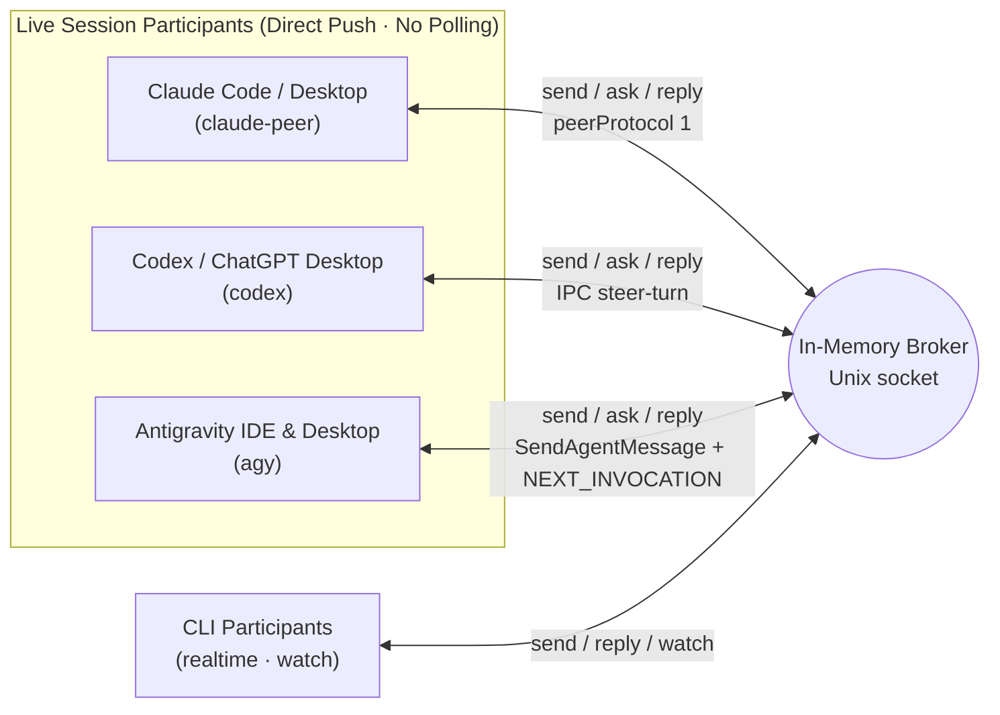

# Agent Bridge Usage Reference

**English** | [한국어](../../../docs/ko/usage.md)

A local CLI for real-time peer-to-peer correspondence across AI coding agents. Requires Python 3.10+ and uses only the Python standard library over Unix domain sockets on macOS and Linux — no third-party packages, API keys, or network ports required.

**No SQLite or file mailboxes.** Only endpoints and channel bindings persist in an owner-private routing snapshot. Messages, delivery state, conversations, idempotency keys, and events stay in memory. Restarting clears that correspondence and re-verifies routing; it never replays messages.

## Architecture



Distinguish broker receipt from model execution completion. `watch` prints events to a connected CLI stream; by itself it does not inject a turn into a running conversation. Register live Claude, Codex, and Antigravity (IDE & Desktop) sessions with `claude-peer`, `codex`, and `agy` respectively to **push directly into the peer's active turn or idle conversation**. Running a `watch` polling loop inside a live agent session is an anti-pattern — reserve `watch` for `realtime` CLI workers.

## Getting Started

Start the broker in one terminal. The default socket path is `~/.local/share/agent-bridge/bridge.sock` with owner-only permissions (`0600`).

```bash
bridge_cli="$HOME/.agents/skills/agent-bridge/scripts/bridge.py"
python3 "$bridge_cli" serve
```

Register participants (Claude, Codex, Antigravity, or CLI workers) and bind project channels:

```bash
python3 "$bridge_cli" register codex-agent --project my-app --cwd /path/to/workspace
python3 "$bridge_cli" register claude-agent --project my-app --cwd /path/to/workspace
python3 "$bridge_cli" register agy-agent --project my-app --cwd /path/to/workspace
python3 "$bridge_cli" channel-bind modal-view --project my-app --owner codex-agent --description 'Modal UI & responsive layout'
python3 "$bridge_cli" channel-bind game-logic --project my-app --owner claude-agent --description 'Core rules & state contracts'
python3 "$bridge_cli" channel-bind motion-rig --project my-app --owner agy-agent --description 'Rigging & render verification'
python3 "$bridge_cli" channels --project my-app
python3 "$bridge_cli" ping
```

`channels` reports the owner, description, bound session, generation number, and current subscriber count. Subscriber count does not indicate whether an AI model is actively working; `active` means the channel accepts new requests.

A process lock prevents two brokers from sharing the same socket. Stop the broker with `stop` or `Ctrl-C`:

```bash
python3 "$bridge_cli" stop
```

To run an isolated broker instance, pass an explicit temporary `--socket` to every command and `serve --state-dir /absolute/private/state` to the server. Never stop a shared broker for testing.

## Real-Time Correspondence

Live sessions registered with `claude-peer`, `codex`, or `agy` receive messages automatically via direct push on `send`, `ask`, and `reply`. `realtime` CLI participants first subscribe to a channel with `watch` to receive JSON Lines events (ready once the initial `subscribed` event prints):

```bash
python3 "$bridge_cli" watch --project my-app --channel modal-view
```

Ask a question from the sender (`ask` prints the request ID first and waits for the reply):

```bash
python3 "$bridge_cli" ask --project my-app --from-channel game-logic --channel modal-view \
  --key hp-contract-001 --file - --timeout 60 <<'MESSAGE'
Please review the health state contract.
Follow the project guidelines and reply with the view-layer requirements without modifying files in this step.
MESSAGE
```

The receiver responds to the request ID from another shell invocation:

```bash
python3 "$bridge_cli" ack REQUEST_ID
python3 "$bridge_cli" progress REQUEST_ID --note 'Checking view rendering conditions'
python3 "$bridge_cli" reply REQUEST_ID --key hp-contract-response-001 --file - <<'MESSAGE'
We need current and max values; a single change event is enough to refresh the view.
MESSAGE
```

- `ack` sets status to `received` and `progress` sets `in_progress`. Neither counts as a reply or triggers auto-responses.
- `reply` uses the return route captured on the original request. Replying to a reply ID continues the same `conversation`.
- `send` takes the same arguments as `ask` without waiting. You can wait later with `wait REQUEST_ID --timeout 60`.
- When `ask` or `wait` times out, it exits with code 2 (`timed_out: true`). It does not cancel the request; run `wait` again on the same ID to collect a late reply.
- Reuse the same `--key` when retrying a send. Reusing a key with different payload parameters is rejected. Idempotency keys last only while their messages are retained in the current broker run. Eviction removes the key; reusing it then creates a new message. Never automatically repeat an evicted request.
- Inspect queued or historical in-memory messages with `inbox`, `show`, and `conversation`:

```bash
python3 "$bridge_cli" inbox --project my-app --channel modal-view
python3 "$bridge_cli" show REQUEST_ID
python3 "$bridge_cli" conversation REQUEST_ID
```

## Disconnection & Reconnection

Every `watch` event carries the broker `instance` UUID and a monotonic `seq` number. Reconnect within the same broker run using the last processed sequence number:

```bash
python3 "$bridge_cli" watch --project my-app --channel modal-view \
  --instance BROKER_INSTANCE_UUID --after LAST_PROCESSED_SEQ
```

The broker keeps the most recent 1,024 events in memory. Out-of-range cursors or stale broker instances are rejected; re-check `channels` and `inbox` when that happens. Individual message bodies are limited to 32 KiB UTF-8. `serve --max-messages 2048` is the message retention size. At capacity, the oldest eligible terminal message is evicted before accepting a new send or reply:

- `done`: explicitly completed with `resolve --state done --note ...`.
- `answered`: a bridge reply has been recorded. A reply can itself remain pending.
- `failed`: a definite dispatch failure, not an uncertain outcome.

`pending`, `dispatching`, `submitted`, `received`, `in_progress`, and `uncertain` are unfinished and never evicted. Delivery acceptance, acknowledgment, progress, or a wait timeout cannot make a message terminal. There is no automatic expiry; `delivered`, `replied`, and `expired` are not protocol states. No delivery retries are introduced.

The current reply parent, active waits, and terminal replies needed by an unfinished or actively waited parent are protected. If no eligible message remains, sends/replies fail with `In-memory message limit reached: no evictable terminal messages`; this includes all-pending traffic and protected completed history. A reply requires a free slot or another eviction candidate, even if it will complete its parent. Invalid addresses, bodies, keys, and reply IDs are rejected before eviction. `show` on an evicted ID fails; `conversation` may show partial history. The message's answer event and idempotency entry are removed with it. Event replay has its independent 1,024-event window and can contain copies of already evicted messages.

## Routing Storage and Opt-In launchd

`serve --state-dir PATH` stores `routes.json` beneath an owner-private directory (0700, file 0600). Without this option, the socket path's suffix is replaced by `.state`; for the default socket this is `~/.local/share/agent-bridge/bridge.state/`. Every registration, channel bind, and channel close writes an allowlisted complete snapshot to a temporary file, flushes and fsyncs it, then atomically replaces the previous snapshot. Memory changes only after replacement succeeds. A separate state-directory lock also prevents two sockets from writing the same routing store. Corrupt or unsupported top-level snapshots refuse startup without overwriting the file.

Only project/name, transport, session UUID, workspace, optional executable, and channel ownership/description/generation/active flag and pinned route are stored. No message bodies, idempotency keys, delivery state, event history, provider tokens, discovered peer socket paths, PIDs, or discovery payloads are stored. This is a private local routing file; keep it out of version control. Atomic replacement protects complete snapshots, but directory entries are not fsynced: sudden power loss is outside the durability guarantee.

On startup, each endpoint and each channel's **pinned** route is independently validated. A channel may still target an older session than its current endpoint; restoration preserves that session and generation rather than silently rebinding it. Closed channels retain their generation and closed flag. Every route must have a valid stored identity and an existing workspace directory. `claude-peer` also requires the exact live registry UUID/PID/protocol, owned socket and matching workspace; `agy` requires its exact live trajectory and workspace. `realtime` and dedicated `claude` routes validate UUID/workspace syntax/existence only; restoring them never launches a Claude CLI.

**Codex restoration preserves saved identity without requiring liveness.** Best-effort `auto` metadata discovery checks the exact UUID and resolved workspace when readable. Idle, `unknown`/`notLoaded`, absent Desktop ownership and account limits do not invalidate a saved route. Metadata timeout, transport/provider error or incomplete metadata retains the route and its pinned channels with a sanitized `routing_retain` diagnostic stating that identity was retained unverified; it does not rewrite the snapshot or infer deletion. The current metadata API combines missing-thread and discovery failures in one error, so a failed read alone cannot prove the thread is gone. A confirmed UUID/workspace mismatch, invalid or missing stored identity, or missing local workspace is dropped with a sanitized failed-check reason. There is no owner IPC, account-limit query, deep-link wake, send or retry during restore. Retained routing is not delivery success; exact-thread wake and delivery remain a separate send/deliver responsibility.

Invalid or mismatched routes are dropped and the cleaned snapshot is saved. Diagnostics omit raw discovery exceptions, credentials and peer socket metadata. Live-peer providers other than Codex retain their existing fail-closed behavior. Liveness can change after startup and delivery adapters check their exact target again.

Messages and in-flight IDs remain volatile after a restart. Channels are restored with no subscribers; clients must reconnect using the new broker instance, inspect routes/channels and inbox, and coordinate unfinished work explicitly. Never infer that lost IDs are safe to resend. Existing `stop` (shutdown RPC), SIGINT and SIGTERM close open watch, wait, partial-request and stalled client transports before waiting for the server to close. A successful `stop` response acknowledges shutdown; process exit is separate.

Supervision is **off by default**. On macOS the owner can inspect a generated per-user launchd plist before installing anything:

```bash
python3 "$bridge_cli" --socket /absolute/private/bridge.sock install-service \
  --state-dir /absolute/private/state --plist /absolute/review/agent.plist --generate-only
plutil -lint /absolute/review/agent.plist
```

This mode only writes the plist (and its parent directory); it never calls launchctl or starts the broker. Generation and validation are sufficient for tests. `uninstall-service --generate-only --plist PATH` only removes a matching generated plist; use it only for an unloaded review file. Generation requires an explicit `--plist` outside `~/Library/LaunchAgents`, so a review file cannot activate at the next login. The installation default is `~/Library/LaunchAgents/com.agent-bridge.broker.SOCKET_HASH.plist`; the label includes a stable hash of the absolute broker socket path to separate instances. Generation refuses to overwrite an existing file, so remove the unloaded review copy before actual installation.

For owner-approved installation, `install-service` without `--generate-only` writes that plist and calls `launchctl bootstrap gui/UID PLIST`. It uses absolute Python/script/socket/state paths, private log files in the state directory, `RunAtLoad`, `KeepAlive: true`, a 10-second throttle and umask 0077. It does not modify shell startup files or stop any existing broker. Coordinate migration from a manually started broker first; the socket lock refuses a second instance. Installation failures leave the plist for inspection, and ambiguous launchctl results are never automatically retried. Existing registrations enter the routing snapshot only after a broker running this version accepts them; there is no automatic migration from an older broker's memory.

**KeepAlive restarts even after `stop`, Ctrl-C, SIGTERM, or a clean exit.** To keep a supervised broker down, use `uninstall-service` with matching `--socket`, `--state-dir`, and optional `--plist`. It calls `launchctl bootout gui/UID/com.agent-bridge.broker.SOCKET_HASH` before removing the matching plist. Failure retains the plist; an already-unloaded service may need owner inspection and explicit `--generate-only` removal. Routing files are retained. No launchctl actions run merely from installing the shared skill or starting the foreground broker. Actual service load/restart behavior requires an owner-approved macOS installation and is separate from plist lint validation.

## Session Discovery & Verification

Discovery commands work even when no broker is running. They never fetch full transcripts or trigger model turns.

```bash
python3 "$bridge_cli" sessions --cwd /path/to/workspace
python3 "$bridge_cli" sessions --provider claude --search 'feature'
python3 "$bridge_cli" sessions --provider codex --limit 100
python3 "$bridge_cli" sessions --provider agy --cwd /path/to/workspace
python3 "$bridge_cli" session codex SESSION_UUID
python3 "$bridge_cli" session claude SESSION_UUID
python3 "$bridge_cli" session agy SESSION_UUID

# Verify the target session's working directory and register 3-way live sessions:
python3 "$bridge_cli" register codex-agent --project my-app --transport codex \
  --session SESSION_UUID --discover
python3 "$bridge_cli" register claude-agent --project my-app --transport claude-peer \
  --session CLAUDE_SESSION_ID --discover --cwd /path/to/workspace
python3 "$bridge_cli" register agy-agent --project my-app --transport agy \
  --session AGY_CONVERSATION_ID --discover --cwd /path/to/workspace
```

`--discover` verifies the specified UUID (`claude-peer` checks live session files in `~/.claude/sessions`, `agy` queries the running Antigravity `language_server` trajectory registry, and others query CLI metadata). Passing `--cwd` additionally verifies that the session's workspace path matches.

| Provider | Discovery Mechanism | Scope |
| --- | --- | --- |
| Claude | `claude agents --json --all` | Active conversations and completed background sessions tracked by the CLI |
| Codex shared server | `codex app-server proxy` metadata query | Conversations and runtime state known to the shared app-server |
| Codex saved list | Temporary `codex app-server --stdio` metadata query | Unarchived CLI conversations (`unknown` runtime status for other apps) |
| Antigravity (`agy`) | Local `language_server` (`--app_data_dir antigravity` & `antigravity-ide`, skipping `--enable_lsp`) `GetAllCascadeTrajectories` & `GetConversationMetadata` | Live workspace conversations (`running`/`idle`) across both Antigravity IDE (`Antigravity IDE live trajectory registry`) and Desktop (`Antigravity desktop live trajectory registry`) |

### Finding, Addressing, or Opening an Antigravity IDE or Desktop Channel

1. **Check existing registrations first**:
   ```bash
   python3 "$bridge_cli" routes --project my-app
   python3 "$bridge_cli" channels --project my-app
   ```
2. **Discover live Antigravity IDE & Desktop sessions** (if not yet registered):
   ```bash
   python3 "$bridge_cli" sessions --provider agy
   python3 "$bridge_cli" sessions --provider agy --cwd /path/to/workspace
   ```
   Each row reports `scope: "Antigravity IDE live trajectory registry"` or `"Antigravity desktop live trajectory registry"`, along with `id` (conversation UUID), `name` (title), `cwd`, and `status`.
3. **Register an existing session with `--transport agy` (never `realtime`)** so outbound `send`, `ask`, and `reply` calls push directly into the open IDE or Desktop conversation instead of staying `pending`:
   ```bash
   python3 "$bridge_cli" register agy-ide-agent --project my-app --transport agy \
     --session AGY_CONVERSATION_UUID --discover
   ```
4. **Or open a new Antigravity Desktop session on demand**:
   ```bash
   # Standalone creation (returns new session UUID, cwd, model, and project_id):
   python3 "$bridge_cli" open --provider agy --cwd /path/to/workspace \
     --title "Motion Worker" --model claude-opus-4-6-thinking

   # Create and register in one step:
   python3 "$bridge_cli" register agy-worker --project my-app --transport agy \
     --new --cwd /path/to/workspace --title "Motion Worker"
   ```
   `open` and `register --new` target the running Antigravity Desktop `language_server` (`--app_data_dir antigravity`), bind the workspace to its matching Desktop project (`~/.gemini/config/projects/*.json`) when present, and initialize the default interactive agent specification so the fresh 0-step session immediately wakes and executes its first turn when a bridge message is pushed.

## Session Handoff

Project channels act as stable addresses. Agent registration and channel binding are separate, and each channel binding tracks its own generation counter:

```bash
python3 "$bridge_cli" register codex-agent --project my-app --transport codex --session NEW_SESSION_UUID --discover
python3 "$bridge_cli" channels --project my-app
python3 "$bridge_cli" channel-bind modal-view --project my-app --owner codex-agent \
  --description 'Modal UI & responsive layout' --expect-generation 1
```

Handoff succeeds only when `--expect-generation` matches the current generation. New requests route to the new generation, while existing in-flight requests keep their original return routes.

```bash
python3 "$bridge_cli" inbox --project my-app --channel modal-view --session OLD_SESSION_UUID
python3 "$bridge_cli" channel-close modal-view --project my-app --expect-generation 2
```

## Pushing into Live Claude Sessions (`claude-peer`)

`send`, `ask`, and `reply` targeting a `claude-peer` participant or channel push directly into the session's messaging socket immediately after recording the message in the broker.

```bash
python3 "$bridge_cli" register claude-agent --project PROJECT --transport claude-peer \
  --session CLAUDE_SESSION_ID --discover
python3 "$bridge_cli" send --project PROJECT --from codex-agent --to claude-agent --key KEY --file /absolute/msg.txt
```

- **Session resolution**: Each push re-reads `~/.claude/sessions/<pid>.json` (or under `CLAUDE_CONFIG_DIR`) for the registered `sessionId`, confirming the PID is alive, `peerProtocol == 1`, and `messagingSocketPath` exists.
- **Wire frames**: Writes two JSON lines — `{"type":"auth","token":<peerToken>}` and `{"type":"user","message":{...},"session_id":<sessionId>,...}` — and closes the socket. The `peerToken` (`<pid>.<sha256(socket)>.key`) is read in memory only.
- **Envelope**: Includes the bridge header, body, and exact reply command (`bridge.py reply <ID> --key reply-<ID> --file <answer-file>`).
- **Outcomes**: `submitted` (`pushed` event) on clean write; `pending` (`push_failed` event, exit code 1) on pre-write validation or socket error; `uncertain` if unexpected response bytes arrive or the socket fails to close cleanly.

### Opening a New Claude Code Desktop Session

```bash
python3 "$bridge_cli" open --provider claude --cwd /path/to/workspace --title "First message"
python3 "$bridge_cli" register claude-worker --project PROJECT --transport claude-peer \
  --new --cwd /path/to/workspace --title "First message" --timeout 300
```

`open` / `register --new` open `claude://code/new?folder=<cwd>&q=<title>&source=url_external`, then wait for the new session's live record and (for `register`) bind it. Output carries `created`, `session` (the resolved peer endpoint), `desktop_session` (`local_…`), the `url`, and the prefilled `prompt`. Exit 0 on success, 1 with `{"error": …}` otherwise; nothing is registered on failure.

The new session exists only after someone presses Enter in the prefilled composer. For a folder the app has not seen, it first asks to trust the workspace. Both stay human steps.

How the path was chosen (measured against Claude desktop with Claude Code 2.1.299; internal and unversioned, so it may change):

| Candidate | What it does | Used? |
| --- | --- | --- |
| `claude://` URL scheme | `CFBundleURLSchemes = ["claude"]` in the app's `Info.plist`. The app's own Finder service "New Claude Code Session Here" runs `open "claude://code/new?folder=$u&source=services"`. The `code/new` handler reads `q`/`prompt`, `folder`, `file`, `environment`, `runner_pool` and `ssh_*`, and navigates to the new-session page. Observed: the composer opens at the folder with the text prefilled, not submitted. No record appears in `~/.claude/sessions` until Enter | **Yes** — the only external entry point that opens a desktop session at a folder |
| `claude://resume?session=UUID` | Imports an existing CLI transcript into the app | No — needs a transcript that a CLI run already wrote |
| Peer messaging socket | Belongs to one running CLI process and accepts `auth` + `user` frames for that session | No — reaches an existing session only |
| Bundled `claude` CLI | Starts a standalone process | No — a separate CLI process, not a desktop session |
| Local app servers | The main bundle listens only for OAuth loopback, the browser bridge, and SSH askpass | No session API |
| Pressing Enter by keystroke automation | Would type into whichever window has focus | Rejected |

Detection: after trusting a folder the app logs `LocalSessions.saveTrust` and starts a short-lived "temporary query" CLI there. Its `~/.claude/sessions/<pid>.json` has `entrypoint: "claude-desktop"` but no `hostSessionId`, and it exits within seconds. The real session's record also has `hostSessionId: "local_…"`. `--new` waits for exactly one record that is new since the link opened, alive, under `--cwd`, `entrypoint == "claude-desktop"`, `hostSessionId` starting with `local_`, and announcing a messaging socket.

### Opening a New Claude Code IDE Session

```bash
python3 "$bridge_cli" open --provider claude --host ide --cwd /path/to/workspace [--ide antigravity-ide|vscode|cursor]
python3 "$bridge_cli" register claude-worker --project PROJECT --transport claude-peer \
  --new --host ide --cwd /path/to/workspace --timeout 120
```

Measured on Antigravity IDE with the Claude Code extension 2.1.309 (internal and unversioned, so it may change):

- The extension's URI handler takes `/open?session=&prompt=` and runs `claude-vscode.primaryEditor.open`. Without `session` it opens a new conversation tab; `prompt` only prefills the composer.
- The tab starts its CLI at once: a live record with `entrypoint: "claude-vscode"`, `peerProtocol: 1` and a messaging socket appeared within about 1 s, with no Enter and no `hostSessionId`. A push into that never-submitted session was answered in about 5 s, and its `sessionId` did not change after the first turn.
- The IDE main process sends an extension URI to the last active window unless the query carries `windowId=<number>`, an internal id the bridge cannot read. So the bridge runs the IDE CLI (`antigravity-ide`, `code` or `cursor`, found on `PATH` or in the app bundle) with the folder first, waits 3 s, then opens the link.

Detection: exactly one record that is new since the link opened, alive, `entrypoint == "claude-vscode"`, under `--cwd`, and announcing a messaging socket. A new IDE record under another folder fails at once as `stray` (the link reached another window; that tab stays open and unregistered). Two candidates fail without choosing. Output carries `created`, `session`, `host: "ide"`, `ide`, `url` and `prompt`.

## Pushing & Delivering to Codex, Antigravity, and Idle CLI Sessions

`codex`, `claude-peer`, and `agy` push automatically during `send`, `ask`, and `reply`, and can be retried explicitly with `deliver` if left `pending`. Idle dedicated `claude` CLI sessions are dispatched explicitly via `deliver`.

⛔ **Never use `--transport claude` (resume) on a live Claude session** — it spawns a duplicate Claude CLI process. Always use `claude-peer` for live sessions.

```bash
python3 "$bridge_cli" deliver MESSAGE_ID --dry-run
python3 "$bridge_cli" deliver MESSAGE_ID --timeout 180
```

- **Codex (`codex`)**: Connects to the exact registered thread owner over `CODEX_HOME/ipc/ipc.sock` (or `AGENT_BRIDGE_CODEX_IPC`). Sends peer bodies as standalone `toolOutput` (`agent_bridge`), calling `thread-follower-steer-turn` first to join an active turn and falling back to `thread-follower-start-turn` only when inactive.
- **Antigravity (`agy`)**: Verifies the exact `conversationId` and workspace against the local `language_server` ConnectRPC, injects `<SYSTEM_MESSAGE>` (`MESSAGE_PRIORITY_HIGH`) via `SendAgentMessage` so `running` turns steer on the next step without interruption, and calls an empty `SendUserCascadeMessage` (`MESSAGE_DELIVERY_STRATEGY_NEXT_INVOCATION`) when `idle` or waiting on background tasks/subagents so the session wakes immediately without a synthetic user prompt.
- **Dedicated Claude CLI (`claude`)**: Invokes `claude --resume UUID` in read-only `plan` mode (`Read,Grep,Glob`, `opus`) for idle dedicated CLI sessions only.
- **Manual resolution**: After verifying whether an `uncertain` message was received in the target session, resolve its state explicitly:

```bash
python3 "$bridge_cli" resolve MESSAGE_ID --state submitted --note 'Confirmed in target session'
python3 "$bridge_cli" resolve MESSAGE_ID --state pending --note 'Confirmed not received and prior run exited'
python3 "$bridge_cli" resolve MESSAGE_ID --state done --note 'Completed'
```

## Models: Read, Switch, Policy

`model NAME --project P [--set M]` is one command over per-transport adapters (`scripts/models.py`). Measured on 2026-10-23:

| Provider | Read | Switch | New-session model |
| --- | --- | --- | --- |
| agy | last generator `plannerConfig` (`GetCascadeTrajectoryGeneratorMetadata`, tail only via `generatorMetadataOffset`) | idle only; empty `SendUserCascadeMessage` + `cascadeConfig` (own planner, `requestedModel` changed), runs one invocation; verified live | `open`/`register --new --model` (desktop server, or IDE server with `--host ide`) |
| claude (VS Code, desktop) | transcript newest assistant `message.model`; verified live | desktop: relayed through a desktop command post (below), unit-tested only; VS Code: STOP (below) | STOP (below) |
| codex | exact Desktop owner's resumed **NEXT-TURN settings**, fresh in `model`, `routes`, `sessions`; unknown with reason when unreadable (stub-tested) | `model NAME --set M`: advertised model, exact owner, model-only update and readback, one attempt; active turn continues | `open`/`register --new`: flag > env > policy `defaults.codex` > `gpt-6.1-sol`; denylist checked before creation |

**Codex settings.** A reading describes the Desktop owner's settings for the **next turn**, not the model of an already active turn. `codex-model SESSION_ID --model M [--state-dir PATH]` is a deprecated UUID alias through the same policy-guarded switch. A possibly sent update remains `uncertain`, never replayed. Codex adapter coverage here is isolated stub/protocol testing; no live Desktop verification is implied.

**Antigravity switch.** The panel's model picker sends `cascadeConfig.plannerConfig.requestedModel` with the next message. When the message is empty and the conversation is idle, that request starts one invocation on the new model, and later turns, including bridge-woken ones, stay on it.
- Sending a bare config resets the rest of the planner (measured: `knowledgeConfig.enabled` went from true to false). So the bridge copies the last generator's `plannerConfig`, drops `planModel`/`modelName`, and sets only `requestedModel`. With that, knowledge stayed on.
- While a turn runs, the server answers `cannot queue empty user input step`. `SendAllQueuedMessages` (a turnless switch) answers `deprecated`.

**Claude gap (evidence, Claude Code 2.1.307/2.1.308).**
- The peer socket handles only `rename`, idle notices and artifact yields; it has no set_model action.
- `set_model` is an SDK control request on the session's own stdio host channel: the desktop app, the VS Code extension and Agent SDK `query.setModel()`.
- The VS Code extension has no model command, model setting or URI parameter. Its `/open` link takes only `session` and `prompt`. Its picker writes `model` to the user-global `~/.claude/settings.json`, then calls `applyFlagSettings` on that one channel.
- A running session does not hot-reload a settings-file model. Measured on the same CLI binary: turn 1 ran on haiku from `.claude/settings.local.json`; after the file was changed to sonnet, turn 2 still ran on haiku.
- The desktop new-session link passes only `q`, `folder`, `file`, `environment`, `runner_pool` and `ssh_*`.
- The desktop app's `set_session_model` tool exists only inside desktop-hosted sessions. Read from the app bundle (`app.asar`, 2026-10-23): `ccd_session_mgmt` is an internal MCP server the app's main process registers as an Agent SDK `sdk` server, so it has no socket, port or URL; a session's CLI reaches it only through `mcp_message` control requests on the stdio pipe the app owns. The handler takes the caller from that pipe, refuses the caller as its own target ("Must not be this session"), and asks the user before switching a session the caller did not start or moving it to a pricier model (not in auto or bypass permissions mode). No process outside the app can call it.

**Claude desktop switch: the command post relay.** Because only a desktop-hosted session can call `set_session_model`, `model NAME --set M` on a desktop target asks one such session, the *command post*, to make the call.
- A person names it in `policy.json`: `{"command_post": {"claude": "<route name>"}}`. The route must be a `claude-peer` route in the same project, live, on host `claude-desktop`, and not the session being switched (the app refuses a session switching itself). Without the key the command exits 1 with `unsupported: true` and names the key and the file.
- The denylist is checked before anything is sent. The bridge then registers a `realtime` route named `model-relay` in the project if it is missing (the sender, so the reply is held for the waiting command and never pushed into the session being switched; a non-realtime route already holding that name is refused) and pushes one message to the command post over the normal `claude-peer` path. Its body is one line:

  ```text
  bridge-model-request: {"desktop_session":"local_…","id":"<uuid>","model":"M","op":"set_session_model","project":"P","reply":"bridge-model-reply:","session_id":"<target sessionId>","target":"NAME","v":1}
  ```

  Keys are sorted. `session_id` is the route's Claude Code `sessionId`; `desktop_session` is the target's `hostSessionId` from its registry record, present only when it is a desktop id (`local_…`).

- **What a command post does on receiving it:** call `mcp__ccd_session_mgmt__set_session_model` for that session with `model` exactly as given. Which of the two ids the tool accepts was not measured; `list_sessions`/`get_session` show the app's own id for the session. Then answer with the bridge reply command the envelope prints. The reply body must contain one line `bridge-model-reply: {"model": "<model the app reports>", "changed": true|false, "applies": "<when, as the tool says>"}`. On failure, reply `bridge-model-reply: {"error": "<the tool's message>", "uncertain": true|false}`; `uncertain` is true only when the call may have gone through. Do not retry on the requester's behalf.
- The command waits up to `--timeout` (default 30 s; up to 3600 when an approval card needs a person). No reply, a reply without the line, or a line without `model`/`changed` is `uncertain: true`, exit 1: the switch may still happen, so read the model before asking again and never resend. An `error` reply is reported as given.
- The result is `{model, changed, applies, via, request}` where `via` is the command post. Read stays transcript-based: the new model shows there after the target's next turn.

## Security & Verification

Agent Bridge is a local tool trusting the current OS user account. Participant names are routing labels, not cryptographic identities, and peer messages do not substitute for human authorization.

Run the test suite with:

```bash
python3 -m unittest discover -s tests -v
```

### Creating a New Codex Desktop Session Autonomously

```bash
python3 "$bridge_cli" open --provider codex --cwd /path/to/workspace --title "Worker" --model MODEL
python3 "$bridge_cli" register codex-worker --project PROJECT --transport codex \
  --new --cwd /path/to/workspace --title "Worker" --model MODEL --timeout 180
```

Creates one persistent thread through the installed CLI's documented `app-server --stdio` JSON-RPC interface, sets its actual name with `thread/name/set`, and closes the creator. A fresh metadata-only client must read the same UUID, exact resolved `--cwd`, and requested title from the store. The bridge then opens `codex://threads/UUID` to let Desktop adopt that existing thread. It waits for the exact owner advertising `supportsUntrustedAppInput` and confirms the owner has resumed the thread. **No Enter, composer submission, synthetic user prompt, model turn, inherited MCP context, or UI automation is needed.** The macOS app and bundled CLI must be installed and available; a live exact Desktop owner is required before registration.

`--title` is the actual thread name. An explicit `--model` must be advertised by the installed provider; unknown models are refused before creation and provider fallback is disabled. Empty persistent threads can adopt the app's default model even when `thread/start` returned the requested model. Therefore the bridge reads the exact owner's model settings, applies the requested model when needed, and requires matching readback before returning success. Omitting `--model` requests `AGENT_BRIDGE_CODEX_MODEL` if set, then policy `defaults.codex`, then `gpt-6.1-sol`, under the same catalog check and readback — never the app's own default; a default the provider does not advertise fails by name, so pass `--model`. New Codex sessions always request the supported Full Access profile `:danger-full-access` with `approvalPolicy: never`. `permissionProfile/list` must advertise that profile as allowed before creation; a missing or disallowed profile is a refusal, never a weaker fallback. The creator response must confirm the full profile, `dangerFullAccess` sandbox and `never` policy. After adoption, the bridge reads the exact owner's next-turn settings and applies the same profile/policy only to that new thread if needed. A versioned snapshot must confirm all three before registration. `permission_settings` reports that verified `latestThreadSettings` reading; `currentPermissions` can still describe a previous turn. `creator_settings` separately reports the creation response. Existing sessions and global user configuration are never changed by creation.

Creation is sent once. `--timeout` sets an overall deadline; a final in-flight IPC call and process cleanup can add short bounded overhead. Failures after creation preserve `session`, `created`, `adopted`, `registered: false`, `stage`, and `uncertain`; a missing UUID after a sent create is an unknown outcome. Never repeat `--new` automatically. Inspect the exact UUID and complete any unfinished adoption/model verification before binding it. Broker registration failure preserves the successful discovery result and UUID so `register --transport codex --session ID --discover` can bind it without creating another thread. Success from `register --new` includes `registered: true`; `created` and `adopted` live in `discovery` alongside the verified model. None of these is task completion.

The app-server schema is generated by the installed CLI; experimental API capability is explicitly negotiated for creation fields. Desktop's exact-ID deep link and versioned owner/settings/snapshot IPC remain internal, update-sensitive contracts. Snapshot reads pin the exact UUID, source owner, destination and protocol version, reject oversized or incomplete frames, and unsubscribe even on failure. The native app-tools pipe is not used or bypassed. Tests exercise the JSONL subprocess protocol and isolated Desktop IPC, including model substitution, ambiguous creation, persistence failure, title failure, owner absence, and registration recovery. A successful standard CLI creation by itself is never presented as a Desktop session.
