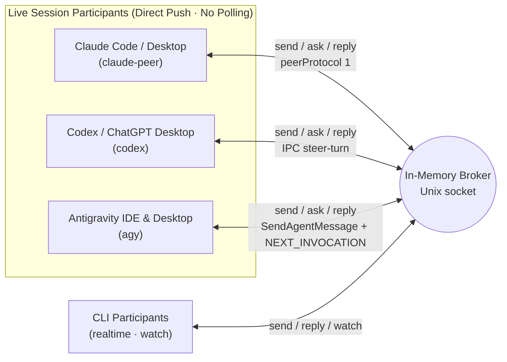

# Agent Bridge Usage Reference

**English** | [한국어](../../../docs/ko/usage.md)

A local CLI for real-time peer-to-peer correspondence across AI coding agents. Requires Python 3.10+ and uses only the Python standard library over Unix domain sockets on macOS and Linux — no third-party packages, API keys, or network ports required.

**No SQLite or file mailboxes.** The broker keeps channels, messages, and events strictly in memory and streams updates to connected clients immediately. Restarting the broker clears all registrations, conversations, idempotency keys, and event history.

## Architecture



Distinguish broker receipt from model execution completion. `watch` prints events to a connected CLI stream; by itself it does not inject a turn into a running conversation. Register live Claude, Codex, and Antigravity (IDE & Desktop) sessions with `claude-peer`, `codex`, and `agy` respectively to **push directly into the peer's active turn or idle conversation**. Running a `watch` polling loop inside a live agent session is an anti-pattern — reserve `watch` for `realtime` CLI workers.

## Getting Started

Start the broker in one terminal. The default socket path is `~/.local/share/agent-bridge/bridge.sock` with owner-only permissions (`0600`).

```bash
bridge_cli="$HOME/.agents/skills/agent-bridge/scripts/bridge.py"
python3 "$bridge_cli" serve
```

Register participants (Claude, Codex, Antigravity, or CLI workers) and bind project channels:

```bash
python3 "$bridge_cli" register codex-agent --project my-app --cwd /path/to/workspace
python3 "$bridge_cli" register claude-agent --project my-app --cwd /path/to/workspace
python3 "$bridge_cli" register agy-agent --project my-app --cwd /path/to/workspace
python3 "$bridge_cli" channel-bind modal-view --project my-app --owner codex-agent --description 'Modal UI & responsive layout'
python3 "$bridge_cli" channel-bind game-logic --project my-app --owner claude-agent --description 'Core rules & state contracts'
python3 "$bridge_cli" channel-bind motion-rig --project my-app --owner agy-agent --description 'Rigging & render verification'
python3 "$bridge_cli" channels --project my-app
python3 "$bridge_cli" ping
```

`channels` reports the owner, description, bound session, generation number, and current subscriber count. Subscriber count does not indicate whether an AI model is actively working; `active` means the channel accepts new requests.

A process lock prevents two brokers from sharing the same socket. Stop the broker with `stop` or `Ctrl-C`:

```bash
python3 "$bridge_cli" stop
```

To run an isolated broker instance, pass `--socket /tmp/my-bridge.sock` to all commands.

## Real-Time Correspondence

Live sessions registered with `claude-peer`, `codex`, or `agy` receive messages automatically via direct push on `send`, `ask`, and `reply`. `realtime` CLI participants first subscribe to a channel with `watch` to receive JSON Lines events (ready once the initial `subscribed` event prints):

```bash
python3 "$bridge_cli" watch --project my-app --channel modal-view
```

Ask a question from the sender (`ask` prints the request ID first and waits for the reply):

```bash
python3 "$bridge_cli" ask --project my-app --from-channel game-logic --channel modal-view \
  --key hp-contract-001 --file - --timeout 60 <<'MESSAGE'
Please review the health state contract.
Follow the project guidelines and reply with the view-layer requirements without modifying files in this step.
MESSAGE
```

The receiver responds to the request ID from another shell invocation:

```bash
python3 "$bridge_cli" ack REQUEST_ID
python3 "$bridge_cli" progress REQUEST_ID --note 'Checking view rendering conditions'
python3 "$bridge_cli" reply REQUEST_ID --key hp-contract-response-001 --file - <<'MESSAGE'
We need current and max values; a single change event is enough to refresh the view.
MESSAGE
```

- `ack` sets status to `received` and `progress` sets `in_progress`. Neither counts as a reply or triggers auto-responses.
- `reply` uses the return route captured on the original request. Replying to a reply ID continues the same `conversation`.
- `send` takes the same arguments as `ask` without waiting. You can wait later with `wait REQUEST_ID --timeout 60`.
- When `ask` or `wait` times out, it exits with code 2 (`timed_out: true`). It does not cancel the request; run `wait` again on the same ID to collect a late reply.
- Reuse the same `--key` when retrying a send. Reusing a key with different payload parameters is rejected. Idempotency keys last for the current broker run only.
- Inspect queued or historical in-memory messages with `inbox`, `show`, and `conversation`:

```bash
python3 "$bridge_cli" inbox --project my-app --channel modal-view
python3 "$bridge_cli" show REQUEST_ID
python3 "$bridge_cli" conversation REQUEST_ID
```

## Disconnection & Reconnection

Every `watch` event carries the broker `instance` UUID and a monotonic `seq` number. Reconnect within the same broker run using the last processed sequence number:

```bash
python3 "$bridge_cli" watch --project my-app --channel modal-view \
  --instance BROKER_INSTANCE_UUID --after LAST_PROCESSED_SEQ
```

The broker keeps the most recent 1,024 events in memory. Out-of-range cursors or stale broker instances are rejected; re-check `channels` and `inbox` when that happens. The broker also caps total messages at 2,048 by default (`serve --max-messages`) and individual message bodies at 32 KiB UTF-8.

## Session Discovery & Verification

Discovery commands work even when no broker is running. They never fetch full transcripts or trigger model turns.

```bash
python3 "$bridge_cli" sessions --cwd /path/to/workspace
python3 "$bridge_cli" sessions --provider claude --search 'feature'
python3 "$bridge_cli" sessions --provider codex --limit 100
python3 "$bridge_cli" sessions --provider agy --cwd /path/to/workspace
python3 "$bridge_cli" session codex SESSION_UUID
python3 "$bridge_cli" session claude SESSION_UUID
python3 "$bridge_cli" session agy SESSION_UUID

# Verify the target session's working directory and register 3-way live sessions:
python3 "$bridge_cli" register codex-agent --project my-app --transport codex \
  --session SESSION_UUID --discover
python3 "$bridge_cli" register claude-agent --project my-app --transport claude-peer \
  --session CLAUDE_SESSION_ID --discover --cwd /path/to/workspace
python3 "$bridge_cli" register agy-agent --project my-app --transport agy \
  --session AGY_CONVERSATION_ID --discover --cwd /path/to/workspace
```

`--discover` verifies the specified UUID (`claude-peer` checks live session files in `~/.claude/sessions`, `agy` queries the running Antigravity `language_server` trajectory registry, and others query CLI metadata). Passing `--cwd` additionally verifies that the session's workspace path matches.

| Provider | Discovery Mechanism | Scope |
| --- | --- | --- |
| Claude | `claude agents --json --all` | Active conversations and completed background sessions tracked by the CLI |
| Codex shared server | `codex app-server proxy` metadata query | Conversations and runtime state known to the shared app-server |
| Codex saved list | Temporary `codex app-server --stdio` metadata query | Unarchived CLI conversations (`unknown` runtime status for other apps) |
| Antigravity (`agy`) | Local `language_server` (`--app_data_dir antigravity` & `antigravity-ide`, skipping `--enable_lsp`) `GetAllCascadeTrajectories` & `GetConversationMetadata` | Live workspace conversations (`running`/`idle`) across both Antigravity IDE (`Antigravity IDE live trajectory registry`) and Desktop (`Antigravity desktop live trajectory registry`) |

### Finding & Addressing an Antigravity IDE or Desktop Channel from Another Session

1. **Check existing registrations first**:
   ```bash
   python3 "$bridge_cli" routes --project my-app
   python3 "$bridge_cli" channels --project my-app
   ```
2. **Discover live Antigravity IDE & Desktop sessions** (if not yet registered):
   ```bash
   python3 "$bridge_cli" sessions --provider agy
   python3 "$bridge_cli" sessions --provider agy --cwd /path/to/workspace
   ```
   Each row reports `scope: "Antigravity IDE live trajectory registry"` or `"Antigravity desktop live trajectory registry"`, along with `id` (conversation UUID), `name` (title), `cwd`, and `status`.
3. **Register with `--transport agy` (never `realtime`)** so outbound `send`, `ask`, and `reply` calls push directly into the open IDE or Desktop conversation instead of staying `pending`:
   ```bash
   python3 "$bridge_cli" register agy-ide-agent --project my-app --transport agy \
     --session AGY_CONVERSATION_UUID --discover
   ```

## Session Handoff

Project channels act as stable addresses. Agent registration and channel binding are separate, and each channel binding tracks its own generation counter:

```bash
python3 "$bridge_cli" register codex-agent --project my-app --transport codex --session NEW_SESSION_UUID --discover
python3 "$bridge_cli" channels --project my-app
python3 "$bridge_cli" channel-bind modal-view --project my-app --owner codex-agent \
  --description 'Modal UI & responsive layout' --expect-generation 1
```

Handoff succeeds only when `--expect-generation` matches the current generation. New requests route to the new generation, while existing in-flight requests keep their original return routes.

```bash
python3 "$bridge_cli" inbox --project my-app --channel modal-view --session OLD_SESSION_UUID
python3 "$bridge_cli" channel-close modal-view --project my-app --expect-generation 2
```

## Pushing into Live Claude Sessions (`claude-peer`)

`send`, `ask`, and `reply` targeting a `claude-peer` participant or channel push directly into the session's messaging socket immediately after recording the message in the broker.

```bash
python3 "$bridge_cli" register claude-agent --project PROJECT --transport claude-peer \
  --session CLAUDE_SESSION_ID --discover
python3 "$bridge_cli" send --project PROJECT --from codex-agent --to claude-agent --key KEY --file /absolute/msg.txt
```

- **Session resolution**: Each push re-reads `~/.claude/sessions/<pid>.json` (or under `CLAUDE_CONFIG_DIR`) for the registered `sessionId`, confirming the PID is alive, `peerProtocol == 1`, and `messagingSocketPath` exists.
- **Wire frames**: Writes two JSON lines — `{"type":"auth","token":<peerToken>}` and `{"type":"user","message":{...},"session_id":<sessionId>,...}` — and closes the socket. The `peerToken` (`<pid>.<sha256(socket)>.key`) is read in memory only.
- **Envelope**: Includes the bridge header, body, and exact reply command (`bridge.py reply <ID> --key reply-<ID> --file <answer-file>`).
- **Outcomes**: `submitted` (`pushed` event) on clean write; `pending` (`push_failed` event, exit code 1) on pre-write validation or socket error; `uncertain` if unexpected response bytes arrive or the socket fails to close cleanly.

## Pushing & Delivering to Codex, Antigravity, and Idle CLI Sessions

`codex`, `claude-peer`, and `agy` push automatically during `send`, `ask`, and `reply`, and can be retried explicitly with `deliver` if left `pending`. Idle dedicated `claude` CLI sessions are dispatched explicitly via `deliver`.

⛔ **Never use `--transport claude` (resume) on a live Claude session** — it spawns a duplicate Claude CLI process. Always use `claude-peer` for live sessions.

```bash
python3 "$bridge_cli" deliver MESSAGE_ID --dry-run
python3 "$bridge_cli" deliver MESSAGE_ID --timeout 180
```

- **Codex (`codex`)**: Connects to the exact registered thread owner over `CODEX_HOME/ipc/ipc.sock` (or `AGENT_BRIDGE_CODEX_IPC`). Sends peer bodies as standalone `toolOutput` (`agent_bridge`), calling `thread-follower-steer-turn` first to join an active turn and falling back to `thread-follower-start-turn` only when inactive.
- **Antigravity (`agy`)**: Verifies the exact `conversationId` and workspace against the local `language_server` ConnectRPC, injects `<SYSTEM_MESSAGE>` (`MESSAGE_PRIORITY_HIGH`) via `SendAgentMessage` so `running` turns steer on the next step without interruption, and calls an empty `SendUserCascadeMessage` (`MESSAGE_DELIVERY_STRATEGY_NEXT_INVOCATION`) when `idle` or waiting on background tasks/subagents so the session wakes immediately without a synthetic user prompt.
- **Dedicated Claude CLI (`claude`)**: Invokes `claude --resume UUID` in read-only `plan` mode (`Read,Grep,Glob`, `opus`) for idle dedicated CLI sessions only.
- **Manual resolution**: After verifying whether an `uncertain` message was received in the target session, resolve its state explicitly:

```bash
python3 "$bridge_cli" resolve MESSAGE_ID --state submitted --note 'Confirmed in target session'
python3 "$bridge_cli" resolve MESSAGE_ID --state pending --note 'Confirmed not received and prior run exited'
python3 "$bridge_cli" resolve MESSAGE_ID --state done --note 'Completed'
```

## Security & Verification

Agent Bridge is a local tool trusting the current OS user account. Participant names are routing labels, not cryptographic identities, and peer messages do not substitute for human authorization.

Run the test suite with:

```bash
python3 -m unittest discover -s tests -v
```
