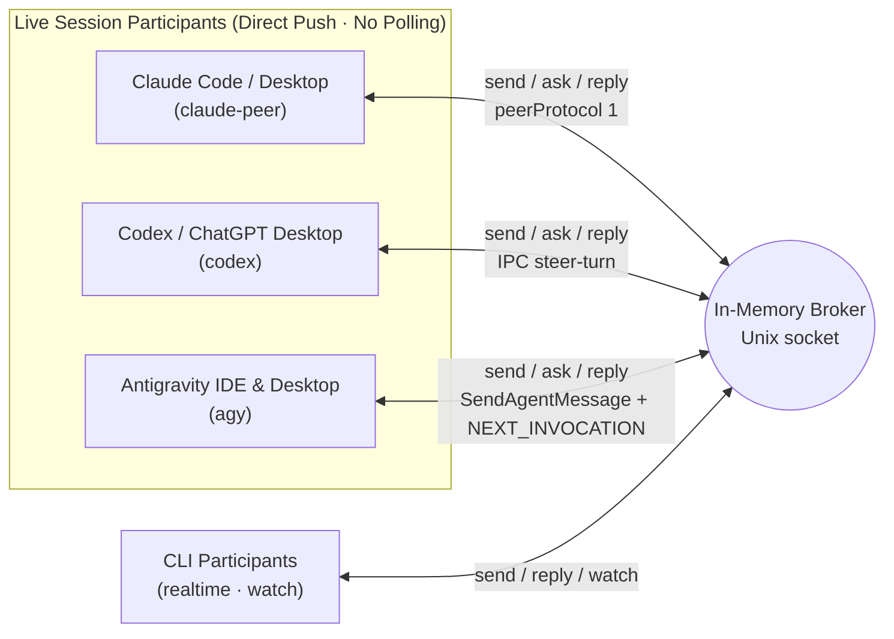

# Agent Bridge Usage Reference

**English** | [한국어](../../../docs/ko/usage.md)

A local CLI for real-time peer-to-peer correspondence across AI coding agents. Requires Python 3.10+ and uses only the Python standard library over Unix domain sockets on macOS and Linux — no third-party packages, API keys, or network ports required.

**No SQLite or file mailboxes for broker messages.** Only endpoints and channel bindings persist in an owner-private routing snapshot (`routes.json`). Messages, delivery state, conversations, idempotency keys, and events stay in memory. Restarting clears correspondence and re-verifies routing; it never replays messages.

## Architecture



Distinguish broker receipt from model execution completion. `watch` prints events to a connected CLI stream; by itself it does not inject a turn into a running conversation. Register live Claude, Codex, and Antigravity (IDE & Desktop) sessions with `claude-peer`, `codex`, and `agy` respectively to **push directly into the peer's active turn or idle conversation**. Running a `watch` polling loop inside a live agent session is an anti-pattern — reserve `watch` for `realtime` CLI workers.

## Getting Started

Start the broker in one terminal. The default socket path is `~/.local/share/agent-bridge/bridge.sock` with owner-only permissions (`0600`).

```bash
bridge_cli="$HOME/.agents/skills/agent-bridge/scripts/bridge.py"
python3 "$bridge_cli" serve
```

Register participants and bind project channels:

```bash
python3 "$bridge_cli" register codex-agent --project my-app --transport codex --session CODEX_UUID --discover
python3 "$bridge_cli" register claude-agent --project my-app --transport claude-peer --session CLAUDE_UUID --discover
python3 "$bridge_cli" register agy-agent --project my-app --transport agy --session AGY_UUID --discover

python3 "$bridge_cli" channel-bind modal-view --project my-app --owner codex-agent --description 'Modal UI & responsive layout'
python3 "$bridge_cli" channel-bind game-logic --project my-app --owner claude-agent --description 'Core rules & state contracts'
python3 "$bridge_cli" channel-bind motion-rig --project my-app --owner agy-agent --description 'Rigging & render verification'
python3 "$bridge_cli" channels --project my-app
python3 "$bridge_cli" ping
```

`channels` reports the owner, description, bound session, generation number, and current subscriber count. Subscriber count does not indicate whether an AI model is actively working; `active` means the channel accepts new requests.

A process lock prevents two brokers from sharing the same socket. Stop the broker with `stop` or `Ctrl-C`:

```bash
python3 "$bridge_cli" stop
```

To run an isolated broker instance, pass an explicit temporary `--socket` to every command and `serve --state-dir /absolute/private/state` to the server. Never stop a shared broker for testing.

## Real-Time Correspondence

Live sessions registered with `claude-peer`, `codex`, or `agy` receive messages automatically via direct push on `send`, `ask`, and `reply`. `realtime` CLI participants first subscribe to a channel with `watch` to receive JSON Lines events (ready once the initial `subscribed` event prints):

```bash
python3 "$bridge_cli" watch --project my-app --channel modal-view
```

Ask a question from the sender (`ask` prints the request ID first and waits for the reply):

```bash
python3 "$bridge_cli" ask --project my-app --from-channel game-logic --channel modal-view \
  --key hp-contract-001 --file - --timeout 60 <<'MESSAGE'
Please review the health state contract.
Follow the project guidelines and reply with the view-layer requirements without modifying files in this step.
MESSAGE
```

The receiver responds to the request ID from another shell invocation:

```bash
python3 "$bridge_cli" ack REQUEST_ID
python3 "$bridge_cli" progress REQUEST_ID --note 'Checking view rendering conditions'
python3 "$bridge_cli" reply REQUEST_ID --key hp-contract-response-001 --file - <<'MESSAGE'
We need current and max values; a single change event is enough to refresh the view.
MESSAGE
```

- `ack` sets status to `received` and `progress` sets `in_progress`. Neither counts as a reply or triggers auto-responses.
- `reply` uses the return route captured on the original request. Replying to a reply ID continues the same `conversation`.
- `send` takes the same arguments as `ask` without waiting. You can wait later with `wait REQUEST_ID --timeout 60`.
- When `ask` or `wait` times out, it exits with code 2 (`timed_out: true`). It does not cancel the request; run `wait` again on the same ID to collect a late reply.
- Reuse the same `--key` when retrying a send. Reusing a key with different payload parameters is rejected. Idempotency keys last only while their messages are retained in the current broker run.
- Inspect queued or historical in-memory messages with `inbox`, `show`, and `conversation`:

```bash
python3 "$bridge_cli" inbox --project my-app --channel modal-view
python3 "$bridge_cli" show REQUEST_ID
python3 "$bridge_cli" conversation REQUEST_ID
```

## Disconnection, Retention & Reconnection

Every `watch` event carries the broker `instance` UUID and a monotonic `seq` number. Reconnect within the same broker run using the last processed sequence number:

```bash
python3 "$bridge_cli" watch --project my-app --channel modal-view \
  --instance BROKER_INSTANCE_UUID --after LAST_PROCESSED_SEQ
```

- **Event window**: The broker keeps the most recent 1,024 events in memory. Out-of-range cursors or stale broker instances are rejected; re-check `channels` and `inbox` when that happens.
- **Message size & retention**: Individual message bodies are limited to 32 KiB UTF-8. `serve --max-messages 2048` sets the message retention capacity. At capacity, the oldest eligible terminal message is evicted before accepting a new send or reply:
  - `done`: explicitly completed with `resolve --state done --note ...`.
  - `answered`: a bridge reply has been recorded.
  - `failed`: a definite dispatch failure, not an uncertain outcome.
- **Protected messages**: `pending`, `dispatching`, `submitted`, `received`, `in_progress`, and `uncertain` are unfinished and never evicted. The current reply parent, active waits, and terminal replies needed by an unfinished or actively waited parent are also protected. If no eligible message remains, sends/replies fail with `In-memory message limit reached: no evictable terminal messages`.

## Routing Storage and Opt-In launchd

`serve --state-dir PATH` stores `routes.json` beneath an owner-private directory (`0700`, file `0600`). Without this option, the socket path's suffix is replaced by `.state` (default: `~/.local/share/agent-bridge/bridge.state/`). Every registration, route removal (`unregister`, used by `close`), channel bind, and channel close atomically writes an allowlisted snapshot (`routes.json`).

- **What is stored**: Only project/name, transport, session UUID, workspace, optional executable, and channel ownership/description/generation/active flag and pinned route. No message bodies, idempotency keys, delivery state, event history, provider tokens, discovered peer socket paths, or PIDs are persisted.
- **Startup validation**:
  - `claude-peer`: requires the exact live registry UUID/PID/protocol, owned socket, and matching workspace.
  - `agy`: requires its exact live trajectory and workspace.
  - `codex`: preserves saved identity without requiring live Desktop ownership at startup; drops only confirmed UUID/workspace mismatches or missing local workspaces.
  - `realtime` / `claude`: validates UUID/workspace syntax and existence only.
- **Opt-in macOS `launchd` service**: Supervision is **off by default**. Inspect a generated per-user plist before installing:

```bash
python3 "$bridge_cli" --socket /absolute/private/bridge.sock install-service \
  --state-dir /absolute/private/state --plist /absolute/review/agent.plist --generate-only
plutil -lint /absolute/review/agent.plist
```

For owner-approved installation, run `install-service` without `--generate-only` (writes `~/Library/LaunchAgents/com.agent-bridge.broker.SOCKET_HASH.plist` and calls `launchctl bootstrap gui/UID PLIST`). Because `KeepAlive` restarts the broker after `stop` or `SIGTERM`, use `uninstall-service` to keep a supervised broker down.

## Session Discovery, Opening & Handoff

Discovery commands work even when no broker is running and never trigger model turns:

```bash
python3 "$bridge_cli" sessions --cwd /path/to/workspace
python3 "$bridge_cli" sessions --provider claude --search 'feature'
python3 "$bridge_cli" sessions --provider codex --limit 100
python3 "$bridge_cli" sessions --provider agy --cwd /path/to/workspace
python3 "$bridge_cli" session codex SESSION_UUID
python3 "$bridge_cli" session claude SESSION_UUID
python3 "$bridge_cli" session agy SESSION_UUID
```

| Provider | Discovery Mechanism | Scope |
| --- | --- | --- |
| **Claude** | `claude agents --json --all` & `~/.claude/sessions/*.json` | Active conversations and completed background sessions tracked by the CLI |
| **Codex (shared)** | `codex app-server proxy` metadata query | Conversations and runtime state known to the shared app-server |
| **Codex (saved)** | Temporary `codex app-server --stdio` metadata query | Unarchived CLI conversations (`unknown` runtime status for other apps) |
| **Antigravity (`agy`)** | Local `language_server` / `agy --hub` (`GetAllCascadeTrajectories` & `GetConversationMetadata`, skipping `--enable_lsp`) | Live workspace conversations (`running`/`idle`) across Antigravity IDE and Desktop |

### 1. Opening & Registering Antigravity Sessions (`agy`)

```bash
# Standalone creation (Desktop by default, or IDE with --host ide):
python3 "$bridge_cli" open --provider agy [--host ide] --cwd /path/to/workspace \
  --title "Motion Worker" --model claude-opus-4-6-thinking

# Create and register in one step:
python3 "$bridge_cli" register agy-worker --project my-app --transport agy \
  --new [--host ide] --cwd /path/to/workspace --title "Motion Worker"
```

- **Desktop (default)**: Calls `StartCascade` and `UpdateConversationAnnotations` on the Desktop `language_server` (`--app_data_dir antigravity`), links the workspace to its matching Desktop project (`~/.gemini/config/projects/*.json`) when present, and initializes `customAgentSpec` (`builtinAgent.defaultAgent` + `planModel`) so a 0-step session wakes and runs its first turn when a bridge message is pushed.
- **IDE (`--host ide`)**: Creates the conversation on the IDE hub server (`agy --hub`, preferring the window whose `--add-dir` matches `--cwd`, or legacy `--app_data_dir antigravity-ide`) with `workspaceUris`. Idle orphaned `agy --hub` processes (`ppid == 1`) are automatically reaped during discovery so stale processes do not hijack IDE session creation or status reporting.

### 2. Opening & Registering Claude Sessions (`claude-peer`)

```bash
# Desktop (opens prefilled composer; waits for user Enter):
python3 "$bridge_cli" open --provider claude --cwd /path/to/workspace --title "First message"
python3 "$bridge_cli" register claude-worker --project PROJECT --transport claude-peer \
  --new --cwd /path/to/workspace --title "First message" --timeout 300

# IDE (autonomous; no human step required):
python3 "$bridge_cli" open --provider claude --host ide --cwd /path/to/workspace [--ide antigravity-ide|vscode|cursor]
python3 "$bridge_cli" register claude-worker --project PROJECT --transport claude-peer \
  --new --host ide --cwd /path/to/workspace --timeout 120
```

- **Desktop**: Opens `claude://code/new?folder=<cwd>&q=<title>&source=url_external` and waits for a single new live record under `--cwd` with `entrypoint == "claude-desktop"` and `hostSessionId: "local_…"` (ignoring the short-lived probe CLI spawned after workspace trust). Pressing Enter remains a human step.
- **IDE (`--host ide`)**: Focuses/opens the workspace window via the IDE CLI (`antigravity-ide`, `code`, or `cursor`), waits 3 s, and opens `<scheme>://anthropic.claude-code/open`. The extension opens a new conversation tab whose CLI starts immediately (`entrypoint == "claude-vscode"`, `peerProtocol == 1`) without requiring Enter. If a new record appears under another folder, it fails immediately as `stray` without registering.

### 3. Opening & Registering Codex Desktop Sessions (`codex`)

```bash
python3 "$bridge_cli" open --provider codex --cwd PATH --title "Worker" --model MODEL \
  [--register codex-worker --project PROJECT]
python3 "$bridge_cli" register codex-worker --project PROJECT --transport codex \
  --new --cwd /path/to/workspace --title "Worker" --model MODEL --timeout 180
```

- **Autonomous flow**: Creates one persistent thread via `app-server --stdio`, sets its title with `thread/name/set`, verifies the saved record, opens `codex://threads/UUID` so Desktop adopts it, and waits for the exact Desktop owner advertising `supportsUntrustedAppInput` to resume the thread. **No Enter, synthetic user prompt, model turn, or UI automation is needed.**
- **Model & permissions verification**:
  - Model resolution order: `--model` > `AGENT_BRIDGE_CODEX_MODEL` > `policy.json` `defaults.codex` > `gpt-6.1-sol` (never the app default, and never `gpt-6-astra` for coding). Verified via readback on the Desktop owner.
  - Requests Full Access (`:danger-full-access`, `approvalPolicy: never`, `dangerFullAccess` sandbox) and verifies `latestThreadSettings` on the Desktop owner before succeeding.
- **Duplicate guard**: When `--title` is provided, ordinary `open --provider codex` scans unarchived saved threads for the exact title and resolved `cwd` and refuses duplicates with `stage: "duplicate"` (`existing_sessions`). Pass `--new` (`open --new` or `register --new`) to bypass duplicate checking.
- **Envelope fields**: Emits a single JSON object containing `created`, `adopted`, `registered`, `uncertain`, `stage`, `error`, `registration_error`, `warning`, `session`, `owner`, `url`, `model`, `model_source`, `creator_settings`, `permission_settings`, `permission_settings_source`, `settings_update`, and `existing_sessions`. Never automatically repeat a failed or `uncertain` creation.

### 4. Session Handoff

Project channels act as stable addresses. Agent registration and channel binding are separate, and each channel binding tracks its own generation counter:

```bash
python3 "$bridge_cli" register codex-agent --project my-app --transport codex --session NEW_SESSION_UUID --discover
python3 "$bridge_cli" channel-bind modal-view --project my-app --owner codex-agent \
  --description 'Modal UI & responsive layout' --expect-generation 1
```

Handoff succeeds only when `--expect-generation` matches the current generation. New requests route to the new generation, while existing in-flight requests keep their original return routes. Close a channel with `channel-close modal-view --project my-app --expect-generation 2`.

## Live Push & Delivery Mechanics

`codex`, `claude-peer`, and `agy` push automatically during `send`, `ask`, and `reply`, and can be retried explicitly with `deliver` if left `pending`. Idle dedicated `claude` CLI sessions are dispatched explicitly via `deliver`.

- **Claude (`claude-peer`)**:
  - Re-reads `~/.claude/sessions/<pid>.json` for the registered `sessionId`, confirming the PID is alive, `peerProtocol == 1`, and `messagingSocketPath` exists.
  - Writes two JSON lines (`{"type":"auth","token":<peerToken>}` and `{"type":"user","message":{...},"session_id":<sessionId>,...}`) and closes the socket. The `peerToken` is read in memory only.
  - Returns `submitted` (`pushed` event) on clean write, `pending` (`push_failed` event, exit 1) on pre-write validation/socket error, or `uncertain` if unexpected response bytes arrive.
- **Codex (`codex`)**:
  - Connects to the exact registered thread owner over `CODEX_HOME/ipc/ipc.sock` (or `AGENT_BRIDGE_CODEX_IPC`).
  - Delivers peer bodies as standalone `toolOutput` (`agent_bridge`), calling `thread-follower-steer-turn` first to join an active turn and falling back to `thread-follower-start-turn` only when inactive.
  - After the first accepted task (`submitted`), initializes an empty native sidebar `preview` in `state_5.sqlite` (100 ms SQLite lock budget; preview warnings never fail or resend an accepted delivery).
- **Antigravity (`agy`)**:
  - Verifies the exact `conversationId` and workspace against the local `language_server` / `agy --hub` ConnectRPC (`GetAllCascadeTrajectories` / `GetConversationMetadata`).
  - Injects `<SYSTEM_MESSAGE>` (`MESSAGE_PRIORITY_HIGH`) via `SendAgentMessage` so `running` turns steer on the next step without interruption, and calls an empty `SendUserCascadeMessage` (`MESSAGE_DELIVERY_STRATEGY_NEXT_INVOCATION`) when `idle` or waiting on background tasks/subagents so the session wakes immediately without a synthetic user prompt.
- **Dedicated Claude CLI (`claude`)**:
  - ⛔ **Never use `--transport claude` on a live session** — it spawns a duplicate CLI process. Use `claude` only for idle dedicated CLI sessions (`deliver` runs `claude --resume UUID` in read-only `plan` mode).
- **Explicit retry & manual resolution**:

```bash
python3 "$bridge_cli" deliver MESSAGE_ID --dry-run
python3 "$bridge_cli" deliver MESSAGE_ID --timeout 180

# After verifying whether an uncertain message arrived in the target session:
python3 "$bridge_cli" resolve MESSAGE_ID --state submitted --note 'Confirmed in target session'
python3 "$bridge_cli" resolve MESSAGE_ID --state pending --note 'Confirmed not received and prior run exited'
python3 "$bridge_cli" resolve MESSAGE_ID --state done --note 'Completed'
```

## Models: Read, Switch, Policy

`model NAME --project P [--set M]` is a single provider-neutral command over per-transport adapters (`scripts/models.py`):

| Provider | Read | Switch (`model NAME --project P --set M`) | New-Session Model |
| --- | --- | --- | --- |
| **Antigravity (`agy`)** | Last generator's `plannerConfig` (`GetCascadeTrajectoryGeneratorMetadata`, tail only via `generatorMetadataOffset`) | Idle only; sends empty `SendUserCascadeMessage` + `cascadeConfig` preserving existing planner fields (`knowledgeConfig`, etc.) with `requestedModel` updated. Runs one real turn (2–8 generators, 10–90 s) and reports `generators_spent` / `busy_after` | `open` / `register --new --model` (Desktop server, or IDE server with `--host ide`) |
| **Claude (`claude-peer`)** | Transcript newest assistant `message.model` | **Desktop**: Relayed through a `command_post` route configured in `policy.json` (`{"command_post": {"claude": "<route>"}}`), which calls `mcp__ccd_session_mgmt__set_session_model` and replies with `bridge-model-reply: {"model", "changed", "applies"}`. **VS Code / IDE**: `unsupported (STOP)` | `unsupported (STOP)` — select in the composer or IDE picker |
| **Codex (`codex`)** | Exact Desktop owner's resumed **NEXT-TURN settings** (`latestThreadSettings`) | Validates advertised model in `model/list`, sends `{model: M}` via `thread-follower-update-thread-settings` to the exact owner, and verifies readback without interrupting an active turn (`codex-model` is a deprecated UUID alias) | `open` / `register --new`: `--model` > `AGENT_BRIDGE_CODEX_MODEL` > `policy.json` `defaults.codex` > `gpt-6.1-sol` |

## Closing a Session

```bash
python3 "$bridge_cli" close NAME --project PROJECT [--keep-route] [--timeout 10]
```

`close` stops or archives the session behind a registered route and removes the route via `unregister` (unless `--keep-route`). It never deletes data and never retries:

| Transport / Host | Action | Observed Behavior | Undo / Resume |
| --- | --- | --- | --- |
| `claude-peer` (`claude-vscode`) | `SIGTERM` to the exact registered PID; waits up to `--timeout` | Process exits within ~1 s (`resumable: true`), freeing ~310 MB RSS; tab shows exit code 143 | Typing in the tab resumes the same `sessionId` under a new PID |
| `claude-peer` (`claude-desktop`) | Same (`SIGTERM`) | Process exits within ~3 s; app shows "session interrupted" | Sending a message in the session resumes the same `sessionId` |
| `agy` (Desktop & IDE) | Refused while `running`; sends `UpdateConversationAnnotations {archived: true}` and verifies readback | Conversation leaves the IDE panel / Desktop sidebar | Restore from archive in the UI |
| `codex` | `unsupported` (nothing sent) | Desktop IPC exposes no archive/unload request | — |
| `realtime` / `claude` | Route removal only | — | — |

## Private MCP Independent Inbox

The CLI `inbox`/`ack` contract above is unchanged. The private MCP facade (`scripts/mcp_server.py`) supports an explicit `"inbox_enabled": true` opt-in in `--phase1-config` for independent (`reply_to: null`) inbound messages via three tools: `bridge_inbox_list`, `bridge_message_get`, and `bridge_message_ack`. Read messages without consuming them, then explicitly ACK the stable signed ID after consumption. Correlated replies remain operation-only (`bridge_operation_get`). See [mcp-phase1.md](mcp-phase1.md#independent-inbox-issue-48-explicit-opt-in) for pagination, limits, restart semantics, and owner deployment gates.

## Security & Verification

Agent Bridge is a local tool trusting the current OS user account. Participant names are routing labels, not cryptographic identities, and peer messages do not substitute for human authorization.

Run the full test suite before committing changes:

```bash
python3 -m unittest discover -s tests -v
```
